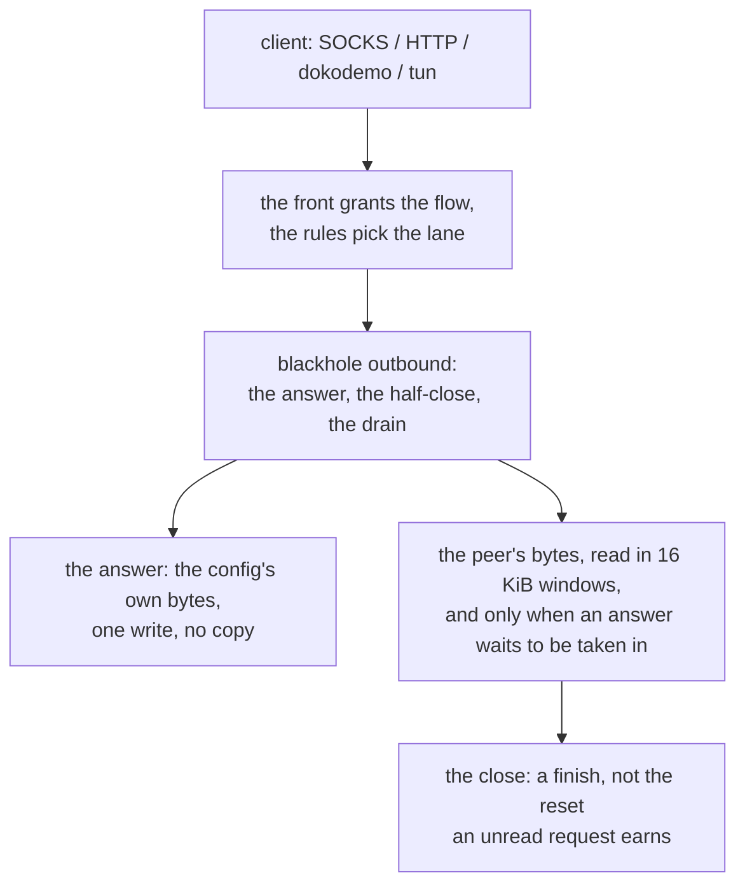

# The blackhole sink outbound

Row 25: a `blackhole` outbound swallows the flow. It answers the client with one of the reference's three answers — nothing, the 403 its own `http.Response.Write` serialises, or the bytes the config carries — and then ends the flow: the peer's read side ends with the answer, and an answer that was written has the peer's bytes read to their end, so the close is a finish and not the reset an unread request earns.

The answer's bytes are the reference's own. The oracle (`scripts/blackhole-oracle`) drives the pinned `xray-core`'s handler over a pipe and records every octet it wrote; `ferrox-core`'s `blackhole` module is compared to that record octet for octet, and the answer the writer receives is the config's own buffer — the pointer it sees is the pointer the answer holds, and a clone of the answer does not move it.

The config is the reference's shape — `{"response": {"type": "none" | "http" | "custom", "customResponseData": "<base64>"}}` — read the way the reference's own config builder reads it, with the type folded to lower case. An answer the reference does not know, and a response that is not an object at all, are refused at startup with the reason named.

The sink is the last resort of the untagged lane: a config that names a dial takes the dial, and a config that names only the sink takes the sink. A routing rule names it by tag, and a rule that sends a flow to the tag gets the sink.

The datagram lane is not the sink's to answer: a SOCKS association to a blackhole is refused with `0x07` before the relay binds, the way sing-box refuses the dial and ZeroNet rejects the datagram, so a client learns its datagrams go nowhere instead of watching them vanish.

## Data path



## Measured

<!-- counts:begin -->
| key | value | checked by |
| --- | --- | --- |
| ops-retired-instructions | UNBLESSED | scripts/count-ops.sh |
| answer-bytes-the-reference-writes | 101 | ferrox-core-blackhole::tests::the_answer_is_the_bytes_the_pinned_go_writes |
| answer-writes-per-flow | 1 | ferrox-core-blackhole::tests::the_answer_is_one_write |
| answer-copies-per-byte-written | 0 | ferrox-core-blackhole::tests::the_answer_reaches_the_writer_uncopied |
| answer-allocations-per-flow | 0 | ferrox-core-blackhole::tests::the_answer_reaches_the_writer_uncopied |
| answer-buffer-moves-per-clone | 0 | ferrox-core-blackhole::tests::the_answer_reaches_the_writer_uncopied |
| custom-answer-bytes-written-verbatim | 3 | ferrox-core-blackhole::tests::the_answer_is_the_bytes_the_pinned_go_writes |
| peer-reads-per-window | 1 | ferrox-app-blackhole::tests::the_peers_bytes_are_read_in_windows |
| peer-reads-for-the-end | 1 | ferrox-app-blackhole::tests::the_peers_bytes_are_read_in_windows |
| drain-allocations-per-flow | 0 | ferrox-app-blackhole::tests::the_peers_bytes_are_read_in_windows |
| upstream-connections-per-flow | 0 | ferrox-app-proxy::tests::a_blackhole_front_answers_the_client_and_dials_nothing |
| scenario-map-tests-passing | 1 | scripts/run-xray-scenario-map.sh |
<!-- counts:end -->

`answer-bytes-the-reference-writes` is the oracle's first line: the pinned `xray-core`'s handler writes 101 bytes for the `http` answer, and they are these. `custom-answer-bytes-written-verbatim` is the oracle's second case: the configured bytes reach the client unchanged, three of them in the script. The copy rows are pointer identity, not a byte comparison: the writer is handed the answer's own base pointer, the answer's allocation does not move when the answer is cloned, and the write allocates nothing. The read rows are driven from an in-memory stream that answers a whole window at a time, so the count is exact: one read per 16 KiB window, one more for the bytes that do not fill one, and one more for the end of them. `upstream-connections-per-flow` is the front's own test: the destination the client asked for never sees a connection, because the sink dials nothing. `scenario-map-tests-passing` is the reference's own blackhole scenario: `TestBlackhole` is green in the map, and it is green for the right reason now — the blackhole's config decodes, the rule that sends the flow to the sink reaches this tree's own router, and the flow is swallowed where the reference swallows it. Before this slice the same test was green for the wrong one: the blackhole's config was refused, the server never bound its port, and the connection the test made failed because nothing was listening.

## Ops

```bash
./scripts/count-ops.sh report \
  blackhole::tests::the_answer_reaches_the_writer_uncopied 'blackhole::Response::write_to'
```

`UNBLESSED`, as above. `scripts/count-ops.sh` needs valgrind, which does not exist on macOS/aarch64, so this count is CI-only (`ops.yml`); nothing quotes it until the artefact has been read.

## Time

**Not measured.** `scripts/lib-matrix.sh` carries no benchmark cell for this row — no `blackhole-*` scenario id exists — so `bench.yml` and `parity.yml` gate nothing here. What the flow's cost is is argued on the page: the answer is one write of the answer's own bytes, the flow ends when the peer is done rather than after a second, and the peer's bytes are read in windows. A duration would come from a CI runner, and no CI artefact has been read for this row.

## What we removed

The reference's second. `xray-core`'s handler writes its answer, sleeps a second so the client has time to take it in, and closes — a second of a held goroutine per answered flow, and the flow's end is a timer rather than the peer's own. This one writes the answer, ends its own write side so the client reads the answer and the end of the flow in one go, and reads the peer's bytes until the peer is done: the flow ends when the client closes, and the grace bounds a peer that never does. A sink with no answer has nothing to take in and ends the flow at once, the way the reference's does — the reference sleeps only when it has answered something.

The copy the answer used to cost. `xray-core` stages the answer in a fresh `buf.Buffer` per flow (`mbc.Write(h.response)`), and `xray-core-rust` copies the configured bytes again per handler (`data.clone()`) and allocates a `Vec` per write (`HTTP_403_RESPONSE.as_bytes().to_vec()`). The answer here is the config's own `Arc<[u8]>` — or, for the 403, a static — and it is written from there: `the_answer_reaches_the_writer_uncopied` asserts the writer saw the answer's own base pointer and that a clone of the answer does not move it.

The 403 that was not the reference's. ZeroNet spells the `http` answer with `Connection` before `Cache-Control` and three trailing CRLFs, which is not what `xray-core` writes. The bytes here are the reference's own, proved by the oracle: `HTTP/1.1 403 Forbidden`, the headers in the order Go's `Header.WriteSubset` sorts them, the `Content-Length: 0` Go adds for a status that allows a body, and the blank line last.

## What was not removed

The peer's bytes are read, not skipped, when there is an answer to protect, and that is a read per window the reference does not pay: `xray-core` never reads the TCP lane's request at all, so its close earns the reset an unread request earns, and the answer it wrote a moment earlier can be swallowed by it. Reading them is what makes the close a finish, and the window is the price. The `http` answer's own shape is Go's serialisation and not this tree's: 101 bytes with Go's header order and its empty-body length line, because the bytes on the wire are the reference's and not ours. The datagram lane still refuses the association with `0x07` instead of answering the first datagram the way the reference's UDP ray does — that is the routing row's decision, and this row does not reopen it. The one-second hold the reference keeps is not gone but bounded: the grace is half a second, so the thread the sink holds is never longer than the second the reference holds, and a peer that closes sooner ends the sink sooner.

## Pins

| what | where |
| --- | --- |
| the answer, the sleep, the drain of the datagram ray | `upstream/xray-core/proxy/blackhole/` |
| the refusal of the dial, for both networks | `upstream/sing-box/protocol/block/` |
| the three answers, the copy per handler, the write per answer | `upstream/xray-core-rust/crates/xray-proxy-blackhole/` |
| the refusal of the datagram, the canned answer that ends the flow | `upstream/zeronet/crates/zero-runtime/src/server.rs`, `upstream/zeronet/crates/zero-config/src/xray_json.rs` |

## CI scope

What a change here owes, read by `scripts/ci-scope.py`; see [`docs/ci-scope.md`](../ci-scope.md). The oracle is this tree's own: the pinned `xray-core` has a blackhole handler but no suite for it, and its scenario package's own blackhole test (`TestBlackhole`) is not in the pin's gated list, so no pin's suite names this row and the oracle is the byte comparison in `ferrox-core`; the scenario map runs that test anyway, and it is green. The bridge carries the blackhole's own config and the router app's tag and port list — the two selectors that scenario writes — so the rule that sends the flow to the sink reaches this tree's own router; every other router selector is refused by name, and the other apps are skipped as the bridge has always skipped them.

<!-- scope:begin -->
- paths: crates/ferrox-app/src/blackhole.rs, crates/ferrox-core/src/blackhole.rs
- symbols: find_blackhole_outbound, blackhole_settings, blackhole_response
- go: ./proxy/blackhole/...
<!-- scope:end -->
