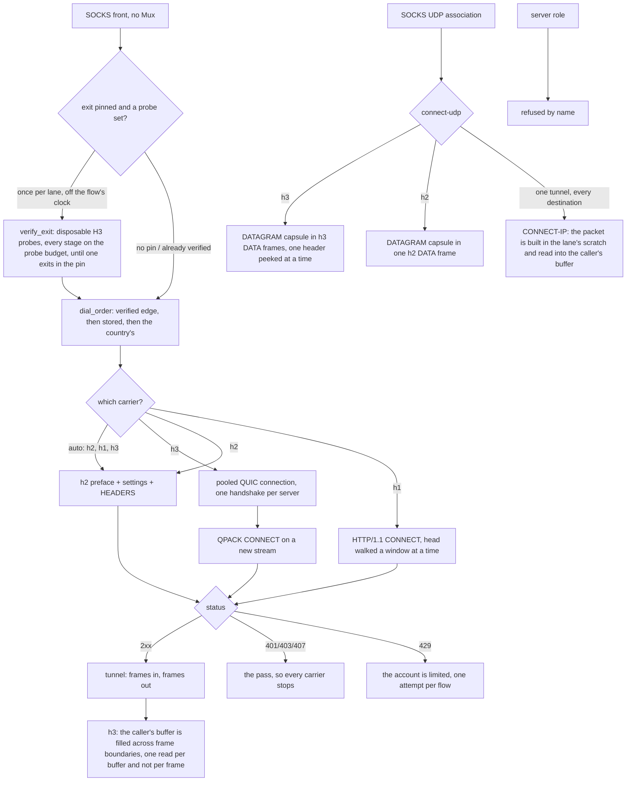

# The Foxy lane

The Foxy lane is an account-authenticated CONNECT tunnel to a CDN edge: a Firefox Accounts login, a Guardian proxy pass, an edge list pinned to one country, and then the tunnel. The page above it is the account plane; this one is the four ways the tunnel's bytes can be carried, because that is what a connection method is:

| carrier | ALPN | what it is |
| --- | --- | --- |
| `h1` | `http/1.1` | CONNECT, then the target's own bytes |
| `h2` | `h2` | one stream per flow over one TLS session |
| `h3` | `h3` | one stream per flow over one shared QUIC connection |
| `auto` | — | `h2`, then `h1`, then `h3` |

UDP rides the same lane as **CONNECT-UDP** (RFC 9298), over `h2` and over `h3`, `h3` first: one capsule stream per destination. HTTP/1.1 has no extended CONNECT, so it is never asked to carry a datagram, which `the_carriers_are_ordered_by_what_the_edge_answers_best` gates.

**How much is left, before a flow is refused for it.** The account plane names the traffic allowance in three headers on the mint (`X-Quota-Limit`, `X-Quota-Remaining`, `X-Quota-Reset`), and `mint-foxy-pass` prints them on the line it already prints for the pass it stores — `quota="4.0 GiB of 5.0 GiB, resets in 1h 0m"` — so an account three flows from empty says so instead of failing a dial. The ceiling rides with the remainder because a remainder on its own cannot be told from a spent one: `0 B of 5.0 GiB` is an exhausted account and `0 B` alone is a number with nothing to be a fraction of. The formatter is integer arithmetic throughout (`Pass::allowance_line`: bytes in the largest unit that keeps a digit, the reset clock in hours and minutes), gated by `the_allowance_is_the_bytes_left_and_when_they_return` and `the_allowance_names_the_ceiling_it_is_left_of`, which pin the two boundaries that round the wrong way — one byte under a gibibyte, and a half-gibibyte tenth — and hold the plane's silence to `None` rather than to a zero that would read as an exhausted account.

One shape for all of them, and it is the whole design: open a stream, send seven header fields, read one status, relay. The parts that decide rather than move bytes live in `ferrox_core::foxy` (the codecs, the window arithmetic, the UDP path and template), and the app crate owns the socket, the pool and the TLS session. A caller that relays bytes does not know which carrier produced its `Read + Write`. The tunnel a dial returns owns the pooled stream it rides (`FoxyOpen::Tunnel`), so the flow that ends is what hands that stream back.

## Data path



## Measured

<!-- counts:begin -->
| key | value | checked by |
| --- | --- | --- |
| ops-retired-instructions | UNBLESSED | scripts/count-ops.sh |
| payload-staging-copies-per-byte-written | 0 | ferrox-app-foxy::loopback::a_relayed_byte_is_copied_once_on_its_way_through_the_lane |
| payload-staging-copies-per-byte-read | 0 | ferrox-app-foxy::loopback::a_relayed_byte_is_copied_once_on_its_way_through_the_lane |
| read-buffer-bytes-per-staged-remainder | 0 | ferrox-app-foxy::loopback::half_a_frame_reaches_the_caller_with_the_rest_left_on_the_wire |
| connect-request-allocations-per-open | 0 | ferrox-core-tls::rustls_backend::tests::the_connect_request_gathers_without_a_heap_buffer |
| write-calls-per-h1-open | 1 | ferrox-core-tls::rustls_backend::tests::the_connect_request_gathers_without_a_heap_buffer |
| qpack-connect-allocations-per-open | 0 | ferrox-core-foxy::hpack::tests::a_connect_block_is_written_without_touching_the_heap |
| head-read-calls-per-open | 1 | ferrox-app-foxy::tests::the_head_walk_reads_the_answer_in_one_call |
| head-tail-bytes-held-after-they-reach-the-caller | 0 | ferrox-app-foxy::tests::the_pipelined_tail_is_released_by_the_read_that_spends_it |
| hop-connect-allocations-per-open | 0 | ferrox-app-foxy::loopback::a_hop_connect_allocates_nothing |
| hop-head-tunnel-bytes-held-after-the-open | 0 | ferrox-app-foxy::loopback::a_hop_head_leaves_the_tunnel_s_first_bytes_on_the_socket |
| h3-window-peek-bytes-per-delivered-frame | 16 | ferrox-app-foxy::loopback::the_h3_downlink_hands_the_caller_the_frame_without_staging_it |
| h3-frame-window-bytes | 16 | ferrox-app-foxy::loopback::the_h3_downlink_hands_the_caller_the_frame_without_staging_it |
| h3-window-bytes-per-frame-ahead-of-the-answer | 16 | ferrox-app-foxy::loopback::a_frame_ahead_of_the_answer_is_consumed_rather_than_waited_on |
| h3-bytes-lost-at-a-frame-boundary | 0 | ferrox-app-foxy::loopback::a_quic_capsule_split_over_frames_arrives_as_one_datagram |
| h3-bytes-lost-behind-a-parked-frame | 0 | ferrox-app-foxy::loopback::a_quic_trailer_that_parks_mid_block_keeps_the_frames_behind_it |
| h3-empty-frames-called-the-end | 0 | ferrox-app-foxy::loopback::an_empty_data_frame_is_not_the_end_of_the_tunnel |
| h3-datagram-write-staging-bytes | 19 | ferrox-app-foxy::loopback::the_masque_carrier_opens_connect_udp_over_quic_and_echoes_a_datagram |
| h3-bytes-lost-in-a-block-arriving-in-pieces | 0 | ferrox-app-foxy::loopback::a_quic_block_that_arrives_in_pieces_keeps_the_pieces_it_already_holds |
| h2-bytes-lost-at-a-read-quantum | 0 | ferrox-app-foxy::loopback::a_frame_that_straddles_a_read_quantum_arrives_whole |
| uplink-bytes-blocked-by-a-parked-leg | 0 | ferrox-app-foxy::loopback::a_parked_downlink_leg_does_not_hold_the_uplink_behind_its_wait |
| h2-upload-bytes-blocked-by-an-unread-grant | 0 | ferrox-app-foxy::loopback::an_upload_is_paced_by_the_grants_the_edge_sends_rather_than_by_the_bytes_it_reads |
| window-update-frames-per-floor-crossing | 2 | ferrox-app-foxy::loopback::credit_crossing_the_floor_costs_one_pair_not_one_per_frame |
| window-update-frames-below-the-floor | 0 | ferrox-app-foxy::loopback::credit_held_under_the_floor_never_reaches_the_wire |
| dead-carrier-dials-per-connect-ip-packet | 0 | ferrox-app-proxy::tests::the_connect_ip_lane_leaves_a_dead_carrier_dead |
| carriers-dialled | 3 | ferrox-app-foxy::tests::the_carriers_are_ordered_by_what_the_edge_answers_best |
| udp-carriers-dialled | 2 | ferrox-app-foxy::tests::the_carriers_are_ordered_by_what_the_edge_answers_best |
| auto-carrier-opened-on | H2 | ferrox-app-foxy::tests::the_carriers_are_ordered_by_what_the_edge_answers_best |
| datagram-frames-per-capsule | 1 | ferrox-app-foxy::loopback::the_masque_carrier_opens_connect_udp_over_quic_and_echoes_a_datagram |
| capsules-reassembled-across-frames | 1 | ferrox-app-foxy::loopback::a_capsule_split_over_frames_reassembles_as_one_datagram |
| datagrams-out-of-one-frame | 2 | ferrox-app-foxy::loopback::a_frame_of_two_datagrams_arrives_as_two_datagrams |
| quic-datagrams-out-of-one-frame | 2 | ferrox-app-foxy::loopback::a_quic_frame_of_two_datagrams_arrives_as_two_datagrams |
| h2-bytes-lost-at-a-short-datagram-read | 0 | ferrox-app-foxy::loopback::a_datagram_wider_than_the_caller_s_buffer_keeps_its_tail |
| h3-bytes-lost-at-a-short-datagram-read | 0 | ferrox-app-foxy::loopback::a_quic_datagram_wider_than_the_caller_s_buffer_keeps_its_tail |
| stream-write-staging-copies-per-byte | 0 | ferrox-app-foxy::loopback::the_quic_carrier_sends_the_block_reads_the_status_and_carries_the_bytes |
| datagram-write-staging-copies-per-byte | 0 | ferrox-app-foxy::loopback::the_masque_carrier_opens_connect_udp_and_echoes_a_datagram |
| ip-read-staging-copies-per-byte | 0 | ferrox-app-foxy::loopback::the_connect_ip_carrier_opens_one_tunnel_and_carries_a_datagram |
| platform-store-reads-per-flow | 0 | ferrox-app-quic::tests::the_platform_anchors_are_read_once |
| server-roles | 0 | ferrox-app-proxy::tests::quic_serve_closes_without_handshake |
| dialled-without-ca-cert-file | 0 | ferrox-app-proxy::tests::quic_outbound_reads_ca_cert_file |
| address-assign-capsule-bytes-per-grant | 9 | ferrox-core-foxy::connectip::tests::the_assign_a_proxy_writes_is_the_assign_the_lane_reads |
| route-advert-capsule-bytes-per-route | 12 | ferrox-core-foxy::connectip::tests::the_route_advert_a_proxy_writes_is_the_route_advert_the_lane_reads |
| edges-preferred-by-verified-exit | 1 | ferrox-app-proxy::foxy_exit_tests::the_preferred_edge_is_the_first_one_whose_exit_agrees_not_the_first_one_opened |
| tcp-connections-asked-of-an-untrusted-edge | 1 | ferrox-app-foxy::loopback::an_untrusted_edge_is_named_and_asked_once |
| catalogue-edges-kept-across-a-failed-fetch | 4 | ferrox-app-foxy_catalog::tests::a_fetch_that_failed_keeps_the_edges_already_known |
| catalogue-edges-rewritten-from-the-cache-file | 5 | ferrox-app-foxy_catalog::tests::the_cache_file_one_process_writes_is_the_one_the_next_reads |
| dials-of-a-silent-tcp-carrier | 1 | ferrox-app-proxy::tests::a_silent_carrier_is_dialled_once_rather_than_once_per_rung |
| dials-across-three-flows-of-a-rested-carrier | 2 | ferrox-app-proxy::tests::a_silent_carrier_is_dialled_once_rather_than_once_per_rung |
| relay-legs-held-after-their-lane-ended | 0 | ferrox-app-foxy::loopback::a_lane_that_ends_releases_the_leg_parked_on_its_client |
| relay-legs-held-after-their-client-ended | 0 | ferrox-app-foxy::loopback::a_client_that_ends_releases_the_leg_parked_on_its_lane |
| pool-workers-held-after-a-finished-burst | 0 | ferrox-app-proxy::tests::a_finished_burst_hands_its_workers_back_to_the_process |
| pool-directions-lost-on-a-gone-worker | 0 | ferrox-app-proxy::tests::a_claim_that_reaches_a_gone_worker_keeps_its_direction |
| rate-limits-that-stopped-a-renewal | 0 | ferrox-app-foxy_account::tests::a_refused_credential_is_the_only_answer_a_second_ask_cannot_change |
| named-waits-dropped-from-a-renewal-pause | 0 | ferrox-app-foxy_account::tests::a_rate_limit_carries_the_wait_its_head_names |
| renewal-pauses-past-their-own-ceiling | 0 | ferrox-app-foxy_account::tests::the_next_ask_waits_the_gap_the_plane_names_or_a_curve_that_caps |
| edge-peer-read-allocations-per-open | 0 | ferrox-core-foxy::tests::a_literal_edge_address_is_read_without_a_buffer_of_its_own |
| edge-authority-allocations-per-lane-open | 0 | ferrox-core-foxy::tests::an_edge_authority_brackets_an_address_and_borrows_a_plain_default_port_name |
| huffman-literal-allocations-per-decode | 1 | ferrox-core-foxy::hpack::tests::a_coded_literal_is_decoded_into_one_allocation |
| ip-packet-allocations-per-datagram | 0 | ferrox-app-foxy::loopback::the_packet_scratch_is_the_lanes_own_buffer_and_it_stays_there |
| ip-read-packet-allocations-per-datagram | 0 | ferrox-app-foxy::loopback::the_read_packet_is_the_callers_own_buffer_and_it_stays_there |
| pass-token-copies-per-dial | 0 | ferrox-core-foxy::tests::a_cloned_pass_shares_its_token_rather_than_copying_it |
| h3-read-calls-per-16k-download | 5 | ferrox-app-foxy::loopback::an_h3_read_crosses_the_frames_under_it |
| h3-bytes-lost-when-the-peer-finishes | 0 | ferrox-app-foxy::loopback::an_h3_stream_the_peer_finished_ends_the_tunnel |
| carrier-cache-lookup-allocations | 0 | ferrox-core-foxy::tests::a_carrier_cache_lookup_allocates_nothing |
<!-- counts:end -->

`tcp-connections-asked-of-an-untrusted-edge 1` is the retry rule seen from the edge's side: the lane asks an edge for a TLS session eight times because the edge sometimes drops a handshake it started, and a chain this device does not trust drops for a reason no second ask changes. The counter in `an_untrusted_edge_is_named_and_asked_once` is the server's own accept loop, so it sees the connections, not the intent: one, and the failure that comes back names the certificate rather than the moment. The same rule is what stops the `auto` carrier walk at the first refusal — the edge's certificate is not the carrier's, so HTTP/2 and HTTP/1.1 would answer it identically — so a pinned edge with no trusted chain costs one handshake per address instead of one per address per carrier. What the front answers stays `0x01 general failure`, now asserted for the new variant by `a_refusal_becomes_the_socks_reply_that_says_so`; what changed is that the message the user can act on ("this device does not trust the edge's certificate") survives to the caller instead of becoming "the carrier io failed".

What this leaves alone, deliberately: `FoxyOut::remember_unanswered` still caches only `Io | Stream | Frame` as a carrier that died, so an untrusted chain does not mark that carrier dead for the next flow. Trust is per edge, not per carrier, and a client that installs the missing root — or fixes its clock — should get a real dial on the next flow rather than a cached refusal.

`dials-of-a-silent-tcp-carrier 1` and `dials-across-three-flows-of-a-rested-carrier 2` are the TCP walk reading the cache it already wrote. The walk asks a carrier's `Refusals` entry before it dials, exactly as the datagram walk does, because the rule that made the cache was written for the ladder and the TCP front never consulted it: `Carrier::order()` returns a *named* carrier three times — the same rung three times, so the walk needs no dedupe of its own — and an unremembered cache means a flow pointed at an edge that names no protocol this lane speaks paid three handshakes for one answer, then repaid them on every later flow for the whole `CARRIER_DEAD_SECS` window. The counter is again the edge's own accept loop, and the three numbers it sees are the three rules: one for the flow that learns the silence, none for the flow inside the window, one more once the window is expired by hand in the test. What the walk spends instead is nothing: the key a carrier's silence is remembered under is the carrier's own byte, the edge's own name and the port it was reached on — three fields the caller already holds — so the lookup asks the cache without spelling a key. `carrier-cache-lookup-allocations 0` is gated by `a_carrier_cache_lookup_allocates_nothing`, which holds the allocator window over 4096 lookups and reads `0` allocations, `0` bytes and `0` zeroed. The joined key it replaced was a `String` per lookup, and the lookup is once per carrier per edge per flow — a three-rung `auto` walk paid three of them per edge, on a path whose alternative is a handshake.

What this does not do is re-ask an edge that answered a *status*: `opened()` still refuses a non-2xx as `Rejected`, and a status is the edge speaking, so `remember_unanswered` leaves it out of the cache and the next flow dials it again. The rest is only ever for silence.

All three diallers consult it: `foxy_open` on the TCP front, `open_foxy_ip_tunnel` on the CONNECT-IP walk and `foxy_udp_dial` each ask `carrier_unanswered` before they dial and `remember_unanswered` on the silence they meet, so a carrier the lane already knows is dead costs no socket on any of the three paths. The CONNECT-IP walk is the one with its own row — `dead-carrier-dials-per-connect-ip-packet 0` above, checked by `the_connect_ip_lane_leaves_a_dead_carrier_dead`, which counts what a silent edge receives: nothing while the quarantine holds, and asked again the moment its window runs out.

The other thing this slice found and left alone: the front kept a `Refusals` map for the *target*, filled it when an edge answered that a target is unreachable and looked it up only at the top of the call, before anything had been written to it. Per-flow state with no second reader, so the lookup and the write are gone and the walk behaves exactly as it did; the rule the code was reaching for — a target an edge declined is answered locally for the rest of its window — is the same shape as the carrier rule above and needs a shared map and its own witness, not a comment.

`catalogue-edges-kept-across-a-failed-fetch 4` is the catalogue's answer when the settings server does not answer: the four edges the test envelope publishes stay dialable, at their own age, so the next flow asks again. A failed fetch — or one that reads no edges at all — used to `unwrap_or_default()` the list away, so a serverlist hiccup turned a known-good edge set into no edges and every pinned country into a refusal. `catalogue-edges-rewritten-from-the-cache-file 5` is the same list through the file one process leaves for the next: five edges, one tab-separated line each, including the blank city code, which is why the separator is a tab and the reader wants exactly four fields per line. A torn file keeps the whole lines and drops the rest (`a_cache_file_cut_off_mid_write_keeps_the_lines_that_are_whole`), and no file is no list rather than a guess.

What the file buys, named without a number: a cold start inside the `FRESH` window dials the settings server not at all, and one with no network at all still has yesterday's edges. `edges()` keeps its lock off the fetch — the guard is dropped before the round trip, because a control-plane call must not serialize every dial in the process — and the stale list is not restamped, so a fetch is still attempted per flow while the server is down.

`payload-staging-copies-per-byte-written 0` and `payload-staging-copies-per-byte-read 0` are the two rows this page exists to name, and the checker for both is the lane's own buffers: `out` is the write buffer and `carry` the read one an `h2` lane still keeps for a zero-size caller, and a lane that stages a payload before handing it over has grown the buffer it staged in. Capacity is the witness, because the bytes are identical either way — the byte-level tests pass whether the copy is there or not, which is exactly why they cannot see it.

Two honest bounds on those rows. The TLS library still copies the payload into its own record buffer, so a *relayed* byte crosses userspace once for that reason; these rows count the copies this lane makes, which is what the capacity gate observes. And `read-buffer-bytes-per-staged-remainder` reached 0 only with the resumed frame: a caller whose buffer is smaller than the frame in flight now keeps what fit, the lane keeps the cursor, and the rest stays on the wire for the next read — the remainder was the last copy this lane made, and it is gone rather than relocated.

`h3-window-peek-bytes-per-delivered-frame 16` is the same removal on the QUIC carrier, and the lane paid it twice per byte: `quiche::stream_recv` filled the request-stream window with whole DATA frames, the frame walk copied each payload from that window into the caller, and any remainder a small buffer could not take was staged a third time in `carry`, a buffer this read no longer has. The read now peeks two varints' worth of header — `H3_PEEK`, sixteen bytes, the ceiling of a QUIC-varint kind and length — reads a DATA frame's payload from the stream straight into the caller's own buffer, and returns `WouldBlock` at the same quantum boundary mid-frame with only the cursor kept, exactly the resumed frame the `h2` rows name. The checker feeds 200 KiB downlink to a caller reading 4096 bytes at a time: every byte arrives in order, and when the last frame is spent the window holds nothing beyond a header's spill and the frame in flight is not held anywhere — under the old lane that window had swallowed the whole 16 KiB frame before the first byte reached the caller.

What the peek costs is named: at most sixteen bytes of a frame's head can arrive inside the same read as its header, and those bytes cross the window once, per frame — 0.1 percent of a 16 KiB frame, the price of not buffering the other 99.9 percent. The mid-frame park that resumes is bounded by a wait armed once per read call, from that call's own start: re-armed inside the loop it could never expire, and an edge that stopped answering held the lane instead of handing the caller a `WouldBlock` at `head_wait` — the same bound the socket carriers' read timeout already gives, and no count row can see it. What else was not removed: quiche's own copy from a datagram into its stream buffer, which is the one userspace crossing every QUIC byte pays regardless of what the lane does after, and the bytes one `read` returns — a caller asking for the same sizes still sees the same answers, only paid for from the stream instead of from a stage. A stream that ends mid-frame and a frame the lane cannot parse still end it on the same `Failure::Stream` and `Failure::Frame`. The window's size no longer paces this path at all — only the head walk and the capsule stream land payload bytes in it now, which is what the window bullet under *What we removed* counts the shrinking of.

`h3-read-calls-per-16k-download 5` and `h3-bytes-lost-when-the-peer-finishes 0` are the same read's grain and its end, and the count row is the one that moved. The lane answered one H3 DATA frame per `Read::read`: the read found a frame, set the body's length and returned, so a caller with a 4 KiB buffer over a download cut into 512-byte frames paid one call per frame — thirty-two calls for sixteen kibibytes, each one a `read` syscall on the relay's leg and a turn the lane takes the tunnel's lock for. The read now fills the caller's buffer across frame boundaries and ends when the caller's buffer is full rather than when a frame is, so the same download costs at most five calls. The checker is `an_h3_read_crosses_the_frames_under_it`: the bytes arrive in the same order either way, so the call count is the only witness that can see the grain move, and the gate turns red at the old lane's thirty-two. The fin is the other half of the same change — a peer that finished its request stream used to leave the lane waiting for a frame that would never come, so the tunnel ran out its whole head timeout instead of ending, and a caller that read the tunnel's end as a short download got a hang rather than an answer. `an_h3_stream_the_peer_finished_ends_the_tunnel` holds that the bytes the peer sent before its fin are the caller's and that the read after them is the end of the stream; the row is zero bytes lost, and it is red without the fin handled at all.

`h2-bytes-lost-at-a-read-quantum 0` is the frame reader's boundary condition. The relay arms a read quantum so the writer behind the same mutex gets a turn; a quantum that expired *inside* a DATA frame used to abandon the bytes already read, the next call parsed that frame's own tail as a header, the lane answered `a header that is not a frame`, and the relay broke mid-body — a download arrived truncated, or arrived as bytes no TLS stack could decrypt. What was removed is the abandonment: the header and the partial payload's cursor live on the lane and the next call resumes at it, straight into that call's own buffer, so a stalled frame costs only the polls that wait for its tail. What was not removed: the TLS record copy, and the bytes a `read` returns — a caller asking for the same sizes still sees the same answers, only paid for from the wire instead of from a stage. A truncated frame still ends the lane on the error it gave before, after handing over the bytes that actually arrived.

`uplink-bytes-blocked-by-a-parked-leg 0` is the same mutex seen from the other leg. `relay_tunnel` runs both directions over one `Arc<Mutex<Tunnel>>`, and the backward leg's read held that lock for the whole quantum: an edge that had gone quiet — a keep-alive target between two responses — left the lane inside a 100 ms blocking read, and the first byte the browser wrote after that quiet paid for most of it. The distribution is worse than the average, because a writer arrives at an unknown point inside a hold already under way: half a quantum on average, a quantum plus the writer's own turn at worst. What changed is where the wait happens. A TCP carrier's read now takes one grain — `budgets::SESSION_POLL`, the 1 ms cadence a read that shares a lock is armed with elsewhere in the app — and the rest of the quantum is spent outside the lock, parked on a dup'd edge socket in `poll` (`WSAPoll` on Windows), whose level-triggered readiness closes the read/race without a wake-up flag of its own. The lane hands that socket back only when it can hand over nothing else: `read_wait` answers `Some` with the staged frame spent (`at >= carry.len()`) and rustls holding no plaintext (`CommonState::wants_read()`), because a byte already in the layer or in the lane's own buffer has to reach the caller rather than wait for the wire. The checker is `a_parked_downlink_leg_does_not_hold_the_uplink_behind_its_wait`, which arms a 500 ms wait — five times production's quantum, so a stall has room to show — and writes four bytes up a loopback browser while the edge says nothing: 2.01 s on `h2` and 2.51 s on `h1` with the wait put back inside the lock, 0.65 ms and 0.58 ms with it outside. The test first waits for the leg's own `downlink-park` census line, so a lane that never parks is red before it is timed. The same arm is what a `VeePN` flow gets, because its front hands the same `Tunnel` to the same relay.

`h2-upload-bytes-blocked-by-an-unread-grant 0` is the credit rule, and the row is the shape of the bug: the lane counted what it had *received* as the credit it was allowed to *send*, so an upload to an edge that advertises the protocol default spent its first 64 KiB, found no more credit, and only moved again when the target answered with bytes of its own. On a download-shaped flow that coupling is invisible — the inbound DATA refills the outbound window every frame — which is why the echo loopback tests stayed green for it; on an upload it is a stall that looks like a slow line. What the lane does now is what HTTP/2 says: the send window opens at the edge's `SETTINGS_INITIAL_WINDOW_SIZE`, moves only on the edge's `WINDOW_UPDATE` frames (stream 1 for the stream, stream 0 for the connection), and a frame is at most the tighter of those two. The checker is a consuming edge that answers no payload at all and grants back exactly what it takes: 256 KiB leaves, and with the grants unread the body stops at the first window.

The grant this lane *sends* back is batched the same arithmetic: every byte of delivered DATA is held in one counter and written back as a single `WINDOW_UPDATE` pair when it crosses the 64 KiB floor, rather than a pair per inbound frame. `window-update-frames-per-floor-crossing 2` and `window-update-frames-below-the-floor 0` are the two halves of that claim, and the checkers watch the edge's own socket: five 16 KiB frames leave the lane having written exactly one pair, and 65,383 taken bytes leave it having written nothing. What was not removed: the wire shape of a grant — the pair still updates stream 1 and stream 0 exactly as the per-frame write did, because a download refills both windows, and only the clock on it changed.

Three consequences are named rather than hidden. An `h2` datagram whose capsule does not fit the credit it has is lost and the lane is kept — the association's own loop is the only reader of that lane, so a writer that blocked waiting for a grant would be waiting for a frame nobody else is about to read; `address_assign` now bounds its own wait by the header budget rather than spinning on it; and a CONNECT-IP tunnel that loses a packet loses one packet, which is what UDP is. What did not change is the 16 MiB the lane *advertises*: the opening `WINDOW_UPDATE` on stream 0 and the `SETTINGS_INITIAL_WINDOW_SIZE` in `client_settings` are both the edge's permission to send, so a download is still paced by the edge's grants to us and not by this row.

`dead-carrier-dials-per-connect-ip-packet 0` is a memo that one of three openers forgot to read. The TCP flow and the CONNECT-UDP dialer both ask whether a carrier is already known silent before they dial it; the CONNECT-IP opener wrote that verdict into the same cache and never consulted it, so every packet that found no tunnel re-probed the carriers the lane had just buried — on an edge that answers TCP rather than QUIC, one probe timeout plus one TCP+TLS+CONNECT+assign walk per reopen. The checker counts the edge's accepts: with both capsule carriers marked dead an open costs the edge nothing and a second open costs it nothing again, and clearing one window has it dialled.

The pre-flight's exit probe kept the same amnesia one level up, and no local checker can see the saving. A sweep that reached an edge and found its exit *differing* from the pinned country cached nothing — a later edge might honour the pin, so the walk kept walking — and each flow then paid the disposable tunnel, the CONNECT and the trace again to be told what the last flow was told. That verdict is now kept for the window a silent carrier is kept for, and the rule itself is `sweep_verdict`, gated beside the pure probe-order tests; the round trips it saves need an edge that really answers a trace, which is `foxy-relay.yml`'s to measure and not a loopback's.

`datagrams-out-of-one-frame` and `quic-datagrams-out-of-one-frame` count what one carrier's stream order costs: a frame boundary is not a capsule boundary, so a single DATA frame can hold two capsules, and each has to leave the lane as its own datagram in the order the edge wrote them. The value is 2 because that is how many datagrams the gate puts in the frame, on `h2` and on `h3` separately — the two lanes reassemble independently and a fix to one says nothing about the other.

`h2-bytes-lost-at-a-short-datagram-read 0` and `h3-bytes-lost-at-a-short-datagram-read 0` price the same stream order against a caller that cannot hold a datagram. Both `read_datagram` legs used to copy `min(buf.len(), capsule.len())` octets, drain the capsule anyway, and return the capsule's own length, so a capsule wider than the caller's buffer lost its tail *and* reported octets it never wrote: the UDP relay's `reply.extend_from_slice(&datagram[..n])` over a 65535-octet buffer is a panic, and the capsule's width is the edge's choice, bounded only by what the stream can stage (`DATAGRAM_BUF_MAX`), not by the caller. Each lane now carries a per-capsule cursor and releases the capsule at its last copied octet, and the h2 hand-over-where-it-lies path asks for the caller's room before it takes the shortcut. Both gates put a 1350-octet capsule and a short one in the same frame, read the first through a 64-octet buffer 22 times, and assert each count lies inside the buffer, every octet arrives once in the order it was sent, and the capsule behind it still follows it. With the cursor taken out both gates read "a read reports what its buffer got, not what the capsule holds"; with only the h2 guard taken out the `h2` one reads the same on its first call. What is **not** removed: the shape a caller with room takes — a 1350-octet datagram into the relay's 65535-octet buffer is still one read, one copy, nothing staged, which is what `datagram-frames-per-capsule 1`, `datagrams-out-of-one-frame 2` and the two write-staging rows above keep asserting — and one comparison per DATA frame on the fast path. What is **added** is the debt a short caller was already owed: one capsule held between its reads, bounded by the same `DATAGRAM_BUF_MAX` that bounds a capsule that never parses.

`edges-preferred-by-verified-exit 1` is the lane's exit-country selection: when a pinned country offers more than one edge, a once-per-lane pre-flight asks a disposable HTTP/3 probe tunnel where it really exits and dials the first whose observed `loc` matches the pin, not the first that merely opened. The walk ends at that edge: an answer past the first agreement cannot demote it, and `probe_settled` says so for the same tables the pick is tested on (`the_walk_ends_at_the_agreeing_edge_without_losing_the_pick`). The value is the one disagreeing edge the kernel passes over before the agreeing one, which is what `the_preferred_edge_is_the_first_one_whose_exit_agrees_not_the_first_one_opened` observes. A country the serverlist publishes as a single anycast edge — the United States is `us.m1.fastly-masque.net` alone — has nothing to rotate to, so the lane records the truth (`exit CA differs from pin US`, under `FOXY_DEBUG`) and dials the one edge it was given: which CDN point of presence answers a country's anycast from a given runner is not a choice the client can make.

What the pre-flight costs, named rather than hidden: one disposable HTTP/3 dial when the first edge honours the pin, and at most `MAX_FOXY_ALTERNATES` when none does — once per lane, on its own thread, so no flow waits on it. Every stage of a probe carries the probe budget: the dial, the CONNECT answer and the trace read each expire on `budgets::carrier_probe()`, the same 2.5 seconds an `auto` carrier walk uses, rather than the 20-second head timeout a carried flow is allowed — a probe is a probe, and an edge that answers TLS late but the CONNECT never must not park the sweep for minutes. The sweep writes only through `Arc` flags, so the flows that race it ride the label order and the flows after it ride whichever edge it confirmed; a lane whose first flow arrived before any verdict is the one case where the pin is observed a round trip late. It runs only when a country is pinned and an `exitProbe` is set; the recommended location, and every config with no probe, pay nothing, and a runner that cannot carry the trace sets one flag and stops probing rather than costing each lane a dead thread.

The handshake's budget hands over to the head's: on TLS success `tls_to_edge` re-arms the socket with `budgets::head_arrival()` — `headArrival`, twenty seconds unless the config names otherwise — instead of disarming it, so every head read that follows an open (`open_h1`'s CONNECT answer, `Tls2::await_status`, `address_assign`) waits the named budget rather than the life of the flow, the whole head and not one byte of it: `head` also ends at the wall, which a drip that keeps every read inside the socket's arm would otherwise outlast. An edge that completes TLS and never answers the CONNECT cost the Windows relay leg a first flow that no retry could reach until the lane died; the checkers are `a_silent_edge_costs_the_open_its_head_budget_not_the_flow` and `a_dripping_head_costs_the_open_its_head_budget_not_its_length`, which arm 300 ms and fail on the clock as well as on `Failure::Stream`. Nothing is removed from the open path: one `setsockopt` was already paid to disarm, and is now paid to arm instead; the wall is one `Instant` per byte, folded into the read loop that already walked the head a byte at a time.

`edge-peer-read-allocations-per-open 0` is the read that replaces a name. `tls_to_edge` used to hand every edge to `to_socket_addrs`: it formatted `host:port` into a `String` — or, for an edge it already held as a `SocketAddr`, built `vec![address]` for an iterator of exactly one peer — and then `collect`ed the resolver's own answer list into a `Vec` to walk it. The lane now asks `foxy::edge_peer` for the address the name already is, and a `Some(peer)` reaches `dial_peers` as `iter::once(peer)`: no name spelled, no buffer taken, no resolver asked. A host that is not a literal answers `None` and keeps the route it always had, because only a resolver can answer a name. `tcp_to_proxy` asks the same helper for the hop's address, so a hop written as an address and a port — the shape every machine in this project sits behind — reaches the socket as it stands, and its peer walk sits in `tcp_to_peers`, generic over the iterator exactly as `dial_peers` is. The checker is the core window — 4096 reads, a literal and a name, arguments behind `black_box` so the loop cannot be folded out of the measurement, returning `0` allocations, `0` bytes and `0` zeroed bytes — which is the only shape of gate that can see a buffer that is not there: a byte-level test passes with the `Vec` and without it. The arithmetic the row prices: a literal named as text used to cost a `String`, std's list and a collected `Vec` per dial, and an edge already held as an address cost that `Vec`; both now cost nothing, and the dial loop is generic over the iterator instead of over a `Vec` it had to build first. What this also un-refuses is a bare IPv6 edge: the old `format!("{}:{}", host, port)` spelled `::1:443`, which is not an address anything can parse — `authority()` brackets a host containing a colon, and the fallback now goes through it — so an edge configured as `::1` used to answer `Failure::Io` before a socket was opened. The one case deliberately left to the resolver is a scoped address (`fe80::1%eth0`): `IpAddr` carries no scope id, so `edge_peer` returns `None` and the bracketed name reaches std, which is what `a_literal_edge_address_is_read_without_a_buffer_of_its_own` asserts rather than papers over. What is **not** removed: a name still builds `authority()`'s `String` and std's own answer list per dial, and pays one failed `IpAddr` parse before it pays the resolver it always paid; and the resolver round trip a name costs is a syscall count no loopback gate may claim — the CI `ops.yml` artefact is its only witness. What did move off that rule is the hop's own head: `tcp_via` used to format the edge's authority into it, and `hop_connect` gathers the name, the brackets and the digits instead, which is `hop-connect-allocations-per-open 0` below.

`edge-authority-allocations-per-lane-open 0` is the authority text a lane's own head carries, and the four places that spelled it by hand. `open_udp`, `H3::open_ip`, `H3::udp_request` and `open_ip_h2` each wrote `if dial.port == 443 { dial.host.clone() } else { format!("{}:{}", dial.host, dial.port) }`: a `String` per lane open on both branches, and an authority that drops the brackets an address needs. The second half stopped being theoretical with `edge_peer` — an edge configured as `2001:db8::1` now dials instead of failing at the resolver, so the malformed authority would have reached the wire. `foxy::edge_authority` is the one rule those four sites and the builders' own `edge_authority: &str` parameter were already describing: bracket a host that contains a colon, write the port only when it is not the scheme's own, and hand back the caller's text when neither applies. `an_edge_authority_brackets_an_address_and_borrows_a_plain_default_port_name` witnesses the borrow by pointer identity — the returned `Cow` starts at the config's own bytes — and holds the window: 4096 reads of a plain name at the default port, arguments behind `black_box`, `0` allocations, `0` bytes, `0` zeroed bytes. What is **not** removed: a non-default port or a bracketed address still takes the `String` the head has to carry, which is why the window measures only the shape a lane opens on — a row that mixed the two would print a number the common path does not earn.

`huffman-literal-allocations-per-decode 1` is the buffer a coded literal is decoded into. `string_literal` and `qpack_name` sized it to the coded length, but a Huffman symbol is as short as `SHORTEST` = 5 bits, so a `len`-octet window can hold `8 * len / 5` symbols and the old sizing overflowed on any string denser than eight bits a symbol: `:status` `200` codes into 2 octets and decodes into 3 symbols, so the third push grew the vector, copied the 2 bytes it had already written and left the caller holding capacity 8 — 2 allocations and 10 bytes per status, where a name like `www.cloudflare.com` (14 coded octets, 18 symbols) paid 14 + 28 = 42 bytes and one 14-byte copy. `decoded_bound(len)` is that ceiling — the arithmetic, not an estimate — so no literal can overflow it and none pays a growth: the same status is now one 3-byte allocation. `a_coded_literal_is_decoded_into_one_allocation` checks the capacity against `8 * coded / SHORTEST` for five strings and that it still holds what it decoded, then closes the allocator window over 4096 coded statuses: `4096` allocations, `12288` bytes, `0` zeroed. The window is the only gate that can see a growth — a byte-level test passes with the realloc and without it — and it opens only after one decode, because the table's `OnceLock` build allocates on the first. What is **not** removed: the buffer itself, because a coded literal has no caller bytes to borrow and `Literal::Owned` is the answer's home rather than overhead; the overshoot, since the bound is the worst case and reserves 22 octets for the 18 of `www.cloudflare.com`, which is what a never-growing buffer costs; and the `push`'s capacity check, which still runs per symbol and is not this row's price.
`qpack-connect-allocations-per-open 0` is the same rule on the `h3` open. `qpack_connect` wrote its three literal field lines straight into the caller's buffer except that the third value arrived pre-joined: `format!("Bearer {bearer}")` took a `String` and copied the token into it, once per lane open, to produce a field whose length prefix the encoder already had to compute. `qpack_line` now takes the value as runs, so `Bearer ` and the token go on the wire as two writes of one field — the shape `hpack_connect` used already — and no octet of the token is copied twice. `a_connect_block_is_written_without_touching_the_heap` holds the window over 4096 blocks written into one pre-sized buffer — `0` allocations, `0` bytes, `0` zeroed, capacity held at 192 — and turns red at `(8192, 204800, 0)` with the join put back, which is what makes it a witness rather than a comment. The bytes are the same on both sides of that change because the length is the sum of the runs, and the existing golden `a_connect_block_is_the_smallest_literal_form_and_holds_the_bearer` pins the whole 77-octet `q3` block; the new test sweeps tokens of 0, 1, 120, 121 and 300 octets, crossing the seven-bit prefix's own boundary, against the joined form. What is **not** removed: the `block` `Vec` the `h3` open builds to hold the header frame and this block together, which is the next copy on that path and its own slice; and the authority `host:port` `String` the caller hands in.

`hop-connect-allocations-per-open 0` and `hop-head-tunnel-bytes-held-after-the-open 0` are the head a plain HTTP hop is asked to tunnel through — the `CONNECT` `tcp_via` writes before a byte of TLS goes at it. The old shape spelled the edge's authority with `authority()`, joined the request into a `Vec`, then read the answer one octet at a time into a second `Vec` until it ended `\r\n\r\n`: a `String`, two buffers, one `recv` per octet, and the last read sized to the whole head, so whatever the hop put behind its empty line sat in that `Vec` until the caller asked for it. `hop_connect` renders the port's digits at the end of a five-octet stack array and gathers thirteen runs — name, brackets, colon, digits, twice — through `write_all_parts`, a batch wide enough that the bracketed case is still one vectored write, then proves the head with a `peek` and spends exactly `end + 4` octets with one `read_exact`. The octets a hop has already sent are taken before the walk waits for more, so a head whose empty line never arrives costs the read arm instead of a peek that sees the same bytes forever (`a_hop_that_withholds_its_terminator_waits_on_the_wire_not_on_its_own_octets`). The allocation window opens 64 tunnels against answers queued before the window starts, so what it holds is the write, the peek and the drain: `0` allocations, `0` bytes, `0` zeroed, and `(256, 8128, 0)` — four allocations a hop for the joined buffer's growth ladder — with that join put back. The tail gate is a hop that answers `HTTP/1.1 200 Connection established\r\n\r\n` and the tunnel's first 25 octets in one write: the caller's next read gets those octets, and draining the whole peeked window instead of the head loses them (`the tail is still on the socket: ConnectionReset`). `a_hop_connect_brackets_a_literal_edge` holds the shape the joined `authority()` used to guarantee — `CONNECT [::1]:2499` — and caught a gather that was missing its `:` while it was being written. The answer's grammar moved with the read: the head is parsed by `foxy::connect_status`, the rule `open_h1` and the `h2` rung already hold, so a hop whose status line does not start `HTTP/1.` is refused where the hand-split's second field used to be parsed — `HTTP/1.0 200` and a head with header lines behind the status both still open, which is what `tcp_through_an_http_upstream_sends_connect_and_carries_bytes` and `a_hop_head_leaves_the_tunnel_s_first_bytes_on_the_socket` read back. What is **not** removed: the `String` `authority()` still builds when the hop is a name rather than an address, which `tcp_to_proxy` pays to resolve it; the SOCKS arm's greeting `vec![5, 1, 0, 3, …]`, a different head and its own slice; the four `IoSlice` slots a plain name leaves empty and initialises anyway, which is what a batch wide enough for the widest case costs; the 4096 octets of stack the proof window fills on every hop open, which is the head bound the old `Vec` already enforced from the heap and no local gate can price; and one write of the request, because the old path wrote it once too — the octets on the wire are identical, so only the buffers and the reads moved. The `recv` count is one `peek` plus one `read_exact` where the loop paid one per octet, and it is not a local row: a loopback socket's record boundaries are the scheduler's, so the CI `ops.yml` artefact is its witness, and that difference owes one syscall the old path did not pay plus a second userspace walk of the head's octets.

## The pinned anchor

`spkiPins` names a leaf key. Until now that name was only ever a *narrower* filter: `Pinned::verify_server_cert` ran the stock chain verifier first and checked the pin against what had already verified, so a device whose trust store could not build the edge's chain refused the edge it had been told to trust. The newest upstream client in this lane's family fixed the same hazard from the other side: FoxyVPN v1.0.5 ships the GlobalSign E46/R46 roots so an out-of-date Android store can build the chain again.

This lane does not need a bundled root. The pin replaces **who signed the leaf** and nothing else: when the store fails and this leaf's SPKI is one of the pins, the same leaf, the same intermediates, the same name and the same instant are verified again against a one-anchor store of the leaf itself, which is rustls's ordinary path and therefore still enforces the SAN and the validity window.

- **What it costs.** The path where the store verifies is one extra bool. The path where it does not is one `RootStore` and one verifier build, once per handshake, on a dial that used to be a refusal. No data-path count moves.
- **Against the references.** `upstream/xray-core/transport/internet/tls/config.go` reaches `foundLeaf` and `return nil` — the pin replaces the name check and the expiry check along with the chain. This lane is the same feature with those two checks kept, so a mis-set pin on a key that answers for another host, or an old certificate replayed under a still-held key, is still refused.
- **What checks it.** `a_pinned_leaf_carries_the_tunnel_when_the_store_cannot_build_the_chain` dials an edge minted by another hand with the right pin and echoes a payload — red with the fallback removed. `a_pinned_leaf_still_has_to_answer_the_name_it_was_dialled_for` is red with the re-verification removed, which is the xray shape. `a_pin_that_is_not_the_edges_key_is_still_refused_without_a_trust_store` holds the stranger's pin at `Failure::Untrusted`, so the ask-once rule above still applies to it.
- **What it does not reach.** The `h3` carrier is quiche's, and quiche takes its anchors from a CA file (`quic.rs::quiche_config` → `load_verify_locations_from_file`) with no verify callback, so the HTTP/3 leg still needs a store that can build the chain. An `auto` walk over a stale store and a pinned edge therefore cannot use `h3` and lands on `h2` or `h1` — the TCP carriers read the store this lane's own anchor list feeds, and the pin's fallback is rustls's, not quiche's.

## Ops

```bash
./scripts/count-ops.sh report \
  foxy::loopback::a_relayed_byte_is_copied_once_on_its_way_through_the_lane 'Tls2::write'
./scripts/count-ops.sh report \
  foxy::loopback::the_h3_downlink_hands_the_caller_the_frame_without_staging_it 'H3::read'
./scripts/count-ops.sh report \
  foxy::tests::the_head_walk_costs_the_scan_and_nothing_else 'ferrox_core::foxy::head_end'
./scripts/count-ops.sh report \
  foxy::tests::the_head_walk_costs_the_scan_and_nothing_else \
  'ferrox_core::foxy::tests::the_head_walk_costs_the_scan_and_nothing_else'
./scripts/count-ops.sh report \
  foxy::tests::the_serial_terminator_walk_costs_the_same_answer \
  'ferrox_core::foxy::tests::the_serial_terminator_walk_costs_the_same_answer'
```

`ops-retired-instructions` is `UNBLESSED`. `ops.yml` reports every symbol in `scripts/method-ops.txt` on each run and never blocks, so the row is open, not a figure.

The last two lines are one measurement in two frames: 64 walks of the same 87-byte `200` answer, the found offset folded the same way to the same pinned `u32` (`0x734b_5000`), one frame through the shipped scan and one through the `windows(4).position` byte walk it replaced. Both frames are in the same test binary and the same run, so their difference is the scan's price without a second CI run being trusted to agree with the first — the pattern `carrier-websocket`'s `the_head_was_validated_three_times_over` mirror established. Neither absolute is a cost per byte: each frame carries its own loop entry, its `expect` and its fold.

Read from the latest run (`ops.yml` run `39236661359`, 72 rows, one job), and identical in the run before it (`39235395532`): the shipped scan answers as a frame of its own — `ferrox_core::foxy::head_end` **14 848 Ir over 64 walks**, **232 Ir a walk** of one 87-byte head — beside a probe frame of **15 832**. The mirror's frame reads **38 413** for the same 64 walks of the same head. These frames are exclusive: each counts the instructions executed in its own body, and an inlined callee belongs to the caller, which is why the two add up exactly — `38 413 − 15 832 = 22 581` is the `windows(4).position` walk the mirror holds inlined, and the shipped walk costs the **22 581** the mirror's frame cannot separate from its own loop. So the pair prices the scan both ways: **353 Ir a walk** inlined as the walk alone, against **232** as a frame of its own — **1.5x cheaper**, and the 15 832 that stays with the caller is the loop, the `expect` and the fold, unchanged on both sides. Nothing there is a floor for the lane, which walks heads of whatever length an edge sends and takes the four-byte verify at every `\n` it finds.

Nothing deterministic moved against this change. The two runs differ on one untouched row — `ferrox_core::foxy::hpack::huffman_decode` **139 482** then **139 474**, its probe the same **8** — and the difference is not this slice's: the earlier run's merge ref sat before `1fda062` and the later one after it, so the **+8** was a cross-base reading, first recorded here as a regression and withdrawn once the same code was measured against the same base. What this change removes is one second owner of a walk, so no row of the lane's own moves with it; `the_swar_terminator_scan_is_the_windows_four_scan` is where the shape is gated. The socket-driven rows in both runs moved further and in both directions (`quic::pump` +30 046 on 2 382 054, `hysteria::drive_once` +11 379 on 180 750, `foxy::H3::read` −2 971, `shadowsocks2022::Datagrams::open_server` −2 on 44 137), which is what makes them movement and not figures.

## Time

**Measured, against the real edge, on CI.** The lane's throughput is what `.github/workflows/foxy-relay.yml` measures — it downloads 1 MB per carrier (`h1`, `h2`, `h3`, `auto`) against the real edge on all three runners, and the ubuntu job adds a second exit country, the `http` front, the UDP datagram path, and a 10 MB bulk leg over `h2` and `h3` that is the only row big enough to cross the lane's opening receive credit. Its front step now carries each leg's real curl exit and byte count rather than echoing a promised 1000000, so a stalled leg fails and names itself instead of passing green. The job sets an `exitProbe` on every pinned-country leg, so the pre-flight is what reads the real exit country against the real edge. A duration from a machine behind a VPN measures the tunnel, not the lane.

The carrier comparison, read off the ubuntu job of run `39517856638` (the same edge, the same runner, the same minute; the runner's own egress without the lane was 8.11 MB/s), is the answer to which carrier is fastest — and it is not the one the `auto` ladder used to try first:

| carrier | first flow | warm flow 2 | warm flow 3 | 10 MB bulk |
| --- | --- | --- | --- | --- |
| `h1` | 7.47 MB/s | 1.45 MB/s | 1.23 MB/s | — |
| `h2` | 6.04 MB/s | 1.48 MB/s | 1.50 MB/s | 53.04 MB/s |
| `h3` | 2.32 MB/s | 0.52 MB/s | 0.46 MB/s | 5.51 MB/s |
| `auto` | 1.78 MB/s | 0.49 MB/s | 0.42 MB/s | — |

`h3` is the slowest carrier on the runner's own egress, at roughly a third of `h1`'s and `h2`'s line rate, and `auto` inherited that because it opened on `h3` and kept the carrier that answered. The reason is the shape of the two protocols rather than the edge: a `h3` flow pays a QUIC handshake and its congestion window starts empty on a path the edge has never seen, while `h1` and `h2` ride a resumed TCP session whose window the edge has already grown. The warm rows are the smaller numbers because 200 KB does not amortize a connection — a 200 KB flow is one round trip of latency and a little data, and a 1 MB flow is enough to reach the line rate.

**The ladder's order changed, and this is the slice that changed it.** The `auto` ladder used to open on `h3`, and every flow paid that rung: the relay log of the same run shows `auto`'s flows opening `H3` and `h2`'s flows opening `H2`, so `auto` was paying the slowest carrier's handshake and keeping its congestion window on every flow it carried. `auto` opens on `h2` now, with `h1` second and `h3` third — `auto-carrier-opened-on H2`, gated by `the_carriers_are_ordered_by_what_the_edge_answers_best`.

The claim that the reorder is right is three runs on three runners, nine carrier pairs, and the pairing is the same in every one: `h2` beat `h3`, and `h2` beat the old `auto`, on every OS and in every run. The ubuntu job's first flow, in MiB/s:

| run | `h1` | `h2` | `h3` | `auto` (old order) | runner's own egress |
| --- | --- | --- | --- | --- | --- |
| `39517856638` | 7.47 | 6.04 | 2.32 | 1.78 | 8.11 |
| `39525304107` | 2.45 | 2.52 | 1.55 | 1.06 | 7.80 |
| `39567110281` | 1.60 | 2.45 | 1.59 | 1.23 | 6.56 |

The macOS and Windows jobs of the same three runs agree: `h2` beat `h3` and beat the old `auto` in six of six pairs there too (`39567110281` macos: `h2` 1.84, `h3` 1.07, `auto` 0.67; windows: `h2` 4.96, `h3` 1.71, `auto` 0.82). What the nine pairs do **not** say is a line rate: the same carrier's first flow swings from 1.60 to 7.47 MiB/s across runs on the same job, while the runner's own egress holds 6.56 to 9.37, so the absolute numbers are the runner's minute and the ordering is the lane's. That is the whole claim, and it is narrow on purpose.

What this does **not** say: that `h3` is the wrong carrier. `h3` is the only carrier that carries UDP, and the `auto` ladder is a fallback, not a preference — a flow that cannot use `h1` or `h2` (a datagram, an edge whose TCP is filtered) still needs it, and it is still on the ladder in third place. The cost of the reorder is named rather than hidden: **an edge whose TCP is filtered now pays two refused rungs before the QUIC rung answers it.** A rung that refuses is not silent — it is a status or a stream error, and `remember_unanswered` caches only silence, so a TCP-filtered edge is re-asked on every flow rather than once per window. The `h1` rung is cheap to refuse (one TLS handshake against an edge that will not speak HTTP/1.1) and the `h2` rung is the one that used to answer, so the price is one extra handshake per flow on that network and nothing at all on the network the measurements were taken on. The UDP path is untouched: `udp_order()` is still `[H3, H2]`, and a datagram never walks the TCP ladder at all, so `h3` remains the first carrier a datagram asks.

The bulk rows are the read-grain change's price, and it is the shape of the carriers rather than the lane: `h2` reaches 53.04 MB/s over 10 MB — eight times its own 1 MB figure and six times the runner's own egress — because a TCP session the edge has already grown keeps its window open across a long body, while `h3` reaches 5.51 MB/s, its QUIC path's congestion window still filling. The `h3` read's grain changed before these numbers were read (see "A read that stopped at every frame boundary" below): the lane now fills the caller's buffer across frame boundaries rather than stopping at each frame, so a 1 MB download costs the relay's leg one read per buffer rather than one per frame. The `h3` row above is therefore the *new* grain's number, and the bulk row is the only one long enough to price it.

The credit rule above is the row a duration would move, because its cost is a rate rather than a byte count: an upload that stops at 64 KiB per round trip is the same body of bytes arriving later, so only a leg timed against the real edge tells the two apart. Repeated TCP-carrier dials of an edge now resume its TLS session instead of re-verifying its chain: the client config is cached per trust inputs and `ALPN`, because rustls resumes only under a pointer-equal verifier and a config rebuilt per dial threw the ticket away with it, checked loopback by `the_second_dial_to_one_edge_resumes` — a second dial of one listener that rustls reports as `HandshakeKind::Resumed`, the one public witness of a handshake that carried no certificate, since rustls hands a resumed session the chain it cached.

One duration is read locally, and it is a shape rather than a line rate: four uplink bytes written while the downlink leg parks on a 500 ms wait take 2.01 s (`h2`) and 2.51 s (`h1`) with the wait held inside the lane lock, and 0.65 ms and 0.58 ms with it moved outside. That is `a_parked_downlink_leg_does_not_hold_the_uplink_behind_its_wait` on one loopback pair, which measures how long a flow's own mutex makes a browser's first byte after a quiet edge wait — a stall a machine behind a VPN cannot tell apart from a slow line, and the reason it is the only duration here that is read on a contributor box.

## What we removed

Against the two clients this lane is a port of, and named with their paths so the comparison can be re-read:

- **A ladder that opened on its slowest rung.** The `auto` walk tried QUIC first, and QUIC is the carrier whose session starts with an empty congestion window on a path the edge has never seen. Every flow that did not name a carrier paid that: it opened a QUIC session, and the relay log of run `39567110281` shows `auto`'s flows opening `H3` where `h2`'s flows opened `H2`. The walk opens on `h2` now — `auto-carrier-opened-on H2`, gated by `the_carriers_are_ordered_by_what_the_edge_answers_best` — and `h3` is third rather than first. The measurement is in the `## Time` section above: `h2` beat `h3` and beat the old `auto` in nine carrier pairs over three runs and three runners. What is **not** removed: `h3` is still on the ladder, and it is still the first carrier a datagram asks (`udp_order()` is untouched), so a network whose TCP is filtered still reaches QUIC; the ladder still costs one dial per rung it walks; and the absolute rates are the runner's minute, not the lane's — the same carrier's first flow swings from 1.60 to 7.47 MiB/s across the three runs while the runner's own egress holds 6.56 to 9.37.

- **The HTTP/3 refusal.** `FoxyVPN` speaks HTTP/2 only and says so in its README ("HTTP/3 implementation (Not Planned Yet)"), and its README states the consequence: general UDP cannot be relayed at all, so QUIC is out by construction. `firefox-vpn-client` does dial HTTP/3 when asked (`-h3`, `newH3ProxySession`), but its uplink is a CONNECT stream with no datagram, capsule or extended CONNECT anywhere in the tree, and its server list prints `MASQUE` as a protocol name that nothing dialles. So a datagram over the account's own edge is a superset of both, not a port of either, and the MASQUE CONNECT-IP row in `docs/xray-parity.md` stays planned — this page claims CONNECT-UDP, not IP-over-QUIC.

- **Two dials of a carrier the edge already went silent on.** The TCP front wrote the `carrier_dead` cache and never read it, so a flow whose named carrier's handshake the edge refused paid that handshake once per rung the carrier repeats — three for a named one — and every flow after it repaid them for the whole quarantine window. The front now asks the cache first, which is what the datagram walk has done since it was written: one dial for the flow that learns the silence, none inside the window, one again when it expires.

- **A key spelled per cache lookup.** The cache that remembers a silent carrier was keyed by a joined name — the carrier, the edge's name and the port, formatted into a `String` — and the lookup happens once per carrier per edge per flow, so a three-rung `auto` walk paid three allocations per edge to ask a cache whether it had already been told. The key is the three fields the entry already held, and the lookup takes them by reference, so a caller holding the edge's own name asks without copying it; the copy is paid once, when the silence is remembered. `carrier-cache-lookup-allocations 0` is gated by `a_carrier_cache_lookup_allocates_nothing`, which holds the allocator window over 4096 lookups and reads `0` allocations, `0` bytes and `0` zeroed. What is **not** removed: the entry's own copy of the edge's name, taken once when the silence is remembered; the list walk the lookup does, which is a handful of entries and no hashing; and the format of the carrier's own byte, which was always a byte.

- **A name built, a resolver asked and a `Vec` collected to reach an address the lane already had.** Every direct dial — of the edge and of the configured hop — went through `to_socket_addrs`, including the edges the plane publishes as addresses and the ones a config hands over already parsed. `foxy::edge_peer` reads the literal out of the text where it lies and the dial walks `iter::once(peer)`; the resolver keeps only the names, which is the one thing it can answer. `foxy_account::Endpoint::parse` does the same for a numeric origin, so an ask whose server is an address dials it without spelling the name. `edge-peer-read-allocations-per-open 0` is the core window over both branches, and `a_literal_edge_address_is_read_without_a_buffer_of_its_own` holds the IPv6 case the old unbracketed `format!` refused. `upstream_proxy` reads a URL that spells its hop in brackets (`[2001:db8::1]:1080`) as the address inside them, which `authority` puts back where a name is what the wire needs; `an_upstream_proxy_names_its_scheme_host_and_port` is that one's gate, and `an_endpoint_names_itself_and_keeps_the_address_out_of_the_tls_name` the account lane's.
- **A literal buffer sized to the wrong thing.** Each coded header string allocated as many octets as its compressed window and then grew inside it: a digit is 5 bits, so three symbols fit in 2 octets and the third push reallocated and copied what was written. `decoded_bound` reserves the symbol ceiling the window can reach instead, so every literal is one allocation — priced by `huffman-literal-allocations-per-decode 1` over 4096 statuses — and the copy that growth carried is gone.
- **A token copied twice to write one header field.** `qpack_connect` joined `Bearer ` onto the pass with `format!` before encoding it, so every `h3` lane open took a `String` and copied the token into the block from there; `qpack_line` now writes a value given as runs, which is what `hpack_connect` already did. `qpack-connect-allocations-per-open 0` counts the window over 4096 blocks and is red with the join back in it.

- **Four hand-spelled copies of one authority rule.** `open_udp`, `H3::open_ip`, `H3::udp_request` and `open_ip_h2` each cloned or formatted the edge name for their own head, so a lane open cost a `String` whichever branch it took, and an edge written as an address would have put an authority no reader can parse on the wire — reachable now because `edge_peer` lets that edge dial. One core rule answers all four, borrows the caller's text when there is nothing to bracket and nothing to append, and is priced by `edge-authority-allocations-per-lane-open 0`.

- **A second owner of the delimiter walk, and a four-byte weigh at every offset.** This lane's `head_end` answered "where does the head end" with `windows(4).position`, which compares four bytes at every offset it walks, while `proxy::find_double_crlf` already walked the same terminator eight bytes at a time — one XOR, one zero-lane isolate, a verify only at a real `\n` — and its page claimed it as the tree's one terminator scan while a second body stayed in use. The scan has one owner now, in core: this lane's window walk, the kept-head reader's cursor, `find_across`'s past-the-seam half, the xHTTP h2 head and `hysteria::parse_origin_response` all reach it, so the byte-window body is gone rather than sped up. What is **not** removed: the four-byte verify at each `\n` candidate, and the four-byte window loop over the starts past the last whole word — under eight bytes a SWAR pass does not pay, which is why the tail stays the shape it was. The gate is the sweep, not the claim: `the_swar_terminator_scan_is_the_windows_four_scan` runs exhaustive over `{\r, \n, Z}` to eight bytes, every start at lengths 0..=130, and the first two words, mid-buffer and the final partial word at 511, 512, 513, 4096 and 16 384, asserting the same offset or the same `None` as the byte walk at every one. Its price is the pair of frames above, read as their difference.

- **A second TLS record per CONNECT-UDP frame.** Writing the frame header and its capsule as two writes made two TLS records, and a record boundary is on the wire. `write_parts` hands the header and the payload to the same fragmenter in one call, which is the record a concatenated write would have produced: the same plaintext in the same order, one record instead of two.

- **A capsule stream that lost its own tail.** `read_datagram` handed over the first DATAGRAM capsule it found in a frame and dropped the bytes behind it, so a second capsule inside the same frame was never delivered, and a capsule split over frames could be overtaken by a whole one behind it in the buffer. The lane now hands the first capsule over where it lies and stages only what follows it, which is what makes the stream's order the datagrams' order. The common case pays nothing for it: one capsule to a frame leaves the split pointing at the frame's end, so the stage stays empty and `capsule_buf` never grows — which is what `the_masque_carrier_opens_connect_udp_over_quic_and_echoes_a_datagram` still asserts.

- **A read that reported more octets than it copied.** Both `read_datagram` legs drained the head capsule on the strength of a copy that stopped at the caller's buffer, then returned the capsule's length, so the octets past the buffer were gone and the caller was told it had them — `h2-bytes-lost-at-a-short-datagram-read 0` and `h3-bytes-lost-at-a-short-datagram-read 0` are the two gates, and the paragraph that holds their numbers names what stayed.

- **A staging copy on every HTTP/3 datagram written.** `H3::write_datagram` ran `masque::datagram_encode` into the lane's `out` and handed that buffer to quiche, so a UDP payload leaving on the HTTP/3 carrier was copied twice in userspace before its first byte reached a packet. The two headers now ride `out` — the DATA frame's varints, then the capsule's own `masque::datagram_prefix_into` run — and the payload keeps the caller's buffer, sent beside them by the same `send_pair` the tunnel write already uses. The stream bytes are the same run in the same order, because the frame's length is that prefix's own count plus the payload's. `h3-datagram-write-staging-bytes 19` is the capacity bound `the_masque_carrier_opens_connect_udp_over_quic_and_echoes_a_datagram` holds after writing a 1350-byte datagram: the echoed bytes are identical either way, so capacity is the only witness that can see the staging go, and with the stage put back the same assert reads "the lane staged 1357 bytes to write a 1350-byte datagram". What is **not** removed: the two headers still cross into that scratch (nine plus ten octets at the widest — a bounded copy per datagram, kept because it is what makes the stream row's sentinel mean something), and quiche's copy of both parts into its send queue, which is this carrier's floor.

- **A block zeroed once for every packet it arrived in.** `pending_block` grew the capsule buffer to the block's *remaining* length before every `stream_recv` and cut it back to what that call returned, so a block of B bytes delivered in k arrivals was written full of zeros B + (B − r₁) + (B − r₁ − r₂) … times: a 16 KiB capsule frame reaching the lane in twelve ~1.3 KiB packets cost ~100 KiB of zeroing for the 16 KiB it finally held, and a quantum park started the same ladder again on the next turn. The room is asked for once per block now — `resize` to the block's own length, a cursor that advances with every arrival, and a length cut back to what quiche actually wrote only on the exits that still owe bytes (a park, a deadline, a stream that ended mid-block). No row carries the zeroing: the delivered bytes are identical either way and capacity cannot see a `memset`, so the arithmetic above is the claim and the CI `ops.yml` artefact is the only thing that can price it. What the old shape could also *lose* is gated: `h3-bytes-lost-in-a-block-arriving-in-pieces 0`, held by a test that parks a five-second quantum across a 400 ms gap inside one frame's block, so the lane must finish that block at its cursor — refilling from the block's start instead turns it red.

- **A staging copy on every HTTP/2 datagram written.** The CONNECT-UDP writer joined the DATAGRAM capsule's header and the caller's payload in its own buffer before framing, so a written datagram crossed userspace twice — once into that buffer, once into the record. The capsule header now rides a fixed stack buffer (`masque::datagram_prefix_into`, byte-identical to the run `datagram_encode` puts before the payload) while the payload keeps the caller's buffer: the lane hands `[frame header, capsule header, payload]` to one `write_all_slices`, the same call the tunnel's `Write::write` already uses, so the record boundary and every byte are what they were. `datagram-write-staging-copies-per-byte 0` is gated by `the_masque_carrier_opens_connect_udp_and_echoes_a_datagram` resetting the lane's write buffer and holding its capacity at zero across a write — the echoed bytes are identical either way, so capacity is the only witness that can see the copy go. The HTTP/3 leg now does the same thing (see the next bullet), and its `out` is still the sentinel the `stream-write-staging-copies-per-byte 0` row reads: that row's test never writes a datagram, so it holds the buffer at zero, while the datagram row below bounds what a datagram may put in it. What is **not** removed on the leg that changed: the payload still crosses once into the TLS record — that copy is the floor, not this lane's staging.

- **A staging copy on every CONNECT-IP packet read.** The HTTP/2 CONNECT-IP reader copied every inbound packet twice: it staged the whole DATA frame into the capsule buffer, then split the first capsule out of that buffer into the owned `Vec` it returns. Its CONNECT-UDP sibling already handed a capsule whole inside one frame straight out and staged only what followed it; this path had never been brought to the same shape. It now splits the frame where it lies and keeps only the tail behind a whole datagram, so an inbound packet crosses userspace once — into the `Vec` the caller takes — the floor for the Vec-returning read. `ip-read-staging-copies-per-byte 0` is gated by `the_connect_ip_carrier_opens_one_tunnel_and_carries_a_datagram` resetting the capsule buffer with nothing pending and holding its capacity at zero across a read — the packet bytes are identical either way, so capacity is the only witness that can see the staging go. The **HTTP/3 read leg was left alone when this row was written** — its capsules came through a 64 KiB stream window, so the whole-in-one-frame precondition the copy removal rests on was not free there; the window is one header wide now, so the frame's block reaches the capsule stream directly and that leg stages no more than the h2 one, which `h3-frame-window-bytes 16` is the witness for, because a capsule longer than a header cannot have been staged in a window that size. What is **not** removed on the leg that changed: the one copy into the returned `Vec` — the caller takes ownership, so no borrow of the frame outlives the call.

- **Two copies of every relayed byte.** The lane used to stage a DATA frame's payload in its read buffer and then copy it into the caller's, and stage the caller's payload in its write buffer before handing it to the TLS session. The frame payload now goes straight into the caller's buffer, and the caller's payload straight into the record.

- **A heap buffer for every HTTP/1.1 `CONNECT`.** The request was rendered into its own `Vec<u8>` — one allocation and one copy of every octet, on every `h1` open and on the first rung of every `auto` walk — and handed to `write_all`. It is seven runs now (`CONNECT `, the authority, the `Host:` line, the authority again, the `Proxy-Authorization` head the lane dials with — `Bearer ` here, and the parameter is what lets [`carrier-veepn`](carrier-veepn.md) share the builder with `Basic ` — the pass, the empty line) given to the record lane's coalescing write, so the octets reach the record where they lie and the open is still one call carrying the same bytes in the same order. `connect-request-allocations-per-open 0` is counted over three opens in one allocation window and turns red when the segment stack is cut back to six, which is what makes it a witness rather than a comment; `write-calls-per-h1-open 1` is the same gate's call count. The wire shape is held by the lane that reads it back: `the_http11_carrier_sends_three_fields_and_carries_the_bytes` walks the request off the edge and relays over it. The stack bound it rides is shared with the camouflage gather ([`carrier-httpheader`](carrier-httpheader.md)) and the price is named there: three discarded empty-slot initialisations on a Vision framer's four-run write. The `SETTINGS` body the `h2` and `h3` opens write beside it is a const eighteen-octet array (`frames::CLIENT_SETTINGS`) where every open used to build its own `Vec::with_capacity(18)`, and `the_client_settings_ask_for_a_window_a_frame_and_no_push` reads that const back through the frame decoder, so the ids, the values and the order are pinned. What is **not** removed: the authority `String` the caller hands in (`host:port`, still one allocation per open — the request no longer copies it, but producing it is the dial's own bookkeeping), and the copy every plaintext pays into the TLS record.
- **A read per octet of the answer, and the octets that arrived with it.** `head` walked the `200` a byte at a time — one `Read::read`, and one pass through the record deframer, per octet of a status line that arrives whole in one record — into a `Vec::with_capacity(256)` that held 217 idle octets around the 39 octets of the `HTTP/1.1 200 Connection established` answer it needed. It reads a 256-octet window now and parses the status where the octets landed: the head enters no buffer of its own, and that is a claim this harness cannot count — a stack window has no allocation to watch — so it stays prose and the CI `ops.yml` artefact is its only witness. `head-read-calls-per-open 1` is the count an in-memory source can fix exactly (a loopback socket's record boundaries are the scheduler's, so the loopback lanes assert bytes, not calls); it turns red with `HEAD_WINDOW` at 1, which is also what makes it see the other half of the change — an edge that writes the answer and the target's first octets in one record used to leave those octets on the socket to be waited for again, and a walk that stops at the delimiter and forgets what came with it loses them. They are handed on instead: the tail comes back sized to its own bytes (`capacity == len`, asserted where the walk exits) and the read that delivers its last octet releases the buffer, which is `head-tail-bytes-held-after-they-reach-the-caller 0` and the reason swapping the release for a `clear` that keeps capacity fails the gate. `the_head_walk_hands_on_the_bytes_the_edge_pipelined_behind_it` is the same shape over a real TLS session. The cold path — an edge that sends more than a status line — keeps the delimiter rule identical: `a_head_longer_than_the_window_is_walked_without_losing_its_tail` grows a buffer to what arrived, still refuses a head that runs past `MAX_HEAD` without an empty line, and still accepts one whose empty line lands exactly at octet 8192, which is what the byte walk accepted. What is **not** removed: one copy of the tail's octets from the window into the buffer that outlives the walk, which the byte walk did not pay because it never looked at those octets at all; the `Vec` the cold path grows to finish a long head; the 256 octets of stack the window costs every `h1` open; and the read-count win is per open, not per byte — the relay path still crosses each payload byte the same number of times. Neither the syscall count nor the relay's read granularity moves: the answer was one record off the socket either way, and a caller's buffer has always bounded a read, never a record — the read that drains the tail hands its octets and stops, and the next one goes to the socket.
- **A hop's `CONNECT` joined into a buffer, and its answer read a byte at a time.** Behind a plain HTTP upstream the lane spelled the edge's authority with `authority()`, joined the request into a `Vec` and wrote it, then paid one `recv` per octet of the answer into a second `Vec` that stopped only at the empty line — so a 39-octet head cost 39 reads, and whatever the hop pipelined behind that line was held in the walk's own buffer until the caller asked. The request is thirteen gathered runs now, the port's digits land at the end of a stack array, and the head is proved by a `peek` that spends exactly its own octets, so the tunnel's first bytes stay on the socket for the record lane to read. `hop-connect-allocations-per-open 0` counts 64 opens in one allocation window and is red at `(256, 8128, 0)` with the join put back; `hop-head-tunnel-bytes-held-after-the-open 0` is the pipelined tail, and `a_hop_connect_brackets_a_literal_edge` holds the `CONNECT [::1]:2499` shape the joined authority used to guarantee. What is **not** removed: the `String` a *named* hop still pays through `tcp_to_proxy`'s resolver, the SOCKS arm's greeting `vec![5, 1, 0, 3, …]` on the other branch, the one write the request always cost, the 4096 octets of stack the proof window fills where the old head `Vec` grew from the heap, and the `recv` difference the CI `ops.yml` artefact prices rather than a loopback gate — which includes the `peek` this shape pays that the byte walk did not.

- **The HTTP/3 lane's window hop.** The QUIC carrier paid the same staging twice more: whole DATA frames were read into the request-stream window before any of them reached a caller, and the walk copied each payload out of that window into the caller — a remainder a small buffer could not take was staged a third time. The read now keeps only a frame header's sixteen peeked bytes in the window, streams the payload from quiche straight into the caller's buffer, and resumes at the cursor across a quantum park, which is what `h3-window-peek-bytes-per-delivered-frame 16` and `the_h3_downlink_hands_the_caller_the_frame_without_staging_it` hold. What is **not** removed: quiche's copy into its stream buffer — that is this carrier's floor — and the ≤ 16 head bytes of a frame whose header straddles a peek, which cross the window once per frame.
- **A second copy of every byte written on the HTTP/3 carrier.** A frame's varints and its payload were joined in the lane's write buffer before quiche copied that buffer into its send queue, so the payload was copied twice. The varints are their own `stream_send` now and the payload keeps the caller's buffer; a loopback edge that walks whole frames or not at all says the bytes are still the frame they were. The two sends have one more thing between them now: they ride a single `send_pair`, which accepts header and payload under one take of the connection mutex and sweeps egress once. Two `send` calls paid the mutex twice and flushed after the header alone, which put a frame's nine varint bytes in a datagram of their own on a clear lane — the same plaintext in the same order through quiche, one trip through the lock instead of two, and no orphan datagram ahead of its payload. No row carries the merge: the loopback gates see the bytes, and the datagram the header used to force is visible to a packet walk, not to a frame walk.
- **A one-byte memmove in every HTTP/3 frame header, four times over.** An H3 DATA header is the type varint then the payload length varint, but the lane built it by writing the length at the front of a nine-byte buffer, shifting it one byte back (`copy_within`), then overwriting the byte it had just moved with the type — a read-modify-write of a region that had nothing worth preserving, on a nine-byte zeroing whose tail no reader reached. `frames::h3_data_header` lays the type and the length straight at their own offsets now, so the header is two stores, and the same generalization (`quic_varint_into` taking any buffer) lets `masque::datagram_prefix_into` write its capsule length into the destination instead of into a scratch nine-byte array it then copies over. The bytes are identical by construction — the varint never depended on the gap the shift opened — gated against the `Vec` encoder at every width by `the_h3_data_header_is_the_type_then_the_length_varint`, while the loopback lanes that read a DATA frame back (`the_quic_carrier_sends_the_block_reads_the_status_and_carries_the_bytes`, `a_quic_frame_of_two_datagrams_arrives_as_two_datagrams`, `the_connect_ip_carrier_opens_one_tunnel_over_quic_and_carries_a_datagram`) hold the wire shape. No copy row moves: this retires a memmove of the header, not a copy of the payload, so `payload-staging-copies-per-byte-written 0` and `stream-write-staging-copies-per-byte 0` stand; the instructions it saves are read by the CI `ops.yml` artefact, and the local `count-ops` gate that could price them is CI-only on this macOS/aarch64 host (no `valgrind`), so `ops-retired-instructions` stays `UNBLESSED` and no figure is pasted here.
- **A 64 KiB window that staged the very frames it was framing.** The read window was sized for the biggest frame the lane could receive, and no reader of it needs a frame's payload: the head walk asked the stream for the whole window before it had read a three-octet answer; a frame it could not parse as `HEADERS` was never spent, so the same header was re-read every turn while `fill` grew the window and zeroed another 64 KiB each time it reached the end — lane memory only a peer's padding controls, for the whole `head_wait`, ending in a refused open anyway; `fill_peek` reset a full window's `filled` to zero, which dropped up to 64 KiB of bytes that had already arrived; and every capsule walk staged a DATA frame's payload in the window before copying it into the capsule stream, so a capsule byte crossed userspace twice. The window is now the ceiling of a header — two QUIC varints, `H3_PEEK` — the payload of a DATA frame goes to the caller's buffer or to the capsule stream and never crosses the window, and a block the lane has no use for is consumed a piece at a time through one `pending` counter that survives a quantum park, so a resumed walk finishes the block instead of reading its bytes as the next header. `h3-frame-window-bytes 16` is the lane's own `head.capacity()` after a 200 KiB downlink has been read through it, and `h3-window-bytes-per-frame-ahead-of-the-answer 16` is the same read against an edge that pads ahead of its answer — the path that used to grow. Both are capacity rather than a byte comparison because every byte the caller receives is identical either way, which is why capacity is the only witness that can see the staging go. The three losses the rewrite closes are gated separately: a DATAGRAM capsule split over two DATA frames used to report the end of the stream at the boundary (`h3-bytes-lost-at-a-frame-boundary 0`), a HEADERS trailer whose block arrived after the lane had parked used to be read as the next frame's header, which costs every byte behind it (`h3-bytes-lost-behind-a-parked-frame 0`), and an empty DATA frame used to answer zero, which every caller reads as EOF (`h3-empty-frames-called-the-end 0`). What is **not** removed: quiche's copy of a payload into its own stream buffer, which is this carrier's floor; the ≤ 16 bytes of a frame whose header straddles the peek window, which cross it once per frame; the zeroing of the room a dropped frame's block borrows from the capsule stream, which is one `resize` of that block and happens on a frame the tunnel does not read at all; and the frame count itself — the walk now issues one `stream_recv` per block it finishes rather than one per window it fills, which for a dropped trailer is one call for three octets where the old code had already read it inside the 64 KiB it filled at open. What that rewrite did not move is the caller's grain — a read still returned at most one frame's payload — which the read-grain change below then moved: the read now fills the caller's buffer across frames, so the socket read count per delivered byte *is* lower on the tunnel path, and the count it moved is the one the two rows below carry. No allocation row moves: `carrier-foxy` counts nothing per open today, because the app crate has no counting allocator, so what the growth path used to cost is carried by the two capacity rows above rather than by a count of it.

- **A read that stopped at every frame boundary.** The HTTP/3 lane answered one H3 DATA frame per `Read::read`: the read found a frame, set the body length and returned, so the read's grain was the frame's rather than the caller's — a caller with a 4 KiB buffer over 512-byte frames paid one call per frame, and each of those calls is a `read` syscall on the relay's leg and a turn the lane takes the tunnel's lock for. The lane now fills the caller's buffer across frame boundaries: a frame's payload goes to the caller as it arrives, the next frame's header is peeked without leaving the caller's buffer half full, and the read ends when the caller's buffer is full rather than when a frame is. `h3-read-calls-per-16k-download 5` is the new grain's number and `an_h3_read_crosses_the_frames_under_it` is its gate, which turns red at the old lane's thirty-two calls. The fin is now read as a fin rather than as a frame header's end: a peer that finished its stream used to leave the lane waiting for a frame that would never come, so the tunnel ran out its whole head timeout instead of ending, and a tunnel that ended mid-frame read as a short download rather than a broken one — `h3-bytes-lost-when-the-peer-finishes 0` and `an_h3_stream_the_peer_finished_ends_the_tunnel` hold that, and the row is red without the fin handled at all. What is **not** removed: the caller's own buffer bound — a read still hands back no more than the caller asked for, so a caller with a 1 KiB buffer still takes one read per KiB; the frame headers themselves, which the lane parses and spends but does not copy to the caller; and quiche's own copy of each payload into its stream buffer, which is this carrier's floor.

- **The platform trust store read again per flow.** A flow whose settings named no `caCertFile` asked the OS for every certificate it trusts, copied each DER into a fresh `Vec`, and then deep-copied that list twice more on its way to the handshake — once into the `FoxyDial`, once into the `TlsConfig` built from it — while a `https` cover origin re-read the whole store on every request it dialed. The anchors are an `Arc<[Vec<u8>]>` now, read once for the process: a dial costs a reference count, and the config cache's key compares two anchor lists by pointer before it walks their bytes. `platform-store-reads-per-flow 0` is gated by `the_platform_anchors_are_read_once`, which holds that two calls to `system_roots()` answer with one allocation, and by `every_dial_of_one_trust_names_the_same_anchors`, which holds it through the dial and the config; a test that compared the bytes would pass with the copy still in place, which is why both assert identity. What is **not** removed: one `Vec<u8>` per certificate still, because the trust file quiche is handed is staged by walking them, and the anchors are still hashed by content in the hysteria and QUIC server pool keys, where a CA-file config and the same config read back have to pool together.

- **Two hand-rolled `ADDRESS_ASSIGN` capsules.** The HTTP/2 and HTTP/3 CONNECT-IP edges each spelled the grant byte-for-byte by hand; both now call `connectip::address_assign_encode`, and the two loopback lanes read back the identical assignment (`the_connect_ip_carrier_opens_one_tunnel_and_carries_a_datagram`, `..._over_quic_and_carries_a_datagram`). The writer is the exact inverse of the reader it feeds — the same request id, version, address and prefix the client lane parses — so `address-assign-capsule-bytes-per-grant 9` and `route-advert-capsule-bytes-per-route 12` name the framing it emits; `route_advert_encode` gives the server→client direction its writer too, so the codec now spells every capsule it reads.

- **Two buffers per UDP flow.** A CONNECT-UDP request used to build the URI template's path in one `Vec` and the `Bearer` value in another. Both are written where they are read now, because their lengths are known before they are written, which is what `a_named_path_length_is_the_length_of_the_bytes_that_follow` holds the two halves of.

- **A fetch that threw away what it had already learned.** `edges()` answered a failed serverlist call with `unwrap_or_default()`, so the lane's knowledge of a country's edges lasted exactly as long as the settings server's uptime and survived no restart at all. The decision is now a function of the list already known plus one fetch's answer, which is what the two catalogue rows can see. The list is also written down — a temp file at `0o600`, renamed onto the live path, the shape `quic.rs::stage_at` already uses — so the next process starts from edges rather than from a round trip.

- **A bit-at-a-time Huffman decode.** `huffman_decode` probed the canonical table once per bit it read — eight probes per byte of a coded literal — on the `:status` read of every dial and every header string the H2 and QPACK lanes decode. One 12-bit window answers every code of length ≤ 12 — the whole ASCII range — in one load of the 4096-entry table `huffman()` builds once beside the probe rows, and that window now comes from a register rather than from the string: the unread bits are held left-justified in one `u64` and refilled a byte at a time as symbols consume them, so a symbol is a shift and a table load where it was three byte loads plus the shifts to assemble them, and a long code's probe and the string's last bits read the same register instead of indexing octets per bit. `the_primary_window_resolves_exactly_the_codes_of_twelve_bits_or_fewer` checks each window against the probe rows, and `the_table_decode_matches_the_serial_probe_on_every_case` compares verdict and partial output against the independent bit-serial decode across every one- and two-byte string, every prefix of the 256-symbol sweep, every two-byte padding suffix on a valid encoding and 30 000 LCG garbage and long-code cases; that sweep sees the register — widening the probe loop by one bit, taking the wrong bit in the tail, and dropping the window floor each turn it red. What is **not** removed: the tail rule (≥ 8 leftover bits, or leftover that is not all ones, still refuses); the probe rows themselves, since a long code still walks lengths 13..30, now one shift per length instead of one load per bit; the string's byte loads, because the refill takes one per eight bits consumed, which is about one per symbol; and `out.push`'s capacity check. The instruction figures are `ops.yml`'s, read from `the_huffman_probe_costs_the_decode_and_nothing_else` — the row landed one PR ahead of this change, so the two runs are a before/after pair: `ferrox_core::foxy::hpack::huffman_decode` went 151668 → 139482 retired instructions over the probe's 64 decodes, and the probe frame around it 162717 → 150531, the same 12186 on both, which says the saving is in the walk and not in what calls it. The absolute is a probe row, so it is read as that difference and not divided into a cost per symbol — the frame entry rides inside it. `ops-retired-instructions` stays `UNBLESSED`: the gate that blesses a figure, `count-ops.sh check`, runs under one hardcoded filter that never decodes Huffman, so it cannot see this row, and `ops.yml` reports without ever blocking.

- **A relay leg parked after its lane ended.** The flow shut its client socket's write half when the direction running on the caller's own thread finished, then joined the other direction. A FIN we send does not wake a `recv` blocked on the same socket, so the pooled leg stayed parked, the join burned its whole budget, printed the give-up, and returned — leaving one pool worker, one lane and both buffers owned by nobody for the life of the process, and the next flow to spawn its own worker. The UDP relays joined this way from the start — they shut both halves — and the lane now does the same, so the leg waiting in a parked read ends with the flow that parked it. The wake is the read's own grain, not only the shutdown: the pooled leg arms `budgets::relay_quantum` on its read handle and reads a timeout as a client that has not spoken rather than a flow that has ended, because a stack that leaves a read already in flight asleep still ends the one after it. Changing a parked read from "never wakes" to "wakes once per quantum" is the count change here, and it costs nothing while bytes move. `windows x86_64` was the platform that said so — the leg stayed parked there through both halves of a shutdown, and `a_lane_that_ends_releases_the_leg_parked_on_its_client` now bounds the whole teardown at two grains, so a fall back to the join budget is red. What is **not** removed: a client that vanishes without a FIN while its lane is still alive. Nothing in this tree notices that, so such a flow still holds both legs; naming it here rather than as a count, because no gate in the harness can see it. And the two-socket `relay` still shuts one half for the same reason it took a lane to, so it keeps the leg it parked — its own slice, not this one.

- **The leg reading the lane never heard the client leave.** The same flow, seen from the other leg: a client that sends its goodbye while the edge keeps the stream open ends the pooled direction, and the direction on the caller's thread stays in `lane.read()`, reading a quantum timeout as "the lane has not answered" rather than "the flow has ended", so it never returns, never reaches the shutdown, and holds the lane, its pooled stream and the flow's own thread for the life of the process. `sample` on a live lane with the macOS system proxy on counted 131 threads over 42 client sockets, and the legs that never ended are the difference a keep-alive browser leaves behind. Each leg now reports its own end into one flag the other reads, and the flag is consulted only on the two timeout arms — the arms that already ran — so a flow with bytes moving costs no extra load, and a parked leg ends within one grain of the other leg ending. `a_client_that_ends_releases_the_leg_parked_on_its_lane` answers a HEADERS with 200 and then holds the stream open, shuts the client's write half, and fails at ten seconds if the flow has not returned; with the flags read as `false` it is red, and it passes in 0.23 s. What is **not** removed: the flag pair — two `Arc<AtomicBool>` per flow, and the two `store`s that go with them. A client that vanishes without a FIN still ends neither leg, because the notice this slice adds is a leg finishing, not a socket going quiet.

- **A parked downlink leg's wait on the uplink's head.** Both directions of a flow share one `Arc<Mutex<Tunnel>>`, and the backward read held that lock for its whole quantum, so the first byte a browser wrote after a quiet edge paid for the quiet: half of production's 100 ms on average, a quantum plus the writer's own turn at worst, since a writer arrives at an unknown point inside a hold already under way. A TCP carrier's read now takes one `budgets::SESSION_POLL` grain and waits the rest of the quantum outside the lock, on a dup'd edge socket through `poll` (`WSAPoll` on Windows), which `read_wait` hands back only with the staged frame spent and `CommonState::wants_read()` reporting no plaintext in the layer. `uplink-bytes-blocked-by-a-parked-leg 0` is gated by `a_parked_downlink_leg_does_not_hold_the_uplink_behind_its_wait` on both TCP carriers, which arms 500 ms, is gated on the `downlink-park` census line, and is red at 2.01 s (`h2`) and 2.51 s (`h1`) with the wait put back inside the lock. What is **not** removed: the `h3` leg still waits inside the lock — its stream shares the pooled QUIC connection's one pump socket, so a readiness wait there would wake every flow on the connection for one datagram — and an idle quantum now costs one `try_clone` and one socket close that the sleep on a timer did not pay. The `wants_read()` term is a guard, not a win: a read that expired on its own arm cannot have a record's plaintext still pending, so no run of this harness reaches it with bytes to hand over, and the row above is not its witness.

- **A pool worker that never handed its thread back.** A worker ran its direction and then parked on its channel with an unbounded `recv`, so a burst of concurrent flows left one thread per flow for the life of the process — `sample` on a live lane counted 194 threads, 157 of them asleep in that `recv`. Worse, the direction that *woke* a worker was handed to it at spawn, before any `idle.push`, so a pool serving flows one after another never found a parked worker either and bought a fresh thread every time. A worker now parks for the worker life (`budgets::RELAY_WORKER_LIFE`, 30 s) after every direction, the first included, and hands its thread back when nothing claimed it in that window, taking its own entries out of the parking lot as it goes. A claim that pops a sender exactly as its worker's park ends is closed by one more look at the channel under the pool's lock: a task that landed there runs, and a send into the receiver dropped on the way out fails into a fresh spawn instead of vanishing, and the direction a rejected send returns is handed to that spawn rather than dropped with it. `a_finished_burst_hands_its_workers_back_to_the_process` holds eight directions in flight at once, sees eight parked workers, then sees none; with an hour's park it stays red at eight, and `a_claim_that_reaches_a_gone_worker_keeps_its_direction` is the red panic of the claim that lands on a receiver being dropped. What is **not** removed: the threads a *live* flow holds. Each direction of a flow is still a thread and a lane of its own, so a lane with N concurrent flows still runs N legs; fewer threads at the same concurrency is the session reuse the `h2`/`h1` carriers do not have yet, not this reap.

- **A zero-fill on every relay read window.** Six fixed read windows in the app's per-flow relay loops were freshly zeroed with `vec![0u8; n]` before a `read`/`stream_recv` overwrote them from index 0 — a memset whose tail no reader reached, because only the prefix the read reports is ever carried onward: `kcp_relay`'s up and down legs and `xdrive_relay`'s up and down legs (each `RELAY_SMALL_BUFFER`, 16 KiB), and the QUIC lane's pump drain and uplink read (each 32 KiB, now the named `quic::PUMP_WINDOW`). They take the shape the UDP relay already used for this same reason (`udp_buffer` → `RelayBuf::with_len(n).into_vec()`): the identical window handed to `read`, minus the zeroing. The window does not shrink — 16 KiB and 32 KiB are the same quanta the literals were — so the read granularity and every forwarded byte are unchanged. `a_relay_leg_window_keeps_its_quantum_after_leaving_the_buffer` is the checker at the `into_vec` boundary over both sizes: `len == window`, headroom and base pointer steady across a sub-window read (no realloc per read), and only the reported prefix equals the source. The kCP legs' bytes at the peer are held unchanged by `a_stale_handshake_deadline_does_not_drop_a_kcp_reply` (a one-byte reply through both converted legs); the xdrive and QUIC legs take the same `&buf[..n]` forward the reply test pins, so their byte path is that shape, not a new one. That the uninitialised tail is never read is no byte test's to see — it is CI `safety.yml`'s Miri, which the window test above hands a concrete path over the converted shape. What is **not** removed, stated as the honest bound: this retires a memset, so it is CPU and memory-bandwidth — the CI `ops.yml` artefact reads the drop, and the local `count-ops` gate that could bless a figure is CI-only on this macOS/aarch64 host (no `valgrind`), so `ops-retired-instructions` stays `UNBLESSED` and no number is pasted here. The peak burst footprint does **not** move: each window's size is its protocol's read quantum, and cutting the capacity is the throughput trade this slice excludes.

- **A renewal clock that one rate limit could stop.** `Denied::of(429)` answered `Quota`, and both consumers read `Quota` as final: the renewal thread printed its one line and returned, and the sign-in loop refused the lane outright — the opposite of the comment beside it, which says a plane refusal retries. Every lane start is a fresh sign-in and a fresh mint, so lanes restarted in a row collide on that limiter and the first collision cost the whole lane: the pass it stood over kept running out with nothing asking for another. A `Quota` now carries the seconds its own head named (`Retry-After`, numeric form), `Denied::is_final` is the single answer a second ask cannot change — a refused credential — and `renewal_gap` decides the pause: that named wait, clamped to a second and twelve hours, or else five seconds doubling to a fifteen-minute ceiling, and cut short by whatever the carried pass has left so a lapse is noticed before the curve says to wait. `a_refused_credential_is_the_only_answer_a_second_ask_cannot_change` walks the five refusals and says which one ends the clock, `a_rate_limit_carries_the_wait_its_head_names` reads the wait out of a head, and `the_next_ask_waits_the_gap_the_plane_names_or_a_curve_that_caps` is the pause table, both ceilings included. What is **not** removed: a `Retry-After` in HTTP-date form is not a number, so it falls onto the guessed curve rather than the plane's own clock, and a refusal still costs the pass clock before it — `renews_in` sleeps first, so an ask waits its half-life *plus* the refusal pause, never less than the 15 s floor `renewal_delay` writes. Nothing here keeps a lane alive past a pass that really has lapsed: it asks again instead of never asking again.

- **A buffer per IP packet, in both directions.** A CONNECT-IP datagram was built in a `Vec` of its own on the way out and read into one on the way back, so every packet of a flow paid for a buffer that grew from nothing to the payload's size in three steps — the header, then the UDP header, then the payload — and threw it away at the end of the packet. The lane now keeps one scratch for the packet it builds (`Ip::write`) and the caller keeps one for the packet it takes (`Ip::read`), and each is written in place: the build claims its room before the first byte is written, so the appends never reallocate, and the read hands the packet over as a copy into the caller's own buffer rather than as an owned `Vec` the caller has to free. `ip-packet-allocations-per-datagram 0` is gated by `the_packet_scratch_is_the_lanes_own_buffer_and_it_stays_there`, and `ip-read-packet-allocations-per-datagram 0` by `the_read_packet_is_the_callers_own_buffer_and_it_stays_there`; both assert *pointer identity* rather than bytes, because a byte-level test passes with the copy and without it — the scratch's base pointer does not move and its capacity does not grow across a push and a drain, and the caller's buffer's own pointer and capacity are the same across three rounds. What is **not** removed: the copy of the packet into the caller's buffer on the read, which the caller owns and the lane cannot borrow past the call; the TLS record copy every relayed byte pays on the `h1`/`h2` carriers; and the one copy into quiche's send queue on the `h3` carrier, which is that carrier's floor.

- **A zero pass over a block's room, once per datagram.** The HTTP/3 carrier's capsule walk grew its block buffer with `resize(len, 0)` before every `stream_recv`, so the region the peer was about to fill was memset first: a 16 KiB block arriving in twelve pieces was written full of zeros sixteen thousand times over. The room is now claimed without a zero pass (`grow_scratch`: the bytes past the old length are claimed, not written, and the length is rolled back on every path that leaves it short), so a block costs one claim and no memset. No row carries it: the delivered bytes are identical either way and capacity cannot see a `memset`, so this stays prose and the CI `ops.yml` artefact is the only thing that can price it — the same bound the `h3` window's own shrink carries. What is **not** removed: the room the block borrows is still claimed and rolled back per arrival, and the block's own bytes still cross into quiche's stream window, which is that carrier's floor.

- **A per-flow `env::var` and a per-flow formatted trace.** The lane's diagnostics were behind `FOXY_DEBUG`, and the flag was read from the environment on every flow and every failed attempt, and the text it printed was built whether or not anyone was listening: an authority joined per dial and a message formatted per attempt, for a line that is off by default. The flag is now read once per process behind a `OnceLock` — it cannot change under a running process — and every trace is a closure, so the text is only rendered when the flag is on. What is **not** removed: the formatting itself, which still runs on a lane whose trace is on, and the authority join, which the trace line needs.

- **A copy of the pass's token per carrier.** A flow's dial clones the pass into every carrier it tries, and the pass carries the bearer token, so each clone copied the whole token — a few hundred bytes of a JWT, allocated and freed per attempt, for bytes every attempt sent identically. The token is now shared rather than copied: the pass holds an `Arc<str>`, and a clone takes a refcount instead of the bytes. `pass-token-copies-per-dial 0` is gated by `a_cloned_pass_shares_its_token_rather_than_copying_it`, which asserts *pointer identity* rather than bytes — the clone's token points at the same bytes the original does — because a byte-level test passes with the copy and without it. What is **not** removed: the copy the account makes when the plane mints a fresh token, which is a new token and not a copy of one; and the pass's own clone into the lane's dial, which is now a refcount rather than a copy.

What is **not** removed, named rather than claimed: 0-RTT, connection migration and key updates are quiche's, and this tree has not made them run; the batching this tree did make run is the socket's own — one `sendmmsg` out, one `recvmmsg` in — and quiche's internal datagram batching is still its own. The HTTP/3 DATAGRAM frame form (RFC 9297 over QUIC unidirectional streams) is not carried — the capsule form is, because it is the one an edge answers on the same stream it opened CONNECT on. The server role is refused by name: the CONNECT-IP *client* dials over the Foxy `h3` lane (`serve_socks_udp_foxy_ip`, one tunnel carrying every destination), and the codec now writes every capsule in both directions, but no proxy *terminates* one — the address pool and the IP/ICMP forwarding to a device are not wired, and neither is a standalone `Carrier::Masque` VLESS outbound (its planned reason names the live foxy lane and the missing dial). And the published MASQUE edge answers on the same authority over both TCP and QUIC — the relay log of run `39567110281` shows `H3` openings carrying a full 1 007 571 B download, so `h3` is a carrier the edge really speaks, not a fallback for an edge that only answers TCP; what separates them is the rate, which is the `## Time` section's measurement.

## The rested edge

The pre-flight proves an edge *answers*; it does not prove a tunnel through it *holds*. An exit the edge's own rule refuses opens a CONNECT the edge grants and then ends on arrival, so the `verified`/`stored` edge the dial order puts first is dialed again by every flow. `count_tunnel_end` rests such an edge after `EDGE_REST_STRIKES` quick ends in a row and keeps it out of the order for `EDGE_REST`; a tunnel that stayed up `TUNNEL_STAYED_UP` clears the streak, so a good edge a network change briefly dropped is not punished for ending.

This is a TCP-front behavior: the association that ends is the relayed flow, so `EdgeStrikes` is keyed on the edge authority and consulted once when a flow is dialed (skip rested edges, dial them anyway when every one rests rather than black-hole the flow) and once when its relay returns. The ejection itself is checked by `ferrox-core::foxy::tests` — `count_tunnel_end` and the two-ends-rest / long-tunnel-frees round trip are deterministic there. The consequence that matters, *the next dial reaching a different live edge*, is only observable against the real MASQUE edge, so it belongs to `foxy-relay.yml`, not to a loopback test that cannot stand in for an exit rule. What the flow gains for that is two `Mutex` acquisitions and one small `HashMap` probe per tunnel, off the byte path and unchanged in count when no edge has rested.

## Pins

| what | where |
| --- | --- |
| the QUIC + HTTP/3 stack behind `h3` | `upstream/quiche` @ `acf560f2` |
| `foundLeaf`: the pin replaces chain, name and expiry | `upstream/xray-core/transport/internet/tls/config.go` |
| the Android client this lane ports | `/tmp/foxyvpn` (`com.vauth.foxyvpn`) |
| the Go reference client this lane ports | `/tmp/firefox-vpn-client` |

## CI scope

What a change here owes, read by `scripts/ci-scope.py`; see [`docs/ci-scope.md`](../ci-scope.md).

<!-- scope:begin -->
- paths: crates/ferrox-app/src/foxy.rs, crates/ferrox-app/src/foxy_account.rs, crates/ferrox-app/src/foxy_catalog.rs, crates/ferrox-app/src/foxy_challenge.rs, crates/ferrox-app/src/foxy_live.rs, crates/ferrox-core/src/foxy/*
- symbols: foxy, FoxyOpen, probe_edge_exit
- go: ./transport/internet/masque/...
<!-- scope:end -->
