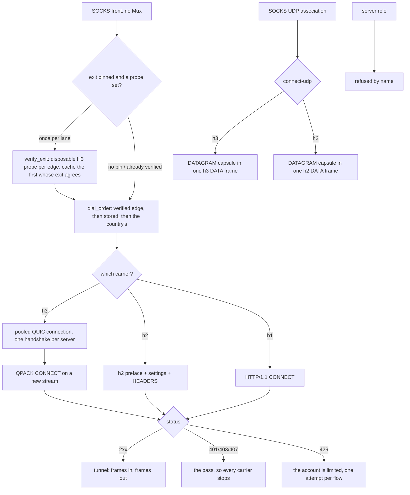

# The Foxy lane

The Foxy lane is an account-authenticated CONNECT tunnel to a CDN edge: a
Firefox Accounts login, a Guardian proxy pass, an edge list pinned to one
country, and then the tunnel. The page above it is the account plane; this one
is the four ways the tunnel's bytes can be carried, because that is what a
connection method is:

| carrier | ALPN | what it is |
| --- | --- | --- |
| `h1` | `http/1.1` | CONNECT, then the target's own bytes |
| `h2` | `h2` | one stream per flow over one TLS session |
| `h3` | `h3` | one stream per flow over one shared QUIC connection |
| `auto` | — | `h3`, then `h2`, then `h1` |

UDP rides the same lane as **CONNECT-UDP** (RFC 9298), over `h2` and over `h3`,
`h3` first: one capsule stream per destination. HTTP/1.1 has no extended
CONNECT, so it is never asked to carry a datagram, which
`the_carriers_are_ordered_by_what_the_edge_can_answer` gates.

One shape for all of them, and it is the whole design: open a stream, send
seven header fields, read one status, relay. The parts that decide rather than
move bytes live in `ferrox_core::foxy` (the codecs, the window arithmetic, the
UDP path and template), and the app crate owns the socket, the pool and the
TLS session. A caller that relays bytes does not know which carrier produced
its `Read + Write`. The tunnel a dial returns owns the pooled stream it rides
(`FoxyOpen::Tunnel`), so the flow that ends is what hands that stream back.

## Data path



## Measured

<!-- counts:begin -->
| key | value | checked by |
| --- | --- | --- |
| ops-retired-instructions | UNBLESSED | scripts/count-ops.sh |
| payload-staging-copies-per-byte-written | 0 | ferrox-app-foxy::loopback::a_relayed_byte_is_copied_once_on_its_way_through_the_lane |
| payload-staging-copies-per-byte-read | 0 | ferrox-app-foxy::loopback::a_relayed_byte_is_copied_once_on_its_way_through_the_lane |
| read-buffer-bytes-per-staged-remainder | 1 | ferrox-app-foxy::loopback::a_read_leaves_only_what_the_callers_buffer_had_no_room_for |
| h2-bytes-lost-at-a-read-quantum | 0 | ferrox-app-foxy::loopback::a_frame_that_straddles_a_read_quantum_arrives_whole |
| carriers-dialled | 3 | ferrox-app-foxy::tests::the_carriers_are_ordered_by_what_the_edge_can_answer |
| udp-carriers-dialled | 2 | ferrox-app-foxy::tests::the_carriers_are_ordered_by_what_the_edge_can_answer |
| datagram-frames-per-capsule | 1 | ferrox-app-foxy::loopback::the_masque_carrier_opens_connect_udp_over_quic_and_echoes_a_datagram |
| capsules-reassembled-across-frames | 1 | ferrox-app-foxy::loopback::a_capsule_split_over_frames_reassembles_as_one_datagram |
| datagrams-out-of-one-frame | 2 | ferrox-app-foxy::loopback::a_frame_of_two_datagrams_arrives_as_two_datagrams |
| quic-datagrams-out-of-one-frame | 2 | ferrox-app-foxy::loopback::a_quic_frame_of_two_datagrams_arrives_as_two_datagrams |
| stream-write-staging-copies-per-byte | 0 | ferrox-app-foxy::loopback::the_quic_carrier_sends_the_block_reads_the_status_and_carries_the_bytes |
| datagram-write-staging-copies-per-byte | 0 | ferrox-app-foxy::loopback::the_masque_carrier_opens_connect_udp_and_echoes_a_datagram |
| ip-read-staging-copies-per-byte | 0 | ferrox-app-foxy::loopback::the_connect_ip_carrier_opens_one_tunnel_and_carries_a_datagram |
| server-roles | 0 | ferrox-app-proxy::tests::quic_serve_closes_without_handshake |
| dialled-without-ca-cert-file | 0 | ferrox-app-proxy::tests::quic_outbound_reads_ca_cert_file |
| address-assign-capsule-bytes-per-grant | 9 | ferrox-core-foxy::connectip::tests::the_assign_a_proxy_writes_is_the_assign_the_lane_reads |
| route-advert-capsule-bytes-per-route | 12 | ferrox-core-foxy::connectip::tests::the_route_advert_a_proxy_writes_is_the_route_advert_the_lane_reads |
| edges-preferred-by-verified-exit | 1 | ferrox-app-proxy::foxy_exit_tests::the_preferred_edge_is_the_first_one_whose_exit_agrees_not_the_first_one_opened |
| tcp-connections-asked-of-an-untrusted-edge | 1 | ferrox-app-foxy::loopback::an_untrusted_edge_is_named_and_asked_once |
| catalogue-edges-kept-across-a-failed-fetch | 4 | ferrox-app-foxy_catalog::tests::a_fetch_that_failed_keeps_the_edges_already_known |
| catalogue-edges-rewritten-from-the-cache-file | 5 | ferrox-app-foxy_catalog::tests::the_cache_file_one_process_writes_is_the_one_the_next_reads |
| dials-of-a-silent-tcp-carrier | 1 | ferrox-app-proxy::tests::a_silent_carrier_is_dialled_once_rather_than_once_per_rung |
| dials-across-three-flows-of-a-rested-carrier | 2 | ferrox-app-proxy::tests::a_silent_carrier_is_dialled_once_rather_than_once_per_rung |
| relay-legs-held-after-their-lane-ended | 0 | ferrox-app-foxy::loopback::a_lane_that_ends_releases_the_leg_parked_on_its_client |
| pool-workers-held-after-a-finished-burst | 0 | ferrox-app-proxy::tests::a_finished_burst_hands_its_workers_back_to_the_process |
| pool-directions-lost-on-a-gone-worker | 0 | ferrox-app-proxy::tests::a_claim_that_reaches_a_gone_worker_keeps_its_direction |
| rate-limits-that-stopped-a-renewal | 0 | ferrox-app-foxy_account::tests::a_refused_credential_is_the_only_answer_a_second_ask_cannot_change |
| named-waits-dropped-from-a-renewal-pause | 0 | ferrox-app-foxy_account::tests::a_rate_limit_carries_the_wait_its_head_names |
| renewal-pauses-past-their-own-ceiling | 0 | ferrox-app-foxy_account::tests::the_next_ask_waits_the_gap_the_plane_names_or_a_curve_that_caps |
<!-- counts:end -->

`tcp-connections-asked-of-an-untrusted-edge 1` is the retry rule seen from the
edge's side: the lane asks an edge for a TLS session eight times because the edge
sometimes drops a handshake it started, and a chain this device does not trust
drops for a reason no second ask changes. The counter in
`an_untrusted_edge_is_named_and_asked_once` is the server's own accept loop, so it
sees the connections, not the intent: one, and the failure that comes back names
the certificate rather than the moment. The same rule is what stops the `auto`
carrier walk at the first refusal — the edge's certificate is not the carrier's,
so HTTP/2 and HTTP/1.1 would answer it identically — so a pinned edge with no
trusted chain costs one handshake per address instead of one per address per
carrier. What the front answers stays `0x01 general failure`, now asserted for the
new variant by `a_refusal_becomes_the_socks_reply_that_says_so`; what changed is
that the message the user can act on ("this device does not trust the edge's
certificate") survives to the caller instead of becoming "the carrier io failed".

What this leaves alone, deliberately: `FoxyOut::remember_unanswered` still caches
only `Io | Stream | Frame` as a carrier that died, so an untrusted chain does not
mark that carrier dead for the next flow. Trust is per edge, not per carrier, and
a client that installs the missing root — or fixes its clock — should get a real
dial on the next flow rather than a cached refusal.

`dials-of-a-silent-tcp-carrier 1` and `dials-across-three-flows-of-a-rested-carrier 2`
are the TCP walk reading the cache it already wrote. The walk asks a carrier's
`Refusals` entry before it dials, exactly as the datagram walk does, because the
rule that made the cache was written for the ladder and the TCP front never
consulted it: `Carrier::order()` returns a *named* carrier three times — the same
rung three times, so the walk needs no dedupe of its own — and an unremembered
cache means a flow pointed at an edge that names no protocol this lane speaks paid
three handshakes for one answer, then repaid them on every later flow for the
whole `CARRIER_DEAD_SECS` window. The counter is again the edge's own accept loop,
and the three numbers it sees are the three rules: one for the flow that learns the
silence, none for the flow inside the window, one more once the window is expired
by hand in the test. What the walk spends instead is one formatted key per carrier
rung — `carrier_key` builds a `String`, so a three-rung `auto` walk now formats
three keys per edge where it formatted none; that is the cost of the skip and it
sits on a path whose alternative is a handshake.

What this does not do is re-ask an edge that answered a *status*: `opened()` still
refuses a non-2xx as `Rejected`, and a status is the edge speaking, so
`remember_unanswered` leaves it out of the cache and the next flow dials it again.
The rest is only ever for silence.

One dialler still does not consult the cache: `open_foxy_ip_tunnel`, the
CONNECT-IP walk, marks a silent carrier dead but asks it again on every flow like
the TCP front used to. It has no witness here because nothing in this tree dials
that walk, so its row would be a claim with no checker rather than a number.

The other thing this slice found and left alone: the front kept a `Refusals` map
for the *target*, filled it when an edge answered that a target is unreachable and
looked it up only at the top of the call, before anything had been written to it.
Per-flow state with no second reader, so the lookup and the write are gone and the
walk behaves exactly as it did; the rule the code was reaching for — a target an
edge declined is answered locally for the rest of its window — is the same shape as
the carrier rule above and needs a shared map and its own witness, not a comment.

`catalogue-edges-kept-across-a-failed-fetch 4` is the catalogue's answer when the
settings server does not answer: the four edges the test envelope publishes stay
dialable, at their own age, so the next flow asks again. A failed fetch — or one
that reads no edges at all — used to `unwrap_or_default()` the list away, so a
serverlist hiccup turned a known-good edge set into no edges and every pinned
country into a refusal. `catalogue-edges-rewritten-from-the-cache-file 5` is the
same list through the file one process leaves for the next: five edges, one
tab-separated line each, including the blank city code, which is why the separator
is a tab and the reader wants exactly four fields per line. A torn file keeps the
whole lines and drops the rest (`a_cache_file_cut_off_mid_write_keeps_the_lines_that_are_whole`),
and no file is no list rather than a guess.

What the file buys, named without a number: a cold start inside the `FRESH`
window dials the settings server not at all, and one with no network at all still
has yesterday's edges. `edges()` keeps its lock off the fetch — the guard is
dropped before the round trip, because a control-plane call must not serialize
every dial in the process — and the stale list is not restamped, so a fetch is
still attempted per flow while the server is down.

`payload-staging-copies-per-byte-written 0` and
`payload-staging-copies-per-byte-read 0` are the two rows this page exists to
name, and the checker for both is the lane's own buffers: `carry` is the read
buffer and `out` the write one, and a lane that stages a payload before handing
it over has grown the buffer it staged in. Capacity is the witness, because the
bytes are identical either way — the byte-level tests pass whether the copy is
there or not, which is exactly why they cannot see it.

Two honest bounds on those rows. The TLS library still copies the payload into
its own record buffer, so a *relayed* byte crosses userspace once for that
reason; these rows count the copies this lane makes, which is what the
capacity gate observes. And `read-buffer-bytes-per-staged-remainder` is 1
rather than 0 because a caller whose buffer is smaller than the frame it is
reading has its remainder staged once — the only copy that cannot be avoided
without changing how many times `read` returns.

`h2-bytes-lost-at-a-read-quantum 0` is the frame reader's boundary condition.
The relay arms a read quantum so the writer behind the same mutex gets a turn;
a quantum that expired *inside* a DATA frame used to abandon the bytes already
read, the next call parsed that frame's own tail as a header, the lane answered
`a header that is not a frame`, and the relay broke mid-body — a download
arrived truncated, or arrived as bytes no TLS stack could decrypt. What was
removed is the abandonment: the header and the partial payload now live on the
lane and the next call resumes at the cursor, so a stalled frame costs only the
polls that wait for its tail. What was not removed: a frame is still read whole
before `read` hands anything over, so the granularity the rows above count is
unchanged, and a closed stream still ends the lane on the error it gave before.

`datagrams-out-of-one-frame` and `quic-datagrams-out-of-one-frame` count what
one carrier's stream order costs: a frame boundary is not a capsule boundary, so
a single DATA frame can hold two capsules, and each has to leave the lane as its
own datagram in the order the edge wrote them. The value is 2 because that is
how many datagrams the gate puts in the frame, on `h2` and on `h3` separately —
the two lanes reassemble independently and a fix to one says nothing about the
other.

`edges-preferred-by-verified-exit 1` is the lane's exit-country selection: when a
pinned country offers more than one edge, a once-per-lane pre-flight asks each
disposable HTTP/3 probe tunnel where it really exits and dials the first whose
observed `loc` matches the pin, not the first that merely opened. The value is
the one disagreeing edge the kernel passes over before the agreeing one, which is
what `the_preferred_edge_is_the_first_one_whose_exit_agrees_not_the_first_one_opened`
observes. A country the serverlist publishes as a single anycast edge — the
United States is `us.m1.fastly-masque.net` alone — has nothing to rotate to, so
the lane records the truth (`exit CA differs from pin US`, under `FOXY_DEBUG`) and
dials the one edge it was given: which CDN point of presence answers a country's
anycast from a given runner is not a choice the client can make.

What the pre-flight costs, named rather than hidden: up to `MAX_FOXY_ALTERNATES +
1` disposable HTTP/3 dials, once per lane, then cached on `FoxyOut` — so it is
paid on the first flow, not every one. It runs only when a country is pinned and
an `exitProbe` is set; the recommended location, and every config with no probe,
pay nothing, and a runner that cannot carry the trace sets one flag and stops
probing rather than costing each flow a dead dial.

## The pinned anchor

`spkiPins` names a leaf key. Until now that name was only ever a *narrower*
filter: `Pinned::verify_server_cert` ran the stock chain verifier first and
checked the pin against what had already verified, so a device whose trust store
could not build the edge's chain refused the edge it had been told to trust. The
newest upstream client in this lane's family fixed the same hazard from the other
side: FoxyVPN v1.0.5 ships the GlobalSign E46/R46 roots so an out-of-date Android
store can build the chain again.

This lane does not need a bundled root. The pin replaces **who signed the leaf**
and nothing else: when the store fails and this leaf's SPKI is one of the pins,
the same leaf, the same intermediates, the same name and the same instant are
verified again against a one-anchor store of the leaf itself, which is rustls's
ordinary path and therefore still enforces the SAN and the validity window.

- **What it costs.** The path where the store verifies is one extra bool. The
  path where it does not is one `RootStore` and one verifier build, once per
  handshake, on a dial that used to be a refusal. No data-path count moves.
- **Against the references.** `upstream/xray-core/transport/internet/tls/config.go`
  reaches `foundLeaf` and `return nil` — the pin replaces the name check and the
  expiry check along with the chain. This lane is the same feature with those two
  checks kept, so a mis-set pin on a key that answers for another host, or an old
  certificate replayed under a still-held key, is still refused.
- **What checks it.** `a_pinned_leaf_carries_the_tunnel_when_the_store_cannot_build_the_chain`
  dials an edge minted by another hand with the right pin and echoes a payload —
  red with the fallback removed. `a_pinned_leaf_still_has_to_answer_the_name_it_was_dialled_for`
  is red with the re-verification removed, which is the xray shape.
  `a_pin_that_is_not_the_edges_key_is_still_refused_without_a_trust_store` holds
  the stranger's pin at `Failure::Untrusted`, so the ask-once rule above still
  applies to it.
- **What it does not reach.** The `h3` carrier is quiche's, and quiche takes its
  anchors from a CA file (`quic.rs::quiche_config` →
  `load_verify_locations_from_file`) with no verify callback, so the HTTP/3 leg
  still needs a store that can build the chain. An `auto` walk over a stale store
  and a pinned edge therefore fails `h3` and lands on `h2`, which is a downgrade
  the lane already survives rather than a new failure.

## Ops

```bash
./scripts/count-ops.sh report \
  foxy::loopback::a_relayed_byte_is_copied_once_on_its_way_through_the_lane 'Tls2::write'
```

`ops-retired-instructions` is `UNBLESSED`. `ops.yml` reports every symbol in
`scripts/method-ops.txt` on each run and never blocks, so the row is open, not a
figure.

## Time

**Not measured on this branch.** The lane's throughput is what
`.github/workflows/foxy-relay.yml` measures — it downloads 1 MB per carrier
(`h1`, `h2`, `h3`, `auto`) against the real edge on all three runners, and the
ubuntu job adds a second exit country, the `http` front and the UDP datagram
path. That job now also sets an `exitProbe` on every pinned-country leg, so the
pre-flight is what reads the real exit country against the real edge. A duration
from a machine behind a VPN measures the tunnel, not the lane.

## What we removed

Against the two clients this lane is a port of, and named with their paths so
the comparison can be re-read:

- **The HTTP/3 refusal.** `FoxyVPN` speaks HTTP/2 only and says so in its
  README ("HTTP/3 implementation (Not Planned Yet)"), and its README states the
  consequence: general UDP cannot be relayed at all, so QUIC is out by
  construction. `firefox-vpn-client` does dial HTTP/3 when asked
  (`-h3`, `newH3ProxySession`), but its uplink is a CONNECT stream with no
  datagram, capsule or extended CONNECT anywhere in the tree, and its server
  list prints `MASQUE` as a protocol name that nothing dialles. So a datagram
  over the account's own edge is a superset of both, not a port of either, and
  the MASQUE CONNECT-IP row in `docs/xray-parity.md` stays refused — this page
  claims CONNECT-UDP, not IP-over-QUIC.

- **Two dials of a carrier the edge already went silent on.** The TCP front wrote
  the `carrier_dead` cache and never read it, so a flow whose named carrier's
  handshake the edge refused paid that handshake once per rung the carrier repeats
  — three for a named one — and every flow after it repaid them for the whole
  quarantine window. The front now asks the cache first, which is what the
  datagram walk has done since it was written: one dial for the flow that learns
  the silence, none inside the window, one again when it expires.

- **A second TLS record per CONNECT-UDP frame.** Writing the frame header and
  its capsule as two writes made two TLS records, and a record boundary is on
  the wire. `write_parts` hands the header and the payload to the same
  fragmenter in one call, which is the record a concatenated write would have
  produced: the same plaintext in the same order, one record instead of two.

- **A capsule stream that lost its own tail.** `read_datagram` handed over the
  first DATAGRAM capsule it found in a frame and dropped the bytes behind it, so
  a second capsule inside the same frame was never delivered, and a capsule
  split over frames could be overtaken by a whole one behind it in the buffer.
  The lane now hands the first capsule over where it lies and stages only what
  follows it, which is what makes the stream's order the datagrams' order. The
  common case pays nothing for it: one capsule to a frame leaves the split
  pointing at the frame's end, so the stage stays empty and `capsule_buf` never
  grows — which is what
  `the_masque_carrier_opens_connect_udp_over_quic_and_echoes_a_datagram` still
  asserts.

- **A staging copy on every HTTP/2 datagram written.** The CONNECT-UDP writer
  joined the DATAGRAM capsule's header and the caller's payload in its own buffer
  before framing, so a written datagram crossed userspace twice — once into that
  buffer, once into the record. The capsule header now rides a fixed stack buffer
  (`masque::datagram_prefix_into`, byte-identical to the run `datagram_encode`
  puts before the payload) while the payload keeps the caller's buffer: the lane
  hands `[frame header, capsule header, payload]` to one `write_all_slices`, the
  same call the tunnel's `Write::write` already uses, so the record boundary and
  every byte are what they were. `datagram-write-staging-copies-per-byte 0` is
  gated by `the_masque_carrier_opens_connect_udp_and_echoes_a_datagram` resetting
  the lane's write buffer and holding its capacity at zero across a write — the
  echoed bytes are identical either way, so capacity is the only witness that can
  see the copy go. The HTTP/3 leg is deliberately left alone: its `out` is the
  sentinel the `stream-write-staging-copies-per-byte 0` row already reads to prove
  the *relay* write stages nothing, and taking the datagram copy there too would
  empty that sentinel rather than strengthen it. What is **not** removed on the
  leg that changed: the payload still crosses once into the TLS record — that copy
  is the floor, not this lane's staging.

- **A staging copy on every CONNECT-IP packet read.** The HTTP/2 CONNECT-IP
  reader copied every inbound packet twice: it staged the whole DATA frame into
  the capsule buffer, then split the first capsule out of that buffer into the
  owned `Vec` it returns. Its CONNECT-UDP sibling already handed a capsule whole
  inside one frame straight out and staged only what followed it; this path had
  never been brought to the same shape. It now splits the frame where it lies and
  keeps only the tail behind a whole datagram, so an inbound packet crosses
  userspace once — into the `Vec` the caller takes — the floor for the
  Vec-returning read. `ip-read-staging-copies-per-byte 0` is gated by
  `the_connect_ip_carrier_opens_one_tunnel_and_carries_a_datagram` resetting the
  capsule buffer with nothing pending and holding its capacity at zero across a
  read — the packet bytes are identical either way, so capacity is the only
  witness that can see the staging go. The **HTTP/3 read leg is left alone**: its
  capsules arrive through the stream window and may span reads, so the
  whole-in-one-frame precondition the copy removal rests on is not free there, and
  the staged path stays correct. What is **not** removed on the leg that changed:
  the one copy into the returned `Vec` — the caller takes ownership, so no borrow
  of the frame outlives the call.

- **Two copies of every relayed byte.** The lane used to stage a DATA frame's
  payload in its read buffer and then copy it into the caller's, and stage the
  caller's payload in its write buffer before handing it to the TLS session.
  The frame payload now goes straight into the caller's buffer, and the caller's
  payload straight into the record.
- **A second copy of every byte written on the HTTP/3 carrier.** A frame's
  varints and its payload were joined in the lane's write buffer before quiche
  copied that buffer into its send queue, so the payload was copied twice.
  The varints are their own `stream_send` now and the payload keeps the
  caller's buffer; a loopback edge that walks whole frames or not at all says
  the bytes are still the frame they were.

- **Two hand-rolled `ADDRESS_ASSIGN` capsules.** The HTTP/2 and HTTP/3
  CONNECT-IP edges each spelled the grant byte-for-byte by hand; both now call
  `connectip::address_assign_encode`, and the two loopback lanes read back the
  identical assignment (`the_connect_ip_carrier_opens_one_tunnel_and_carries_a_datagram`,
  `..._over_quic_and_carries_a_datagram`). The writer is the exact inverse of the
  reader it feeds — the same request id, version, address and prefix the client
  lane parses — so `address-assign-capsule-bytes-per-grant 9` and
  `route-advert-capsule-bytes-per-route 12` name the framing it emits;
  `route_advert_encode` gives the server→client direction its writer too, so the
  codec now spells every capsule it reads.

- **Two buffers per UDP flow.** A CONNECT-UDP request used to build the URI
  template's path in one `Vec` and the `Bearer` value in another. Both are
  written where they are read now, because their lengths are known before they
  are written, which is what `a_named_path_length_is_the_length_of_the_bytes_that_follow`
  holds the two halves of.

- **A fetch that threw away what it had already learned.** `edges()` answered a
  failed serverlist call with `unwrap_or_default()`, so the lane's knowledge of a
  country's edges lasted exactly as long as the settings server's uptime and
  survived no restart at all. The decision is now a function of the list already
  known plus one fetch's answer, which is what the two catalogue rows can see. The
  list is also written down — a temp file at `0o600`, renamed onto the live path,
  the shape `quic.rs::stage_at` already uses — so the next process starts from
  edges rather than from a round trip.

- **A bit-at-a-time Huffman decode.** `huffman_decode` probed the canonical
  table once per bit it read — eight probes per byte of a coded literal — on the
  `:status` read of every dial and every header string the H2 and QPACK lanes
  decode. One 12-bit window now answers every code of length ≤ 12, which is the
  whole ASCII range, in one load of a 4096-entry table `huffman()` builds once
  beside the probe rows; a miss hands the twelve bits it already read to the
  same serial probe the pre-table decoder ran, for the 13..30-bit codes.
  `the_primary_window_resolves_exactly_the_codes_of_twelve_bits_or_fewer` checks
  each window against the probe rows, and
  `the_table_decode_matches_the_serial_probe_on_every_case` compares verdict and
  partial output across every one- and two-byte string, every prefix of the
  256-symbol sweep, every two-byte padding suffix on a valid encoding, and
  30 000 LCG garbage and long-code cases. What is **not** removed: the tail rule
  (≥ 8 leftover bits, or leftover that is not all ones, still refuses) and the
  probe rows themselves — a long code still probes bit by bit, just from twelve
  rather than from one.

- **A relay leg parked after its lane ended.** The flow shut its client socket's
  write half when the direction running on the caller's own thread finished, then
  joined the other direction. A FIN we send does not wake a `recv` blocked on the
  same socket, so the pooled leg stayed parked, the join burned its whole budget,
  printed the give-up, and returned — leaving one pool worker, one lane and both
  buffers owned by nobody for the life of the process, and the next flow to
  spawn its own worker. The UDP relays joined this way from the start — they shut
  both halves — and the lane now does the same, so the leg waiting in a parked
  read ends with the flow that parked it.
  The wake is the read's own grain, not only the shutdown: the pooled leg arms
  `budgets::relay_quantum` on its read handle and reads a timeout as a client that
  has not spoken rather than a flow that has ended, because a stack that leaves a
  read already in flight asleep still ends the one after it. Changing a parked
  read from "never wakes" to "wakes once per quantum" is the count change here,
  and it costs nothing while bytes move. `windows x86_64` was the platform that
  said so — the leg stayed parked there through both halves of a shutdown, and
  `a_lane_that_ends_releases_the_leg_parked_on_its_client` now bounds the whole
  teardown at two grains, so a fall back to the join budget is red.
  What is **not** removed: a client that vanishes without a FIN while its lane is
  still alive. Nothing in this tree notices that, so such a flow still holds both
  legs; naming it here rather than as a count, because no gate in the harness can
  see it. And the two-socket `relay` still shuts one half for the same reason it
  took a lane to, so it keeps the leg it parked — its own slice, not this one.

- **A pool worker that never handed its thread back.** A worker ran its direction
  and then parked on its channel with an unbounded `recv`, so a burst of
  concurrent flows left one thread per flow for the life of the process — `sample`
  on a live lane counted 194 threads, 157 of them asleep in that `recv`. Worse,
  the direction that *woke* a worker was handed to it at spawn, before any
  `idle.push`, so a pool serving flows one after another never found a parked
  worker either and bought a fresh thread every time. A worker now parks for the
  worker life (`budgets::RELAY_WORKER_LIFE`, 30 s) after every direction, the
  first included, and hands its thread back when nothing claimed it in that
  window, taking its own entries out of the parking lot as it goes. A claim that
  pops a sender exactly as its worker's park ends is closed by one more look at
  the channel under the pool's lock: a task that landed there runs, and a send
  into the receiver dropped on the way out fails into a fresh spawn instead of
  vanishing, and the direction a rejected send returns is handed to that spawn
  rather than dropped with it. `a_finished_burst_hands_its_workers_back_to_the_process`
  holds eight directions in flight at once, sees eight parked workers, then sees
  none; with an hour's park it stays red at eight, and
  `a_claim_that_reaches_a_gone_worker_keeps_its_direction` is the red panic of the
  claim that lands on a receiver being dropped.
  What is **not** removed: the threads a *live* flow holds. Each direction of a
  flow is still a thread and a lane of its own, so a lane with N concurrent flows
  still runs N legs; fewer threads at the same concurrency is the session reuse
  the `h2`/`h1` carriers do not have yet, not this reap.

- **A renewal clock that one rate limit could stop.** `Denied::of(429)` answered
  `Quota`, and both consumers read `Quota` as final: the renewal thread printed its
  one line and returned, and the sign-in loop refused the lane outright — the
  opposite of the comment beside it, which says a plane refusal retries. Every lane
  start is a fresh sign-in and a fresh mint, so lanes restarted in a row collide on
  that limiter and the first collision cost the whole lane: the pass it stood over
  kept running out with nothing asking for another. A `Quota` now carries the
  seconds its own head named (`Retry-After`, numeric form), `Denied::is_final` is
  the single answer a second ask cannot change — a refused credential — and
  `renewal_gap` decides the pause: that named wait, clamped to a second and twelve
  hours, or else five seconds doubling to a fifteen-minute ceiling, and cut short
  by whatever the carried pass has left so a lapse is noticed before the curve says
  to wait. `a_refused_credential_is_the_only_answer_a_second_ask_cannot_change`
  walks the five refusals and says which one ends the clock,
  `a_rate_limit_carries_the_wait_its_head_names` reads the wait out of a head, and
  `the_next_ask_waits_the_gap_the_plane_names_or_a_curve_that_caps` is the pause
  table, both ceilings included.
  What is **not** removed: a `Retry-After` in HTTP-date form is not a number, so it
  falls onto the guessed curve rather than the plane's own clock, and a refusal
  still costs the pass clock before it — `renews_in` sleeps first, so an ask waits
  its half-life *plus* the refusal pause, never less than the 15 s floor
  `renewal_delay` writes. Nothing here keeps a lane alive past a pass that really
  has lapsed: it asks again instead of never asking again.

What is **not** removed, named rather than claimed: 0-RTT, connection
migration, key updates and batched datagram I/O are quiche's, and this tree has
not made them run. The HTTP/3 DATAGRAM frame form (RFC 9297 over QUIC
unidirectional streams) is not carried — the capsule form is, because it is the
one an edge answers on the same stream it opened CONNECT on. The server role is
refused by name: the CONNECT-IP *client* dials over the Foxy `h3` lane
(`serve_socks_udp_foxy_ip`, one tunnel carrying every destination), and the codec
now writes every capsule in both directions, but no proxy *terminates* one — the
address pool and the IP/ICMP forwarding to a device are not wired, and neither is
a standalone `Carrier::Masque` VLESS outbound (its planned reason names the live
foxy lane and the missing dial). And the published MASQUE edge answers TCP on
port 2499 rather than QUIC, which is why `h3` is tried first and `h2` is not a
downgrade.

## The rested edge

The pre-flight proves an edge *answers*; it does not prove a tunnel through it
*holds*. An exit the edge's own rule refuses opens a CONNECT the edge grants and
then ends on arrival, so the `verified`/`stored` edge the dial order puts first is
dialed again by every flow. `count_tunnel_end` rests such an edge after
`EDGE_REST_STRIKES` quick ends in a row and keeps it out of the order for
`EDGE_REST`; a tunnel that stayed up `TUNNEL_STAYED_UP` clears the streak, so a
good edge a network change briefly dropped is not punished for ending.

This is a TCP-front behavior: the association that ends is the relayed flow, so
`EdgeStrikes` is keyed on the edge authority and consulted once when a flow is
dialed (skip rested edges, dial them anyway when every one rests rather than
black-hole the flow) and once when its relay returns. The ejection itself is
checked by `ferrox-core::foxy::tests` — `count_tunnel_end` and the two-ends-rest
/ long-tunnel-frees round trip are deterministic there. The consequence that
matters, *the next dial reaching a different live edge*, is only observable
against the real MASQUE edge, so it belongs to `foxy-relay.yml`, not to a loopback
test that cannot stand in for an exit rule. What the flow gains for that is two
`Mutex` acquisitions and one small `HashMap` probe per tunnel, off the byte path
and unchanged in count when no edge has rested.

## Pins

| what | where |
| --- | --- |
| the QUIC + HTTP/3 stack behind `h3` | `upstream/quiche` @ `b60aff93` |
| `foundLeaf`: the pin replaces chain, name and expiry | `upstream/xray-core/transport/internet/tls/config.go` |
| the Android client this lane ports | `/tmp/foxyvpn` (`com.vauth.foxyvpn`) |
| the Go reference client this lane ports | `/tmp/firefox-vpn-client` |

## CI scope

What a change here owes, read by `scripts/ci-scope.py`; see [`docs/ci-scope.md`](../ci-scope.md).

<!-- scope:begin -->
- paths: crates/ferrox-app/src/foxy.rs, crates/ferrox-app/src/foxy_account.rs, crates/ferrox-app/src/foxy_catalog.rs, crates/ferrox-app/src/foxy_challenge.rs, crates/ferrox-app/src/foxy_live.rs, crates/ferrox-core/src/foxy/*
- symbols: foxy, FoxyOpen, probe_edge_exit
- go: ./transport/internet/masque/...
<!-- scope:end -->
