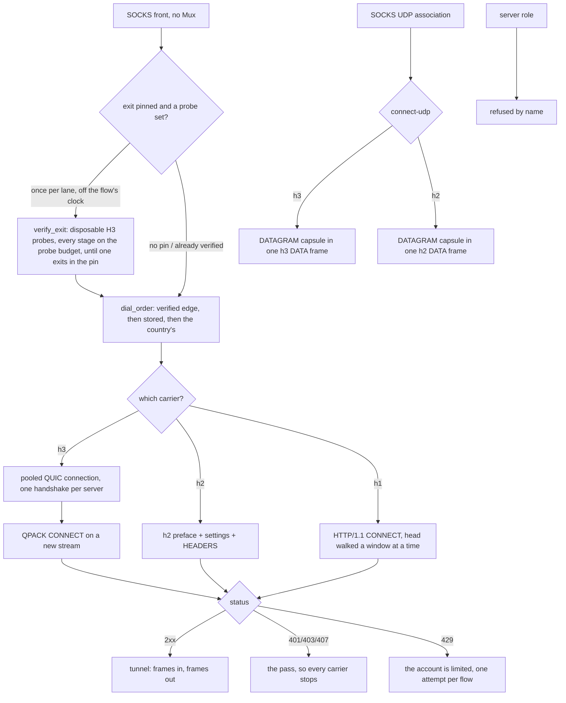

# The Foxy lane

The Foxy lane is an account-authenticated CONNECT tunnel to a CDN edge: a Firefox Accounts login, a Guardian proxy pass, an edge list pinned to one country, and then the tunnel. The page above it is the account plane; this one is the four ways the tunnel's bytes can be carried, because that is what a connection method is:

| carrier | ALPN | what it is |
| --- | --- | --- |
| `h1` | `http/1.1` | CONNECT, then the target's own bytes |
| `h2` | `h2` | one stream per flow over one TLS session |
| `h3` | `h3` | one stream per flow over one shared QUIC connection |
| `auto` | — | `h3`, then `h2`, then `h1` |

UDP rides the same lane as **CONNECT-UDP** (RFC 9298), over `h2` and over `h3`, `h3` first: one capsule stream per destination. HTTP/1.1 has no extended CONNECT, so it is never asked to carry a datagram, which `the_carriers_are_ordered_by_what_the_edge_can_answer` gates.

One shape for all of them, and it is the whole design: open a stream, send seven header fields, read one status, relay. The parts that decide rather than move bytes live in `ferrox_core::foxy` (the codecs, the window arithmetic, the UDP path and template), and the app crate owns the socket, the pool and the TLS session. A caller that relays bytes does not know which carrier produced its `Read + Write`. The tunnel a dial returns owns the pooled stream it rides (`FoxyOpen::Tunnel`), so the flow that ends is what hands that stream back.

## Data path



## Measured

<!-- counts:begin -->
| key | value | checked by |
| --- | --- | --- |
| ops-retired-instructions | UNBLESSED | scripts/count-ops.sh |
| payload-staging-copies-per-byte-written | 0 | ferrox-app-foxy::loopback::a_relayed_byte_is_copied_once_on_its_way_through_the_lane |
| payload-staging-copies-per-byte-read | 0 | ferrox-app-foxy::loopback::a_relayed_byte_is_copied_once_on_its_way_through_the_lane |
| read-buffer-bytes-per-staged-remainder | 0 | ferrox-app-foxy::loopback::half_a_frame_reaches_the_caller_with_the_rest_left_on_the_wire |
| connect-request-allocations-per-open | 0 | ferrox-core-tls::rustls_backend::tests::the_connect_request_gathers_without_a_heap_buffer |
| write-calls-per-h1-open | 1 | ferrox-core-tls::rustls_backend::tests::the_connect_request_gathers_without_a_heap_buffer |
| head-read-calls-per-open | 1 | ferrox-app-foxy::tests::the_head_walk_reads_the_answer_in_one_call |
| head-tail-bytes-held-after-they-reach-the-caller | 0 | ferrox-app-foxy::tests::the_pipelined_tail_is_released_by_the_read_that_spends_it |
| h3-window-peek-bytes-per-delivered-frame | 16 | ferrox-app-foxy::loopback::the_h3_downlink_hands_the_caller_the_frame_without_staging_it |
| h2-bytes-lost-at-a-read-quantum | 0 | ferrox-app-foxy::loopback::a_frame_that_straddles_a_read_quantum_arrives_whole |
| h2-upload-bytes-blocked-by-an-unread-grant | 0 | ferrox-app-foxy::loopback::an_upload_is_paced_by_the_grants_the_edge_sends_rather_than_by_the_bytes_it_reads |
| window-update-frames-per-floor-crossing | 2 | ferrox-app-foxy::loopback::credit_crossing_the_floor_costs_one_pair_not_one_per_frame |
| window-update-frames-below-the-floor | 0 | ferrox-app-foxy::loopback::credit_held_under_the_floor_never_reaches_the_wire |
| dead-carrier-dials-per-connect-ip-packet | 0 | ferrox-app-proxy::tests::the_connect_ip_lane_leaves_a_dead_carrier_dead |
| carriers-dialled | 3 | ferrox-app-foxy::tests::the_carriers_are_ordered_by_what_the_edge_can_answer |
| udp-carriers-dialled | 2 | ferrox-app-foxy::tests::the_carriers_are_ordered_by_what_the_edge_can_answer |
| datagram-frames-per-capsule | 1 | ferrox-app-foxy::loopback::the_masque_carrier_opens_connect_udp_over_quic_and_echoes_a_datagram |
| capsules-reassembled-across-frames | 1 | ferrox-app-foxy::loopback::a_capsule_split_over_frames_reassembles_as_one_datagram |
| datagrams-out-of-one-frame | 2 | ferrox-app-foxy::loopback::a_frame_of_two_datagrams_arrives_as_two_datagrams |
| quic-datagrams-out-of-one-frame | 2 | ferrox-app-foxy::loopback::a_quic_frame_of_two_datagrams_arrives_as_two_datagrams |
| stream-write-staging-copies-per-byte | 0 | ferrox-app-foxy::loopback::the_quic_carrier_sends_the_block_reads_the_status_and_carries_the_bytes |
| datagram-write-staging-copies-per-byte | 0 | ferrox-app-foxy::loopback::the_masque_carrier_opens_connect_udp_and_echoes_a_datagram |
| ip-read-staging-copies-per-byte | 0 | ferrox-app-foxy::loopback::the_connect_ip_carrier_opens_one_tunnel_and_carries_a_datagram |
| platform-store-reads-per-flow | 0 | ferrox-app-quic::tests::the_platform_anchors_are_read_once |
| server-roles | 0 | ferrox-app-proxy::tests::quic_serve_closes_without_handshake |
| dialled-without-ca-cert-file | 0 | ferrox-app-proxy::tests::quic_outbound_reads_ca_cert_file |
| address-assign-capsule-bytes-per-grant | 9 | ferrox-core-foxy::connectip::tests::the_assign_a_proxy_writes_is_the_assign_the_lane_reads |
| route-advert-capsule-bytes-per-route | 12 | ferrox-core-foxy::connectip::tests::the_route_advert_a_proxy_writes_is_the_route_advert_the_lane_reads |
| edges-preferred-by-verified-exit | 1 | ferrox-app-proxy::foxy_exit_tests::the_preferred_edge_is_the_first_one_whose_exit_agrees_not_the_first_one_opened |
| tcp-connections-asked-of-an-untrusted-edge | 1 | ferrox-app-foxy::loopback::an_untrusted_edge_is_named_and_asked_once |
| catalogue-edges-kept-across-a-failed-fetch | 4 | ferrox-app-foxy_catalog::tests::a_fetch_that_failed_keeps_the_edges_already_known |
| catalogue-edges-rewritten-from-the-cache-file | 5 | ferrox-app-foxy_catalog::tests::the_cache_file_one_process_writes_is_the_one_the_next_reads |
| dials-of-a-silent-tcp-carrier | 1 | ferrox-app-proxy::tests::a_silent_carrier_is_dialled_once_rather_than_once_per_rung |
| dials-across-three-flows-of-a-rested-carrier | 2 | ferrox-app-proxy::tests::a_silent_carrier_is_dialled_once_rather_than_once_per_rung |
| relay-legs-held-after-their-lane-ended | 0 | ferrox-app-foxy::loopback::a_lane_that_ends_releases_the_leg_parked_on_its_client |
| relay-legs-held-after-their-client-ended | 0 | ferrox-app-foxy::loopback::a_client_that_ends_releases_the_leg_parked_on_its_lane |
| pool-workers-held-after-a-finished-burst | 0 | ferrox-app-proxy::tests::a_finished_burst_hands_its_workers_back_to_the_process |
| pool-directions-lost-on-a-gone-worker | 0 | ferrox-app-proxy::tests::a_claim_that_reaches_a_gone_worker_keeps_its_direction |
| rate-limits-that-stopped-a-renewal | 0 | ferrox-app-foxy_account::tests::a_refused_credential_is_the_only_answer_a_second_ask_cannot_change |
| named-waits-dropped-from-a-renewal-pause | 0 | ferrox-app-foxy_account::tests::a_rate_limit_carries_the_wait_its_head_names |
| renewal-pauses-past-their-own-ceiling | 0 | ferrox-app-foxy_account::tests::the_next_ask_waits_the_gap_the_plane_names_or_a_curve_that_caps |
<!-- counts:end -->

`tcp-connections-asked-of-an-untrusted-edge 1` is the retry rule seen from the edge's side: the lane asks an edge for a TLS session eight times because the edge sometimes drops a handshake it started, and a chain this device does not trust drops for a reason no second ask changes. The counter in `an_untrusted_edge_is_named_and_asked_once` is the server's own accept loop, so it sees the connections, not the intent: one, and the failure that comes back names the certificate rather than the moment. The same rule is what stops the `auto` carrier walk at the first refusal — the edge's certificate is not the carrier's, so HTTP/2 and HTTP/1.1 would answer it identically — so a pinned edge with no trusted chain costs one handshake per address instead of one per address per carrier. What the front answers stays `0x01 general failure`, now asserted for the new variant by `a_refusal_becomes_the_socks_reply_that_says_so`; what changed is that the message the user can act on ("this device does not trust the edge's certificate") survives to the caller instead of becoming "the carrier io failed".

What this leaves alone, deliberately: `FoxyOut::remember_unanswered` still caches only `Io | Stream | Frame` as a carrier that died, so an untrusted chain does not mark that carrier dead for the next flow. Trust is per edge, not per carrier, and a client that installs the missing root — or fixes its clock — should get a real dial on the next flow rather than a cached refusal.

`dials-of-a-silent-tcp-carrier 1` and `dials-across-three-flows-of-a-rested-carrier 2` are the TCP walk reading the cache it already wrote. The walk asks a carrier's `Refusals` entry before it dials, exactly as the datagram walk does, because the rule that made the cache was written for the ladder and the TCP front never consulted it: `Carrier::order()` returns a *named* carrier three times — the same rung three times, so the walk needs no dedupe of its own — and an unremembered cache means a flow pointed at an edge that names no protocol this lane speaks paid three handshakes for one answer, then repaid them on every later flow for the whole `CARRIER_DEAD_SECS` window. The counter is again the edge's own accept loop, and the three numbers it sees are the three rules: one for the flow that learns the silence, none for the flow inside the window, one more once the window is expired by hand in the test. What the walk spends instead is one formatted key per carrier rung — `carrier_key` builds a `String`, so a three-rung `auto` walk now formats three keys per edge where it formatted none; that is the cost of the skip and it sits on a path whose alternative is a handshake.

What this does not do is re-ask an edge that answered a *status*: `opened()` still refuses a non-2xx as `Rejected`, and a status is the edge speaking, so `remember_unanswered` leaves it out of the cache and the next flow dials it again. The rest is only ever for silence.

All three diallers consult it: `foxy_open` on the TCP front, `open_foxy_ip_tunnel` on the CONNECT-IP walk and `foxy_udp_dial` each ask `carrier_unanswered` before they dial and `remember_unanswered` on the silence they meet, so a carrier the lane already knows is dead costs no socket on any of the three paths. The CONNECT-IP walk is the one with its own row — `dead-carrier-dials-per-connect-ip-packet 0` above, checked by `the_connect_ip_lane_leaves_a_dead_carrier_dead`, which counts what a silent edge receives: nothing while the quarantine holds, and asked again the moment its window runs out.

The other thing this slice found and left alone: the front kept a `Refusals` map for the *target*, filled it when an edge answered that a target is unreachable and looked it up only at the top of the call, before anything had been written to it. Per-flow state with no second reader, so the lookup and the write are gone and the walk behaves exactly as it did; the rule the code was reaching for — a target an edge declined is answered locally for the rest of its window — is the same shape as the carrier rule above and needs a shared map and its own witness, not a comment.

`catalogue-edges-kept-across-a-failed-fetch 4` is the catalogue's answer when the settings server does not answer: the four edges the test envelope publishes stay dialable, at their own age, so the next flow asks again. A failed fetch — or one that reads no edges at all — used to `unwrap_or_default()` the list away, so a serverlist hiccup turned a known-good edge set into no edges and every pinned country into a refusal. `catalogue-edges-rewritten-from-the-cache-file 5` is the same list through the file one process leaves for the next: five edges, one tab-separated line each, including the blank city code, which is why the separator is a tab and the reader wants exactly four fields per line. A torn file keeps the whole lines and drops the rest (`a_cache_file_cut_off_mid_write_keeps_the_lines_that_are_whole`), and no file is no list rather than a guess.

What the file buys, named without a number: a cold start inside the `FRESH` window dials the settings server not at all, and one with no network at all still has yesterday's edges. `edges()` keeps its lock off the fetch — the guard is dropped before the round trip, because a control-plane call must not serialize every dial in the process — and the stale list is not restamped, so a fetch is still attempted per flow while the server is down.

`payload-staging-copies-per-byte-written 0` and `payload-staging-copies-per-byte-read 0` are the two rows this page exists to name, and the checker for both is the lane's own buffers: `out` is the write buffer and `carry` the read one an `h2` lane still keeps for a zero-size caller, and a lane that stages a payload before handing it over has grown the buffer it staged in. Capacity is the witness, because the bytes are identical either way — the byte-level tests pass whether the copy is there or not, which is exactly why they cannot see it.

Two honest bounds on those rows. The TLS library still copies the payload into its own record buffer, so a *relayed* byte crosses userspace once for that reason; these rows count the copies this lane makes, which is what the capacity gate observes. And `read-buffer-bytes-per-staged-remainder` reached 0 only with the resumed frame: a caller whose buffer is smaller than the frame in flight now keeps what fit, the lane keeps the cursor, and the rest stays on the wire for the next read — the remainder was the last copy this lane made, and it is gone rather than relocated.

`h3-window-peek-bytes-per-delivered-frame 16` is the same removal on the QUIC carrier, and the lane paid it twice per byte: `quiche::stream_recv` filled the request-stream window with whole DATA frames, the frame walk copied each payload from that window into the caller, and any remainder a small buffer could not take was staged a third time in `carry`, a buffer this read no longer has. The read now peeks two varints' worth of header — `H3_PEEK`, sixteen bytes, the ceiling of a QUIC-varint kind and length — reads a DATA frame's payload from the stream straight into the caller's own buffer, and returns `WouldBlock` at the same quantum boundary mid-frame with only the cursor kept, exactly the resumed frame the `h2` rows name. The checker feeds 200 KiB downlink to a caller reading 4096 bytes at a time: every byte arrives in order, and when the last frame is spent the window holds nothing beyond a header's spill and the frame in flight is not held anywhere — under the old lane that window had swallowed the whole 16 KiB frame before the first byte reached the caller.

What the peek costs is named: at most sixteen bytes of a frame's head can arrive inside the same read as its header, and those bytes cross the window once, per frame — 0.1 percent of a 16 KiB frame, the price of not buffering the other 99.9 percent. The mid-frame park that resumes is bounded by a wait armed once per read call, from that call's own start: re-armed inside the loop it could never expire, and an edge that stopped answering held the lane instead of handing the caller a `WouldBlock` at `head_wait` — the same bound the socket carriers' read timeout already gives, and no count row can see it. What else was not removed: quiche's own copy from a datagram into its stream buffer, which is the one userspace crossing every QUIC byte pays regardless of what the lane does after, and the bytes one `read` returns — a caller asking for the same sizes still sees the same answers, only paid for from the stream instead of from a stage. A stream that ends mid-frame and a frame the lane cannot parse still end it on the same `Failure::Stream` and `Failure::Frame`. The window's size no longer paces this path at all — only the head walk and the capsule stream land payload bytes in it now, which is what the window bullet under *What we removed* counts the shrinking of.

`h2-bytes-lost-at-a-read-quantum 0` is the frame reader's boundary condition. The relay arms a read quantum so the writer behind the same mutex gets a turn; a quantum that expired *inside* a DATA frame used to abandon the bytes already read, the next call parsed that frame's own tail as a header, the lane answered `a header that is not a frame`, and the relay broke mid-body — a download arrived truncated, or arrived as bytes no TLS stack could decrypt. What was removed is the abandonment: the header and the partial payload's cursor live on the lane and the next call resumes at it, straight into that call's own buffer, so a stalled frame costs only the polls that wait for its tail. What was not removed: the TLS record copy, and the bytes a `read` returns — a caller asking for the same sizes still sees the same answers, only paid for from the wire instead of from a stage. A truncated frame still ends the lane on the error it gave before, after handing over the bytes that actually arrived.

`h2-upload-bytes-blocked-by-an-unread-grant 0` is the credit rule, and the row is the shape of the bug: the lane counted what it had *received* as the credit it was allowed to *send*, so an upload to an edge that advertises the protocol default spent its first 64 KiB, found no more credit, and only moved again when the target answered with bytes of its own. On a download-shaped flow that coupling is invisible — the inbound DATA refills the outbound window every frame — which is why the echo loopback tests stayed green for it; on an upload it is a stall that looks like a slow line. What the lane does now is what HTTP/2 says: the send window opens at the edge's `SETTINGS_INITIAL_WINDOW_SIZE`, moves only on the edge's `WINDOW_UPDATE` frames (stream 1 for the stream, stream 0 for the connection), and a frame is at most the tighter of those two. The checker is a consuming edge that answers no payload at all and grants back exactly what it takes: 256 KiB leaves, and with the grants unread the body stops at the first window.

The grant this lane *sends* back is batched the same arithmetic: every byte of delivered DATA is held in one counter and written back as a single `WINDOW_UPDATE` pair when it crosses the 64 KiB floor, rather than a pair per inbound frame. `window-update-frames-per-floor-crossing 2` and `window-update-frames-below-the-floor 0` are the two halves of that claim, and the checkers watch the edge's own socket: five 16 KiB frames leave the lane having written exactly one pair, and 65,383 taken bytes leave it having written nothing. What was not removed: the wire shape of a grant — the pair still updates stream 1 and stream 0 exactly as the per-frame write did, because a download refills both windows, and only the clock on it changed.

Three consequences are named rather than hidden. An `h2` datagram whose capsule does not fit the credit it has is lost and the lane is kept — the association's own loop is the only reader of that lane, so a writer that blocked waiting for a grant would be waiting for a frame nobody else is about to read; `address_assign` now bounds its own wait by the header budget rather than spinning on it; and a CONNECT-IP tunnel that loses a packet loses one packet, which is what UDP is. What did not change is the 16 MiB the lane *advertises*: the opening `WINDOW_UPDATE` on stream 0 and the `SETTINGS_INITIAL_WINDOW_SIZE` in `client_settings` are both the edge's permission to send, so a download is still paced by the edge's grants to us and not by this row.

`dead-carrier-dials-per-connect-ip-packet 0` is a memo that one of three openers forgot to read. The TCP flow and the CONNECT-UDP dialer both ask whether a carrier is already known silent before they dial it; the CONNECT-IP opener wrote that verdict into the same cache and never consulted it, so every packet that found no tunnel re-probed the carriers the lane had just buried — on an edge that answers TCP rather than QUIC, one probe timeout plus one TCP+TLS+CONNECT+assign walk per reopen. The checker counts the edge's accepts: with both capsule carriers marked dead an open costs the edge nothing and a second open costs it nothing again, and clearing one window has it dialled.

The pre-flight's exit probe kept the same amnesia one level up, and no local checker can see the saving. A sweep that reached an edge and found its exit *differing* from the pinned country cached nothing — a later edge might honour the pin, so the walk kept walking — and each flow then paid the disposable tunnel, the CONNECT and the trace again to be told what the last flow was told. That verdict is now kept for the window a silent carrier is kept for, and the rule itself is `sweep_verdict`, gated beside the pure probe-order tests; the round trips it saves need an edge that really answers a trace, which is `foxy-relay.yml`'s to measure and not a loopback's.

`datagrams-out-of-one-frame` and `quic-datagrams-out-of-one-frame` count what one carrier's stream order costs: a frame boundary is not a capsule boundary, so a single DATA frame can hold two capsules, and each has to leave the lane as its own datagram in the order the edge wrote them. The value is 2 because that is how many datagrams the gate puts in the frame, on `h2` and on `h3` separately — the two lanes reassemble independently and a fix to one says nothing about the other.

`edges-preferred-by-verified-exit 1` is the lane's exit-country selection: when a pinned country offers more than one edge, a once-per-lane pre-flight asks a disposable HTTP/3 probe tunnel where it really exits and dials the first whose observed `loc` matches the pin, not the first that merely opened. The walk ends at that edge: an answer past the first agreement cannot demote it, and `probe_settled` says so for the same tables the pick is tested on (`the_walk_ends_at_the_agreeing_edge_without_losing_the_pick`). The value is the one disagreeing edge the kernel passes over before the agreeing one, which is what `the_preferred_edge_is_the_first_one_whose_exit_agrees_not_the_first_one_opened` observes. A country the serverlist publishes as a single anycast edge — the United States is `us.m1.fastly-masque.net` alone — has nothing to rotate to, so the lane records the truth (`exit CA differs from pin US`, under `FOXY_DEBUG`) and dials the one edge it was given: which CDN point of presence answers a country's anycast from a given runner is not a choice the client can make.

What the pre-flight costs, named rather than hidden: one disposable HTTP/3 dial when the first edge honours the pin, and at most `MAX_FOXY_ALTERNATES` when none does — once per lane, on its own thread, so no flow waits on it. Every stage of a probe carries the probe budget: the dial, the CONNECT answer and the trace read each expire on `budgets::carrier_probe()`, the same 2.5 seconds an `auto` carrier walk uses, rather than the 20-second head timeout a carried flow is allowed — a probe is a probe, and an edge that answers TLS late but the CONNECT never must not park the sweep for minutes. The sweep writes only through `Arc` flags, so the flows that race it ride the label order and the flows after it ride whichever edge it confirmed; a lane whose first flow arrived before any verdict is the one case where the pin is observed a round trip late. It runs only when a country is pinned and an `exitProbe` is set; the recommended location, and every config with no probe, pay nothing, and a runner that cannot carry the trace sets one flag and stops probing rather than costing each lane a dead thread.

The handshake's budget hands over to the head's: on TLS success `tls_to_edge` re-arms the socket with `budgets::head_arrival()` — `headArrival`, twenty seconds unless the config names otherwise — instead of disarming it, so every head read that follows an open (`open_h1`'s CONNECT answer, `Tls2::await_status`, `address_assign`) waits the named budget rather than the life of the flow, the whole head and not one byte of it: `head` also ends at the wall, which a drip that keeps every read inside the socket's arm would otherwise outlast. An edge that completes TLS and never answers the CONNECT cost the Windows relay leg a first flow that no retry could reach until the lane died; the checkers are `a_silent_edge_costs_the_open_its_head_budget_not_the_flow` and `a_dripping_head_costs_the_open_its_head_budget_not_its_length`, which arm 300 ms and fail on the clock as well as on `Failure::Stream`. Nothing is removed from the open path: one `setsockopt` was already paid to disarm, and is now paid to arm instead; the wall is one `Instant` per byte, folded into the read loop that already walked the head a byte at a time.

## The pinned anchor

`spkiPins` names a leaf key. Until now that name was only ever a *narrower* filter: `Pinned::verify_server_cert` ran the stock chain verifier first and checked the pin against what had already verified, so a device whose trust store could not build the edge's chain refused the edge it had been told to trust. The newest upstream client in this lane's family fixed the same hazard from the other side: FoxyVPN v1.0.5 ships the GlobalSign E46/R46 roots so an out-of-date Android store can build the chain again.

This lane does not need a bundled root. The pin replaces **who signed the leaf** and nothing else: when the store fails and this leaf's SPKI is one of the pins, the same leaf, the same intermediates, the same name and the same instant are verified again against a one-anchor store of the leaf itself, which is rustls's ordinary path and therefore still enforces the SAN and the validity window.

- **What it costs.** The path where the store verifies is one extra bool. The path where it does not is one `RootStore` and one verifier build, once per handshake, on a dial that used to be a refusal. No data-path count moves.
- **Against the references.** `upstream/xray-core/transport/internet/tls/config.go` reaches `foundLeaf` and `return nil` — the pin replaces the name check and the expiry check along with the chain. This lane is the same feature with those two checks kept, so a mis-set pin on a key that answers for another host, or an old certificate replayed under a still-held key, is still refused.
- **What checks it.** `a_pinned_leaf_carries_the_tunnel_when_the_store_cannot_build_the_chain` dials an edge minted by another hand with the right pin and echoes a payload — red with the fallback removed. `a_pinned_leaf_still_has_to_answer_the_name_it_was_dialled_for` is red with the re-verification removed, which is the xray shape. `a_pin_that_is_not_the_edges_key_is_still_refused_without_a_trust_store` holds the stranger's pin at `Failure::Untrusted`, so the ask-once rule above still applies to it.
- **What it does not reach.** The `h3` carrier is quiche's, and quiche takes its anchors from a CA file (`quic.rs::quiche_config` → `load_verify_locations_from_file`) with no verify callback, so the HTTP/3 leg still needs a store that can build the chain. An `auto` walk over a stale store and a pinned edge therefore fails `h3` and lands on `h2`, which is a downgrade the lane already survives rather than a new failure.

## Ops

```bash
./scripts/count-ops.sh report \
  foxy::loopback::a_relayed_byte_is_copied_once_on_its_way_through_the_lane 'Tls2::write'
./scripts/count-ops.sh report \
  foxy::loopback::the_h3_downlink_hands_the_caller_the_frame_without_staging_it 'H3::read'
```

`ops-retired-instructions` is `UNBLESSED`. `ops.yml` reports every symbol in `scripts/method-ops.txt` on each run and never blocks, so the row is open, not a figure.

## Time

**Not measured yet.** The lane's throughput is what `.github/workflows/foxy-relay.yml` measures — it downloads 1 MB per carrier (`h1`, `h2`, `h3`, `auto`) against the real edge on all three runners, and the ubuntu job adds a second exit country, the `http` front and the UDP datagram path. Its front step now carries each leg's real curl exit and byte count rather than echoing a promised 1000000, so a stalled leg fails and names itself instead of passing green. The job sets an `exitProbe` on every pinned-country leg, so the pre-flight is what reads the real exit country against the real edge. A duration from a machine behind a VPN measures the tunnel, not the lane. The credit rule above is the row a duration would move, because its cost is a rate rather than a byte count: an upload that stops at 64 KiB per round trip is the same body of bytes arriving later, so only a leg timed against the real edge tells the two apart. Repeated TCP-carrier dials of an edge now resume its TLS session instead of re-verifying its chain: the client config is cached per trust inputs and `ALPN`, because rustls resumes only under a pointer-equal verifier and a config rebuilt per dial threw the ticket away with it, checked loopback by `the_second_dial_to_one_edge_resumes` — a second dial of one listener that rustls reports as `HandshakeKind::Resumed`, the one public witness of a handshake that carried no certificate, since rustls hands a resumed session the chain it cached; the saved chain-verify and round trip per flow are a duration the relay job's legs would move, not yet read.

## What we removed

Against the two clients this lane is a port of, and named with their paths so the comparison can be re-read:

- **The HTTP/3 refusal.** `FoxyVPN` speaks HTTP/2 only and says so in its README ("HTTP/3 implementation (Not Planned Yet)"), and its README states the consequence: general UDP cannot be relayed at all, so QUIC is out by construction. `firefox-vpn-client` does dial HTTP/3 when asked (`-h3`, `newH3ProxySession`), but its uplink is a CONNECT stream with no datagram, capsule or extended CONNECT anywhere in the tree, and its server list prints `MASQUE` as a protocol name that nothing dialles. So a datagram over the account's own edge is a superset of both, not a port of either, and the MASQUE CONNECT-IP row in `docs/xray-parity.md` stays planned — this page claims CONNECT-UDP, not IP-over-QUIC.

- **Two dials of a carrier the edge already went silent on.** The TCP front wrote the `carrier_dead` cache and never read it, so a flow whose named carrier's handshake the edge refused paid that handshake once per rung the carrier repeats — three for a named one — and every flow after it repaid them for the whole quarantine window. The front now asks the cache first, which is what the datagram walk has done since it was written: one dial for the flow that learns the silence, none inside the window, one again when it expires.

- **A second TLS record per CONNECT-UDP frame.** Writing the frame header and its capsule as two writes made two TLS records, and a record boundary is on the wire. `write_parts` hands the header and the payload to the same fragmenter in one call, which is the record a concatenated write would have produced: the same plaintext in the same order, one record instead of two.

- **A capsule stream that lost its own tail.** `read_datagram` handed over the first DATAGRAM capsule it found in a frame and dropped the bytes behind it, so a second capsule inside the same frame was never delivered, and a capsule split over frames could be overtaken by a whole one behind it in the buffer. The lane now hands the first capsule over where it lies and stages only what follows it, which is what makes the stream's order the datagrams' order. The common case pays nothing for it: one capsule to a frame leaves the split pointing at the frame's end, so the stage stays empty and `capsule_buf` never grows — which is what `the_masque_carrier_opens_connect_udp_over_quic_and_echoes_a_datagram` still asserts.

- **A staging copy on every HTTP/2 datagram written.** The CONNECT-UDP writer joined the DATAGRAM capsule's header and the caller's payload in its own buffer before framing, so a written datagram crossed userspace twice — once into that buffer, once into the record. The capsule header now rides a fixed stack buffer (`masque::datagram_prefix_into`, byte-identical to the run `datagram_encode` puts before the payload) while the payload keeps the caller's buffer: the lane hands `[frame header, capsule header, payload]` to one `write_all_slices`, the same call the tunnel's `Write::write` already uses, so the record boundary and every byte are what they were. `datagram-write-staging-copies-per-byte 0` is gated by `the_masque_carrier_opens_connect_udp_and_echoes_a_datagram` resetting the lane's write buffer and holding its capacity at zero across a write — the echoed bytes are identical either way, so capacity is the only witness that can see the copy go. The HTTP/3 leg is deliberately left alone: its `out` is the sentinel the `stream-write-staging-copies-per-byte 0` row already reads to prove the *relay* write stages nothing, and taking the datagram copy there too would empty that sentinel rather than strengthen it. What is **not** removed on the leg that changed: the payload still crosses once into the TLS record — that copy is the floor, not this lane's staging.

- **A staging copy on every CONNECT-IP packet read.** The HTTP/2 CONNECT-IP reader copied every inbound packet twice: it staged the whole DATA frame into the capsule buffer, then split the first capsule out of that buffer into the owned `Vec` it returns. Its CONNECT-UDP sibling already handed a capsule whole inside one frame straight out and staged only what followed it; this path had never been brought to the same shape. It now splits the frame where it lies and keeps only the tail behind a whole datagram, so an inbound packet crosses userspace once — into the `Vec` the caller takes — the floor for the Vec-returning read. `ip-read-staging-copies-per-byte 0` is gated by `the_connect_ip_carrier_opens_one_tunnel_and_carries_a_datagram` resetting the capsule buffer with nothing pending and holding its capacity at zero across a read — the packet bytes are identical either way, so capacity is the only witness that can see the staging go. The **HTTP/3 read leg is left alone**: its capsules arrive through the stream window and may span reads, so the whole-in-one-frame precondition the copy removal rests on is not free there, and the staged path stays correct. What is **not** removed on the leg that changed: the one copy into the returned `Vec` — the caller takes ownership, so no borrow of the frame outlives the call.

- **Two copies of every relayed byte.** The lane used to stage a DATA frame's payload in its read buffer and then copy it into the caller's, and stage the caller's payload in its write buffer before handing it to the TLS session. The frame payload now goes straight into the caller's buffer, and the caller's payload straight into the record.

- **A heap buffer for every HTTP/1.1 `CONNECT`.** The request was rendered into its own `Vec<u8>` — one allocation and one copy of every octet, on every `h1` open and on the first rung of every `auto` walk — and handed to `write_all`. It is seven runs now (`CONNECT `, the authority, the `Host:` line, the authority again, the `Proxy-Authorization` head the lane dials with — `Bearer ` here, and the parameter is what lets [`carrier-veepn`](carrier-veepn.md) share the builder with `Basic ` — the pass, the empty line) given to the record lane's coalescing write, so the octets reach the record where they lie and the open is still one call carrying the same bytes in the same order. `connect-request-allocations-per-open 0` is counted over three opens in one allocation window and turns red when the segment stack is cut back to six, which is what makes it a witness rather than a comment; `write-calls-per-h1-open 1` is the same gate's call count. The wire shape is held by the lane that reads it back: `the_http11_carrier_sends_three_fields_and_carries_the_bytes` walks the request off the edge and relays over it. The stack bound it rides is shared with the camouflage gather ([`carrier-httpheader`](carrier-httpheader.md)) and the price is named there: three discarded empty-slot initialisations on a Vision framer's four-run write. The `SETTINGS` body the `h2` and `h3` opens write beside it is a const eighteen-octet array (`frames::CLIENT_SETTINGS`) where every open used to build its own `Vec::with_capacity(18)`, and `the_client_settings_ask_for_a_window_a_frame_and_no_push` reads that const back through the frame decoder, so the ids, the values and the order are pinned. What is **not** removed: the authority `String` the caller hands in (`host:port`, still one allocation per open — the request no longer copies it, but producing it is the dial's own bookkeeping), and the copy every plaintext pays into the TLS record.
- **A read per octet of the answer, and the octets that arrived with it.** `head` walked the `200` a byte at a time — one `Read::read`, and one pass through the record deframer, per octet of a status line that arrives whole in one record — into a `Vec::with_capacity(256)` that held 217 idle octets around the 39 octets of the `HTTP/1.1 200 Connection established` answer it needed. It reads a 256-octet window now and parses the status where the octets landed: the head enters no buffer of its own, and that is a claim this harness cannot count — a stack window has no allocation to watch — so it stays prose and the CI `ops.yml` artefact is its only witness. `head-read-calls-per-open 1` is the count an in-memory source can fix exactly (a loopback socket's record boundaries are the scheduler's, so the loopback lanes assert bytes, not calls); it turns red with `HEAD_WINDOW` at 1, which is also what makes it see the other half of the change — an edge that writes the answer and the target's first octets in one record used to leave those octets on the socket to be waited for again, and a walk that stops at the delimiter and forgets what came with it loses them. They are handed on instead: the tail comes back sized to its own bytes (`capacity == len`, asserted where the walk exits) and the read that delivers its last octet releases the buffer, which is `head-tail-bytes-held-after-they-reach-the-caller 0` and the reason swapping the release for a `clear` that keeps capacity fails the gate. `the_head_walk_hands_on_the_bytes_the_edge_pipelined_behind_it` is the same shape over a real TLS session. The cold path — an edge that sends more than a status line — keeps the delimiter rule identical: `a_head_longer_than_the_window_is_walked_without_losing_its_tail` grows a buffer to what arrived, still refuses a head that runs past `MAX_HEAD` without an empty line, and still accepts one whose empty line lands exactly at octet 8192, which is what the byte walk accepted. What is **not** removed: one copy of the tail's octets from the window into the buffer that outlives the walk, which the byte walk did not pay because it never looked at those octets at all; the `Vec` the cold path grows to finish a long head; the 256 octets of stack the window costs every `h1` open; and the read-count win is per open, not per byte — the relay path still crosses each payload byte the same number of times. Neither the syscall count nor the relay's read granularity moves: the answer was one record off the socket either way, and a caller's buffer has always bounded a read, never a record — the read that drains the tail hands its octets and stops, and the next one goes to the socket.
- **The HTTP/3 lane's window hop.** The QUIC carrier paid the same staging twice more: whole DATA frames were read into the request-stream window before any of them reached a caller, and the walk copied each payload out of that window into the caller — a remainder a small buffer could not take was staged a third time. The read now keeps only a frame header's sixteen peeked bytes in the window, streams the payload from quiche straight into the caller's buffer, and resumes at the cursor across a quantum park, which is what `h3-window-peek-bytes-per-delivered-frame 16` and `the_h3_downlink_hands_the_caller_the_frame_without_staging_it` hold. What is **not** removed: quiche's copy into its stream buffer — that is this carrier's floor — and the ≤ 16 head bytes of a frame whose header straddles a peek, which cross the window once per frame.
- **A second copy of every byte written on the HTTP/3 carrier.** A frame's varints and its payload were joined in the lane's write buffer before quiche copied that buffer into its send queue, so the payload was copied twice. The varints are their own `stream_send` now and the payload keeps the caller's buffer; a loopback edge that walks whole frames or not at all says the bytes are still the frame they were. The two sends have one more thing between them now: they ride a single `send_pair`, which accepts header and payload under one take of the connection mutex and sweeps egress once. Two `send` calls paid the mutex twice and flushed after the header alone, which put a frame's nine varint bytes in a datagram of their own on a clear lane — the same plaintext in the same order through quiche, one trip through the lock instead of two, and no orphan datagram ahead of its payload. No row carries the merge: the loopback gates see the bytes, and the datagram the header used to force is visible to a packet walk, not to a frame walk.
- **A one-byte memmove in every HTTP/3 frame header, four times over.** An H3 DATA header is the type varint then the payload length varint, but the lane built it by writing the length at the front of a nine-byte buffer, shifting it one byte back (`copy_within`), then overwriting the byte it had just moved with the type — a read-modify-write of a region that had nothing worth preserving, on a nine-byte zeroing whose tail no reader reached. `frames::h3_data_header` lays the type and the length straight at their own offsets now, so the header is two stores, and the same generalization (`quic_varint_into` taking any buffer) lets `masque::datagram_prefix_into` write its capsule length into the destination instead of into a scratch nine-byte array it then copies over. The bytes are identical by construction — the varint never depended on the gap the shift opened — gated against the `Vec` encoder at every width by `the_h3_data_header_is_the_type_then_the_length_varint`, while the loopback lanes that read a DATA frame back (`the_quic_carrier_sends_the_block_reads_the_status_and_carries_the_bytes`, `a_quic_frame_of_two_datagrams_arrives_as_two_datagrams`, `the_connect_ip_carrier_opens_one_tunnel_over_quic_and_carries_a_datagram`) hold the wire shape. No copy row moves: this retires a memmove of the header, not a copy of the payload, so `payload-staging-copies-per-byte-written 0` and `stream-write-staging-copies-per-byte 0` stand; the instructions it saves are read by the CI `ops.yml` artefact, and the local `count-ops` gate that could price them is CI-only on this macOS/aarch64 host (no `valgrind`), so `ops-retired-instructions` stays `UNBLESSED` and no figure is pasted here.
- **A 256 KiB read window where the frames are 16 KiB.** Each HTTP/3 flow on a lane held a 256 KiB per-flow window before the lane would compact what it had parsed, sixty-four of them at the lane's flow cap standing freshly allocated while the edge's DATA frames stop at 16 KiB. The window is 64 KiB now — four whole frames before the same compaction fires, on the same terms — which is lane memory the pinned flow count stops costing, and the byte path is unchanged: `fill_capsules` still compacts inside the last sixteen bytes of the window so a header that straddles the floor is still whole. The shrink is named without a row because no gate counts it; the resumed-frame and zero-staging rows above are the ones that walk this window, and they pass with the smaller buffer unchanged in shape.

- **The platform trust store read again per flow.** A flow whose settings named no `caCertFile` asked the OS for every certificate it trusts, copied each DER into a fresh `Vec`, and then deep-copied that list twice more on its way to the handshake — once into the `FoxyDial`, once into the `TlsConfig` built from it — while a `https` cover origin re-read the whole store on every request it dialed. The anchors are an `Arc<[Vec<u8>]>` now, read once for the process: a dial costs a reference count, and the config cache's key compares two anchor lists by pointer before it walks their bytes. `platform-store-reads-per-flow 0` is gated by `the_platform_anchors_are_read_once`, which holds that two calls to `system_roots()` answer with one allocation, and by `every_dial_of_one_trust_names_the_same_anchors`, which holds it through the dial and the config; a test that compared the bytes would pass with the copy still in place, which is why both assert identity. What is **not** removed: one `Vec<u8>` per certificate still, because the trust file quiche is handed is staged by walking them, and the anchors are still hashed by content in the hysteria and QUIC server pool keys, where a CA-file config and the same config read back have to pool together.

- **Two hand-rolled `ADDRESS_ASSIGN` capsules.** The HTTP/2 and HTTP/3 CONNECT-IP edges each spelled the grant byte-for-byte by hand; both now call `connectip::address_assign_encode`, and the two loopback lanes read back the identical assignment (`the_connect_ip_carrier_opens_one_tunnel_and_carries_a_datagram`, `..._over_quic_and_carries_a_datagram`). The writer is the exact inverse of the reader it feeds — the same request id, version, address and prefix the client lane parses — so `address-assign-capsule-bytes-per-grant 9` and `route-advert-capsule-bytes-per-route 12` name the framing it emits; `route_advert_encode` gives the server→client direction its writer too, so the codec now spells every capsule it reads.

- **Two buffers per UDP flow.** A CONNECT-UDP request used to build the URI template's path in one `Vec` and the `Bearer` value in another. Both are written where they are read now, because their lengths are known before they are written, which is what `a_named_path_length_is_the_length_of_the_bytes_that_follow` holds the two halves of.

- **A fetch that threw away what it had already learned.** `edges()` answered a failed serverlist call with `unwrap_or_default()`, so the lane's knowledge of a country's edges lasted exactly as long as the settings server's uptime and survived no restart at all. The decision is now a function of the list already known plus one fetch's answer, which is what the two catalogue rows can see. The list is also written down — a temp file at `0o600`, renamed onto the live path, the shape `quic.rs::stage_at` already uses — so the next process starts from edges rather than from a round trip.

- **A bit-at-a-time Huffman decode.** `huffman_decode` probed the canonical table once per bit it read — eight probes per byte of a coded literal — on the `:status` read of every dial and every header string the H2 and QPACK lanes decode. One 12-bit window answers every code of length ≤ 12 — the whole ASCII range — in one load of the 4096-entry table `huffman()` builds once beside the probe rows, and that window now comes from a register rather than from the string: the unread bits are held left-justified in one `u64` and refilled a byte at a time as symbols consume them, so a symbol is a shift and a table load where it was three byte loads plus the shifts to assemble them, and a long code's probe and the string's last bits read the same register instead of indexing octets per bit. `the_primary_window_resolves_exactly_the_codes_of_twelve_bits_or_fewer` checks each window against the probe rows, and `the_table_decode_matches_the_serial_probe_on_every_case` compares verdict and partial output against the independent bit-serial decode across every one- and two-byte string, every prefix of the 256-symbol sweep, every two-byte padding suffix on a valid encoding and 30 000 LCG garbage and long-code cases; that sweep sees the register — widening the probe loop by one bit, taking the wrong bit in the tail, and dropping the window floor each turn it red. What is **not** removed: the tail rule (≥ 8 leftover bits, or leftover that is not all ones, still refuses); the probe rows themselves, since a long code still walks lengths 13..30, now one shift per length instead of one load per bit; the string's byte loads, because the refill takes one per eight bits consumed, which is about one per symbol; and `out.push`'s capacity check. The instruction figures are `ops.yml`'s, read from `the_huffman_probe_costs_the_decode_and_nothing_else` — the row landed one PR ahead of this change, so the two runs are a before/after pair: `ferrox_core::foxy::hpack::huffman_decode` went 151668 → 139482 retired instructions over the probe's 64 decodes, and the probe frame around it 162717 → 150531, the same 12186 on both, which says the saving is in the walk and not in what calls it. The absolute is a probe row, so it is read as that difference and not divided into a cost per symbol — the frame entry rides inside it. `ops-retired-instructions` stays `UNBLESSED`: the gate that blesses a figure, `count-ops.sh check`, runs under one hardcoded filter that never decodes Huffman, so it cannot see this row, and `ops.yml` reports without ever blocking.

- **A relay leg parked after its lane ended.** The flow shut its client socket's write half when the direction running on the caller's own thread finished, then joined the other direction. A FIN we send does not wake a `recv` blocked on the same socket, so the pooled leg stayed parked, the join burned its whole budget, printed the give-up, and returned — leaving one pool worker, one lane and both buffers owned by nobody for the life of the process, and the next flow to spawn its own worker. The UDP relays joined this way from the start — they shut both halves — and the lane now does the same, so the leg waiting in a parked read ends with the flow that parked it. The wake is the read's own grain, not only the shutdown: the pooled leg arms `budgets::relay_quantum` on its read handle and reads a timeout as a client that has not spoken rather than a flow that has ended, because a stack that leaves a read already in flight asleep still ends the one after it. Changing a parked read from "never wakes" to "wakes once per quantum" is the count change here, and it costs nothing while bytes move. `windows x86_64` was the platform that said so — the leg stayed parked there through both halves of a shutdown, and `a_lane_that_ends_releases_the_leg_parked_on_its_client` now bounds the whole teardown at two grains, so a fall back to the join budget is red. What is **not** removed: a client that vanishes without a FIN while its lane is still alive. Nothing in this tree notices that, so such a flow still holds both legs; naming it here rather than as a count, because no gate in the harness can see it. And the two-socket `relay` still shuts one half for the same reason it took a lane to, so it keeps the leg it parked — its own slice, not this one.

- **The leg reading the lane never heard the client leave.** The same flow, seen from the other leg: a client that sends its goodbye while the edge keeps the stream open ends the pooled direction, and the direction on the caller's thread stays in `lane.read()`, reading a quantum timeout as "the lane has not answered" rather than "the flow has ended", so it never returns, never reaches the shutdown, and holds the lane, its pooled stream and the flow's own thread for the life of the process. `sample` on a live lane with the macOS system proxy on counted 131 threads over 42 client sockets, and the legs that never ended are the difference a keep-alive browser leaves behind. Each leg now reports its own end into one flag the other reads, and the flag is consulted only on the two timeout arms — the arms that already ran — so a flow with bytes moving costs no extra load, and a parked leg ends within one grain of the other leg ending. `a_client_that_ends_releases_the_leg_parked_on_its_lane` answers a HEADERS with 200 and then holds the stream open, shuts the client's write half, and fails at ten seconds if the flow has not returned; with the flags read as `false` it is red, and it passes in 0.23 s. What is **not** removed: the flag pair — two `Arc<AtomicBool>` per flow, and the two `store`s that go with them. A client that vanishes without a FIN still ends neither leg, because the notice this slice adds is a leg finishing, not a socket going quiet.

- **A pool worker that never handed its thread back.** A worker ran its direction and then parked on its channel with an unbounded `recv`, so a burst of concurrent flows left one thread per flow for the life of the process — `sample` on a live lane counted 194 threads, 157 of them asleep in that `recv`. Worse, the direction that *woke* a worker was handed to it at spawn, before any `idle.push`, so a pool serving flows one after another never found a parked worker either and bought a fresh thread every time. A worker now parks for the worker life (`budgets::RELAY_WORKER_LIFE`, 30 s) after every direction, the first included, and hands its thread back when nothing claimed it in that window, taking its own entries out of the parking lot as it goes. A claim that pops a sender exactly as its worker's park ends is closed by one more look at the channel under the pool's lock: a task that landed there runs, and a send into the receiver dropped on the way out fails into a fresh spawn instead of vanishing, and the direction a rejected send returns is handed to that spawn rather than dropped with it. `a_finished_burst_hands_its_workers_back_to_the_process` holds eight directions in flight at once, sees eight parked workers, then sees none; with an hour's park it stays red at eight, and `a_claim_that_reaches_a_gone_worker_keeps_its_direction` is the red panic of the claim that lands on a receiver being dropped. What is **not** removed: the threads a *live* flow holds. Each direction of a flow is still a thread and a lane of its own, so a lane with N concurrent flows still runs N legs; fewer threads at the same concurrency is the session reuse the `h2`/`h1` carriers do not have yet, not this reap.

- **A renewal clock that one rate limit could stop.** `Denied::of(429)` answered `Quota`, and both consumers read `Quota` as final: the renewal thread printed its one line and returned, and the sign-in loop refused the lane outright — the opposite of the comment beside it, which says a plane refusal retries. Every lane start is a fresh sign-in and a fresh mint, so lanes restarted in a row collide on that limiter and the first collision cost the whole lane: the pass it stood over kept running out with nothing asking for another. A `Quota` now carries the seconds its own head named (`Retry-After`, numeric form), `Denied::is_final` is the single answer a second ask cannot change — a refused credential — and `renewal_gap` decides the pause: that named wait, clamped to a second and twelve hours, or else five seconds doubling to a fifteen-minute ceiling, and cut short by whatever the carried pass has left so a lapse is noticed before the curve says to wait. `a_refused_credential_is_the_only_answer_a_second_ask_cannot_change` walks the five refusals and says which one ends the clock, `a_rate_limit_carries_the_wait_its_head_names` reads the wait out of a head, and `the_next_ask_waits_the_gap_the_plane_names_or_a_curve_that_caps` is the pause table, both ceilings included. What is **not** removed: a `Retry-After` in HTTP-date form is not a number, so it falls onto the guessed curve rather than the plane's own clock, and a refusal still costs the pass clock before it — `renews_in` sleeps first, so an ask waits its half-life *plus* the refusal pause, never less than the 15 s floor `renewal_delay` writes. Nothing here keeps a lane alive past a pass that really has lapsed: it asks again instead of never asking again.

What is **not** removed, named rather than claimed: 0-RTT, connection migration, key updates and batched datagram I/O are quiche's, and this tree has not made them run. The HTTP/3 DATAGRAM frame form (RFC 9297 over QUIC unidirectional streams) is not carried — the capsule form is, because it is the one an edge answers on the same stream it opened CONNECT on. The server role is refused by name: the CONNECT-IP *client* dials over the Foxy `h3` lane (`serve_socks_udp_foxy_ip`, one tunnel carrying every destination), and the codec now writes every capsule in both directions, but no proxy *terminates* one — the address pool and the IP/ICMP forwarding to a device are not wired, and neither is a standalone `Carrier::Masque` VLESS outbound (its planned reason names the live foxy lane and the missing dial). And the published MASQUE edge answers TCP on port 2499 rather than QUIC, which is why `h3` is tried first and `h2` is not a downgrade.

## The rested edge

The pre-flight proves an edge *answers*; it does not prove a tunnel through it *holds*. An exit the edge's own rule refuses opens a CONNECT the edge grants and then ends on arrival, so the `verified`/`stored` edge the dial order puts first is dialed again by every flow. `count_tunnel_end` rests such an edge after `EDGE_REST_STRIKES` quick ends in a row and keeps it out of the order for `EDGE_REST`; a tunnel that stayed up `TUNNEL_STAYED_UP` clears the streak, so a good edge a network change briefly dropped is not punished for ending.

This is a TCP-front behavior: the association that ends is the relayed flow, so `EdgeStrikes` is keyed on the edge authority and consulted once when a flow is dialed (skip rested edges, dial them anyway when every one rests rather than black-hole the flow) and once when its relay returns. The ejection itself is checked by `ferrox-core::foxy::tests` — `count_tunnel_end` and the two-ends-rest / long-tunnel-frees round trip are deterministic there. The consequence that matters, *the next dial reaching a different live edge*, is only observable against the real MASQUE edge, so it belongs to `foxy-relay.yml`, not to a loopback test that cannot stand in for an exit rule. What the flow gains for that is two `Mutex` acquisitions and one small `HashMap` probe per tunnel, off the byte path and unchanged in count when no edge has rested.

## Pins

| what | where |
| --- | --- |
| the QUIC + HTTP/3 stack behind `h3` | `upstream/quiche` @ `acf560f2` |
| `foundLeaf`: the pin replaces chain, name and expiry | `upstream/xray-core/transport/internet/tls/config.go` |
| the Android client this lane ports | `/tmp/foxyvpn` (`com.vauth.foxyvpn`) |
| the Go reference client this lane ports | `/tmp/firefox-vpn-client` |

## CI scope

What a change here owes, read by `scripts/ci-scope.py`; see [`docs/ci-scope.md`](../ci-scope.md).

<!-- scope:begin -->
- paths: crates/ferrox-app/src/foxy.rs, crates/ferrox-app/src/foxy_account.rs, crates/ferrox-app/src/foxy_catalog.rs, crates/ferrox-app/src/foxy_challenge.rs, crates/ferrox-app/src/foxy_live.rs, crates/ferrox-core/src/foxy/*
- symbols: foxy, FoxyOpen, probe_edge_exit
- go: ./transport/internet/masque/...
<!-- scope:end -->
