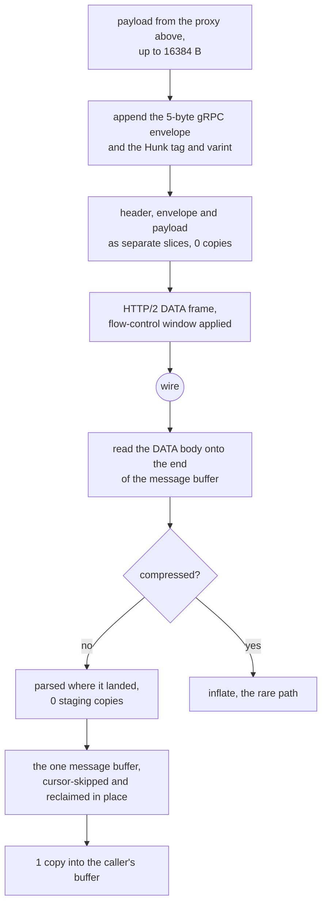

# The gRPC carrier

gRPC is the most expensive carrier in the matrix and it is expensive because of
HTTP/2, not because of anything this tree does. What this tree controls is the
envelope: a 5-byte gRPC length prefix, a compressed-flag byte, and a
protobuf `Hunk` carrying one `bytes Data = 1` field. There is no chunking in the
envelope — one `Hunk` is exactly one buffer that came from above, at most
`HUNK = 16384` bytes.

Write never touches the payload. The 5-byte gRPC envelope and the `Hunk` tag
and varint are assembled in a small prefix buffer, and the caller's payload is
handed to HTTP/2 as a separate frozen slice beside it — a `writev` of frame
header, envelope prefix and payload — so the bytes the proxy passed down are
the bytes the socket carries, and no payload byte is staged into a message
buffer first. Before this shape the payload was copied into a `Hunk`, then into
an envelope, then once more per flow-control window; none of those copies
survive here.

Read has one buffer. A DATA frame's body is read onto the end of the message
buffer, the envelope and the `Hunk` are parsed where they landed, and the payload
is delivered out of that buffer at the offset the parser found — so a byte is
copied twice on the way through: once into user space by the socket read, once
into the caller's buffer. The cursor skips the protobuf fields this lane does not
read without moving them, and the dead prefix is reclaimed before the next body
is appended, which is what keeps one buffer enough. There is no second buffer to
stage into and no backlog to join one to.

## Data path



## Measured

<!-- counts:begin -->
| key | value | checked by |
| --- | --- | --- |
| ops-retired-instructions | UNBLESSED | scripts/count-ops.sh |
| hunk-payload-bytes | 16384 | ferrox-app-grpc::tests::hunks_carry_the_xray_schema_bytes |
| user-space-copies-per-byte-written | 0 | ferrox-app-grpc::tests::the_uplink_hands_the_payload_to_the_writer_by_pointer |
| payload-staging-copies-per-byte-read | 0 | ferrox-app-grpc::tests::a_body_never_lands_in_a_second_buffer |
| message-bytes-moved-per-padded-frame | 11 | ferrox-app-grpc::tests::a_padded_frame_is_the_one_move_the_lane_still_makes |
| message-buffer-reallocations-per-same-sized-frame | 0 | ferrox-app-grpc::tests::the_message_buffer_is_reused_not_reallocated |
<!-- counts:end -->

`payload-staging-copies-per-byte-read` is the reader's own `staged` counter, the
shape `xtls-vision` uses: it counts the bytes this lane moves for itself, which
are the only copies a byte test cannot see. It is driven from an in-memory server
that answers whole frames, over the three shapes a body can arrive in — one
message per frame, two messages in one frame, one message split over frames. The
`11` on the padded row is that gate's own message: a 4-byte payload, its 5-byte
envelope and the `Hunk` tag and length. Neither of those two numbers is a
duration, and `## Time` says why.

## Ops

```bash
./scripts/count-ops.sh report \
  grpc::tests::hunks_carry_the_xray_schema_bytes 'grpc::frame_prefix'
```

`UNBLESSED`, as above.

## Time

**Not measured on this branch.** `tunnel_carries_an_echo_over_loopback` is the
flakiest loopback test in the tree — the roadmap records it failing 23 times in
200 runs with nothing else running, where `read_body` sees EOF after a 9-byte
frame header, which is a torn write or an RST with data queued rather than a
framing error. That is an open row and no duration is quoted from this carrier
until it is closed.

## What we removed

- **The envelope chain.** Xray's `transport/internet/grpc/encoding/hunkconn.go`
  copies the hunk into the caller's buffer on every `Read` (`:68-82`), adopts
  the protobuf's slice only when `cap(h.buf) >= buf.Size` (`:97`) and copies
  otherwise, and allocates a `&Hunk{...}` per write (`:108-118`). The HTTP/2
  side then does its own copy into a 32 KiB `bufWriter`
  (`grpc@v1.84.0/internal/transport/http_util.go:328-353`), and the read side
  allocates a fresh buffer per DATA frame (`:545-556`). sing-box's
  `transport/v2raygrpc/conn.go:37-52` does `copy(b, hunk.Data)` into the
  caller's buffer and stashes the tail in a cache, through grpc-go, so a
  `Hunk{Data: b}` is a protobuf marshal per write.
- **The quadratic drain.** Consuming a pending buffer with `Vec::drain` moves
  every remaining byte for every message, so a burst of N messages in one
  window costs O(N²) bytes moved. One cursor consumes the message buffer, and
  the reclaim that keeps it bounded moves only what is still live, once per
  appended body.
- **The reader's own staging hop.** Until this page's read rows were written the
  way they read now, the path was socket → frame scratch → message buffer →
  backlog → caller: the DATA body was `extend`ed into `msg`, `hunk_decode`
  borrowed it, and the very next statement copied that borrow into a backlog
  because the caller had not asked for it yet. Two of those three moves are now
  gone — the body is read straight onto the end of `msg` and the payload is
  delivered where it lies — which is what `payload-staging-copies-per-byte-read
  0` counts. `user-space-copies-per-byte-read 1` was the row before, and no test
  observed it: `tunnel_carries_an_echo_over_loopback` is a byte test, and a byte
  test cannot see a copy. It is replaced by the counter, not re-blessed.
- **A second allocation per message.** The message buffer is reused across
  writes, and the HTTP/2 layer takes it by `split().freeze()` so the refcount,
  not a copy, is what crosses the boundary. On the read side the same buffer now
  serves every frame, gated by `message-buffer-reallocations-per-same-sized-frame
  0`.
- **The write-side copy that was never there.** `user-space-copies-per-byte-written`
  read `1` and named `hunks_carry_the_xray_schema_bytes`, a byte test that
  cannot see a copy — the bytes are identical whether the payload is staged or
  handed straight to the socket. The carrier already assembles the frame header,
  the envelope prefix and the caller's payload as three separate slices and
  passes them to a `writev`, so the true count at this layer is `0`. The row is
  not re-blessed to a nicer number: it is given the witness it never had —
  `the_uplink_hands_the_payload_to_the_writer_by_pointer` records the base of
  every slice that reaches the frame writer and fails unless one of them *is*
  the caller's buffer, at the payload's full length.

What is **not** removed: HTTP/2's own framing. `T_DATA`, `T_HEADERS` and
`T_SETTINGS`, HPACK and the flow-control window are the cost of the carrier,
and they are the same cost Xray and sing-box pay. The 32 KiB HTTP/2 write buffer
and the 4 MiB session window are named here rather than claimed as ours. Nor is
the copy into the caller's buffer: a `Read` has to fill the caller's `&mut [u8]`,
and that is the `1` the `## Data path` graph ends on. Two moves survive the
staging removal, and both are counted rather than hidden: a padded DATA frame
carries its pad byte and pad tail *inside* the body the parser reads, so the
message between them moves once (`11` bytes for the gate's 4-byte payload), and
a caller that leaves a payload in the buffer while the next frame arrives pays
one reclaim move of what it has not taken — `staged` counts both, which is the
only reason the zero on the first row means anything.

## Pins

| what | where |
| --- | --- |
| `Hunk` encoding, per-write allocation, 32 KiB bufWriter | `upstream/xray-core/transport/internet/grpc/encoding/` |
| `copy(b, hunk.Data)`, per-write protobuf marshal | `upstream/sing-box` → `transport/v2raygrpc/conn.go` |
| one in-place assembly, `advance` instead of `drain` | `upstream/zeronet/crates/zero-transport/src/grpc.rs` |