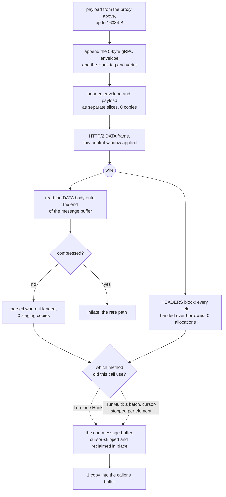

# The gRPC carrier

gRPC is the most expensive carrier in the matrix and it is expensive because of
HTTP/2, not because of anything this tree does. What this tree controls is the
envelope: a 5-byte gRPC length prefix, a compressed-flag byte, and a
protobuf `Hunk` carrying one `bytes Data = 1` field. There is no chunking in the
envelope — one `Hunk` is exactly one buffer that came from above, at most
`HUNK = 16384` bytes.

Write never touches the payload. The 5-byte gRPC envelope and the `Hunk` tag
and varint are assembled in a small prefix buffer, and the caller's payload is
handed to HTTP/2 as a separate frozen slice beside it — a `writev` of frame
header, envelope prefix and payload — so the bytes the proxy passed down are
the bytes the socket carries, and no payload byte is staged into a message
buffer first. Before this shape the payload was copied into a `Hunk`, then into
an envelope, then once more per flow-control window; none of those copies
survive here.

Read has one buffer. A DATA frame's body is read onto the end of the message
buffer, the envelope and the `Hunk` are parsed where they landed, and the payload
is delivered out of that buffer at the offset the parser found — so a byte is
copied twice on the way through: once into user space by the socket read, once
into the caller's buffer. Each body is credited back to the peer as it lands: the
connection and the stream each get their `WINDOW_UPDATE`, and the two frames —
eighteen constant header bytes differing only by stream id and the increment —
leave as one write. The cursor skips the protobuf fields this lane does not
read without moving them, and the dead prefix is reclaimed before the next body
is appended, which is what keeps one buffer enough. There is no second buffer to
stage into and no backlog to join one to.

One listener serves both methods the service defines. `rpc Tun` streams a `Hunk`
— one `bytes Data = 1` — and `rpc TunMulti` streams a `MultiHunk`, whose field 1
is `repeated bytes`, so one message carries the batch a writer's `WriteMultiBuffer`
holds: Xray's server reads the echo through a `readv` reader that doubles up to
eight 8 KiB buffers and puts one element per buffer into a single message
(`transport/internet/grpc/encoding/multiconn.go:115-134`). A served call's method
is the `:path` it used — the configured path, or the same path with `TunMulti` for
the last segment — because the two shapes cannot share a decoder: a `MultiHunk`
read as a `Hunk` hands the caller only the last element of every message, which is
a silent truncation rather than an error. The mode is the caller's choice, not the
listener's, the way Xray's hub registers both handlers from one config
(`transport/internet/grpc/hub.go:124`). In multi mode the cursor stops being
per-message and becomes per-element: an element's own bytes end exactly where the
next element's key begins, so a batch is delivered from the one message buffer in
order, element by element, with no staging move — `8` on the batched row is eight
8 KiB elements arriving from two messages, and its `0` is the same `staged` counter
the single-mode rows use. What is not here: this lane still writes one element per
message, and an outbound dialled with `grpcSettings.multiMode` still asks for
`Tun`, so the batching win is only on the side that receives it.

## Data path



## Measured

<!-- counts:begin -->
| key | value | checked by |
| --- | --- | --- |
| ops-retired-instructions | UNBLESSED | scripts/count-ops.sh |
| hunk-payload-bytes | 16384 | ferrox-app-grpc::tests::hunks_carry_the_xray_schema_bytes |
| user-space-copies-per-byte-written | 0 | ferrox-app-grpc::tests::the_uplink_hands_the_payload_to_the_writer_by_pointer |
| payload-staging-copies-per-byte-read | 0 | ferrox-app-grpc::tests::a_body_never_lands_in_a_second_buffer |
| message-bytes-moved-per-padded-frame | 0 | ferrox-app-grpc::tests::a_padded_frame_opens_a_message_without_moving |
| window-update-writes-per-data-frame | 1 | ferrox-app-grpc::tests::a_credit_grants_both_windows_in_one_write |
| window-update-frames-per-data-frame | 2 | ferrox-app-grpc::tests::a_credit_grants_both_windows_in_one_write |
| message-buffer-reallocations-per-same-sized-frame | 0 | ferrox-app-grpc::tests::the_message_buffer_is_reused_not_reallocated |
| batched-elements-served-per-message | 8 | ferrox-app-grpc::tests::a_batched_downlink_arrives_element_by_element |
| grpc-methods-served-per-listener | 2 | ferrox-app-grpc::tests::one_listener_serves_both_methods |
| header-field-copies-per-head | 0 | ferrox-app-h2::tests::a_plain_field_borrows_the_block |
| table-entry-copies-per-indexed-field | 0 | ferrox-app-h2::tests::an_indexed_field_borrows_the_table |
| decoder-buffer-writes-per-borrowed-field | 0 | ferrox-app-h2::tests::a_borrowed_block_leaves_the_scratch_alone |
| header-field-allocations-per-inserted-field | 2 | ferrox-app-h2::tests::an_indexed_field_borrows_the_table |
<!-- counts:end -->

`payload-staging-copies-per-byte-read` is the reader's own `staged` counter, the
shape `xtls-vision` uses: it counts the bytes this lane moves for itself, which
are the only copies a byte test cannot see. It is driven from an in-memory server
that answers whole frames, over the three shapes a body can arrive in — one
message per frame, two messages in one frame, one message split over frames. The
`0` on the padded row is that gate's own message opened behind a pad byte: the
parser steps over the byte and the frame's length drops the tail, so nothing
moves; a second padded test cuts a pad byte into a message the frame before had
started and shows the counter at `5`, the move that shape still pays. The two
window rows come from one test: the two `WINDOW_UPDATE` frames a credit grants
are the peer's bytes exactly as before, and they now leave in a single write. The
batched row counts the elements one `TunMulti` message hands over before the
caller sees a gap: eight 8 KiB elements in two messages, each element delivered
from where it lay, so the row's `0` is the same `staged` counter and the eight
8 KiB runs are the assertion that no element was dropped or reordered — the
failure `hunk_decode` would give is the last element of each message and nothing
else. The methods row is served from a scripted wire: `Tun` with a `Hunk`,
`TunMulti` with a batch, and a third path that is neither and is refused. The four
header rows are the decoder handing a block's fields over borrowed rather than
built: `header-field-copies-per-head` records the address every field arrives at
and fails unless it lies inside the block the caller passed, at the offset where
that field's own bytes are.
`table-entry-copies-per-indexed-field` requires the pair a dynamic entry is and
the pair the consumer was handed to be the same two addresses — once for the
insert that made the entry, once for the index that names it afterwards.
`decoder-buffer-writes-per-borrowed-field` warms the decoder's Huffman buffers,
then reads a block of one index and one plain literal, and fails if either
buffer's pointer or capacity moves or either ends the block holding bytes. The
inserted row is the `2` those two allocations still cost: a name and a value the
table keeps after the block is gone. None of those numbers is a duration, and
`## Time` says why.

## Ops

```bash
./scripts/count-ops.sh report \
  grpc::tests::the_envelope_and_the_hunk_cost_their_loops_and_nothing_else \
  grpc::tests::the_envelope_and_the_hunk_cost_their_loops_and_nothing_else
```

`UNBLESSED`, as above. The row is a probe, not a fixture test: the two
per-message math steps — a gRPC envelope assembled and a `Hunk` parsed — over
buffers the compiler cannot fold, so the frame is the loops and the methods and
the number is read as the difference between two runs of the same row, never as
the cost of a method alone.

## Time

**Not measured on this branch.** `tunnel_carries_an_echo_over_loopback` is the
flakiest loopback test in the tree — the roadmap records it failing 23 times in
200 runs with nothing else running, where `read_body` sees EOF after a 9-byte
frame header, which is a torn write or an RST with data queued rather than a
framing error. That is an open row and no duration is quoted from this carrier
until it is closed.

## What we removed

- **The envelope chain.** Xray's `transport/internet/grpc/encoding/hunkconn.go`
  copies the hunk into the caller's buffer on every `Read` (`:68-82`), adopts
  the protobuf's slice only when `cap(h.buf) >= buf.Size` (`:97`) and copies
  otherwise, and allocates a `&Hunk{...}` per write (`:108-118`). The HTTP/2
  side then does its own copy into a 32 KiB `bufWriter`
  (`grpc@v1.84.0/internal/transport/http_util.go:328-353`), and the read side
  allocates a fresh buffer per DATA frame (`:545-556`). sing-box's
  `transport/v2raygrpc/conn.go:37-52` does `copy(b, hunk.Data)` into the
  caller's buffer and stashes the tail in a cache, through grpc-go, so a
  `Hunk{Data: b}` is a protobuf marshal per write.
- **The quadratic drain.** Consuming a pending buffer with `Vec::drain` moves
  every remaining byte for every message, so a burst of N messages in one
  window costs O(N²) bytes moved. One cursor consumes the message buffer, and
  the reclaim that keeps it bounded moves only what is still live, once per
  appended body.
- **The reader's own staging hop.** Until this page's read rows were written the
  way they read now, the path was socket → frame scratch → message buffer →
  backlog → caller: the DATA body was `extend`ed into `msg`, `hunk_decode`
  borrowed it, and the very next statement copied that borrow into a backlog
  because the caller had not asked for it yet. Two of those three moves are now
  gone — the body is read straight onto the end of `msg` and the payload is
  delivered where it lies — which is what `payload-staging-copies-per-byte-read
  0` counts. `user-space-copies-per-byte-read 1` was the row before, and no test
  observed it: `tunnel_carries_an_echo_over_loopback` is a byte test, and a byte
  test cannot see a copy. It is replaced by the counter, not re-blessed.
- **A second allocation per message.** The message buffer is reused across
  writes, and the HTTP/2 layer takes it by `split().freeze()` so the refcount,
  not a copy, is what crosses the boundary. On the read side the same buffer now
  serves every frame, gated by `message-buffer-reallocations-per-same-sized-frame
  0`.
- **The write-side copy that was never there.** `user-space-copies-per-byte-written`
  read `1` and named `hunks_carry_the_xray_schema_bytes`, a byte test that
  cannot see a copy — the bytes are identical whether the payload is staged or
  handed straight to the socket. The carrier already assembles the frame header,
  the envelope prefix and the caller's payload as three separate slices and
  passes them to a `writev`, so the true count at this layer is `0`. The row is
  not re-blessed to a nicer number: it is given the witness it never had —
  `the_uplink_hands_the_payload_to_the_writer_by_pointer` records the base of
  every slice that reaches the frame writer and fails unless one of them *is*
  the caller's buffer, at the payload's full length.
- **The second write per credit.** A credit is two `WINDOW_UPDATE` frames, one
  for the connection and one for the stream, and each was built and written on
  its own. Their eighteen header bytes are constant and only the stream id and
  the increment differ, so both come out of one 26-byte template in a single
  write — the same two frames, in the same order, one write syscall fewer per
  DATA frame. What this leaves alone: `xhttp_h2`'s `replenish` credits the same
  pair as two frames over two writes, and its page owns that row.
- **The pair per header field.** `Decoder::decode` used to answer with a
  `Vec<(Vec<u8>, Vec<u8>)>`: a name and a value allocated for every field of
  every block, which the consumer then read from and dropped. gRPC's `headers()`
  built one to look up four fields — `:status`, `:path`, `:method`,
  `content-type` — and xHTTP/H2's `open_stream` built one to take `:method` and
  `:path` out of it and re-emit the rest as head lines. The block now walks
  itself and hands each field to the visitor as it is read: an index gives up the
  table's own entry, a plain literal gives up the block's own run, so a field
  that is only read costs neither an allocation nor a copy. gRPC keeps four
  `Option<bool>` judged as the fields pass, and xHTTP/H2 keeps the one head
  buffer it was going to write anyway — sized for the bytes it carries, and its
  page owns that row. What is not removed: the two allocations an inserted field
  costs, because the dynamic table outlives the block, and one copy into the
  decoder's warm buffer for a Huffman-coded string, which is what the
  `## Measured` capacity gate is written against.

What is **not** removed: HTTP/2's own framing. `T_DATA`, `T_HEADERS` and
`T_SETTINGS`, HPACK and the flow-control window are the cost of the carrier,
and they are the same cost Xray and sing-box pay. The 32 KiB HTTP/2 write buffer
and the 4 MiB session window are named here rather than claimed as ours. Nor is
the copy into the caller's buffer: a `Read` has to fill the caller's `&mut [u8]`,
and that is the `1` the `## Data path` graph ends on. Two moves still survive the
staging removal, and both are counted rather than hidden. A caller that leaves a
payload in the buffer while the next frame arrives pays one reclaim move of what
it has not taken. A pad byte that cuts into a message the frame before had
started still moves what follows it down, because those bytes have to become
contiguous for the parser; a pad byte that opens a message region costs a cursor
step instead, which is the `0` on the padded row. `staged` counts both, which is
the only reason the zeros mean anything. One accounting gap is named rather than
fixed: a credit is the DATA body less its pad byte and pad tail where RFC 7540
§6.9.1 counts the whole body, so a padded frame leaves that many bytes of window
unreturned — conservative, and never taken back.

## Pins

| what | where |
| --- | --- |
| `Hunk` encoding, per-write allocation, 32 KiB bufWriter | `upstream/xray-core/transport/internet/grpc/encoding/` |
| `MultiHunk{repeated bytes}`, `WriteMultiBuffer` batching into one message | `upstream/xray-core/transport/internet/grpc/encoding/multiconn.go` |
| `copy(b, hunk.Data)`, per-write protobuf marshal | `upstream/sing-box` → `transport/v2raygrpc/conn.go` |
| one in-place assembly, `advance` instead of `drain` | `upstream/zeronet/crates/zero-transport/src/grpc.rs` |

## CI scope

What a change here owes, read by `scripts/ci-scope.py`; see [`docs/ci-scope.md`](../ci-scope.md).

<!-- scope:begin -->
- paths: crates/ferrox-app/src/grpc.rs, crates/ferrox-app/src/h2.rs
- symbols: grpc, h2
- scenarios: vless-grpc
- oracle: grpc
- go: ./transport/internet/grpc/...
<!-- scope:end -->
