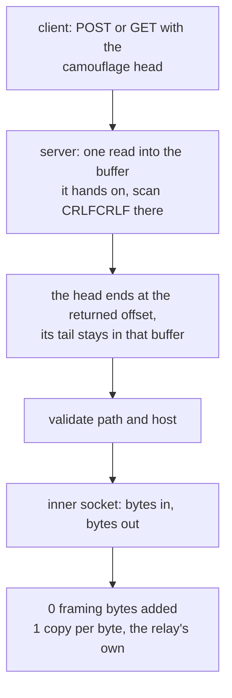

# The HTTP masquerade carrier

VLESS and VMess and Shadowsocks and Trojan all ride this carrier, which is the
cheapest one in the matrix: a request head with `Connection: upgrade` and a
matching response, and then no framing at all. It exists so a connection looks
like HTTP to something in the middle, and it costs one `memcmp`-shaped scan.

`read_http_head_kept` is the interesting part and it is shared with every carrier that has a
handshake head and a place to put the tail. It reads once into the buffer it hands back, finds
`\r\n\r\n` there, and returns the offset where the head ends: one call per round instead of the
`peek`-then-re-read it replaces, and whatever rode in behind the delimiter is already the
reader's own prefix instead of a second trip through the socket.
`httpheader::tests::the_bytes_behind_the_head_reach_the_relay_without_a_syscall` hands the reader
that buffer over a delegate that panics on any `read`, so the row is zero because the reader never
reaches it. The two callers that have nowhere to put a tail — the `http` front,
whose prefix goes to a one-buffer `CONNECT` writer, and the Shadowsocks rung, which waits inside
a `peek` for the first byte of a request packet — keep `read_http_head` and pay its `peek` plus
its re-read.

The record halves, which have no `peek` to lose, took the same shape when `read_exact_head`
became that loop: `HeadReader { prefix, at }` is handed the read's own buffer with the cursor
past the head, so the octets behind the delimiter never leave the allocation they were read
into (`head-tail-allocations 0`, witnessed by
`httpheader::tests::the_record_head_hands_over_the_buffer_it_filled`, which fails the base
arithmetic if the tail is `split_off` into a buffer of its own).

## Data path



## Measured

<!-- counts:begin -->
| key | value | checked by |
| --- | --- | --- |
| ops-retired-instructions | UNBLESSED | scripts/count-ops.sh |
| framing-bytes-added | 0 | ferrox-app-httpheader::tests::header_carries_an_echo_over_loopback |
| head-tail-read-syscalls | 0 | ferrox-app-httpheader::tests::the_bytes_behind_the_head_reach_the_relay_without_a_syscall |
| head-tail-allocations | 0 | ferrox-app-httpheader::tests::the_record_head_hands_over_the_buffer_it_filled |
| user-space-copies-per-byte-relayed | 1 | ferrox-app-proxy::tests::carried_streams_round_trip_behind_the_http_camouflage |
<!-- counts:end -->

## Ops

```bash
./scripts/count-ops.sh report \
  httpheader::tests::header_carries_an_echo_over_loopback 'proxy::read_http_head'
```

`UNBLESSED`, as above.

## Time

**Not measured on this branch.** The HTTP camouflage scenarios run in
`benchmark-matrix.yml` and `parity.yml`; no artefact from this branch has been
read.

## What we removed

Nothing on the data path. Two things are named because they are easy to get
wrong rather than because they were fixed:

- The 8 KiB head limit (`HEAD_LIMIT = 8192`) is a *limit*, not a buffer. A
  carrier that reads its head into a 64 KiB window to be safe pays 64 KiB of
  allocation per handshake to reject the same request one round later.
  `header_rejects_a_wrong_path` and the shared `read_http_head` limit check are
  the gate.
- `read_http_head`'s `peek`-then-`read` is two syscalls per round and no
  allocation: the tail is `read_exact`'d straight into the head's own spare
  capacity, so the bytes are never staged in a second buffer and zero-filled
  before they are overwritten. `bytes_pipelined_behind_a_head_stay_in_the_kernel`
  is the gate that the second pass leaves the pipelined tail untouched.
- A timed-out read is retried until the head's own budget runs out
  (`proxy::budgets::head_arrival()`, `HEAD_DEADLINE`'s twenty seconds unless the
  config's `budgets` object restated it, the header budget the rest of this
  binary already gives a handshake), and the socket is armed with `RELAY_POLL`
  for the rounds if the caller armed nothing — so a peer that connects and stays
  quiet is a refused handshake, not a thread parked in `peek` or a loop that
  wakes once per poll forever. The price is two `setsockopt` per handshake (arm,
  restore); the socket is handed back with the timeout it came with, which the
  gate asserts. `a_quiet_peer_ends_both_head_readers_at_their_budget` is the gate.

## Pins

| what | where |
| --- | --- |
| head read, `BufferedReader`, `http.ReadRequest` | `upstream/xray-core/transport/internet/headers/` |
| head read, pooled buffer | `upstream/sing-box` → `transport/v2rayhttp/` |
| `scanned` head scan, no over-read | `upstream/zeronet/crates/zero-transport/src/httpupgrade.rs` |

## CI scope

What a change here owes, read by `scripts/ci-scope.py`; see [`docs/ci-scope.md`](../ci-scope.md).

<!-- scope:begin -->
- paths: crates/ferrox-app/src/httpheader.rs
- symbols: httpheader
- go: ./transport/internet/headers/...
<!-- scope:end -->
