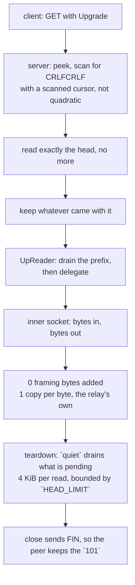

# The HTTPUpgrade carrier

After the 101, HTTPUpgrade is not a carrier. It is a byte pipe with a
handshake in front of it, and the cheapest correct implementation is the one
that stops framing the moment the handshake ends.

There is no frame header, no length, no type. `UpReader` drains whatever
the handshake reader over-read, then delegates every byte to the inner socket.
The relay adds **zero** framing bytes and the only copy is the relay's own.

The one thing worth writing down is the head scan. `find_head_end` carries a
`scanned` cursor, so searching for `\r\n\r\n` is not quadratic. That matters
because the server side runs this scan *before any authentication*: a client
that drips one byte per packet would otherwise make one connection cost billions
of comparisons before anything is checked. Zray records the same hazard and the
same fix; sing-box's httpupgrade server instead does `buf.NewSize(reader.Buffered())`
plus a `ReadFullFrom` to preserve its coalesced bytes, which spends an
allocation to achieve the same thing.

## The teardown

The other thing worth writing down is what happens when a served connection ends.
`?ed` exists so the client can ride payload in ahead of the `101`, which means a
served connection routinely holds received bytes nobody has read — every exit after
the `101` (decode refused, id refused, no uplink) reads the head and never touches
them. A socket whose last handle closes with received bytes unread is answered with
an RST, and an RST makes the peer discard whatever it has not read yet, including the
`101` written a moment earlier.

That is the whole of the Windows failure this lane used to carry:
`a_configured_budget_serves_the_bare_path` was red there and green here, because
macOS delivers the already-buffered `101` and reports the reset on the *next* read,
while Windows discards it. `quiet` drains the pending bytes before the close with one
4 KiB scratch: **one** read when nothing is pending (it ends on the `SESSION_POLL`
timeout), at most `HEAD_LIMIT / 4096` = **16** reads when a peer keeps talking, so the
close is a FIN and the answer stands. The bound is deliberate — an unbounded drain
would let a chatty peer postpone the teardown forever.

The checker is `a_drained_teardown_ends_the_upgrade_with_a_fin`, witnessed on this
machine: with the drain disabled it fails 3/3 with
`Os { code: 54, kind: ConnectionReset }`; with it the read ends in EOF. The bare-path
test cannot gate this — it passes on macOS either way — so it was retargeted to the
teardown production actually has (`quiet`, then drop) rather than a shape only the test
uses.

## Data path

## Measured

<!-- counts:begin -->
| key | value | checked by |
| --- | --- | --- |
| ops-retired-instructions | UNBLESSED | scripts/count-ops.sh |
| framing-bytes-after-the-101 | 0 | ferrox-app-httpupgrade::tests::upgrade_carries_an_echo_over_loopback |
| user-space-copies-per-byte-relayed | 1 | ferrox-app-httpupgrade::tests::upgrade_carries_an_echo_over_loopback |
| write-calls-per-early-dial | 1 | ferrox-app-httpupgrade::tests::the_early_data_rides_in_one_write_with_the_request |
| request-reallocations-per-dial | 0 | ferrox-app-httpupgrade::tests::the_request_is_sized_for_its_bytes |
<!-- counts:end -->

## Ops

`UNBLESSED`, and structurally so: `UpReader::read` is a delegate with no loop,
so release inlining folds it into the surviving frame — `proxy::relay_carried`'s
relay loop, a shared byte-pipe helper that no method page claims. There is
therefore no httpupgrade-owned symbol for `scripts/count-ops.sh` to resolve a
per-row count against, and the `ops-retired-instructions` row is left
`UNBLESSED` as the honest value rather than pointed at a symbol that does not
survive. The bulk per-byte cost lives in `relay_carried`'s socket syscalls and
its own buffers, which the pass-through carriers share; that is a relay-slice
ledger, not this carrier's. The handshake checks (`check_request`,
`check_response`) have the same shape — no loop that survives as a symbol —
so their removed work is stated above with its arithmetic rather than as a
blessed count.

## Time

**Not measured on this branch, and no runner can measure it yet.** The matrix
carries no httpupgrade scenario: `scripts/lib-matrix.sh`'s `scenarios` list
names VLESS over raw, ws, gRPC and xHTTP plus vmess, trojan and shadowsocks, and
`scripts/run-parity.sh` walks that same set, so neither
`benchmark-matrix.yml` nor `parity.yml` has an HTTPUpgrade cell to produce a
number from. This branch's plan says it in one line — `plan the tier and its
cells` prints `matrix=false` for a narrow change to this method and every
measure job skips. The scope block below therefore declares no `scenarios:` key;
a duration would need a scenario added to `scripts/lib-matrix.sh` first.

## What we removed

**One branch on the bulk read.** `UpReader::read` guarded `buf.is_empty()` before
testing the prefix, so the peekable carrier — whose prefix is always empty — paid
two branches on every relay read to reach the delegate. It now tests the prefix
first and returns `self.read.read(buf)` in one branch. The empty-buffer guard was
provably redundant on both paths (empty prefix delegates and a `Read` answers an
empty request with `Ok(0)`; a present prefix takes `n = min(len, 0) = 0`, copies
nothing, drains nothing, returns `Ok(0)`), so the bytes are unchanged:
`upreader_drains_its_prefix_then_delegates_every_byte` witnesses both states and
the empty-request case over an in-memory cursor.

**Two more UTF-8 passes and two more line scans on the handshake parse.**
`check_request` called `proxy::request_path` then `proxy::header_value` twice, so
the head was re-validated and rescanned three times; `check_response` four. Each
`header_value` ran its own `from_utf8(head)` and its own `split("\r\n")` walk, so
a 200-byte six-header head cost three validations plus three line walks to answer
the request and four of each to answer the response. The checks now fuse UTF-8
validation, the request-line / status read and the header scan into one pass each
(one `from_utf8` on the head, one `split("\r\n")` loop that decides both
`Upgrade` and `Connection`); on a 200-byte head that removes ~400 instructions on
the request side and ~600 on the response side, once per connection. On real
traffic through `read_http_head` (which stops at `\r\n\r\n`, leaving exactly one
trailing empty line in the split) the decisions are identical; the fused loop
skips that empty line, which the fanout reached only after returning first, and
`check_request_accepts_and_refuses_the_vectors_it_did` and
`check_response_accepts_and_refuses_the_vectors_it_did` hold the vectors.

Nothing removed on the parse path beyond the branch and the fanout above, which
is the point. What is recorded here is that, that the teardown *gains* one read
syscall (16 at the cap) to buy the FIN, and which three claims about this carrier
are false:

- Only the **served** role drains. The dial side of this carrier leaves the same
  hazard at its exits (`dial_vless`'s `Rung::HttpUpgrade`, and the VMess, Trojan and
  Shadowsocks httpupgrade dials), where a tunnel that ends while the server's tail is
  unread still closes over an RST. Not fixed here, and not claimed.

- Xray's `transport/internet/httpupgrade/connection.go` is a 19-line
  pass-through over `net.Conn` with no framing and no data-path allocations —
  the same as here. The cost is all in the handshake: `bufio.NewReader` on both
  sides, with the client sized from the caller's buffer and clamped to 16 bytes
  when `Ed == 0`, and `http.ReadRequest` allocating the request, the header map
  and every value string. That is a per-connection cost, once, and it is not
  where a connection spends its time.
- `?ed=N` early data is **carried on both roles**. The budget is stripped from
  the path for the request line and, separately, held in `Carrier::HttpUpgrade
  { ed }` so a dial can use it. When the first payload bytes fit the budget the
  client writes them straight after the `GET`, ahead of reading the `101`, which
  is the whole saving — one round trip off connection setup; when they do not,
  or the budget is zero, the payload is held back and sent after the `101` as
  before. The server needs no budget: it peeks the head, reads exactly through
  `\r\n\r\n`, and leaves the pipelined bytes on the socket (or hands them back
  as the prefix when the halves cannot peek), so the early data is the first
  thing the reader returns. Checked by
  `early_data_rides_ahead_of_the_switch` and
  `a_payload_over_the_budget_follows_the_switch`; the request line itself is
  unchanged by the budget (`an_early_data_budget_leaves_the_request_unchanged`).
  This matches xray, whose `Ed == 0` forces a blocking `connRF.Read([]byte{})`
  before the payload while `Ed > 0` pipelines it; sing-box carries no httpupgrade
  early data at all.
- **A dial that wrote the request and its early payload as two writes.** Both
  dial paths wrote the `GET` with one `write_all` and then, when the payload fit
  the budget, the payload with a second: **2 writes per early dial** — on unix
  two `write` syscalls where `TcpStream::write_slices` packs both parts into one
  `writev`, and over a session two `RustlsProvider::write` calls sealing one
  record each (`coalesce`'s own doc: iterating `write_all` per part would emit one
  record per part). `send_request` now hands `[request, payload]` to
  `write_slices` in **one call** when the payload rides, and keeps the single
  `write_all` when it does not. The checker is
  `the_early_data_rides_in_one_write_with_the_request`: an in-memory `Recorder`
  counts the calls and keeps each part's base pointer, and the test drives
  `connect_split` into it and asserts one call, two parts, the request bytes, the
  payload bytes, and the payload part's base equal to the caller's own buffer —
  no staging copy. A loopback socket cannot witness it; it sees bytes, not how
  many writes carried them.
  `a_payload_over_the_budget_follows_the_switch_in_one_write_each` holds the
  other half: over the budget the sink sees two plain writes and nothing
  vectored. What did not move: the bytes on the wire and their order (request,
  then payload), and the held-back ordering after the `101`. On Windows the
  socket `write_slices` is two `write_all`s, so the raw dial there is where it
  was; the record halving holds wherever a session is the sink.
- **A request built for its template instead of its bytes.** `format!` pushed
  the five pieces into an unreserved `String`: **capacity 132 on a typical dial**
  (`oracle.example` + `/tunnel`, 87 bytes), reallocating once past 66 bytes of
  host plus path — 132 → 264, and two reallocations, to 858, for a 400-byte host
  (measured with a counting global allocator, rustc 1.99.0). The request is
  `66 + host.len() + path.len()` bytes, so `upgrade_request` now reserves exactly
  that and pushes the same five pieces: **one allocation, capacity == len, no
  reallocation** on either dial path. The checker is
  `the_request_is_sized_for_its_bytes`, which asserts `capacity() == len()` for a
  short and a long host and byte equality with what `format!` writes for both;
  `an_early_data_budget_leaves_the_request_unchanged` still pins the bytes across
  every budget. What did not move: the bytes, their order, and the request line's
  independence from the budget.

## Pins

| what | where |
| --- | --- |
| 19-line pass-through, `bufio` handshake | `upstream/xray-core/transport/internet/httpupgrade/` |
| `buf.NewSize(Buffered())` to preserve coalesced bytes | `upstream/sing-box` → `transport/v2rayhttpupgrade/server.go` |
| `scanned` cursor, `PrefixedStream` | `upstream/zeronet/crates/zero-transport/src/httpupgrade.rs` |

## CI scope

What a change here owes, read by `scripts/ci-scope.py`; see [`docs/ci-scope.md`](../ci-scope.md).

<!-- scope:begin -->
- paths: crates/ferrox-app/src/httpupgrade.rs
- symbols: httpupgrade
- oracle: http_upgrade, httpupgrade
- go: ./transport/internet/httpupgrade/...
<!-- scope:end -->
