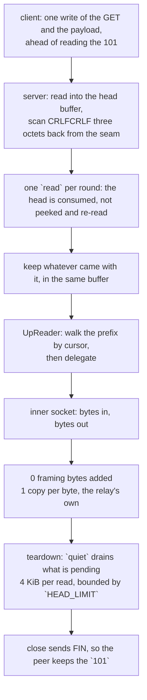

# The HTTPUpgrade carrier

After the 101, HTTPUpgrade is not a carrier. It is a byte pipe with a
handshake in front of it, and the cheapest correct implementation is the one
that stops framing the moment the handshake ends.

There is no frame header, no length, no type. `UpReader` walks whatever
the handshake reader over-read, then delegates every byte to the inner socket.
The relay adds **zero** framing bytes and the only copy on the data path is the
relay's own; what the handshake stages, and why, is under *What we removed*.

The one thing worth writing down is the head scan. It is not quadratic, and the
reason is where the work lands per round: the fd read hands `proxy::find_double_crlf`
the bytes it just consumed, starting three octets before them so a delimiter that
straddles the seam is still proved, and one SWAR pass tests eight bytes per word and
visits only its `\n` lanes. The accumulated head is never re-scanned, so the cost is
linear in the bytes read. `proxy::find_across` carries the same three-octet seam window
for the `peek` reader that the Shadowsocks rung and the `http` front still use. Zeronet
carries the same cursor on its side (`find_head_end`'s `scanned`). That matters because
the server side runs this scan *before any authentication*: a client that drips one byte
per packet would otherwise make one connection cost billions of comparisons before
anything is checked. Zray records the same hazard and the
same fix; sing-box's httpupgrade server instead does `buf.NewSize(reader.Buffered())`
plus a `ReadFullFrom` to preserve its coalesced bytes, which spends an
allocation to achieve the same thing.

## The teardown

The other thing worth writing down is what happens when a served connection ends.
`?ed` exists so the client can ride payload in ahead of the `101`, which means a
served connection routinely holds received bytes nobody has read — every exit after
the `101` (decode refused, id refused, no uplink) reads the head and never touches
them. A socket whose last handle closes with received bytes unread is answered with
an RST, and an RST makes the peer discard whatever it has not read yet, including the
`101` written a moment earlier.

That is the whole of the Windows failure this lane used to carry:
`a_configured_budget_serves_the_bare_path` was red there and green here, because
macOS delivers the already-buffered `101` and reports the reset on the *next* read,
while Windows discards it. `quiet` drains the pending bytes before the close with one
4 KiB scratch: **one** read when nothing is pending (it ends on the `SESSION_POLL`
timeout), at most `HEAD_LIMIT / 4096` = **16** reads when a peer keeps talking, so the
close is a FIN and the answer stands. The bound is deliberate — an unbounded drain
would let a chatty peer postpone the teardown forever.

The checker is `a_drained_teardown_ends_the_upgrade_with_a_fin`, witnessed on this
machine: with the drain disabled it fails 3/3 with
`Os { code: 54, kind: ConnectionReset }`; with it the read ends in EOF. The bare-path
test cannot gate this — it passes on macOS either way — so it was retargeted to the
teardown production actually has (`quiet`, then drop) rather than a shape only the test
uses.

## Data path

## Measured

<!-- counts:begin -->
| key | value | checked by |
| --- | --- | --- |
| ops-retired-instructions | UNBLESSED | scripts/count-ops.sh |
| framing-bytes-after-the-101 | 0 | ferrox-app-httpupgrade::tests::upgrade_carries_an_echo_over_loopback |
| user-space-copies-per-byte-relayed | 1 | ferrox-app-httpupgrade::tests::upgrade_carries_an_echo_over_loopback |
| write-calls-per-early-dial | 1 | ferrox-app-httpupgrade::tests::the_early_data_rides_in_one_write_with_the_request |
| request-reallocations-per-dial | 0 | ferrox-app-httpupgrade::tests::the_request_is_sized_for_its_bytes |
| round-trips-per-early-dial | 0 | ferrox-app-httpupgrade::tests::an_over_budget_payload_rides_ahead_of_a_lazy_answer |
| round-trips-per-shadowsocks-dial | 0 | ferrox-app-proxy::tests::socks_dials_ss_over_httpupgrade_with_early_data_to_echo |
| head-reads-per-window | 1 | ferrox-app-proxy::tests::a_kept_head_costs_one_read_per_window_and_takes_its_tail |
| inner-reads-per-pipelined-prefix | 0 | ferrox-app-httpupgrade::tests::the_pipelined_prefix_reaches_the_reader_without_a_socket_read |
| prefix-bytes-held-after-walk | 0 | ferrox-app-httpupgrade::tests::the_pipelined_prefix_reaches_the_reader_without_a_socket_read |
<!-- counts:end -->

`round-trips-per-early-dial` is witnessed on a socket against a server that answers
only *after* it has read the payload: a dial that held the payload back would sit in
the head read until `budgets::head_arrival()` and return no upgrade, which is exactly
what it does under the length rule (red at 20.03 s). An echo test cannot see the
difference — a held-back payload arrives eventually either way — and
`the_early_data_rides_in_one_write_with_the_request` cannot either, because it counts
writes, not the round trip between them.

`round-trips-per-shadowsocks-dial` is the same witness moved up to the dial: the
Shadowsocks request packet is produced by the protocol, not by the carrier, so its
ladder rung used to hold it back whatever the config asked for. The server is
`serve_httpupgrade_answering_after_the_request`, which reads the head, blocks in a
`peek` until the first byte of the request packet is there, and only then writes the
`101`; with `attempt.ed` put back to `0` the test is red at **20.08 s**, and green in
0.03 s as it stands.

`head-reads-per-window` is counted on `Counted` over an in-memory stream, because a
loopback socket sees bytes and not the calls that carried them: the same wire through
the `peek` reader costs two calls per window (`peek` to prove, `read_exact` to take),
and one here. `inner-reads-per-pipelined-prefix` is the reason the read is worth
making — the payload that rode in with the head reaches its caller from the buffer it
already landed in, so the reader does not touch the handle behind it — and
`prefix-bytes-held-after-walk` is the same test's `capacity()` assertion, that the
buffer carrying the head and the tail is gone once the walk passes it. What no count
here can see is the arithmetic on a head of `H` octets with `P` octets riding behind
it and both arriving in one round: `peek` copied `H + P` into a stack probe and `H`
again into the head buffer, then the payload was read once more, so the first bulk read
cost **2H+2P** byte-copies and **three** read-family calls. The kept read costs
**H+2P** copies and **one** call, and the `P` bytes of that read cost the socket
nothing.

## Ops

`UNBLESSED`, and structurally so: `UpReader::read` is a delegate with no loop,
so release inlining folds it into the surviving frame — `proxy::relay_carried`'s
relay loop, a shared byte-pipe helper that no method page claims. There is
therefore no httpupgrade-owned symbol for `scripts/count-ops.sh` to resolve a
per-row count against, and the `ops-retired-instructions` row is left
`UNBLESSED` as the honest value rather than pointed at a symbol that does not
survive. The bulk per-byte cost lives in `relay_carried`'s socket syscalls and
its own buffers, which the pass-through carriers share; that is a relay-slice
ledger, not this carrier's. The handshake checks (`check_request`,
`check_response`) have the same shape — no loop that survives as a symbol —
so their removed work is stated above with its arithmetic rather than as a
blessed count.

## Time

**Not measured on this branch, and no runner can measure it yet.** The matrix
carries no httpupgrade scenario: `scripts/lib-matrix.sh`'s `scenarios` list
names VLESS over raw, ws, gRPC and xHTTP plus vmess, trojan and shadowsocks, and
`scripts/run-parity.sh` walks that same set, so neither
`benchmark-matrix.yml` nor `parity.yml` has an HTTPUpgrade cell to produce a
number from. This branch's plan says it in one line — `plan the tier and its
cells` prints `matrix=false` for a narrow change to this method and every
measure job skips. The scope block below therefore declares no `scenarios:` key;
a duration would need a scenario added to `scripts/lib-matrix.sh` first.

## What we removed

**The `peek` that only proved what the next call would take.** The fd handshake read
`peek`ed into a 512-byte stack probe, scanned it for `\r\n\r\n`, then `read_exact`ed the
same octets into the head buffer — because a `peek` cannot consume, and the bytes behind
the delimiter had to stay in the socket for the reader. So the head crossed user space
**twice** and each round of a dribbled head cost **two** read-family calls.
`proxy::read_http_head_kept` reads straight into the buffer it hands back, finds the
delimiter there, and returns the buffer with the offset where the head ends: the head
crosses **once**, a round costs **one** call, and the octets behind the delimiter are
already in the caller's hands as the prefix — which is what makes the `?ed` payload
arrive without a second trip to the socket. Counted on `Counted` over an in-memory
stream (`head-reads-per-window 1`), and the straddling delimiter is held by
`a_kept_head_straddling_a_round_is_proved_by_two_reads` and
`a_head_that_straddles_a_read_round_keeps_its_riding_payload`, since the three-octet
look-back is the one thing a one-shot read cannot show. Zeronet keeps the same shape
(`PrefixedStream`); sing-box pays an allocation for it (`buf.NewSize(Buffered())` plus
`ReadFullFrom`).

What this does *not* claim, and the reason `read_http_head` is still in the tree: two
callers have nowhere to put the tail. The `http` front hands its prefix to a `CONNECT`
writer that takes one buffer, and the Shadowsocks rung's server deliberately `peek`s and
waits in it for the first byte of the request packet, so consuming the segment would
take the byte it is watching for. Both keep the `peek` reader, as do `ws`, `xhttp` and
`httpheader` until their carriers take the kept reader too — this is the shared-head-
reader item, cut here at the one carrier whose prefix slot already exists. Also
unchanged: the three socket options that arm and restore the poll quantum around a head
read (a `dup`ed handle shares `SO_RCVTIMEO`, so leaving it armed would park the other
readers on the same socket), and the request `String`, which is one allocation sized to
its bytes.

**A memmove per byte the handshake over-read.** `UpReader` held the pipelined bytes in
a `Vec` and served them with `prefix.drain(..n)`, which moves every byte *behind* the
window each call to keep the prefix flush against the front. The worst input is the one
the carrier is named for: `P` octets of early data read a byte at a time by a
length-prefixed caller cost `P + (P-1) + … + 1` = **P(P+1)/2** byte moves (**131 328**
for the 512-byte round the head read can hand over) and left the tail's bytes at a new
address each time. The reader now carries a cursor, so the walk is **0** memmove bytes
and `P` copies into the caller's buffer, and the buffer is dropped by the read that
finishes the walk: `prefix-bytes-held-after-walk 0`. No count sees the old memmove — a
`drain` and a cursor return the same bytes, which is exactly why the gate is the walk's
`capacity()` and the in-memory `Counted` reader rather than a byte test.
`upreader_walks_its_prefix_then_delegates_every_byte` holds the byte sequence, the
peekable carrier's one-branch delegate and the empty-request case.

**One branch on the bulk read.** `UpReader::read` guarded `buf.is_empty()` before
testing the prefix, so the peekable carrier — whose prefix is always empty — paid
two branches on every relay read to reach the delegate. It now tests the prefix
first and returns `self.read.read(buf)` in one branch. The empty-buffer guard was
provably redundant on both paths (empty prefix delegates and a `Read` answers an
empty request with `Ok(0)`; a present prefix takes `n = min(len, 0) = 0`, copies
nothing, advances the cursor by nothing, returns `Ok(0)`), so the bytes are
unchanged.

**Two more UTF-8 passes and two more line scans on the handshake parse.**
`check_request` called `proxy::request_path` then `proxy::header_value` twice, so
the head was re-validated and rescanned three times; `check_response` four. Each
`header_value` ran its own `from_utf8(head)` and its own `split("\r\n")` walk, so
a 200-byte six-header head cost three validations plus three line walks to answer
the request and four of each to answer the response. The checks now fuse UTF-8
validation, the request-line / status read and the header scan into one pass each
(one `from_utf8` on the head, one `split("\r\n")` loop that decides both
`Upgrade` and `Connection`); on a 200-byte head that removes ~400 instructions on
the request side and ~600 on the response side, once per connection. On real
traffic through `read_http_head` (which stops at `\r\n\r\n`, leaving exactly one
trailing empty line in the split) the decisions are identical; the fused loop
skips that empty line, which the fanout reached only after returning first, and
`check_request_accepts_and_refuses_the_vectors_it_did` and
`check_response_accepts_and_refuses_the_vectors_it_did` hold the vectors.

**The round trip an over-budget payload used to pay.** The dial decided
`!first.is_empty() && first.len() as u64 <= u64::from(budget)`, so a payload larger
than `?ed=N` was held back until after the `101` and paid a second round trip. `Ed`
is a flag in the pinned reference, never a length: xray reads `if
transportConfiguration.Ed == 0` and otherwise returns the connection *without reading
the answer at all*, so its caller's first write goes ahead whatever its size. (The
websocket transport is where a length matters, because the payload has to fit inside a
header value.) The rule is now `rides(budget, first)` = `budget != 0 &&
!first.is_empty()`, which removes a length compare, a widening cast and a saturating
path, and pipelines strictly more than before; both dials call it, so the rule cannot
drift between the raw and split lanes. Checked by
`an_over_budget_payload_rides_ahead_of_a_lazy_answer`, red at 20.03 s with the length
compare restored.

**The round trip a Shadowsocks dial paid whatever the config asked for.**
`dial_ss_httpupgrade` handed the carrier `0, &[]`, so the budget held in
`Carrier::HttpUpgrade { ed }` never reached it: the request packet is produced *after*
the answer, because `client_send_handshake` seals it straight onto the writer it is
given. An AES-256-GCM dial to an IPv4 target therefore wrote the `GET`, waited a round
trip for the `101`, then wrote the salt (32 B) and the sealed header (`18 + 7 + 16` =
41 B) — **three** `write` syscalls and one round trip that the vless, trojan and vmess
dials on this carrier did not pay. The packet needs no server input, so it seals into
a buffer before the dial and reaches the same `first` seam vmess already uses:
`write_slices([GET, packet])` — **one** write — when the budget is non-zero, and **two**
when it is zero (the GET, then the packet whole). Checked by
`socks_dials_ss_over_httpupgrade_with_early_data_to_echo`, red at 20.08 s when the dial
is put back to `0, &[]`; the bytes and their order are unchanged, which a real server
witnesses in `carried_transports_relay_an_echo`, where the httpupgrade leg rides the
packet at `ed=64` and holds it at `ed=0` and both open the echoed chunk. The rung seals
twice, once per family, so a `2022-blake3-aes-256-gcm` key reaches the same dial in
`socks_dials_ss2022_over_httpupgrade_with_early_data_to_echo`: one branch's witness does
not cover the other's code.

What this *adds*, and it is the reason the row is a round trip and not a count: one
heap buffer per dial and one copy of the packet into it (73 bytes for that IPv4 dial,
325 for the widest domain target), which the raw rung never pays. Neither `shadowsocks.rs`
nor `shadowsocks2022.rs` changed — the buffer is filled through the `&mut dyn Write`
seal the handshake already had. The write half of the claim is the carrier's blessed
`write-calls-per-early-dial 1`, which counts `write_slices` calls for any `first`; the
ladder test runs on a loopback socket, which sees bytes and not writes.

**22 bytes of status literal, and a reason phrase two of the three references accept.**
`check_response` compared the whole line against `"HTTP/1.1 101 Switching Protocols"`
(35 bytes), so it refused a server answering `101 UPGRADED`, any other text, or no
reason phrase at all — a 101 carries no reason phrase under RFC 9112, and Go's
`http.ReadResponse` (xray) and sing-box's `response.StatusCode != 101` both read only
the digits. It now takes a 12-byte prefix plus one boundary byte: 13 bytes compared
instead of 35, and the accept set is the two Go references'. Zeronet's client
(`crates/zero-transport/src/httpupgrade.rs:159`) compares the full literal as this check did, so this tree is
stricter than it and looser than zeronet only in the free-text field a conforming
server never sends. The check gains one boundary branch that keeps `HTTP/1.1 1011`
and `HTTP/1.1 101x` out and lets a bare `HTTP/1.1 101` in; those three vectors plus
the free-text phrase are in `check_response_accepts_and_refuses_the_vectors_it_did`,
and removing the branch is red on the first of them.

Nothing removed on the parse path beyond the branch, the fanout and the status literal
above, which is the point. What is recorded here is that the teardown *gains* one read
syscall (16 at the cap) to buy the FIN, that the fd handshake's read went from two calls
per round to one but keeps the `set_read_timeout` arm and restore that bounds it — **two**
socket options a budget cannot replace, since a `dup`ed handle shares the timeout — and
that the kept reader has not yet reached `ws`, `xhttp` and `httpheader`, whose readers
already hold a prefix slot, nor the `http` front and the Shadowsocks rung, which have
nowhere to put the tail — and which five claims about this carrier are false:

- Only the **served** role drains. The dial side of this carrier leaves the same
  hazard at its exits (`dial_vless`'s `Rung::HttpUpgrade`, and the VMess, Trojan and
  Shadowsocks httpupgrade dials), where a tunnel that ends while the server's tail is
  unread still closes over an RST. Not fixed here, and not claimed.

- Xray's `transport/internet/httpupgrade/connection.go` is a 19-line
  pass-through over `net.Conn` with no framing and no data-path allocations —
  the same as here. The cost is all in the handshake: `bufio.NewReader` on both
  sides, with the client sized from the caller's buffer and clamped to 16 bytes
  when `Ed == 0`, and `http.ReadRequest` allocating the request, the header map
  and every value string. That is a per-connection cost, once, and it is not
  where a connection spends its time.
- `?ed=N` early data is **carried on both roles, and the budget is a flag**. The
  value is stripped from the path for the request line and, separately, held in
  `Carrier::HttpUpgrade { ed }` so a dial can use it. Non-zero means the client's
  first payload goes out in the same write as the `GET`, ahead of reading the `101`,
  which is the whole saving — one round trip off connection setup, at any payload
  size. Zero means it is held back and sent after the `101`. Every protocol's dial on
  this carrier reads it: vless, trojan and vmess passed `attempt.ed` and their own
  first payload, and the Shadowsocks dial passed `0, &[]` until this page's entry above
  sealed its request packet into the same seam. The server needs no budget: the fd read
  consumes through `\r\n\r\n` and keeps whatever came with it as the caller's prefix, and
  a stream that cannot consume (the split halves, the `peek`ing front and rung) hands the
  tail back instead of leaving it, so the early data is the first
  thing the reader returns. Checked by
  `early_data_rides_ahead_of_the_switch`,
  `an_over_budget_payload_rides_ahead_of_a_lazy_answer` and
  `ed_zero_holds_the_payload_behind_in_one_write_each`; the request line itself is
  unchanged by the budget (`an_early_data_budget_leaves_the_request_unchanged`).
  That is xray's rule read literally — `Ed == 0` blocks on `connRF.Read([]byte{})`
  before the payload and any other value returns without reading it; sing-box carries
  no httpupgrade early data at all, and xray-rust's port tests `ed > 0` to *defer*
  the response read, which is the saving inverted.
- **A dial that wrote the request and its early payload as two writes.** Both
  dial paths wrote the `GET` with one `write_all` and then, when the payload rode
  ahead, the payload with a second: **2 writes per early dial** — on unix
  two `write` syscalls where `TcpStream::write_slices` packs both parts into one
  `writev`, and over a session two `RustlsProvider::write` calls sealing one
  record each (`coalesce`'s own doc: iterating `write_all` per part would emit one
  record per part). `send_request` now hands `[request, payload]` to
  `write_slices` in **one call** when the payload rides, and keeps the single
  `write_all` when it does not. The checker is
  `the_early_data_rides_in_one_write_with_the_request`: an in-memory `Recorder`
  counts the calls and keeps each part's base pointer, and the test drives
  `connect_split` into it and asserts one call, two parts, the request bytes, the
  payload bytes, and the payload part's base equal to the caller's own buffer —
  no staging copy. A loopback socket cannot witness it; it sees bytes, not how
  many writes carried them.
  `ed_zero_holds_the_payload_behind_in_one_write_each` holds the
  other half: at `ed=0` the sink sees two plain writes and nothing
  vectored. What did not move: the bytes on the wire and their order (request,
  then payload), and the held-back ordering after the `101`. On Windows the
  socket `write_slices` is two `write_all`s, so the raw dial there is where it
  was; the record halving holds wherever a session is the sink.
- **A request built for its template instead of its bytes.** `format!` pushed
  the five pieces into an unreserved `String`: **capacity 132 on a typical dial**
  (`oracle.example` + `/tunnel`, 87 bytes), reallocating once past 66 bytes of
  host plus path — 132 → 264, and two reallocations, to 858, for a 400-byte host
  (measured with a counting global allocator, rustc 1.99.0). The request is
  `66 + host.len() + path.len()` bytes, so `upgrade_request` now reserves exactly
  that and pushes the same five pieces: **one allocation, capacity == len, no
  reallocation** on either dial path. The checker is
  `the_request_is_sized_for_its_bytes`, which asserts `capacity() == len()` for a
  short and a long host and byte equality with what `format!` writes for both;
  `an_early_data_budget_leaves_the_request_unchanged` still pins the bytes across
  every budget. What did not move: the bytes, their order, and the request line's
  independence from the budget.

## Pins

| what | where |
| --- | --- |
| 19-line pass-through, `bufio` handshake | `upstream/xray-core/transport/internet/httpupgrade/` |
| `buf.NewSize(Buffered())` to preserve coalesced bytes | `upstream/sing-box` → `transport/v2rayhttpupgrade/server.go` |
| `scanned` cursor, `PrefixedStream` | `upstream/zeronet/crates/zero-transport/src/httpupgrade.rs` |

## CI scope

What a change here owes, read by `scripts/ci-scope.py`; see [`docs/ci-scope.md`](../ci-scope.md).

<!-- scope:begin -->
- paths: crates/ferrox-app/src/httpupgrade.rs
- symbols: httpupgrade
- oracle: http_upgrade, httpupgrade
- go: ./transport/internet/httpupgrade/...
<!-- scope:end -->
