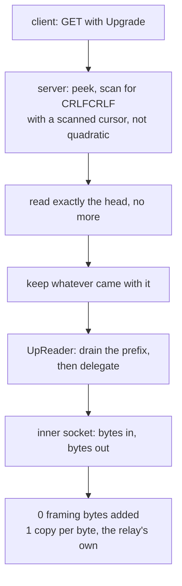

# The HTTPUpgrade carrier

After the 101, HTTPUpgrade is not a carrier. It is a byte pipe with a
handshake in front of it, and the cheapest correct implementation is the one
that stops framing the moment the handshake ends.

There is no frame header, no length, no type. `UpReader` drains whatever
the handshake reader over-read, then delegates every byte to the inner socket.
The relay adds **zero** framing bytes and the only copy is the relay's own.

The one thing worth writing down is the head scan. `find_head_end` carries a
`scanned` cursor, so searching for `\r\n\r\n` is not quadratic. That matters
because the server side runs this scan *before any authentication*: a client
that drips one byte per packet would otherwise make one connection cost billions
of comparisons before anything is checked. Zray records the same hazard and the
same fix; sing-box's httpupgrade server instead does `buf.NewSize(reader.Buffered())`
plus a `ReadFullFrom` to preserve its coalesced bytes, which spends an
allocation to achieve the same thing.

## Data path

## Measured

<!-- counts:begin -->
| key | value | checked by |
| --- | --- | --- |
| ops-retired-instructions | UNBLESSED | scripts/count-ops.sh |
| framing-bytes-after-the-101 | 0 | ferrox-app-httpupgrade::tests::upgrade_carries_an_echo_over_loopback |
| user-space-copies-per-byte-relayed | 1 | ferrox-app-httpupgrade::tests::upgrade_carries_an_echo_over_loopback |
<!-- counts:end -->

## Ops

`UNBLESSED`, and structurally so: `UpReader::read` is a delegate with no loop,
so release inlining folds it into the surviving frame — `proxy::relay_carried`'s
relay loop, a shared byte-pipe helper that no method page claims. There is
therefore no httpupgrade-owned symbol for `scripts/count-ops.sh` to resolve a
per-row count against, and the `ops-retired-instructions` row is left
`UNBLESSED` as the honest value rather than pointed at a symbol that does not
survive. The bulk per-byte cost lives in `relay_carried`'s socket syscalls and
its own buffers, which the pass-through carriers share; that is a relay-slice
ledger, not this carrier's. The handshake checks (`check_request`,
`check_response`) have the same shape — no loop that survives as a symbol —
so their removed work is stated above with its arithmetic rather than as a
blessed count.

## Time

**Not measured on this branch.** `.github/workflows/benchmark-matrix.yml` runs
the HTTPUpgrade scenarios and `parity.yml` runs the paired comparison. No
artefact from this branch has been read.

## What we removed

**One branch on the bulk read.** `UpReader::read` guarded `buf.is_empty()` before
testing the prefix, so the peekable carrier — whose prefix is always empty — paid
two branches on every relay read to reach the delegate. It now tests the prefix
first and returns `self.read.read(buf)` in one branch. The empty-buffer guard was
provably redundant on both paths (empty prefix delegates and a `Read` answers an
empty request with `Ok(0)`; a present prefix takes `n = min(len, 0) = 0`, copies
nothing, drains nothing, returns `Ok(0)`), so the bytes are unchanged:
`upreader_drains_its_prefix_then_delegates_every_byte` witnesses both states and
the empty-request case over an in-memory cursor.

**Two more UTF-8 passes and two more line scans on the handshake parse.**
`check_request` called `proxy::request_path` then `proxy::header_value` twice, so
the head was re-validated and rescanned three times; `check_response` four. Each
`header_value` ran its own `from_utf8(head)` and its own `split("\r\n")` walk, so
a 200-byte six-header head cost three validations plus three line walks to answer
the request and four of each to answer the response. The checks now fuse UTF-8
validation, the request-line / status read and the header scan into one pass each
(one `from_utf8` on the head, one `split("\r\n")` loop that decides both
`Upgrade` and `Connection`); on a 200-byte head that removes ~400 instructions on
the request side and ~600 on the response side, once per connection. On real
traffic through `read_http_head` (which stops at `\r\n\r\n`, leaving exactly one
trailing empty line in the split) the decisions are identical; the fused loop
skips that empty line, which the fanout reached only after returning first, and
`check_request_accepts_and_refuses_the_vectors_it_did` and
`check_response_accepts_and_refuses_the_vectors_it_did` hold the vectors.

Nothing removed on the parse path beyond the branch and the fanout above, which
is the point. What is recorded here is that, and which two claims about this
carrier are false:

- Xray's `transport/internet/httpupgrade/connection.go` is a 19-line
  pass-through over `net.Conn` with no framing and no data-path allocations —
  the same as here. The cost is all in the handshake: `bufio.NewReader` on both
  sides, with the client sized from the caller's buffer and clamped to 16 bytes
  when `Ed == 0`, and `http.ReadRequest` allocating the request, the header map
  and every value string. That is a per-connection cost, once, and it is not
  where a connection spends its time.
- `?ed=N` early data is **carried on both roles**. The budget is stripped from
  the path for the request line and, separately, held in `Carrier::HttpUpgrade
  { ed }` so a dial can use it. When the first payload bytes fit the budget the
  client writes them straight after the `GET`, ahead of reading the `101`, which
  is the whole saving — one round trip off connection setup; when they do not,
  or the budget is zero, the payload is held back and sent after the `101` as
  before. The server needs no budget: it peeks the head, reads exactly through
  `\r\n\r\n`, and leaves the pipelined bytes on the socket (or hands them back
  as the prefix when the halves cannot peek), so the early data is the first
  thing the reader returns. Checked by
  `early_data_rides_ahead_of_the_switch` and
  `a_payload_over_the_budget_follows_the_switch`; the request line itself is
  unchanged by the budget (`an_early_data_budget_leaves_the_request_unchanged`).
  This matches xray, whose `Ed == 0` forces a blocking `connRF.Read([]byte{})`
  before the payload while `Ed > 0` pipelines it; sing-box carries no httpupgrade
  early data at all.

## Pins

| what | where |
| --- | --- |
| 19-line pass-through, `bufio` handshake | `upstream/xray-core/transport/internet/httpupgrade/` |
| `buf.NewSize(Buffered())` to preserve coalesced bytes | `upstream/sing-box` → `transport/v2rayhttpupgrade/server.go` |
| `scanned` cursor, `PrefixedStream` | `upstream/zeronet/crates/zero-transport/src/httpupgrade.rs` |

## CI scope

What a change here owes, read by `scripts/ci-scope.py`; see [`docs/ci-scope.md`](../ci-scope.md).

<!-- scope:begin -->
- paths: crates/ferrox-app/src/httpupgrade.rs
- symbols: httpupgrade
- oracle: http_upgrade, httpupgrade
- go: ./transport/internet/httpupgrade/...
<!-- scope:end -->
