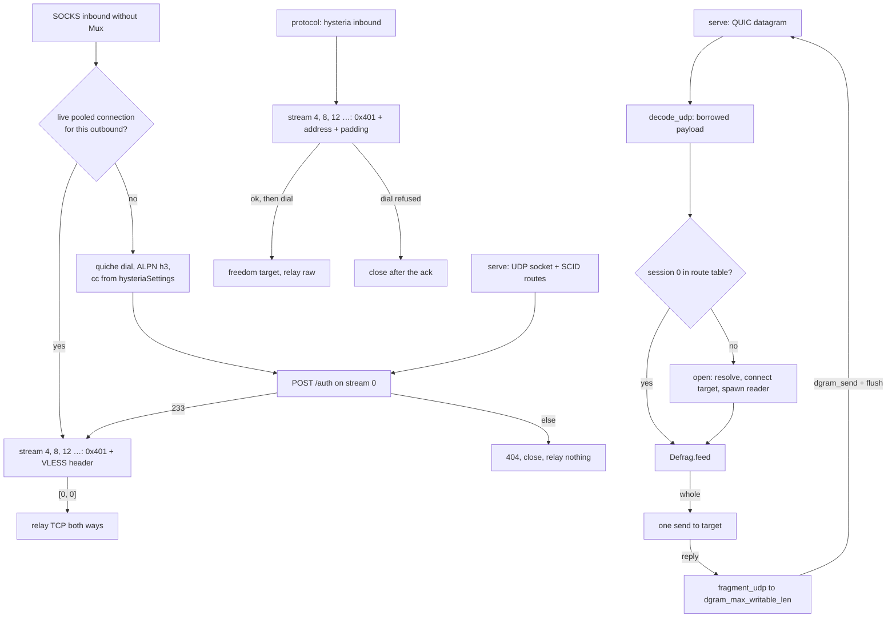

# The Hysteria carrier

Hysteria v2 is a **both-roles, both-shapes** row. As the transport it dials
from a SOCKS inbound without Mux and serves a `streamSettings` inbound that
names a `tlsSettings.certificates[0]` chain, carrying the inner protocol
(VLESS) on each `0x401` stream. As the protocol it serves a
`protocol: hysteria` inbound: the stream's request itself names the
destination as a varint string, the server acknowledges before it dials, and
a refused dial closes after the acknowledgement. Both run over quiche — the
default QUIC stack for this rung, pinned at `upstream/quiche` for reading.
Every served connection also carries the QUIC datagram lane: the auth response
advertises `hysteria-udp: true` the way the reference does whenever a validator
is present — and a served connection always has one — so the lane is on rather
than negotiated, and no branch of it is dead config.

The wire shape is small: every TCP flow is one client-bidirectional QUIC
stream opening with the `0x401` varint, and the connection opens with an
HTTP/3 `POST` to `/auth` carrying `hysteria-auth`, answered `233`.
`ferrox-core::hysteria` owns those bytes and proves them bit-exact
(`ferrox-core-hysteria::*` unit tests); `ferrox-app/src/hysteria.rs` owns the
sockets: a `Router` keyed by server SCID on the serve side, and on the dial
side one authenticated connection per outbound, pooled and reused for every
flow it can carry — stream 4, 8, 12 … — the way the pinned client multiplexes
(`max_tcp_streams: 64`; this tree caps at quiche's `MAX_STREAMS`). The datagram
lane rides the same pooled connection: on the serve side one association per
`BE32 session` id, keyed in the route's table, relayed to its connected target
socket through `ferrox-core-hysteria`'s codec (`decode_udp` borrows the payload
out of the arrived datagram; `a_decoded_datagram_leaves_its_payload_where_it_landed`
is the pointer-identity witness), reassembled by `Defrag`, and reaped after
`UDP_IDLE` (60 s, the reference's `udp_idle_timeout`) or the connection's close
— a UDP socket has no shutdown to wake a blocked read, so the reply-path reader
threads end on the `UDP_POLL` (1 s, the reference's cleanup tick) timeout
watching the stop flag the reap sets. `udp-bytes-relayed` 0 still names the
dial-side gap: `dial_udp_uplink` returns `None` for every non-`Raw` carrier, so
the client's own UDP flows are a cross-cutting row, not this carrier's. A pooled
connection is reused within half the server's 300 s idle timeout, dropped when
it stops taking application data (closed, draining or carrying a close), goes
stale or runs out of streams, and a dial with no live pool entry pays a fresh
handshake: `hysteria_shares_one_connection_between_two_flows` witnesses one
handshake carrying two echoes on the `HANDSHAKES` counter, and
`hysteria_redials_when_a_pooled_connection_closes` the fresh handshake after
`close_pooled`.

A wrong password is refused with `404` then `CONNECTION_CLOSE` and relays
nothing: `hysteria_refuses_a_wrong_password_without_relaying` is the gate.
Settings parse with guarded fallbacks — unknown congestion spellings pace as
`bbr`, and only `version: 2` or absent names this carrier, anything else is
`Unknown`: `hysteria_settings_parse_with_guarded_fallbacks` is the gate. The
full path, dial plus auth plus one VLESS echo, is
`hysteria_carries_vless_echo_over_loopback`, and the UDP lane's full path —
advertisement, association open, fragment, defrag, target echo, reply frames —
is `hysteria_carries_udp_echo_over_loopback`, both serialised on the shared QUIC
mutex and retried like the other loopback socket tests, because a socket test
that passes twice and fails the third is testing the scheduler. The protocol
shape's gate is the pinned one: `xray-rust-hysteria` in `upstream/pins.toml`
runs the pinned client's wrong-password and failed-destination verdicts
against `ferrox-app` in `scripts/run-upstream-suite.sh`, which is also where
the server's SETTINGS-before-auth order is proven — the pinned client's H3
stack posts its auth only once the server's SETTINGS arrive.

## Data path



## Measured

<!-- counts:begin -->
| key | value | checked by |
| --- | --- | --- |
| ops-retired-instructions | UNBLESSED | scripts/count-ops.sh |
| tcp-flows-per-handshake | 2 | ferrox-app-proxy::tests::hysteria_shares_one_connection_between_two_flows |
| closed-connections-reused | 0 | ferrox-app-proxy::tests::hysteria_redials_when_a_pooled_connection_closes |
| request-parse-reallocations | 0 | ferrox-app-hysteria::tests::a_parsed_request_leaves_its_payload_where_it_landed |
| wrong-password-bytes-relayed | 0 | ferrox-app-proxy::tests::hysteria_refuses_a_wrong_password_without_relaying |
| non-v2-configs-carried | 0 | ferrox-app-proxy::tests::hysteria_settings_parse_with_guarded_fallbacks |
| udp-bytes-relayed | 0 | ferrox-app-proxy::tests::hysteria_dial_udp_uplink_is_none |
| udp-datagram-decode-copies | 0 | ferrox-core-hysteria::tests::a_decoded_datagram_leaves_its_payload_where_it_landed |
| udp-fragments-witnessed | 200 | ferrox-core-hysteria::tests::every_length_survives_fragment_then_defrag_intact |
| pinned-hysteria-client-verdicts | 1 | scripts/run-upstream-suite.sh |
<!-- counts:end -->

## Ops

```bash
./scripts/count-ops.sh report proxy::tests::hysteria_carries_vless_echo_over_loopback \
  'hysteria::serve_loop' 'hysteria::drive_once' 'hysteria::serve_stream' \
  'hysteria::read_request' 'hysteria::auth_exchange' 'hysteria::open_pooled'
```

`UNBLESSED`, as above. `scripts/expected-ops.txt` still blesses exactly one
symbol in the whole tree, `der_to_pem 2653`, which is a PEM formatting helper
rather than a carrier. That is why the whole ops row in this table is open.
All six symbols are rows in `scripts/method-ops.txt`, so `ops.yml` publishes
their inclusive cost on every run — the functions whose first store to a
receive or send buffer used to be a memset, and the pool path a shared flow
rides. The datagram relay is under these rows' inclusive cost (`serve_loop`
calls `drive`, which calls `relay_datagrams`); it has no `ops.yml` row of its
own yet.

## Time

**Not measured on this branch.** Every duration in this repository comes from a
named runner, and a number produced off a machine behind a VPN measures the
tunnel. No artefact from this branch has been read.

## What we removed

- **The upstream UDP session machinery, rewritten smaller.** Both pinned
  implementations keep a UDP session manager with a per-direction message
  channel beside the streams (`conn.go:udpSessionManager`,
  `protocol/hysteria2` inbound/outbound UDP paths). This tree carries the lane
  as one `UdpFlow` per association — a connected target socket, the
  `Defrag` reassembly, and the idle reap — the parse, fragmenter and reassembly
  living entirely in `ferrox-core::hysteria`, proven by
  `every_length_survives_fragment_then_defrag_intact` (the 200-row sweep is
  `udp-fragments-witnessed`) and end to end by
  `hysteria_carries_udp_echo_over_loopback`. The reference's
  `MaxDatagramFrameSize: 1200` is not reimposed; fragmentation sizes to the
  peer's live `dgram_max_writable_len` instead.
- **The decoder's per-datagram payload copy.** The relay hands
  `decode_udp`'s borrowed payload straight to the target socket's one `send`;
  the pointer-identity test pins the base inside the arrived datagram, the
  buffer unmoved, the capacity ungrown (`udp-datagram-decode-copies` 0).
  What the lane still pays, named: quiche's `dgram_recv_buf` returns the
  datagram as an owned `Vec` — a copy inside quiche that borrowing the buffer
  would retire but moving it would not; the reply path's one `send` to the
  target and one `dgram_send` of the re-encoded head are the relay's own; and
  the reassembly holds its slots behind one owned address per flow, re-filled
  with `clone_into` rather than a fresh allocation.
- **Salamander obfuscation and the masquerade site.** The keys are never read;
  nothing on the wire pretends otherwise.
- **A custom brutal sender.** `brutal` and `force-brutal` pace as quiche `bbr`
  (`Congestion::quiche_name`), stated in the settings test. That is a
  narrower congestion loop, not a second implementation of one.
- **Rate-capped pacing.** `up_mbps`/`down_mbps` are never read; flows pace by
  quiche `bbr` uncapped, which is wire-compatible with a capped peer and
  differs only in throughput, so the keys stay accepted-and-ignored.
- **A per-chunk relay clone.** The relay direction held its `Flow` behind one
  clone for the whole direction rather than cloning the backlog `Vec` per
  16 KiB chunk.
- **The relay legs' zero fill.** Both `relay` buffers were per-flow
  `vec![0u8; 16384]` callocs; they now read into the same uninitialised
  `RelayBuf` the proxy's raw loops use. Each leg still reads the whole 16 KiB
  and forwards `&buf.as_mut()[..n]`, so read granularity, per-chunk copies and
  syscalls are unchanged — what retires is the two memsets per flow, witnessed
  by the CI RSS matrix, not by a count row.
- **The per-flow handshake.** Every dial used to pay a full QUIC handshake and
  a `POST /auth` for one stream. The dialer now pools one authenticated
  connection per outbound — keyed on host, address, port, congestion, auth and
  roots — and hands each flow the next stream id off it, the pinned client's
  own shape. `tcp-flows-per-handshake` is 2, not 1: the `HANDSHAKES` counter
  shows one handshake carrying two echoes
  (`hysteria_shares_one_connection_between_two_flows`), and a closed pooled
  connection pays a fresh one (`hysteria_redials_when_a_pooled_connection_closes`,
  `closed-connections-reused` 0).
- **A flow handed a connection that had stopped carrying data.** The pool
  asked only `is_closed()`, so a connection quiche had already stopped taking
  application data on — draining, or closed locally and not yet drained — was
  handed the next flow's stream; its `[0, 0]` reply had nothing to arrive on,
  and the dial sat out `HANDSHAKE_TIMEOUT` before redialling. `candidates` and
  `open_pooled` now ask `usable` — not closed, not draining, no local or peer
  error — so the redial gate reaches its fresh-handshake assertion without the
  wait. A connection that drains between the hand-out and the reply is caught
  only after the failed open: `usable` is asked at the hand-out and at the
  eviction, not by the wait itself, so that dial still pays the budget before
  it redials.
- **Nine zeroing passes on the flow paths.** `drive_once`'s receive room
  (1350 bytes), `serve_loop`'s packet buffer and the router's output buffer
  (1350 each), `serve_stream`'s head room (64), `drain_settings`' room (128),
  `recv_reply`'s two-byte reply, and the 4096-byte rooms in
  `read_headers_block`, `auth_exchange` and `read_request` all opened zeroed
  and were overwritten in full by the first read. All take `quic::Unfilled`
  now. Witnessed in machine code like the quic carrier's own removal: the
  aarch64 dev-profile asm of `ferrox-app` goes from 9 `_bzero`/`_memset`
  calls across `ferrox_app::hysteria` frames to 0 — whole-file zeroing calls
  91 → 82 — and the bytes did not move, because the loopback, hand-rolled
  client/server and pinned-client suites read the same stream.
- **The request path's copies.** `serve_stream` used to slice the prefix off
  (`head[prefix..].to_vec()`); `read_request` used to rebuild the backlog with
  `flow.backlog[flow.at..].to_vec()`; `read_headers_block` used to `to_vec`
  the header block; `auth_exchange` used to `to_vec` the auth body before
  verifying it. The prefix now stays in the buffer with a cursor stepped over
  it, and each parse reads what already arrived:
  `a_parsed_request_leaves_its_payload_where_it_landed` pins the backlog's
  base pointer and capacity across the parse (`request-parse-reallocations`
  0), and the other three sit under the same loopback and pinned-client gates
  that read the auth bytes.
- **`Router::idle`'s two passes and the per-packet SETTINGS drain.** `idle`
  collected dead route keys into a `Vec` and locked every surviving route
  twice; it is one `retain` pass with one lock per route. And the server used
  to pay `stream_recv` on stream 2 for every packet; a `settings_done` latch
  set on the stream's FIN retires the call, found with the same one route
  lookup that feeds the auth state. The datagram reap enters through the same
  `retain`, touching each flow once.

What is **not** removed, and is named rather than claimed: the pool is one
process-wide map per outbound key with no eviction policy beyond pruning
closed, stale and stream-exhausted entries on the next dial, so an outbound
burst holds one connection each for `REUSE_WINDOW` (150 s, half the idle
timeout); the client's UDP uplink is not carried (`udp-bytes-relayed` 0 —
`dial_udp_uplink` answers `None` for every non-`Raw` carrier, a cross-cutting
gap rather than this carrier's); salamander obfuscation and the masquerade
site stay out as the `hysteria-obfs-masquerade` add-on in
`crates/ferrox-prompt/prompts.md` — salamander because no pinned tree vendors
it, so a pin or oracle comes before any byte claim, and the masquerade because
it is an H3 request-serving subsystem, not a rung on the relay; 0-RTT,
migration and key updates are quiche's; the server keeps one UDP socket per
inbound with a per-connection route map and a linear scan over routes per
Initial.

## CI scope

What a change here owes, read by `scripts/ci-scope.py`; see [`docs/ci-scope.md`](../ci-scope.md).

<!-- scope:begin -->
- paths: crates/ferrox-core/src/hysteria.rs, crates/ferrox-app/src/hysteria.rs
- symbols: hysteria
- oracle: xray-rust-hysteria=rejects_wrong_auth
- go: ./transport/internet/hysteria/...
<!-- scope:end -->
