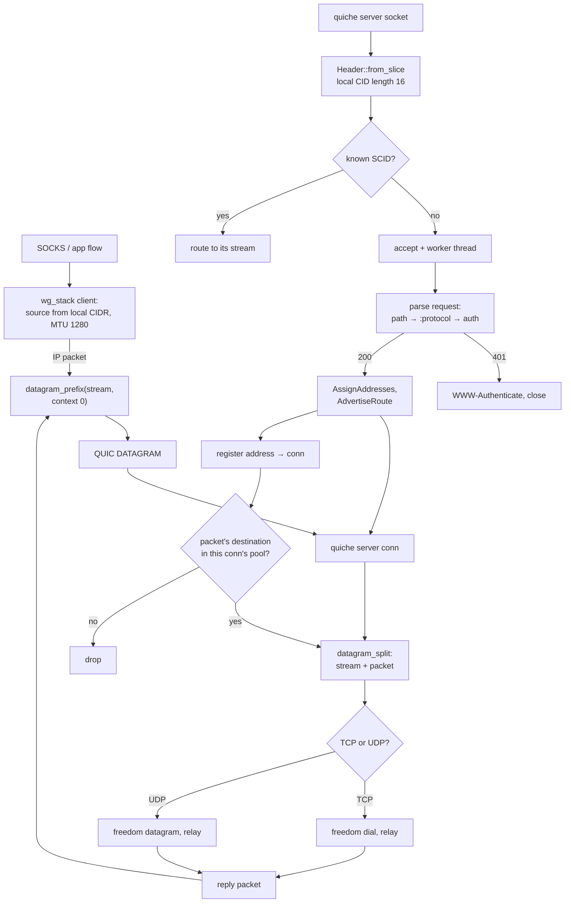

# The MASQUE carrier

MASQUE is the RFC 9484 CONNECT-IP row, carried as the `masque` transport name and as a `protocol: masque` inbound, both roles over quiche. An HTTP/3 `CONNECT` request names the path `/.well-known/masque/ip/*/*/`, `:protocol` `connect-ip` and a Basic credential; the server answers `200` with a Capsule-Protocol header, assigns one address per configured family over the request stream, advertises the default routes, and from then on every IP packet rides a QUIC DATAGRAM frame prefixed with the quarter stream id and a zero context byte. TCP and UDP inside the tunnel feed the same `wg_stack` seams the WireGuard row uses — the client resolves the flow's source from the local CIDR, the server routes each packet through the outbound table — so an ICMP packet is the one that is dropped, exactly as the pinned server's stack drops it.

The server is the part xray-core owns that row 20 did not: an address pool built from the configured prefixes, one address per family per connection, the 401 challenge with `WWW-Authenticate: Basic realm="masque", charset="UTF-8"`, the 503 when a family is exhausted, and the per-capsule DATA frames the reference writes. Address containment is the reference's `inPool` — the network and broadcast addresses are inside a prefix and are therefore never handed to a stack — and a subnet grant is narrowed to its first host the way `prefix.Masked().Addr().Next()` does. The configured `host` wins over the SNI for the request authority, the path is compared after percent-decoding so `%2A` reads as `*`, and the user's email compares case-insensitively because the reference lowercases it in its validator. A configured WARP block is parsed and warned about rather than refused: its static address and mutual TLS are not carried.

The dialer collapses xray's user-agent selector to the pinned Chrome UA for `chrome`, `firefox`, `safari`, `edge` and `curl`; `golang` and an empty value send no user agent, and an absent value sends the same Chrome UA. A configured `remoteDNS` is warned about and names resolve on the host, because resolving them inside the tunnel would need the DNS forwarder this row does not carry. `enable_dgram` is set to quiche's `MAX_DATAGRAM` on both roles: the numbers are datagram payload bytes, and the reference's `QUEUE` constant is a queue depth, not a size.

## Data path

<!-- counts:begin -->
| key | value | checked by |
| --- | --- | --- |
| ops-retired-instructions | UNBLESSED | scripts/count-ops.sh |
| tcp-echo-round-trips | 1 | ferrox-app-masque::tests::a_tcp_flow_crosses_the_tunnel_to_a_freedom_dial |
| ipv6-tcp-echo-round-trips | 1 | ferrox-app-masque::tests::a_tcp_flow_crosses_the_tunnel_over_ipv6 |
| udp-echo-round-trips | 1 | ferrox-app-masque::tests::a_datagram_flow_crosses_the_tunnel_to_a_freedom_dial |
| wrong-password-status | 401 | ferrox-app-masque::tests::a_wrong_password_is_refused_with_401 |
| path-forms-witnessed | 5 | ferrox-app-masque::tests::a_request_path_reads_the_way_xray_parses_it |
| pool-contained-addresses-witnessed | 2 | ferrox-app-masque::tests::a_pool_holds_every_address_its_prefix_covers |
| pool-outside-addresses-witnessed | 1 | ferrox-app-masque::tests::a_pool_holds_every_address_its_prefix_covers |
| subnet-grants-witnessed | 2 | ferrox-app-masque::tests::a_subnet_grant_names_its_first_host |
| datagram-prefix-round-trips | 1 | ferrox-app-masque::tests::the_datagram_prefix_round_trips |
<!-- counts:end -->

## Time

No duration is quoted here. The matrix's `vless-masque` cell and the `TestMasque` / `TestMasqueServer` conformance run are CI-only (`parity.yml`, `conformance.yml`); a local number would measure this machine's tunnel, not the code, so the page carries `UNBLESSED` for the retired-instruction count until the `ops.yml` artefact is read and the gate moves only with that measurement. What the counts above witness is shape, not speed: one TCP echo per family through the full tunnel, one UDP datagram, the 401 on a wrong password, and the pool's containment rule.

## What we removed

- **The terminating server's separate packet forwarder.** The reference carries a dedicated CONNECT-IP server with its own netstack; this tree feeds the same `wg_stack` the WireGuard row already owns, so the server has no packet loop of its own — the capsule parser, the pool and the demux are the only new code.
- **A copy of the flow source.** The client's stack resolves the source from the local CIDR once per flow and the datagram prefix borrows the packet it was handed; no byte of the IP packet is copied to add the prefix.
- **The reference's per-request address manager.** The pool is one masked prefix per family, assigned and released under the same lock, with no goroutines or retry timers; a request whose family is exhausted is answered 503 rather than queued.
- **The h2 leg and the client-to-client test.** Row 48 is h3, so the `TestMasqueServerClientToClient` case that dials h2 is left to row 49; the h3 client and server it does exercise are gated here.
- **What was not removed, named.** The IP packet still crosses one `Vec` from the tunnel receiver into quiche's datagram queue, the reply takes one more into the stack, and each capsule body is staged in a control buffer before its DATA frame; ICMP is dropped rather than forwarded, and the dialer ignores post-establish address updates because the reference closes the tunnel on a withdrawal.

<!-- scope:begin -->
- paths: crates/ferrox-app/src/masque.rs
- symbols: masque
- go: ./proxy/masque/...
<!-- scope:end -->
