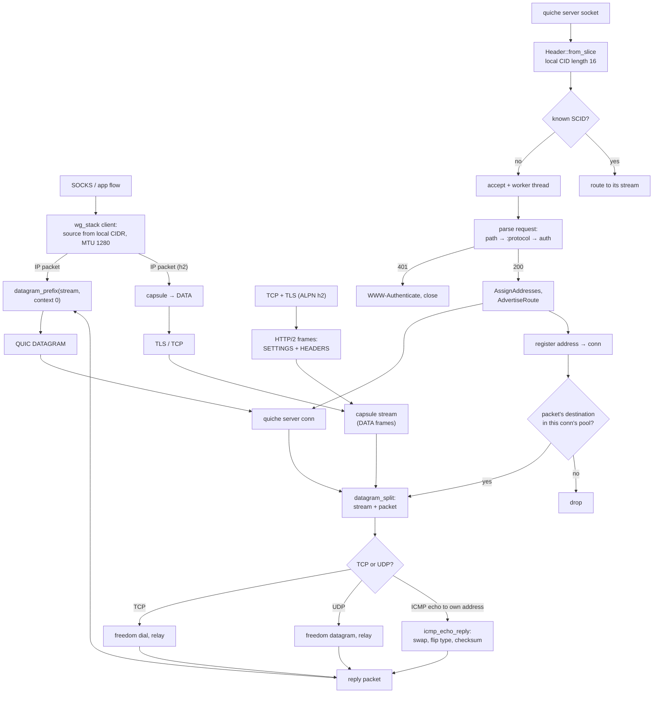

# The MASQUE carrier

MASQUE is the RFC 9484 CONNECT-IP row, carried as the `masque` transport name and as a `protocol: masque` inbound: both roles over quiche/HTTP-3 and, when the configured ALPN names `h2` and not `h3`, over TLS/HTTP-2, with the inbound serving both on the same port. An HTTP/3 `CONNECT` request names the path `/.well-known/masque/ip/*/*/`, `:protocol` `connect-ip` and a Basic credential; the server answers `200` with a Capsule-Protocol header, assigns one address per configured family over the request stream, advertises the default routes, and from then on every IP packet rides a QUIC DATAGRAM frame prefixed with the quarter stream id and a zero context byte. TCP and UDP inside the tunnel feed the same `wg_stack` seams the WireGuard row uses — the client resolves the flow's source from the local CIDR, the server routes each packet through the outbound table — so a packet too wide for the lane's next datagram is answered with the reference's ICMP Packet Too Big and the writing stack narrows to the MTU it names, and an ICMP echo request to the device's own address is answered at both families.

The server is the part xray-core owns that row 20 did not: an address pool built from the configured prefixes, one address per family per connection, the 401 challenge with `WWW-Authenticate: Basic realm="masque", charset="UTF-8"`, the 503 when a family is exhausted, and the per-capsule DATA frames the reference writes. Address containment is the reference's `inPool` — the network and broadcast addresses are inside a prefix and are therefore never handed to a stack — and a subnet grant is narrowed to its first host the way `prefix.Masked().Addr().Next()` does. The reference's flat `address`/`port` outbound settings and its `users` (or `clients`) rows with `pass` read the same edge and table; the nested `server` object and `password`/`account.password` stay as the second way. The configured `host` wins over the SNI for the request authority, the path is compared after percent-decoding so `%2A` reads as `*`, and the user's email compares case-insensitively because the reference lowercases it in its validator. A configured WARP block is parsed and warned about rather than refused: its static address and mutual TLS are not carried.

The dialer collapses xray's user-agent selector to the pinned Chrome UA for `chrome`, `firefox`, `safari`, `edge` and `curl`; `golang` and an empty value send no user agent, and an absent value sends the same Chrome UA. A configured `remoteDNS` is warned about and names resolve on the host, because resolving them inside the tunnel would need the DNS forwarder this row does not carry. `enable_dgram` receives quiche's `MAX_DATAGRAM` as the receive queue depth on both roles and `DGRAM_INFLIGHT` (32) as the send queue depth, which is the reference's `maxDatagramSendQueueLen`: a peer drops datagrams above its own receive queue, and an inner TCP that loses a burst backs off for seconds, so a full send queue holds the packet and the caller retries it after a flush instead of dropping it. `dispatch` also wakes the worker whose queue it just wrote, so a burst leaves on arrival rather than on the 10 ms tick that now only drives retransmission timeouts. An h2 edge that refuses the first dial because its listener is still binding is dialed again for a second, which is the window the QUIC handshake's retransmission already covers; `masque_h2::tests::a_dial_refused_until_the_edge_binds_is_retried` and the pinned `TestMasqueServerHTTP2` are the checkers. After every received event the worker sweeps a QUIC deadline that has already fallen due, so a peer that keeps datagrams arriving inside the wait cannot defer loss recovery or the draining and idle timers; `ferrox-app-masque::tests::a_due_quic_deadline_is_swept_after_an_event` is the checker.

The HTTP/2 client and server retain at most 64 capsules while a send window is stalled. The next capsule ends the session, and its packet channel stops draining; a peer granting credit before overflow can still drain the queue. `masque_h2::tests::a_stalled_send_window_bounds_the_queued_capsules`, `an_overflow_stops_draining_the_packet_channels` and `queued_capsules_flush_when_the_peer_grants_window` check the boundary, termination and recovery. Ended or closed sessions leave pending capsules and packet channels untouched, checked by `ended_or_closed_sessions_leave_capsules_and_channels_untouched`. The capsule encoding and DATA framing are unchanged; the cap counts capsules rather than bytes, and their retained payload allocations remain.

## Data path

<!-- counts:begin -->
| key | value | checked by |
| --- | --- | --- |
| ops-retired-instructions | UNBLESSED | scripts/count-ops.sh |
| tcp-echo-round-trips | 1 | ferrox-app-masque::tests::a_tcp_flow_crosses_the_tunnel_to_a_freedom_dial |
| ipv6-tcp-echo-round-trips | 1 | ferrox-app-masque::tests::a_tcp_flow_crosses_the_tunnel_over_ipv6 |
| udp-echo-round-trips | 1 | ferrox-app-masque::tests::a_datagram_flow_crosses_the_tunnel_to_a_freedom_dial |
| wrong-password-status | 401 | ferrox-app-masque::tests::a_wrong_password_is_refused_with_401 |
| path-forms-witnessed | 5 | ferrox-app-masque::tests::a_request_path_reads_the_way_xray_parses_it |
| reference-edge-spellings | 2 | ferrox-app-masque::tests::the_reference_settings_spellings_read_the_same_edge |
| reference-user-spellings | 4 | ferrox-app-masque::tests::the_reference_user_spellings_serve_the_same_table |
| pool-contained-addresses-witnessed | 2 | ferrox-app-masque::tests::a_pool_holds_every_address_its_prefix_covers |
| pool-outside-addresses-witnessed | 1 | ferrox-app-masque::tests::a_pool_holds_every_address_its_prefix_covers |
| subnet-grants-witnessed | 2 | ferrox-app-masque::tests::a_subnet_grant_names_its_first_host |
| datagram-prefix-round-trips | 1 | ferrox-app-masque::tests::the_datagram_prefix_round_trips |
| assignment-outcomes-witnessed | 5 | ferrox-app-masque::tests::an_address_capsule_withdraws_what_it_no_longer_grants |
| icmp-too-big-shapes | 2 | ferrox-core-foxy::connectip::tests::a_packet_too_big_swaps_the_addresses_and_verifies_at_both_versions |
| icmp-too-big-edges | 5 | ferrox-core-foxy::connectip::tests::a_packet_too_big_copies_options_and_refuses_a_narrow_mtu |
| icmp-mtu-narrows | 2 | ferrox-app-wg-stack::tests::a_packet_too_big_narrows_the_device_mtu |
| icmp-too-big-responses | 1 | ferrox-app-masque::tests::a_packet_wider_than_one_datagram_is_answered_with_icmp |
| datagram-send-queue-depth | 32 | ferrox-app-masque::tests::a_full_datagram_queue_refuses_the_next_packet |
| echo-replies | 2 | ferrox-core-connectip::tests::an_echo_request_is_answered_at_both_families |
| echo-refusals | 3 | ferrox-core-connectip::tests::a_message_that_is_not_an_echo_request_leaves_the_buffer_alone |
| echo-answers-on-the-client | 2 | ferrox-app-wg-stack::tests::an_echo_to_the_devices_own_address_is_answered_on_the_tunnel |
| echo-answers-on-the-server | 1 | ferrox-app-wg-stack::tests::a_server_answers_an_echo_to_its_own_address |
| h2-datagram-round-trips | 1 | ferrox-app-masque-h2::tests::an_h2_tunnel_assigns_and_carries_a_datagram |
| h2-dialer-round-trips | 1 | ferrox-app-masque::tests::a_datagram_flow_crosses_the_h2_tunnel_to_a_freedom_dial |
| h2-tcp-echo-round-trips | 1 | ferrox-app-masque::tests::a_tcp_flow_crosses_the_h2_tunnel_to_a_freedom_dial |
| carrier-alpn-choices-witnessed | 5 | ferrox-app-masque::tests::the_carrier_follows_the_alpn_list |
| h3-datagram-send-allocations | 0 | ferrox-app-masque::tests::a_queued_datagram_is_the_buffer_the_caller_built |
| h3-forward-buffer-reallocations | 0 | ferrox-app-masque::tests::a_forwarded_datagram_is_the_buffer_that_arrived |
| h3-deliver-buffer-reallocations | 0 | ferrox-app-masque::tests::a_delivered_datagram_is_the_buffer_that_arrived |
| h2-frame-body-allocations | 0 | ferrox-app-masque-h2::tests::a_frame_body_is_read_where_it_landed |
| h2-capsule-staging-allocations | 0 | ferrox-app-masque-h2::tests::a_whole_capsule_is_read_where_it_landed |
| h2-datagram-packet-queue-copies | 0 | ferrox-app-masque-h2::tests::a_datagram_capsule_goes_straight_to_its_lane |
| h2-queued-capsule-cap | 64 | ferrox-app-masque-h2::tests::a_stalled_send_window_bounds_the_queued_capsules |
<!-- counts:end -->

## Time

No duration is quoted here. The matrix's `masque` cell (ferrox and xray-core as servers, ferrox and xray-core as clients) and the `TestMasque` / `TestMasqueHTTP2` / `TestMasqueServer` / `TestMasqueServerHTTP2` / `TestMasqueServerClientToClient` conformance run are CI-only (`parity.yml`, `conformance.yml`); a local number would measure this machine's tunnel, not the code, so the page carries `UNBLESSED` for the retired-instruction count until the `ops.yml` artefact is read and the gate moves only with that measurement. What the counts above witness is shape, not speed: one TCP echo per family through the full tunnel, one UDP datagram, the 401 on a wrong password, and the pool's containment rule, five post-establish assignment outcomes, the Packet Too Big the two families compose, the echo answers the two families render and the three messages they refuse, one HTTP/2 tunnel's assigned address and echoed datagram, the h2 dialer's assignment, echoed datagram and TCP echo, the five ALPN lists that choose between h2 and h3, the reference's flat `address`/`port` and nested `server` outbound spellings, and its `users`/`clients` rows with `pass`, `password` or `account.password`. The allocation rows are the handoff's before/after: the queued h3 datagram, the forwarded and delivered buffers, the h2 frame body, a whole capsule and the h2 packet queue all allocate zero, where the copied forms allocated one buffer each.

## What we removed

- **The terminating server's separate packet forwarder.** The reference carries a dedicated CONNECT-IP server with its own netstack; this tree feeds the same `wg_stack` the WireGuard row already owns, so the server has no packet loop of its own — the capsule parser, the pool and the demux are the only new code.
- **A copy of the flow source.** The client's stack resolves the source from the local CIDR once per flow and the datagram prefix borrows the packet it was handed; no byte of the IP packet is copied to add the prefix.
- **The reference's per-request address manager.** The pool is one masked prefix per family, assigned and released under the same lock, with no goroutines or retry timers; a request whose family is exhausted is answered 503 rather than queued.
- **The reference's HTTP/2 transport, both halves.** `golang.org/x/net/http2` is replaced by this tree's own frame head and HPACK decoder: the preface, SETTINGS with `ENABLE_CONNECT_PROTOCOL`, the extended CONNECT head, DATA and WINDOW_UPDATE frames are handwritten for the listener and the dialer, the dialer keeps the stream and connection send windows apart, and the capsule bodies reuse the same `connectip` encoders the h3 path writes. What is not removed: the dialer reads on the listener's 10 ms wait, so a packet queued while the socket is quiet leaves on that turn rather than from a writer thread.
- **The h3 handoff copy and the h2 frame staging.** `send_datagram` hands quiche the prefixed buffer it built (`dgram_send_buf`) instead of a slice quiche copies into a second `Vec`; `read_datagrams`, `io` and `Stream::poll` take quiche's owned receive buffer (`dgram_recv_buf`) and drain the prefix in place, so the packet the stack or lane receives is the allocation quiche dequeued. The h2 reader returns a frame body's range instead of copying it out, and the dialer parses a whole capsule where it landed; only a capsule split across reads is staged there. The listener still stages its capsules.
- **What was not removed, named.** On h2 a datagram still crosses one `Vec` into its lane or stack, and the server still stages a split capsule until its tail arrives. A packet too wide for one datagram is answered with the reference's ICMP Packet Too Big instead of dropped: the composer swaps the addresses, copies the header and eight bytes (or 1,232 for v6), and the v6 checksum covers the pseudo-header. The stack that wrote the packet narrows to the named MTU, so later segments fit; an echo request to the device's own address is answered by the same composer at both families, and any other ICMP message is left unanswered. A post-establish `ADDRESS_ASSIGN` that omits or refuses an address closes the lane, as the reference closes its tunnel; the next flow opens a new lane, and a newly granted family is only used then. The h2 listener keeps one thread per connection and a 10 ms read wait: a packet queued for a peer this tunnel does not own leaves on the next turn, so a cross-connection forward is bounded by that wait rather than pushed by a writer thread. It admits at most 256 live connections; an accept past that is dropped before a thread starts.

<!-- scope:begin -->
- paths: crates/ferrox-app/src/masque.rs, crates/ferrox-app/src/masque_h2.rs
- symbols: masque
- go: ./proxy/masque/...
<!-- scope:end -->
