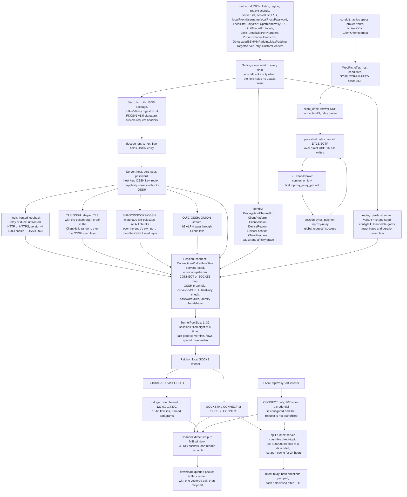

# Psiphon lane (native SSH/OSSH and fronted-meek, signed server list, local SOCKS and HTTP edges)

The lane no longer starts `psiphon-tunnel-core`. It fetches the signed server list, verifies the publisher's RSA signature, decodes the SSH entries, and speaks the OSSH/SSH transport itself: RC4 obfuscation with the seed message, curve25519 key exchange, AES-128-CTR with HMAC-SHA-256, password authentication, and multiplexed `direct-tcpip` channels. The HMAC tag and the 6000-round SHA-1 key derivation run through `ring`'s SHA-NI/AVX paths; both produce the same bytes as the Rust state machines they replaced. A server entry that carries a raw fronted meek capability (`FRONTED-MEEK`, `FRONTED-MEEK-HTTP`, `FRONTED-MEEK-QUIC`, or `FRONTED-MEEK-CDN-QUIC`) keeps the same SSH handshake but reaches it through a loopback relay: the relay carries the SSH bytes in `POST /` bodies over one persistent TLS, HTTP, or HTTP/3 connection to the fronting host, and the first request carries the version-4 meek cookie sealed with NaCl box and obfuscated with the OSSH RC4 stream. An unfronted meek entry (`UNFRONTED-MEEK` or `UNFRONTED-MEEK-HTTPS`) sends the same handshake straight to the server, and an entry that advertises both keeps the fronted configuration for fronting on and promotes the unfronted one for fronting off. A `TLS-OSSH` entry wraps the OSSH stream in a skip-verify shaped TLS session, directly or over the in-proxy data channel, with the ClientHello random carrying the HKDF/HMAC passthrough proof for the entry's meek obfuscated key; a session-ticket capability or the `TLSTunnelObfuscatedPSKProbability` coin also makes the hello carry a client-made obfuscated ticket — the Go-shaped encrypted state in the TLS 1.2 `session_ticket` extension, or a TLS 1.3 PSK with its binder on a uTLS PSK profile; a `LimitTunnelProtocols` naming `TLS-OSSH` selects that transport, and an entry with both OSSH and TLS-OSSH gets a TLS variant when the limit names it. A `SHADOWSOCKS-OSSH` entry carries the same OSSH seed and SSH session over a Shadowsocks AEAD stream: a random 32-byte salt, `chacha20-ietf-poly1305` with the entry's `sshShadowsocksKey` (EVP_BytesToKey), sealed two-byte length and payload chunks with a little-endian nonce counter, and the entry's `sshObfuscatedKey` above it. An entry that names `sshObfuscatedQUICPort` gets a `QUIC-OSSH` sibling: one QUICv1 bidirectional stream over rustls' QUIC handshake and a synchronous packet engine with `h3` ALPN and the TLS ClientHello random carrying the passthrough proof, selected by `LimitTunnelProtocols`/`TunnelProtocol`; the engine caches the flow-control grant beside the TLS ticket, so `QUICDialEarlyProbability` can resume a ticket and carry the first stream bytes in a 0-RTT packet, rolling the sent prefix back if the server rejects it, and `QUICDisablePathMTUDiscoveryProbability` (falling back to `QUICDisableClientPathMTUDiscoveryProbability` when the former is absent) turns off the padded probes that grow the one-RTT datagram from 1280 to the path's limit; only plain direct QUIC probes toward 1452, while obfuscated and in-proxy QUIC keep discovery off and start at their lower limits (1267 for the obfuscated layer, 1171 in the in-proxy data channel); `limitQUICVersions` selects `QUICv1` (plain datagrams), `RANDOMIZED-QUICv1` (plain datagrams, passthrough proof, and a structurally randomized hello: seeded shuffled/truncated TLS 1.3 cipher suites and key groups, a seeded rustls per-dial extension order, and seeded shuffled plus greased transport parameters), `OBFUSCATED-QUICv1`, or `DECOY-QUICv1` (the reference's 12-byte nonce, ChaCha20 over the padding byte and payload, passthrough proof, and the fork's random decoy datagrams). `QUICNoiseProfile` sends the fork's `light`, `firewall`, or `gfw`/`aggressive` profile before a plain QUICv1 handshake, expanding the reference's `<b>`, `<t>`, `<c>`, `<n>`, `<r>`, `<rc>` and `<rd>` spec forms with the 2 ms first-packet pause and the 1200-byte cap. The client-level `LimitQUICVersions` narrows the entry's `limitQUICVersions` before selection, and a limit without a plain version demotes a fronted HTTP/3 entry to its plain fronted capability. An in-proxy `INPROXY-WEBRTC-SHADOWSOCKS-OSSH` destination carries the same AEAD layer over the WebRTC data channel, an `INPROXY-WEBRTC-QUIC-OSSH` destination drives the same synchronous QUIC engine over whole data-channel messages as plain datagrams, and the in-proxy unfronted, non-CDN fronted and fronted HTTP/3 meek destinations run the same version-4 cookie and HTTP relay over the data channel instead of a new socket, and `AdditionalParameters` (base64 JSON) overlays the caller config before any field is read. `DisableTactics` refuses a tactics request with one line when no embedded tactics exist, `MeekAdditionalHeaders` prepends the configured headers, and `SSHChannelWindowSize` sets the channel window. In conduit mode the broker answer opens one persistent WebRTC data channel, the SSH handshake carries the in-proxy connection id and the broker's first relay packet, and the session's bytes ride `psiphon-inproxy-relay` SSH global requests over that channel; the initial relay packet is not sent on the channel before the handshake. The SSH identity carries `DeviceRegion`, `DeviceLocation`, `ClientFeatures`, `PropagationChannelId`, `ClientPlatform`, `ClientVersion`, `SplitTunnelOwnRegion` and `SplitTunnelRegions`. The proxy still sees one local SOCKS endpoint (loopback by default; `listen` and `shareProxyOnNetwork` can widen it), so its TCP and UDP paths are unchanged, and `LocalHttpProxyPort` adds the CONNECT front the reference client also exposes. `TunnelPoolSize` runs one to thirty-two tunnels in parallel and spreads flows over them round-robin, and a download writes each packet straight from the SSH receive buffer instead of staging it through a relay buffer. An entry is recognized through the reference's capability masking: `-OSSH`, `-PASSTHROUGH` and `-PASSTHROUGH-v2` are stripped, `QUICv1` folds into `QUIC`, and a session-ticket passthrough entry falls back to its TLS-OSSH port.

**Obfuscated server lists and server alerts.** The SSH session advertises `server-requests` and answers the server's `psiphon-osl` and `psiphon-alert` global requests, whether they arrive during the handshake or on the open session; an unknown request is logged and failed without retiring the tunnel. `psiphon-osl` persists each seeded SLOK (base64 ID and key) under the lane's state directory, clears them on `clear_local_sloks`, and a newly seeded SLOK forces a registry fetch. `ObfuscatedServerListRootURLs` names the roots in the reference's transfer-URL form (the `URL` value is base64) or as plain strings, with the deprecated single `ObfuscatedServerListRootURL` as the fallback. The lane fetches `osl-registry`, verifies it with `RemoteServerListSignaturePublicKey`, walks each `FileSpecs` entry's `KeyShares` tree, reassembles the file key from seeded SLOKs by Shamir interpolation at zero over GF(256) with the AES polynomial, opens the OSL file with NaCl secretbox and a zero nonce, verifies the inner signed package, and imports the server entries through the same decoder, protocol selection and fronting/session overrides as the signed list. An imported entry is deduplicated by its identity fields through one hash set, so a refresh neither scans the live list per entry nor clones it when nothing is new; `new_entries_keep_the_first_copy_of_each_server` holds the first copy and the order. `EmitSLOKs` and `EmitServerAlerts` turn the notice lines on. Refreshes are throttled to one attempt per five minutes unless a new SLOK forces one, and `FetchRemoteServerListRetryPeriodMilliseconds` holds a failed refresh off for that long. Each root's `URL`, `SkipVerify` and `RequestHeaders` are read from its transfer-URL object; the registry and every OSL file keep an ETag-keyed body under the lane's state directory, so a `304` reuses the cached bytes, and an OSL file whose registry `MD5Sum` matches the cached bytes is not downloaded at all. A partial download still restarts rather than resuming, and `OnlyAfterAttempts` is accepted but not scheduled because every configured root is a first-round candidate.

**Dial-parameter replay.** A successful dial stores the selected server variant and a 32-byte dial-shape seed per host. The seed drives every shape draw made during the dial: the TLS fingerprint and randomized-profile coin, SNI and hostname transforms, TLS and OSSH/Shadowsocks prefixes and split delays, fragmentor plan and pauses, meek padding/cookie/header/User-Agent choices, and the broker/STUN/WebRTC padding and labels. A later dial reuses that server and seed while the entry hash, config-state hash, TTL and candidate budget still match; `ReplayIgnoreChangedConfigStateProbability` can override the config hash, and `ReplayRetainFailedProbability` keeps a failed replay. Direct entries use `ReplayDialParametersTTLSeconds` and the target bytes/duration promotion gate; fronted entries use the `FrontedHTTPClientReplay*` window and in-proxy destinations use the `InproxyReplayBroker*` window, with `InproxyReplayRetainFailedProbability` governing in-proxy failures. `ReplayCandidateCount` bounds how many candidates in a round may replay (`-1` is unlimited), and `ReplayLaterRoundMoveToFrontProbability` controls whether stored candidates are moved to the front after the first round. The cache is in-process; it does not persist across a client restart.

## Data path

## Measured

<!-- counts:begin -->
| key | value | checked by |
| --- | --- | --- |
| ops-per-ssh-handshake | UNBLESSED | scripts/count-ops.sh |
| syscalls-per-relayed-megabyte | UNBLESSED | scripts/count-ops.sh |
| relay-staging-copies-per-byte | UNBLESSED | not measured |
| download-staging-copies-per-byte | 0 | ferrox-app-psiphon-ssh::tests::a_channel_chunk_is_the_packet_allocation |
| ss-vectored-write-extra-buffers | 0 | ferrox-app-psiphon-shadowsocks::tests::a_vectored_write_allocates_only_the_wire_buffer |
| flow-clone-allocations | 0 | ferrox-app-psiphon::tests::a_flow_clone_shares_the_credential_words |
| affinity-lookup-allocations | 0 | ferrox-app-psiphon::tests::an_affinity_lookup_does_not_format_each_entry |
| move-to-front-allocations | 0 | ferrox-app-psiphon::tests::a_live_server_moves_to_the_front |
| capability-name-allocations | 0 | ferrox-app-psiphon::tests::capability_names_borrow_when_no_mask_is_needed |
| preresolved-pick-allocations | 0 | ferrox-app-psiphon-dns::tests::a_preresolved_pick_takes_no_heap |
| ss-direct-write-probe-ops | 47483770 | scripts/count-ops.sh |
| ss-flatten-write-probe-ops | 47621538 | scripts/count-ops.sh |
| quic-varint-probe-ops | 131079 | scripts/count-ops.sh |
| seconds-per-live-transfer | UNBLESSED | .github/workflows/psiphon-live.yml |
| rc4-passes-per-byte | 1 | ferrox-app-psiphon-ssh::tests::rc4_apply_matches_the_stream_across_every_length |
<!-- counts:end -->

`flow-clone-allocations` clones a validated `PsiphonOut` inside the counting allocator and holds the count at zero. The credential is one `Arc<Credential>` shared by every clone, and the test checks the allocation count and the `Arc` pointer identity, so a future field that goes back to owning the words fails the row.

`quic-varint-probe-ops` decodes the same eight-octet QUIC varint 4,096 times through the one-load read, `131079` retired instructions, and through the byte walk it replaced, `360460`; the load takes `229381` (63.6%) out. Both rows come from one ops job and one binary, so their difference is the decode and not the build. `the_word_read_is_the_byte_walk_at_every_width_and_buffer_end` sweeps every width, every trailing length and every truncation against the byte walk.

`rc4-passes-per-byte` is one because the OSSH obfuscation stream is drawn into a block and folded over the payload as a second step, with the same state machine and the same bytes as the bytewise loop it replaces; `rc4_apply_matches_the_stream_across_every_length` sweeps three keys against twelve lengths, block-aligned and with a remainder, each against a bytewise re-derivation and a split-call continuity check, so a drift in either half fails the row. What was not removed: the RC4 state machine stays serial, one keystream byte per step; only the payload fold leaves it.

`download-staging-copies-per-byte` is zero because `Channel::next_batch` hands the receiver the pooled packet buffer itself, and `pump_channel` writes that slice to the client before handing it back to the pool; the test asserts the chunk's base pointer is inside the queued buffer, that the buffer's pointer does not move, and that its capacity does not grow. The upload path encrypts the caller's read buffer in place and sends it with one vectored write, so neither direction copies a payload into a relay staging buffer. The kernel copy into and out of those buffers is not a userspace copy, so `relay-staging-copies-per-byte` stays `UNBLESSED` rather than claiming it.

The SSH packet writer hands the Shadowsocks-OSSH stream its head, payload, padding and tag as four `IoSlice`s. The stream seals each chunk straight from those slices into its wire buffer, using the same `MAX_CHUNK` boundaries the contiguous writer uses, so a packet no longer flattens into a plaintext staging buffer first; `ss-vectored-write-extra-buffers` compares the allocation count and bytes of a vectored write against a contiguous write of the same payload and requires them equal, and `vectored_frames_are_the_contiguous_frames` compares the sealed bytes at every split around a chunk boundary. The SSH bytes and their order are unchanged. `ss-direct-write-probe-ops` seals the four-slice SSH packet directly 4,096 times and reports `47,483,770` retired instructions; `ss-flatten-write-probe-ops` first copies those four slices into one buffer and then seals that one slice with the same writer 4,096 times and reports `47,621,526`. The direct probe is `137,756` (0.29%, or 33.6 instructions per write) lower, a net difference that includes both the flatten copy and the effect of passing four slices versus one to the same writer; it is not a measurement of the previous writer, whose framing loop is in neither probe. Both rows come from one binary, so the build is not the difference.

The reader asks for a packet's body and its HMAC tag in one read, so a packet costs two reads rather than three. `PACKET_POOL` is the window in packets plus eight, so the pool is sized to a whole channel window. A data packet's buffer moves into the channel queue and `recycle_chunk` returns it to the shared pool, so a saturated download reuses allocations instead of taking one per packet; `the_packet_pool_stops_at_its_ceiling` holds the cap. The reader's spare holds a control packet's buffer between reads, not the download path. The dispatcher wakes a reader only when the queue goes from empty to non-empty, not once per packet. The download half waits for the first chunk and then takes every queued packet up to 64 under one receive lock (`next_batch`), writes them with one `write_vectored` from a stack `IoSlice` array, and returns the whole batch to the pool under one pool lock (`recycle_chunks`), held by `queued_packets_leave_in_one_vectored_write`; the bytes and their order are unchanged. The previous form took the first chunk under one receive lock and the rest under a second, so a batch cost three mutex acquisitions instead of two. A 256 KiB relay read replaces the 64 KiB read, so a full window costs a quarter of the read calls, and the channel returns its window adjust at 256 KiB instead of 64 KiB, so a full download sends a quarter of the control packets; the adjust threshold is capped at half the configured `SSHChannelWindowSize`, so a smaller window still returns credit before it drains. `LimitRelayBufferSizes` still selects 4 KiB. `TunnelPoolSize` adds sessions, not paths inside one TCP stream: a flow stays on one tunnel so ordering is unchanged, and separate flows spread over the pool, which is what raises aggregate throughput without a reorder buffer. The pool fills eight tunnels at a time, so a wide pool costs one handshake window, and the last server that answered leads the next reconnect for `EstablishTunnelServerAffinityGracePeriodMilliseconds`.

QUIC-OSSH is a synchronous IETF QUIC stream driven by rustls' sans-IO handshake with the reference's `h3` ALPN; `limitQUICVersions` and the client `LimitQUICVersions` are honoured across `QUICv1`, `RANDOMIZED-QUICv1`, `OBFUSCATED-QUICv1`, and `DECOY-QUICv1`, the obfuscated pair adding the reference's ChaCha20 packet layer and ClientHello random proof, and the decoy variant the fork's random decoy datagrams. Every IETF mode carries the passthrough ClientHello random proof, including plain `QUICv1`. It is the direct QUIC-OSSH rung rather than quiche because rustls exposes the ClientHello random the proof replaces; on rustls 0.23.46 with the ring provider, live run `41803340270` carried 10 MB at 23.47 MiB/s through SOCKS against the pinned console client's 2.89 MiB/s. In-proxy Shadowsocks-OSSH reuses the WebRTC data channel and its key; in-proxy QUIC keeps the same packet engine with the channel's messages standing in for UDP datagrams, and the in-proxy unfronted, non-CDN fronted and fronted HTTP/3 meek shapes reuse the relay and cookie over that channel. Fronted `FRONTED-MEEK-QUIC`/`FRONTED-MEEK-CDN-QUIC` entries ride HTTP/3 over quiche on standard QUICv1, with the same version-4 cookie and the fronting SNI; the reference ships that protocol default-disabled. An upstream proxy carries that front over HTTP/1.1 instead, since QUIC cannot ride the proxy. Tapdance and Conjure remain disabled names, matching the reference's own `DefaultDisabledTunnelProtocols`; the lane prints one line instead of dialling them.

Meek draws one profile for each relay. The cookie name is one `A`-`Z` letter, or a `[a-z_]{2,10}` word when `MeekAlternateCookieNameProbability` lands; the request `Content-Type` is `application/octet-stream`, or one of `application/octet-stream`, `audio/mpeg`, `image/jpeg` and `video/mpeg` when `MeekAlternateContentTypeProbability` lands. `MeekTrafficShapingLimitProtocols` gates the shaping coin by the entry's protocol or its CDN-stripped name. When that list is empty or matches and `MeekTrafficShapingProbability` lands, each front draws its request cap uniformly from `MeekMinLimitRequestPayloadLength` and `MeekMaxLimitRequestPayloadLength`, clamped to `1..=65536` with one line when a value moves, and `MeekRedialTLSProbability` flips after each round trip to drop the connection before the next request. A minimum above the maximum uses the minimum for both and says so in one line. The cap sizes both the `POST` body and the relay's read buffer, so a shaped front splits an upload into smaller bodies instead of exceeding the cap; the unshaped default keeps `65536` and never redials.

**Protocol transforms.** The same byte-regex generator the DNS resolver uses now also shapes the other reference transforms. `DirectHTTPProtocolTransformSpecs` and `FrontedHTTPProtocolTransformSpecs` rewrite the Request-Line and headers of a plain-HTTP meek request before the body is written, selected by `DirectHTTPProtocolTransformProbability`/`FrontedHTTPProtocolTransformProbability` and, when fronted, scoped by the fronting provider ID; the body and its `Content-Length` stay untouched, as in the reference. `OSSHObfuscatorSeedTransformSpecs` rewrites the 16-byte OSSH seed before its RC4 keys are derived, and `ObfuscatedQUICNonceTransformSpecs` rewrites each 12-byte nonce of an obfuscated or decoy QUIC packet before ChaCha20. Each family carries its own probability and scope map, selects one spec per dial, and refuses a replacement that changes the seed or nonce length rather than sending a frame the server cannot decrypt.

The SSH handshake and relay syscall rows are still unmeasured: `scripts/count-ops.sh` has no blessed count for them yet. `UNBLESSED` is an open claim, not a figure. The live workflows are the only checkers that see the path to a real Psiphon server.

`ferrox-app psiphon-regions -c FILE` reads the same signed server list, groups its entries by the `region` field, and prints `CC<TAB>count`; `ferrox-cli locations --psiphon` formats those rows. `ferrox-app psiphon-tactics -c FILE` performs the untunneled tactics request through the first `FRONTED-MEEK-TACTICS` entry: the API parameters are sealed with the entry's tactics public key, the ephemeral key is prepended, the seed message and body carry the entry's `tacticsRequestObfuscatedKey` RC4 stream, and the response is deobfuscated in place and opened with the response nonce. It prints the payload tag and TTL, each `InproxyBrokerSpecs` public key, root obfuscation secret and fronting hosts, and each `InproxyCommonCompartmentIDs` value; the request cookie names the `tactics` endpoint and the relay posts to `/`. The public Android build's private-compartment ID is the default for `InproxyClientPersonalCompartmentID`, and `--psiphon-compartment ID` overrides it; the native transport carries the value for the conduit path, whose broker dials consume the tactics specs. `ferrox-app psiphon-broker -c FILE [--sdp FILE]` completes that dial: it reads the same tactics, builds one plaintext HTTPS `POST /inproxy-broker` front from each `InproxyBrokerSpecs` fronting address, runs a Noise XK session with the broker's Ed25519 key (mapped to Curve25519), and sends a `ClientOfferRequest` carrying the base API parameters, the common compartments from tactics, the personal compartment, the SDP offer and the first packed server entry for the in-proxy connection; the reply is decoded into the broker's `ClientOfferResponse`, including the relay packet and proxy answer. Without `--sdp` it gathers a host candidate and up to two tactics STUN candidates with its own RFC 5389 binding request, builds a str0m offer with a random data-channel label, applies the answer, and opens the channel; it does not relay a packet, because the live lane carries the broker's first relay packet in the SSH handshake. `--sdp` supplies the offer and skips local candidate gathering. Generated mode sends STUN and WebRTC UDP directly, so a configured `UpstreamProxyURL` carries only the broker request and the command prints that divergence. Meek is built here in both shapes: `protocolSelection` `cdn_fronting` keeps only entries with a CDN front and falls back to the whole SSH list with one line when none has one, while fronting off uses an entry's unfronted capability. The relay speaks the reference's version-4 cookie, TLS SNI or plain-HTTP `Host`, and the base relay protocol; an entry that advertises both keeps the fronted config and promotes its unfronted config when fronting is off or the fronted address is absent. `FrontedMeekDialOverrides` contributes its `OverrideID`, `DialAddresses`, `SNIServerName`, `DisableSNI`, `VerifyServerNames`, `VerifyPins`, `ALPNProtocols`, `TLSProfile` and `SkipCertVerify`, with the reference's protocol scope: a plain-HTTP front keeps only the dial address and Host header, a QUIC front keeps its h3 ALPN and turns an IP override back into a routable fronting SNI, and certificate, pin and TLS-profile fields apply only to an HTTPS front; `FrontedMeekCDNScanSpec` contributes `IPCandidates` and `SNIServerNames`; `FrontedMeekCDNScanUseBuiltInSpec`, `FrontedMeekCDNScanBuiltInSets` and `cdnSets` enable the built-in corpus, which now carries every upstream set as 687 merged ranges covering 6,036,311 addresses and 122 SNIs, then samples at most 128 edges per entry across those ranges so the SNI-less pass also fits the 256-variant cap. An entry that names `sshObfuscatedQUICPort` gets a `QUIC-OSSH` sibling because the rustls QUIC handshake lets the lane replace the 32-byte TLS ClientHello random with the passthrough proof; quiche exposes no such hook, so it carries only fronted HTTP/3. A fronted entry expands to one candidate per dial/SNI pair, plus one SNI-less candidate per dial when a scan spec names SNIs, capped at 256 per entry and 512 in the list, and the relay rotates through the entry's `meekFrontingAddresses` and `meekFrontingHosts` on reconnect. `meekFrontingDisableSNI` and an override's `DisableSNI` dial the resolved IP as the TLS name, so rustls omits SNI; `ALPNProtocols` keeps `http/1.1`, the only protocol this HTTP relay speaks, and names a list that omits it in one line.

## Time

No bench cell and no conformance suite. Psiphon is a live network service, and a local duration measures the path to its servers, not this code. The local edge is bound before a tunnel exists, so a refused startup is a retried dial rather than a lane that refuses to run; each dial gets at most `TunnelConnectTimeoutSeconds` (20 by default, with `EstablishTunnelTimeoutSeconds` as the older spelling), scaled by `NetworkLatencyMultiplier` or by a per-dial multiplier sampled from the reference's `NetworkLatencyMultiplierMin`/`Max` range with its `NetworkLatencyMultiplierLambda` shape, `readySeconds` (default 180, capped at one day) bounds the whole race, and `ConnectionWorkerPoolSize` servers (ten by default, thirty or more with `beastMode`/`AggressiveEstablishment`) form one batch, spaced by `StaggerConnectionWorkersMilliseconds` only when the last delay plus a full dial budget still fits `readySeconds`; a server that accepts and then stalls costs one slot instead of the whole window, held by `a_stalled_server_does_not_hold_the_one_that_answers`. A batch that answers nothing is cut at the same dial budget, held by `a_stalled_batch_is_cut_at_its_budget`, so one slow batch cannot spend the whole readiness window; a session that finishes after its batch was decided is dropped and closes its own socket. `.github/workflows/psiphon-live.yml` starts the lane, asserts an exact 10 MB transfer through the SOCKS, mixed and HTTP fronts and a DNS query through the SOCKS5 UDP association, then runs the pinned Go console client on the same runner and pins it to the server and SSH/OSSH or fronted-meek protocol the native lane selected, its SOCKS front on the same 10808 and its HTTP front on 10809 (the native lane's own HTTP edge is 10819, since its mixed inbound holds 10809), and prints native/reference speed, RSS and CPU. `.github/workflows/psiphon-windows.yml` runs the same SOCKS, HTTP and mixed transfer legs beside the engine `Psiphon-Inc/psiphon-windows` ships, checked against the blob hash the pin names, and takes the same `region`, `pool` and `window` dispatch inputs; it does not run the UDP DNS check. The native legs gate; the reference legs are measurements, and the runner's own egress is the control. Its `protocol` dispatch input chooses `direct` (SSH/OSSH) or `cdn` (fronted meek); the CDN leg fails unless the native lane establishes a fronted tunnel. The Linux workflow runs on dispatch and weekly; the Windows one runs on dispatch only; neither runs per push, and their durations gate nothing.

## What we removed against the reference

The protocol reference is the pinned `psiphon-tunnel-core` console client; both live workflows now run it (or the engine the Windows client bundles) on the same runner and server as the native lane, with the SOCKS fronts on the same port, each HTTP front on its own port, and `TargetServerEntry` plus `LimitTunnelProtocols` pinning the server and SSH/OSSH shape, so a ratio compares the implementations rather than two carriers. Xray-core, `sing-box` and ZeroNet carry no Psiphon lane.

**The child process and its config.** The lane used to generate a client config, spawn `psiphon-tunnel-core`, read its stderr notices, and wait for `ListeningSocksProxyPort` plus a non-zero tunnel count. That is gone, with the config writer, notice scanner, `BufReader`, stdout drain, and the kill-on-drop path. The lane now owns the socket from the first byte.

**A second SOCKS server.** The reference's local SOCKS listener was a second server between the flow and the tunnel. The local edge here is the lane's own SOCKS4/4a and SOCKS5 server; it speaks the same wire shape the proxy already dials, so `proxy.rs` keeps one code path for both TCP and UDP.

**The reference's server-list client.** The lane fetches the list over its existing HTTPS account client, verifies the publisher digest and signature with `ring`, and decodes entries in place. It keeps the reference's local `serverList`/`serverEntries` file, the remote URL spellings (`RemoteServerListURLs` objects with base64 `URL` values included), custom request headers, the region filter, and the cached `server_entries.txt`.

**The reference's UDP gateway multiplexer.** One SSH channel to `127.0.0.1:7300` carries every flow. A 16-bit id selects the flow, the first write carries `rebind`, and a keepalive is ignored. Each SOCKS UDP association gets a local relay socket and a reader per destination, so replies return to the client that sent the datagram.

**The reference's second front and its upstream hop.** `LocalHttpProxyPort` binds the edge's IP on its own port and serves CONNECT there, answers `407` with a Basic challenge when `localProxyUsername`/`localProxyPassword` name a credential and the request is not authorized, and compares it in constant time; a credentialed edge refuses SOCKS4, which carries no credential exchange, rather than serving it open. `DisableLocalSocksProxy` removes the configured SOCKS listener; the embedded lane keeps only an ephemeral loopback edge for its own outbound, so no config-named or network-shared proxy is left open while inbounds still reach the tunnel. `UpstreamProxyURL` dials the SSH server through an HTTP CONNECT or SOCKS5 hop, so a network that only permits its own proxy still reaches a Psiphon server.

**Routing and selection.** The entry iterator keeps the reference's move-to-front: a server that answers becomes the affinity and, unless `ServerEntryIteratorMaxMoveToFront` is `0`, moves to the front of the dial order; a positive cap bounds how many entries move, and `ServerEntryIteratorResetProbability` (default `1.0`) reshuffles the list with Fisher-Yates before a new round, so a reset makes every position equally likely. `TunnelConnectTimeoutSeconds` (default `20 s`, floor `1 s`) is the per-dial budget, with `EstablishTunnelTimeoutSeconds` as the older spelling. A `RestrictDirectProviderRegions`/`RestrictInproxyProviderRegions` map (provider ID to regions, `""` matching any region) or `RestrictFrontingProviderIDs` list skips a matching candidate when its `Restrict*ClientProbability` coin lands; the client coins per candidate, as the reference does. The provider-scoped hold-offs read `HoldOff{Direct,Fronting,Inproxy}Tunnel{Min,Max}DurationMilliseconds` and `Probability` and delay activation by the longest applicable jittered duration: direct and inproxy match `providerID` plus the entry's region, fronting matches `frontingProviderID`. `CompressTactics` (default `true`) sends `"psiphon_api_response_version":"1"` with the tactics request and accepts a CBOR payload as well as JSON; the CBOR decoder is the broker's own, reads the reference's integer-keyed `Tag`/`Tactics`/`TacticsCompression` outer map, zlib-decompresses the tactics when asked, and maps the result into the lane's `Json` view. The server entry's `providerID` and `frontingProviderID` are carried into the session so a hold-off or restriction can name them.

**The server's handshake reply.** The identity handshake defaults to the reference's packed CBOR request, with `TargetAPIEncoding` accepting `cbor` or `json` and an invalid value refused in one line; an entry that does not advertise `ssh-api-requests` keeps the JSON request. The packed request uses the reference's integer keys, sends the sponsor and propagation ids as hex-decoded bytes, the client version as an integer, authorizations as one CBOR byte string holding the integer-keyed authorization array, and `psiphon_api_response_version` as `1` when `CompressTactics` is on. The reply may be JSON or CBOR; a CBOR reply is mapped from the reference's integer keys into the same `HandshakeResponse`. `encoded_server_list` entries are decoded with the same entry decoder as the signed list and pass `entry_allowed`, so the config's protocol selection and fronting limits still apply; fronting overrides are not expanded for these entries, and a new `host:port` joins the live dial list. A non-bogon `steering_ip` is cached for the session's `frontingProviderID`, so the next dial of that provider's front resolves to the steering address before the resolver or the preresolved CIDRs; `SteeringIPProbability` (default `1.0`) draws whether a cached address starts being used, and once a provider is in use the lane keeps it until the entry expires, as the reference does. `SteeringIPCacheTTLSeconds` (default `3600`, floored at one second, with no upper cap) bounds its life, and `SteeringIPCacheMaxEntries` (default `65536`) evicts expired entries and then the oldest before a new key. The remaining reply fields (`homepages`, `upgrade_client_version`, `client_region`, `client_address`, `server_timestamp`, `active_authorization_ids`, `tactics_payload`) are decoded and exposed on `Session::handshake()`.

**DNS protocol transforms and the verified cache extension.** `DNSResolverProtocolTransformProbability` draws one named spec per resolve; `DNSResolverProtocolTransformScopedSpecNames` maps the alternate server IP (only when the alternate is preferred) or the empty scope to names, and an empty list for a named scope refuses the transform rather than falling through to the empty scope. `DNSResolverProtocolTransformSpecs` maps a name to `[find, replacement]` pairs; the request is hex-encoded, each pair runs its replacement generator through `regex::bytes` and expands `$n`/`${n}`, and the result is decoded back, on the first A/AAAA attempt only. The generator is a byte-regex subset: literals, `\xHH`/`\n`/`\r`/`\t`/`\$`-style escapes, `[...]` classes, `.`, `(...)` groups, `|`, and `?`/`*`/`+`/`{n,m}` with the reference's 4096 repeat cap and a 64 KiB replacement cap; a bad regex, an unparsable replacement or an undefined scope name is dropped with one line. `DNSResolverQNameMustMatchProbability` enforces the question echo on the first attempt only, as the reference does. The alternate list is built once with a preferred flag per address, so the resolve loop reads the flag instead of scanning `preferred` for every server; `alternate_servers_keep_preferred_order_and_drop_configured_repeats` holds the order, dedup and flags. `DNSResolverCacheExtensionVerifiedTTLMilliseconds` extends a live cached answer after a fronted meek or H3 front connects; the reference waits until the tunnel is authenticated, while this lane verifies the front connection itself, and that divergence is the price of not threading the front address through the SSH session.

**The fork's configuration surface.** `LimitTunnelProtocols` (and the legacy `TunnelProtocol`, with `TLS-OSSH` selecting the TLS transport and `SHADOWSOCKS-OSSH` the Shadowsocks one), `InitialLimitTunnelProtocols` with `InitialLimitTunnelProtocolsCandidateCount` and the `InitialLimitTunnelProtocolsProbability`/`LimitTunnelProtocolsProbability` coins, `PrioritizeTunnelProtocols` with `PrioritizeTunnelProtocolsCandidateCount`/`Probability`, `LimitTunnelDialPortNumbers` with `LimitTunnelDialPortNumbersProbability` and per-protocol or `All` ranges, applied to a targeted entry and to a sibling the active protocol limit also allows, before prioritization, with a protocol that has no list left unrestricted and a fronted tunnel filtered by its protocol port (80 for HTTP, 443 for HTTPS/QUIC), not the front address, `TargetServerEntry`, `CustomHeaders` (a string or an array of strings per name, as the reference accepts) with `AdditionalCustomHeaders` replacing a same-named value, `DisableRemoteServerListFetcher`, `SponsorId`, `EgressRegion`, `DataRootDirectory`, `DisableLocalSocksProxy`, `DisableLocalHTTPProxy`, `TunnelPoolSize` (one to thirty-two, forced to one for a targeted entry as the reference does), `ConnectionWorkerPoolSize` (the race width, one to thirty-two) and `ConnectionWorkerPoolMaxSize` (its cap), `LimitIntensiveConnectionWorkers` (at most that many meek, QUIC or in-proxy candidates in one race, with the rest left to a later batch), `DisableConnectionWorkerPool`, `LimitCPUThreads` (race and fill width of one), `DisableApi` (skip the server API handshake), `TargetAPIProtocol` (`ssh`; `web` is named in one line because this lane carries only the SSH API), `ClientAPILevel` (client-local, no wire field), `ObfuscatedSSHAlgorithms` (the four-name `[kex, cipher, mac, host key]` list narrows kexinit when every name is one this engine carries), `ServerEntrySignaturePublicKey` (accepted; the signed list package is authenticated, individual entry signatures are not re-verified), `UpstreamProxyCustomHeaders` (legacy alias of `CustomHeaders`) and `UpstreamProxyAllowAllServerEntrySources` (accepted; every entry this lane holds is an embedded or remote source), `EstablishTunnelTimeoutSeconds`, `EstablishTunnelPausePeriodSeconds` (the wait between establishment cycles), `EstablishTunnelServerAffinityGracePeriodMilliseconds` (the head start the last good server gets), `StaggerConnectionWorkersMilliseconds`, `LimitMeekBufferSizes` (4 KiB response reads instead of 64 KiB on HTTP/1 and 16 KiB on HTTP/3; the relay still assembles the response body before writing it, so the reference's 128 KiB full-receive-buffer half has no separate allocation here), `MeekAlternateCookieNameProbability`/`MeekAlternateContentTypeProbability` (a drawn cover cookie name or `Content-Type`, both defaulting to `0.5`), `MeekTrafficShapingProbability` with `MeekTrafficShapingLimitProtocols`, `MeekMinLimitRequestPayloadLength`/`MeekMaxLimitRequestPayloadLength` (a per-connection request cap, defaulting to `65536`), and `MeekRedialTLSProbability` (drop and redial a shaped connection after a successful round trip, defaulting to `0.0`), `LimitRelayBufferSizes` (a 4 KiB relay read instead of 256 KiB), `NetworkLatencyMultiplier` (the dial and handshake budget), `NetworkLatencyMultiplierMin`/`Max` and `NetworkLatencyMultiplierLambda` (a per-dial exponential range when no direct multiplier is set), `PropagationChannelId`, `ClientPlatform`, `ClientVersion`, `TargetAPIEncoding` (default `cbor`, with `json` preserving the old body), `NoDefaultTLSSessionIDProbability` (default `0.5`), `TLSTunnelObfuscatedPSKProbability` (the TLS-OSSH obfuscated-ticket coin, default `0.5`; a protocol naming `UNFRONTED-MEEK-SESSION-TICKET` enables it unconditionally), `TrustedCACertificatesFilename` (the only pool a verified TLS-OSSH or meek dial loads, and the only pool a server-list or OSL download uses, instead of the system store), `DisableSystemRootCAs` (skip verification on those dials and downloads, refused in one line when a meek dial also names `VerifyServerNames` or `VerifyPins`, as the reference refuses it), `DeviceRegion`, `DeviceLocation`, `ClientFeatures`, `SplitTunnelOwnRegion` and `SplitTunnelRegions` (the handshake identity and split-tunnel classification), `ListenInterface` (`any` or an IP address names the edge's bind; an interface name is not resolved and keeps the default bind), and the `shareProxyOnNetwork*` spellings are read, with the same meaning the console client gives them. The Android client's `protocolSelection` accepts `auto`, `direct`, `cdn_fronting` and `conduit`; `conduit` fetches tactics, keeps the in-proxy entries, and runs the same SSH session over a persistent WebRTC data channel. `conduitMode` picks `auto`, `public` or `shirokhorshid`; `ConduitTunnelProtocols` filters in-proxy destinations by their full capability name; `conduitTimeout` (180 seconds by default) bounds the broker dial; a configured `UpstreamProxyURL` refuses conduit mode in one line, because the direct UDP path cannot carry the proxy; `rejectCensoredCountryProxies` expands to the Android client's six censored regions, and `GeoIPDatabasePath` plus `InproxyRejectProxyCountryCodes` reject an observed in-proxy peer whose MaxMind country is listed, and `DNSResolverAlternateServers` gives the lane a synchronous UDP fallback when the system resolver returns no address for a meek front, H3 front, STUN server, upstream proxy, or broker host. `cdn_fronting` keeps only entries with a CDN front; a list with no such entry falls back to the whole SSH list with one line, while `auto` and `direct` keep fronted-only entries as a fallback beside the direct list instead of dropping them. `cdn_fronting` and `direct` also apply the Android client's own `LimitTunnelProtocols` and `DisableTactics`, every mode that enables CDN fronting gets its built-in scan set and Fastly override, and an explicit `LimitTunnelProtocols` still wins. Its `beastMode`, and the reference's `AggressiveEstablishment`, raise the worker pool to at least thirty; `TargetServerEntry` pins both the worker pool and the tunnel pool to one, is the only candidate, and the active protocol limit still applies to it: the initial limit while its candidate count is in force, otherwise `LimitTunnelProtocols`; a targeted entry whose effective shape the active limit does not name is refused rather than allowed to bypass the limit. A protocol limit keeps only the shapes and meek transports this transport speaks (`SSH`, `UNFRONTED-SSH`, `OSSH`, `TLS-OSSH`, `SHADOWSOCKS-OSSH`, `UNFRONTED-OSSH`, `FRONTED-MEEK-OSSH`, `FRONTED-MEEK-CDN-OSSH`, `FRONTED-MEEK-HTTP-OSSH`, `FRONTED-MEEK-CDN-HTTP-OSSH`, `FRONTED-MEEK-QUIC-OSSH`, `FRONTED-MEEK-CDN-QUIC-OSSH`, `UNFRONTED-MEEK-OSSH`, `UNFRONTED-MEEK-HTTPS-OSSH`, `INPROXY-WEBRTC-OSSH`, `INPROXY-WEBRTC-SSH`, `INPROXY-WEBRTC-TLS-OSSH`, `INPROXY-WEBRTC-SHADOWSOCKS-OSSH`, `INPROXY-WEBRTC-QUIC-OSSH`, `INPROXY-WEBRTC-UNFRONTED-MEEK-OSSH`, `INPROXY-WEBRTC-UNFRONTED-MEEK-HTTPS-OSSH`, `INPROXY-WEBRTC-UNFRONTED-MEEK-SESSION-TICKET-OSSH`, `INPROXY-WEBRTC-FRONTED-MEEK-OSSH`, `INPROXY-WEBRTC-FRONTED-MEEK-HTTP-OSSH`, `INPROXY-WEBRTC-FRONTED-MEEK-QUIC-OSSH`); server capabilities are matched after stripping `-OSSH`, `-PASSTHROUGH` and `-PASSTHROUGH-v2` and folding `QUICv1` into `QUIC` as the reference does, an HTTPS name does not admit an HTTP front, a limit naming only direct shapes drops every meek entry, and a limit that names a shape but matches no server refuses the lane instead of dialling a prohibited protocol; a limit naming no shape this transport speaks falls back to the whole list with one line. An initial limit is a priority, so when it matches nothing the normal limit still applies. A credential is read the way the console client reads it: `localProxyUsername` and `localProxyPassword` must both be non-empty, and an empty word means no credential rather than an empty one.

**The light proxy and the burst monitor.** `EnableLightProxy` with a base64 `LightProxyEntry` gives the lane a fallback that is not an SSH tunnel: the entry names a proxy host, a TLS pin, an optional `VerifyServerName`, and a recommended SNI, and the lane opens one pinned TLS connection and speaks the reference's light framing over it. The entry is decoded as CBOR without verifying its signature, so a configured entry must come from a trusted source; `LightProxyEntryTracker` and `LightProxyDisable` are read, `LightProxyDialTimeout` bounds the TCP and TLS dial, and `LightProxyTunnelInactiveThreshold` decides when the fallback is eligible. The light proxy is eligible when no live session has read a packet within that threshold, even if a session remains open; `LightProxyTestFetchAddress` restricts the destinations the light path may carry only when it is set, and an unset value permits all destinations; the live workflow sets `LightProxyTunnelInactiveThresholdMilliseconds` to zero so that test fetch is eligible without waiting for a tunnel outage. A failed dial clears the remembered SNI and skips further light attempts for five seconds, so one blocked cover name cannot pin the lane; the relay keeps partial writes, retries a timed-out write without replaying bytes, and half-closes the proxy write side when the client ends its upload. `LightProxyUseRecommendedSNIProbability` and `LightProxyCustomHostNameProbability` with `LightProxyCustomHostNameRegexes` choose the cover SNI. The wire form is one version octet, a two-octet CBOR header length and the header (sponsor, platform, build revision, device region, session id, tracker, network type, connection number, destination, TCP and TLS durations); the first write is padded to a target between 900 and 1400 bytes including the 17-byte TLS overhead, but when the initial header and payload exceed that limit the first write sends the `0xffff` stop sentinel instead of a padded frame, later writes carry the reference's padding frame or the stop sentinel, and a write above 16384 bytes is split into 8192..16384-byte chunks. The certificate pin is compared against the SHA-256 of the leaf's SubjectPublicKeyInfo (SPKI) by `ferrox_core::foxy::pin::digest` because the core TLS config has no pins-only verifier mode, and `VerifyServerName` is then matched against the leaf's SANs and CN. The light path carries TCP only; UDP keeps the udpgw tunnel. What did not move: the SSH tunnel's bytes, its handshake and its routing when a session is live.

`ClientBurstUpstreamTargetBytes`/`ClientBurstUpstreamDeadlineMilliseconds` and the downstream pair turn the session's byte counters into a burst record: a write with no burst open starts one, reaching the target before the deadline completes it, a write whose own duration exceeds the deadline is ignored, and a burst whose start-to-now gap exceeds the deadline is discarded; the first, last, minimum and maximum completed burst are logged on close. The monitor reads the counters the relay already updates. A direction with a zero target or a zero deadline is disabled: when both are disabled no update reads the clock or takes the burst lock, while one disabled direction still reads the clock and takes the lock but records no burst. The live workflows do not gate on the figures, because a burst measures the path and the server, not this code.

**The read copy and the write copy.** The SSH reader used to pull every packet through a 256 KiB `BufReader` and then copy it into the pooled packet; it now reads the pool buffer directly. The client-to-tunnel relay used to copy every 32 KiB chunk into the writer scratch before encrypting it; it now encrypts the read buffer in place and sends header, ciphertext, padding and MAC with one vectored write. Both remove a memcpy per byte without changing the SSH payload, padding rules or MAC input.

**The download staging copy.** The reader handed each payload to the flow through a relay buffer, so every downloaded byte was copied out of its packet before the socket write. `Channel::next_chunk` now lends the packet buffer to the relay, which writes it and returns it to the pool; the pointer-identity test is the witness. The upload side already encrypted in place, so no direction stages a payload copy.

**The meek request staging copy.** The fronted-meek relay built each `POST` as a head and a copied body in one buffer before writing it. The head now goes beside the caller's body — `RecordAlignment::write_all_slices` on TLS, one `writev` on a plain front — so the body is not staged. `the_head_and_body_are_the_request_the_staging_buffer_built` holds the bytes against the staged form, and `the_head_beside_the_body_does_not_allocate_the_body` holds the head below 1 KiB against the staged request's body-sized buffer. What did not move: the HTTP bytes on the wire and the copy the TLS writer makes into its sendable buffer. `write_all_slices` batches the total request in 32 KiB units, so the completion count grows with total request size: a 64 KiB body with a nonempty head uses three completions, one more than the staged form, so a bulk request trades the staged copy for an additional completion.

**The third read per packet.** A packet used to cost a header read, a body read and a separate tag read. The tag follows the body, so the pool buffer reserves its thirty-two bytes and one read takes body and tag together; a packet now costs two reads and the tag is still checked against the plaintext before it is trusted.

**The packet pool under a full window.** The pool held eight buffers while the window allowed sixty-four 32 KiB packets in flight, so a saturated download allocated a buffer for almost every packet and then dropped it. `PACKET_POOL` now covers the whole window plus the packets a flow is writing, and a download returns each packet's allocation through `recycle_chunk`, so the allocator stays out of the steady state; the pool lock remains, once to take and once to return.

**The single tunnel.** The lane used to replace its one session on every reconnect, so every flow shared one TCP connection and one send window. `TunnelPoolSize` keeps up to thirty-two live sessions and picks one per flow round-robin; a flow is still one `direct-tcpip` channel on one session, so byte order and the SSH stream are unchanged, while independent flows use independent connections. `TargetServerEntry` pins the pool to one, as the reference does. The live workflow takes a `pool` dispatch input and, above one, runs eight parallel downloads as the aggregate gate.

**The affinity string per entry.** The first-entry lookup and the move-to-front scan used to format `host:port` for every server they scanned past, then compare the strings. Both now keep the affinity as the entry's host and port and compare those fields, so a dial with an affinity set allocates nothing while it finds the last good server; `an_affinity_lookup_does_not_format_each_entry` measures 88 allocations for the old scan and zero for the field compare over the same 64 entries, with the same index chosen, and `a_live_server_moves_to_the_front` holds the move itself at zero allocations.

**The capability mask.** A capability name that needs no `-OSSH`, `-PASSTHROUGH` or CDN mapping is borrowed, and `capability_protocol` walks the entry's capability array in place instead of collecting it first, so the common server entry allocates nothing while it is matched; `capability_names_borrow_when_no_mask_is_needed` holds those comparisons at zero allocations and the masked forms at the same verdicts.

**The preresolved pick.** A preresolved CIDR answer used to collect its matching family into a `Vec` and lowercase the host and provider into fresh strings. The host and provider now stay borrowed when they are already lowercase, and the family is counted and walked rather than collected, so a pick takes no heap at all; `preresolved-pick-allocations` holds 4,096 picks at zero allocations, bytes and zeroed buffers, and the uppercase-with-trailing-dot case still answers through the same borrowed-or-owned path.

**The serial pool fill.** A wide pool used to cost one full handshake window per tunnel, so eight tunnels took eight races before the pool was warm. `fill` now dials eight at a time and spreads each dial to a different starting entry, so the same pool costs one handshake window; a refusal still leaves the tunnels that did answer and the next cycle fills only the gap. The affinity lead and `EstablishTunnelPausePeriodSeconds` decide which server starts first and how long the warm loop waits between cycles.

**The per-packet wake and write.** The dispatcher woke the download reader once per packet, and the reader wrote one packet per call. A wake now happens only when the queue goes from empty to non-empty, and the reader drains the queued packets and writes them with one vectored call; `queued_packets_leave_in_one_vectored_write` holds the call count and the byte order. The kernel copy and the packet buffer identity are unchanged.

**The reference's 128 KiB channel window.** The console client opens a channel with `ChannelWindowSize` packets of 32 KiB, four by default, and its own comment names the trade: a large window backlogs a bulk transfer ahead of new channels. The lane advertises a 2 MiB window and returns credit every 256 KiB, eight times the in-flight allowance on one flow, so a copy on a high-RTT path is capped by the path rather than by the window and a peer that advertises the reference's smaller window never drains; the threshold is capped at half the configured window, so the reference's 128 KiB window returns credit at 64 KiB, and the live workflows' 10 MB leg is the measurement.

**A buffer per map pair and a byte loop per length.** The broker codec wrote a CBOR map by encoding each key and each value into its own `Vec` and copying both into the record; it now encodes every pair into one scratch buffer and keeps a table of three offsets per pair, so a 64-pair map costs a bounded set of buffers instead of two per pair, and the canonical order still sorts by the key's own encoded bytes. A record's length field is written into the ten-octet window the record already reserved instead of a heap `Vec` built for at most three octets. `a_map_encodes_through_one_scratch` holds the byte answer against the per-pair order and the allocation count below one per pair while `the_per_pair_encoder_costs_two_buffers_a_pair` measures the old form in the same run; `a_record_writes_its_length_without_a_buffer` holds the one-growth count and `the_length_buffer_costs_an_extra_allocation` measures the heap-length form beside it, both writing the same record bytes. The varint decoder reads its first eight octets in one load and folds the seven-bit fields with three shift-masks, falling back to the byte loop for the nine- and ten-octet widths; `every_uvarint_width_decodes_like_the_byte_loop` sweeps every width and byte value against that loop. What did not move: every encoded octet and its order, and the acceptance of a ten-octet value.

**The binary tactics parse.** A CBOR tactics response used to pass through `String::from_utf8_lossy` and a JSON parse before the CBOR decoder, and a compression-zero `Tactics` byte string was copied into a second `Vec` before parsing. A payload whose first octet has its high bit set now goes straight to the CBOR decoder, the outer map is read once for `Tag`, `Tactics` and `TacticsCompression`, and the compression-zero path parses the decoded bytes where they lie. `a_binary_cbor_payload_skips_the_lossy_text_copy` measures the old JSON-first path against the new one and requires fewer allocations and bytes, while `a_compression_zero_tactics_payload_is_parsed_where_it_lies` measures the removed `to_vec` against the direct parse and holds the allocation and byte counts; both return the same `Tactics`, and a non-ASCII JSON payload still takes the lossy text path.

**The decrypted TLS poll.** The TLS-OSSH relay used to read one TLS record and then wait up to a millisecond on the upload side, so a downlink paid the poll interval per record. It now drains up to 1 MiB of decrypted bytes before that poll, which keeps an interactive write responsive while the record path runs at the server's rate; the SSE bytes, the TLS transcript and the OSSH stream above it are unchanged.

**The byte-at-a-time QUIC varint.** A QUIC varint's four widths are one, two, four and eight octets, so the decoder now takes one big-endian load of eight bytes whenever they are in the buffer, shifts past the octets this width does not use, and masks past the two prefix bits; the byte walk stays as the tail case when fewer than eight bytes remain. The values, offsets and refusals are unchanged, and `the_word_read_is_the_byte_walk_at_every_width_and_buffer_end` sweeps every width and every trailing length against the old walk. The probe rows in `scripts/method-ops.txt` price the same eight-octet decode 4096 times through both forms.

**The platform spellings and the keepalive.** The lane reads the capitalised `LocalProxyUsername`/`LocalProxyPassword` the Android fork emits, `DisableTimeouts` (the fork's lambda 0.1, which samples the reference's 1x-3x range instead of shrinking the budget), the reference's `NetworkLatencyMultiplierMin`/`Max`/`Lambda` triple, and sub-1.0 `NetworkLatencyMultiplier` values. A session sends `keepalive@openssh.com` between `SSHKeepAlivePeriodMinMilliseconds` and `Max` (60-120 seconds by default), only after `SSHKeepAlivePeriodicInactivePeriodMilliseconds` without a read, with `SSHKeepAlivePaddingMinBytes`-`MaxBytes` of entropy (0-256), and closes the tunnel when `SSHKeepAlivePeriodicTimeoutMilliseconds` passes without the reply the server sends; `DisablePeriodicSshKeepAlive` and `DisableKeepAlive` turn it off. The probe, resume, connectivity-polling, speed-test and reset-on-failure fields are read and retained for config parity; the desktop lane has no app-resume signal or connectivity checker, and a channel open is its liveness probe. The keepalive is a control packet: proxied bytes and their order do not move.

**Split tunnel.** `SplitTunnelOwnRegion` and `SplitTunnelRegions` ride the SSH handshake as `split_tunnel` and `split_tunnel_regions`; the server compares the destination's GeoIP country with the client's own region and with each listed region, and rejects an untunneled `direct-tcpip` with reason `0xFE000000`. That reason is not a tunnel failure: the flow dials the destination itself and relays both directions, while every other open failure still retires the channel. A destination the server tunnels has no extra round trip. Only untunneled classifications are cached, keyed by `host:port` for the reference's default 24 hours and 65,536 entries, so the next flow to that destination skips the classification round trip; a later tunneled answer removes the entry. The direct dial resolves on the system resolver with `DNSResolverAlternateServers` as fallback when no proxy is set, and otherwise goes through `UpstreamProxyURL` exactly as the reference's untunneled dial does, including a SOCKS5 domain name for the proxy to resolve; UDP and the udpgw channel ride `direct-tcpip-no-split-tunnel@psiphon.ca`, so they are always tunneled.

**ClientHello splitting and User-Agent selection.** `TLSFragmentClientHelloProbability` splits the first TLS record carrying a ClientHello into two records at the start of the SNI host name, so the server name travels in its own segment; `TLSFragmentClientHelloLimitProtocols` scopes the coin to the named tunnel protocols, an empty list admits every TLS dial, and a dial whose SNI is an IP literal is never split because the hello carries no server name. `PickUserAgentProbability` draws a browser User-Agent per dial from the reference's five families — Chrome on macOS, Windows and Android, Safari on iPhone and macOS — and sends an empty `User-Agent` when the coin fails, while a configured `User-Agent` header wins and plaintext broker requests keep their fixed agent. The generated versions and platform tokens follow the reference's ranges; the dial uses the drawn value for every request on its connection.

**Meek payload padding.** `MeekPayloadPaddingProbability` selects padding per connection for every `MEEK` protocol, with `MeekPayloadPaddingMinSize`/`MaxSize` choosing the padding length and `MeekPayloadPaddingOmitProbability` allowing an empty poll to carry no header at all. The cookie signals `"p":true`; the header stream is AES-256-CTR keyed by HKDF-SHA-256 over the obfuscated meek key, the cookie value and the request or response direction, so only the header is encrypted while the padding itself stays random. A non-empty request reserves the prefix byte inside `MeekLimitRequestPayloadLength`, an empty poll carries either a full padding frame or nothing, and the response receiver consumes every padding frame before the OSSH payload reaches the relay; a retried request reuses the same padding bytes and advances the cipher once. The relay's poll backoff treats a padding-only response as empty, and a truncated or unknown padding header fails the round trip instead of reaching the tunnel.

**What is still refused.** `RANDOMIZED-QUICv1` seeds transport-parameter order, cipher suites, key groups and rustls' extension order from the dial replay seed; the compression method list is the reference's own single null method, so there is no order to draw. `InproxyRejectProxyCIDRs` and `GeoIPDatabasePath` country rejection are applied to the observed WebRTC peer address. Conjure, Tapdance and the relay-side knobs have no native transport here. Conjure and Tapdance are disabled in the reference's own `DefaultDisabledTunnelProtocols`; the lane recognizes their names and reports them in one line. Conduit mode refuses a configured upstream proxy instead of sending STUN and data-channel UDP outside it. In-proxy QUIC and HTTP/3 negotiate an unordered data channel with `max-retransmits=0`, matching the reference's `ReliableTransport: false`; they ride whole data-channel messages rather than the reference's media-track path. Direct and in-proxy Shadowsocks-OSSH are carried, and a `ShadowsocksPrefixSpecs` transform replaces the leading salt bytes when its scoped name and `ShadowsocksPrefixProbability` land; without that config the salt stays fully random, so `disableShadowsocksPrefix` still matches. An OSSH stream can lead with the `OSSHPrefixSpecs` bytes and their HKDF terminator when `OSSHPrefixProbability` lands, followed by the encrypted prefix header naming the spec; `OSSHPrefixSplitMinDelayMilliseconds`/`Max` place the configured pause between the generated prefix and its terminator, and the reference's nanosecond `OSSHPrefixSplitMinDelay`/`Max` spellings are accepted too; `ObfuscatedSSHMinPadding`/`ObfuscatedSSHMaxPadding` set the OSSH preamble padding window inside the reference's `[32, 8192]` bounds. `LimitTLSProfiles`/`TLSProfile` choose the shaped hello from the named parrots, with `SelectRandomizedTLSProfileProbability` adding the randomized shape; `CustomTLSProfiles` adds named uTLS specs whose mapped extensions (SNI, ALPN, curves, points, versions, signature algorithms, key shares, GREASE, padding, tickets, status request, SCT, EMS, NPN, channel ID, certificate compression, record-size limit, ALPS, delegated credentials and generic) become immutable per-process parrots, `UseOnlyCustomTLSProfiles` drops the stock list once a custom profile survives, and `DisableFrontingProviderTLSProfiles[provider]` removes either kind for that fronting provider; the same choice and `MeekMinTLSPadding`/`MeekMaxTLSPadding` reach every HTTPS meek front, and that padding is drawn even when `MeekTrafficShapingProbability` does not land, where the reference draws it only inside the shaping coin. The custom spec's `TLSVersMin`/`TLSVersMax` and `GetSessionID` are advisory: the shaped hello keeps its own legacy version and random session id. TLS-OSSH carries the passthrough proof and the RFC 7685 padding extension: `TLSTunnelMinTLSPadding`/`TLSTunnelMaxTLSPadding` draw one body length per dial and move the extension to the front of the shaped hello, as the reference's `TLSPadding` rewrite does. `TLSOSSHSNIServerName`/`TLSOSSHSNIServerNames` pick a cover name, and `CustomHostNameRegexes` with `TransformHostNameProbability`, `CustomHostNameProbability` and `CustomHostNameLimitProtocols` generate one from the common `[a-z0-9]{n,m}\.example\.org` subset; a pattern outside that subset falls back to the server's own name. `NoDefaultTLSSessionIDProbability` (default `0.5`) draws whether a randomized TLS 1.3 hello omits its legacy session id entirely, as uTLS does; the session-id length byte becomes zero and the rest of the record shifts. Parrot profiles keep their preset session id. Obfuscated session tickets are carried on TLS: the state is the reference's 73-byte server record (75 for TLS 1.2 with the X25519 curve id, plus one of the reference's eight padding sizes), AES-128-CTR encrypted under a SHA-512 split of the 32-byte key with an HMAC-SHA-256 tag; TLS 1.2 resumes the abbreviated handshake from its random master secret, and TLS 1.3 rides a PSK whose binder is patched into the hello on a uTLS PSK profile. `QUICObfuscatedPSKProbability` (default `0.5`) lets a non-fronted QUIC dial carry the same client-made state: one local TLS 1.3 handshake with the entry's obfuscation key mints a pool of tickets whose ticket bytes are the reference's obfuscated state around that handshake's master secret, rustls stores them in the shared session cache, and the next QUIC dials resume them over `pre_shared_key`; the in-proxy WebRTC session-ticket shapes carry the same ticket over their TLS leg. The QUIC ticket cache is in memory only, so 0-RTT does not survive a process restart, and its path-MTU probe carries no stream bytes and stops after the first lost packet or refused send instead of backing off to a smaller probe size. The lane names every setting it does not read in one line rather than pretending to honour it.

## References

| what | where |
| --- | --- |
| the signed package and server-list format | `upstream/psiphon-tunnel-core/psiphon/common/authPackage.go`, `psiphon/remoteServerList.go` |
| the server entry fields and capability names | `upstream/psiphon-tunnel-core/psiphon/common/protocol/serverEntry.go` (`GetCapability`) |
| the entry iterator, restrictions and provider hold-offs | `upstream/psiphon-tunnel-core/psiphon/dataStore.go`, `psiphon/dialParameters.go` |
| the server's handshake reply and steering IP | `upstream/psiphon-tunnel-core/psiphon/common/protocol/protocol.go` (`HandshakeResponse`), `psiphon/serverApi.go`, `psiphon/dialParameters.go` |
| the DNS protocol transforms, scoped names and verified cache extension | `upstream/psiphon-tunnel-core/psiphon/common/transforms/transforms.go`, `psiphon/common/regen/`, `psiphon/common/resolver/resolver.go` (`MakeResolveParameters`, `VerifyCacheExtension`) |
| the compressed tactics request and CBOR response | `upstream/psiphon-tunnel-core/psiphon/common/protocol/protocol.go` |
| the Android identity and protocol selection | `upstream/shirokhorshid-android/app/src/main/java/com/psiphon3/psiphonlibrary/TunnelManager.java` |
| the OSSH seed message and RC4 key derivation | `upstream/psiphon-tunnel-core/psiphon/common/obfuscator/obfuscator.go` |
| the TLS-OSSH dial and its passthrough proof | `upstream/psiphon-tunnel-core/psiphon/tlsTunnelConn.go`, `psiphon/common/obfuscator/passthrough.go` |
| the Shadowsocks-OSSH dial and server framing | `upstream/psiphon-tunnel-core/psiphon/shadowsocksConn.go`, `psiphon/server/shadowsocks.go` |
| the QUIC-OSSH dial and ClientHello proof | `upstream/psiphon-tunnel-core/psiphon/common/quic/quic.go`, `psiphon/common/protocol/protocol.go` |
| the QUIC 0-RTT and path-MTU dial parameters | `upstream/psiphon-tunnel-core/psiphon/dialParameters.go` (`QUICDialEarly`, `QUICDisablePathMTUDiscovery`), `psiphon/common/parameters/parameters.go` |
| the fronted-meek relay, cookie and polling | `upstream/psiphon-tunnel-core/psiphon/meekConn.go`, `psiphon/common/protocol/meek.go` |
| the fronting address, SNI and Host selection | `upstream/psiphon-tunnel-core/psiphon/frontingDialParameters.go` |
| the ClientHello fragmentor and User-Agent picker | `upstream/psiphon-tunnel-core/psiphon/tlsDialer.go` (`TLSFragmentorConn`), `psiphon/common/values/values.go` (`GetUserAgent`), `psiphon/dialParameters.go` (`selectUserAgentIfUnset`) |
| the SSH client and `direct-tcpip` | `upstream/psiphon-tunnel-core/psiphon/common/crypto/ssh` |
| the udpgw framing and flags | `upstream/psiphon-tunnel-core/psiphon/udpgw.go` |
| the local SOCKS client and UDP relay | `upstream/xray-core/proxy/socks` |
| the local HTTP front and its credential | `upstream/psiphon-tunnel-core/psiphon/httpProxy.go`, `psiphon/localProxyAuth_test.go` |
| the QUIC noise presets the fork adds | `upstream/psiphon-tunnel-core/psiphon/common/noise/noise.go` |
| the fronted-meek CDN scan sets the fork adds | `upstream/psiphon-tunnel-core/psiphon/frontedMeekCDNScanBuiltIn.go` |
| the light proxy entry, framing and SNI selection | `upstream/psiphon-tunnel-core/psiphon/common/light/` (`client.go`, `common.go`, `conn.go`, `dial.go`, `proxy.go`), `psiphon/dialParameters.go` |
| the client burst monitor | `upstream/psiphon-tunnel-core/psiphon/common/burst.go`, `psiphon/dialParameters.go` |

## CI scope

What a change here owes, read by `scripts/ci-scope.py`. The unit tests cover the RC4 vector, key derivation, the RSA DER wrapper, the signed-package shape, entry decoding, the capability-name match, the unfronted fallback, the HTTPS-versus-HTTP limit, the obfuscated banner keystream, the SOCKS UDP frame, the udpgw frame, the HTTP proxy credential and the allocation-free clone. The live lane is built and run beside the pinned console client by `psiphon-live.yml`, and beside the engine `psiphon-windows` ships by `psiphon-windows.yml`; local gates never download or start a Psiphon client.

<!-- scope:begin -->
- paths: crates/ferrox-core/src/psiphon.rs, crates/ferrox-app/src/psiphon.rs, crates/ferrox-app/src/psiphon_ssh.rs, crates/ferrox-app/src/psiphon_meek.rs, crates/ferrox-app/src/psiphon_quic.rs, crates/ferrox-app/src/psiphon_shadowsocks.rs, crates/ferrox-app/src/psiphon_tactics.rs, crates/ferrox-app/src/psiphon_broker.rs, crates/ferrox-app/src/psiphon_webrtc.rs, crates/ferrox-app/src/psiphon_light.rs, crates/ferrox-app/src/psiphon_burst.rs, dist/ferrox-cli.sh
- symbols: psiphon_ssh
<!-- scope:end -->
