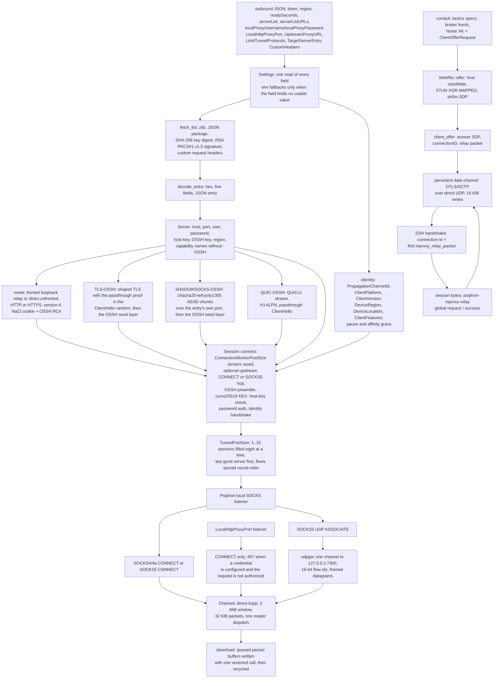

# Psiphon lane (native SSH/OSSH and fronted-meek, signed server list, local SOCKS and HTTP edges)

The lane no longer starts `psiphon-tunnel-core`. It fetches the signed server list, verifies the publisher's RSA signature, decodes the SSH entries, and speaks the OSSH/SSH transport itself: RC4 obfuscation with the seed message, curve25519 key exchange, AES-128-CTR with HMAC-SHA-256, password authentication, and multiplexed `direct-tcpip` channels. The HMAC tag and the 6000-round SHA-1 key derivation run through `ring`'s SHA-NI/AVX paths; both produce the same bytes as the Rust state machines they replaced. A server entry that carries a raw fronted meek capability (`FRONTED-MEEK`, `FRONTED-MEEK-HTTP`, `FRONTED-MEEK-QUIC`, or `FRONTED-MEEK-CDN-QUIC`) keeps the same SSH handshake but reaches it through a loopback relay: the relay carries the SSH bytes in `POST /` bodies over one persistent TLS, HTTP, or HTTP/3 connection to the fronting host, and the first request carries the version-4 meek cookie sealed with NaCl box and obfuscated with the OSSH RC4 stream. An unfronted meek entry (`UNFRONTED-MEEK` or `UNFRONTED-MEEK-HTTPS`) sends the same handshake straight to the server, and an entry that advertises both keeps the fronted configuration for fronting on and promotes the unfronted one for fronting off. A `TLS-OSSH` entry wraps the OSSH stream in a skip-verify shaped TLS session, directly or over the in-proxy data channel, with the ClientHello random carrying the HKDF/HMAC passthrough proof for the entry's meek obfuscated key; a `LimitTunnelProtocols` naming `TLS-OSSH` selects that transport, and an entry with both OSSH and TLS-OSSH gets a TLS variant when the limit names it. A `SHADOWSOCKS-OSSH` entry carries the same OSSH seed and SSH session over a Shadowsocks AEAD stream: a random 32-byte salt, `chacha20-ietf-poly1305` with the entry's `sshShadowsocksKey` (EVP_BytesToKey), sealed two-byte length and payload chunks with a little-endian nonce counter, and the entry's `sshObfuscatedKey` above it. An entry that names `sshObfuscatedQUICPort` gets a `QUIC-OSSH` sibling: one QUICv1 bidirectional stream over rustls' QUIC handshake and a synchronous packet engine with `h3` ALPN and the TLS ClientHello random carrying the passthrough proof, selected by `LimitTunnelProtocols`/`TunnelProtocol`; `limitQUICVersions` selects `QUICv1` (plain datagrams), `RANDOMIZED-QUICv1` (plain datagrams, passthrough proof; the reference's structural ClientHello randomization is not reproduced), `OBFUSCATED-QUICv1`, or `DECOY-QUICv1` (the reference's 12-byte nonce, ChaCha20 over the padding byte and payload, passthrough proof, and the fork's random decoy datagrams). `QUICNoiseProfile` sends the fork's `light`, `firewall`, or `gfw`/`aggressive` junk and signature datagrams before a plain QUICv1 handshake. The client-level `LimitQUICVersions` narrows the entry's `limitQUICVersions` before selection, and a limit without a plain version demotes a fronted HTTP/3 entry to its plain fronted capability. An in-proxy `INPROXY-WEBRTC-SHADOWSOCKS-OSSH` destination carries the same AEAD layer over the WebRTC data channel, and `AdditionalParameters` (base64 JSON) overlays the caller config before any field is read. `DisableTactics` refuses a tactics request with one line when no embedded tactics exist, `MeekAdditionalHeaders` prepends the configured headers, and `SSHChannelWindowSize` sets the channel window. In conduit mode the broker answer opens one persistent WebRTC data channel, the SSH handshake carries the in-proxy connection id and the broker's first relay packet, and the session's bytes ride `psiphon-inproxy-relay` SSH global requests over that channel; the initial relay packet is not sent on the channel before the handshake. The SSH identity carries `DeviceRegion`, `DeviceLocation`, `ClientFeatures`, `PropagationChannelId`, `ClientPlatform` and `ClientVersion`. The proxy still sees one local SOCKS endpoint (loopback by default; `listen` and `shareProxyOnNetwork` can widen it), so its TCP and UDP paths are unchanged, and `LocalHttpProxyPort` adds the CONNECT front the reference client also exposes. `TunnelPoolSize` runs one to thirty-two tunnels in parallel and spreads flows over them round-robin, and a download writes each packet straight from the SSH receive buffer instead of staging it through a relay buffer.

## Data path

## Measured

<!-- counts:begin -->
| key | value | checked by |
| --- | --- | --- |
| ops-per-ssh-handshake | UNBLESSED | scripts/count-ops.sh |
| syscalls-per-relayed-megabyte | UNBLESSED | scripts/count-ops.sh |
| relay-staging-copies-per-byte | UNBLESSED | not measured |
| download-staging-copies-per-byte | 0 | ferrox-app-psiphon-ssh::tests::a_channel_chunk_is_the_packet_allocation |
| flow-clone-allocations | 0 | ferrox-app-psiphon::tests::a_flow_clone_shares_the_credential_words |
| seconds-per-live-transfer | UNBLESSED | .github/workflows/psiphon-live.yml |
<!-- counts:end -->

`flow-clone-allocations` clones a validated `PsiphonOut` inside the counting allocator and holds the count at zero. The credential is one `Arc<Credential>` shared by every clone, and the test checks the allocation count and the `Arc` pointer identity, so a future field that goes back to owning the words fails the row.

`download-staging-copies-per-byte` is zero because `Channel::next_chunk` hands the receiver the pooled packet buffer itself, and `pump_channel` writes that slice to the client before handing it back to the pool; the test asserts the chunk's base pointer is inside the queued buffer, that the buffer's pointer does not move, and that its capacity does not grow. The upload path encrypts the caller's read buffer in place and sends it with one vectored write, so neither direction copies a payload into a relay staging buffer. The kernel copy into and out of those buffers is not a userspace copy, so `relay-staging-copies-per-byte` stays `UNBLESSED` rather than claiming it.

The reader asks for a packet's body and its HMAC tag in one read, so a packet costs two reads rather than three. `PACKET_POOL` is the window in packets plus eight, so the pool is sized to a whole channel window. A data packet's buffer moves into the channel queue and `recycle_chunk` returns it to the shared pool, so a saturated download reuses allocations instead of taking one per packet; `the_packet_pool_stops_at_its_ceiling` holds the cap. The reader's spare holds a control packet's buffer between reads, not the download path. The dispatcher wakes a reader only when the queue goes from empty to non-empty, not once per packet. The download half takes the packets already queued under one receive lock (`drain_chunks`, up to 32), writes them with one `write_vectored` from a stack `IoSlice` array, and returns the whole batch to the pool under one pool lock (`recycle_chunks`), held by `queued_packets_leave_in_one_vectored_write`; the bytes and their order are unchanged. A 64 KiB relay read replaces the 32 KiB read, so a full window costs half the read calls, and `LimitRelayBufferSizes` still selects 4 KiB. `TunnelPoolSize` adds sessions, not paths inside one TCP stream: a flow stays on one tunnel so ordering is unchanged, and separate flows spread over the pool, which is what raises aggregate throughput without a reorder buffer. The pool fills eight tunnels at a time, so a wide pool costs one handshake window, and the last server that answered leads the next reconnect for `EstablishTunnelServerAffinityGracePeriodMilliseconds`.

QUIC-OSSH is a synchronous IETF QUIC stream driven by rustls' sans-IO handshake with the reference's `h3` ALPN; `limitQUICVersions` and the client `LimitQUICVersions` are honoured across `QUICv1`, `RANDOMIZED-QUICv1`, `OBFUSCATED-QUICv1`, and `DECOY-QUICv1`, the obfuscated pair adding the reference's ChaCha20 packet layer and ClientHello random proof, and the decoy variant the fork's random decoy datagrams. Every IETF mode carries the passthrough ClientHello random proof, including plain `QUICv1`. It is the direct QUIC-OSSH rung rather than quiche because rustls exposes the ClientHello random the proof replaces; on rustls 0.23.46 with the ring provider, live run `41803340270` carried 10 MB at 23.47 MiB/s through SOCKS against the pinned console client's 2.89 MiB/s. In-proxy Shadowsocks-OSSH reuses the WebRTC data channel and its key. Fronted `FRONTED-MEEK-QUIC`/`FRONTED-MEEK-CDN-QUIC` entries ride HTTP/3 over quiche on standard QUICv1, with the same version-4 cookie and the fronting SNI; the reference ships that protocol default-disabled. An upstream proxy carries that front over HTTP/1.1 instead, since QUIC cannot ride the proxy. Tapdance and Conjure remain disabled names, matching the reference's own `DefaultDisabledTunnelProtocols`; the lane prints one line instead of dialling them.

The operation and syscall rows are unmeasured: the transport is new and `scripts/count-ops.sh` has no blessed count for it yet. `UNBLESSED` is an open claim, not a figure. The live workflows are the only checkers that see the path to a real Psiphon server.

`ferrox-app psiphon-regions -c FILE` reads the same signed server list, groups its entries by the `region` field, and prints `CC<TAB>count`; `ferrox-cli locations --psiphon` formats those rows. `ferrox-app psiphon-tactics -c FILE` performs the untunneled tactics request through the first `FRONTED-MEEK-TACTICS` entry: the API parameters are sealed with the entry's tactics public key, the ephemeral key is prepended, the seed message and body carry the entry's `tacticsRequestObfuscatedKey` RC4 stream, and the response is deobfuscated in place and opened with the response nonce. It prints the payload tag and TTL, each `InproxyBrokerSpecs` public key, root obfuscation secret and fronting hosts, and each `InproxyCommonCompartmentIDs` value; the request cookie names the `tactics` endpoint and the relay posts to `/`. The public Android build's private-compartment ID is the default for `InproxyClientPersonalCompartmentID`, and `--psiphon-compartment ID` overrides it; the native transport carries the value for the conduit path, whose broker dials consume the tactics specs. `ferrox-app psiphon-broker -c FILE [--sdp FILE]` completes that dial: it reads the same tactics, builds one plaintext HTTPS `POST /inproxy-broker` front from each `InproxyBrokerSpecs` fronting address, runs a Noise XK session with the broker's Ed25519 key (mapped to Curve25519), and sends a `ClientOfferRequest` carrying the base API parameters, the common compartments from tactics, the personal compartment, the SDP offer and the first packed server entry for the in-proxy connection; the reply is decoded into the broker's `ClientOfferResponse`, including the relay packet and proxy answer. Without `--sdp` it gathers a host candidate and up to two tactics STUN candidates with its own RFC 5389 binding request, builds a str0m offer with a random data-channel label, applies the answer, and opens the channel; it does not relay a packet, because the live lane carries the broker's first relay packet in the SSH handshake. `--sdp` supplies the offer and skips local candidate gathering. Generated mode sends STUN and WebRTC UDP directly, so a configured `UpstreamProxyURL` carries only the broker request and the command prints that divergence. Meek is built here in both shapes: `protocolSelection` `cdn_fronting` keeps only entries with a CDN front and falls back to the whole SSH list with one line when none has one, while fronting off uses an entry's unfronted capability. The relay speaks the reference's version-4 cookie, TLS SNI or plain-HTTP `Host`, and the base relay protocol; an entry that advertises both keeps the fronted config and promotes its unfronted config when fronting is off or the fronted address is absent. `FrontedMeekDialOverrides` contributes its `DialAddresses`, `SNIServerName`, `DisableSNI` and `ALPNProtocols`; `FrontedMeekCDNScanSpec` contributes `IPCandidates` and `SNIServerNames`; `FrontedMeekCDNScanUseBuiltInSpec`, `FrontedMeekCDNScanBuiltInSets` and `cdnSets` select the built-in candidate set. An entry that names `sshObfuscatedQUICPort` gets a `QUIC-OSSH` sibling because the rustls QUIC handshake lets the lane replace the 32-byte TLS ClientHello random with the passthrough proof; quiche exposes no such hook, so it carries only fronted HTTP/3. A fronted entry expands to one candidate per dial/SNI pair, capped at 256 per entry and 512 in the list, and the relay rotates through the entry's `meekFrontingAddresses` and `meekFrontingHosts` on reconnect. `meekFrontingDisableSNI` and an override's `DisableSNI` dial the resolved IP as the TLS name, so rustls omits SNI; `ALPNProtocols` keeps `http/1.1`, the only protocol this HTTP relay speaks, and names a list that omits it in one line.

## Time

No bench cell and no conformance suite. Psiphon is a live network service, and a local duration measures the path to its servers, not this code. The local edge is bound before a tunnel exists, so a refused startup is a retried dial rather than a lane that refuses to run; each dial gets at most `EstablishTunnelTimeoutSeconds` (12 by default), scaled by `NetworkLatencyMultiplier` or by a per-dial multiplier sampled from the reference's `NetworkLatencyMultiplierMin`/`Max` range with its `NetworkLatencyMultiplierLambda` shape, `readySeconds` (default 180, capped at one day) bounds the whole race, and `ConnectionWorkerPoolSize` servers (ten by default, thirty or more with `beastMode`/`AggressiveEstablishment`) form one batch, spaced by `StaggerConnectionWorkersMilliseconds` only when the last delay plus a full dial budget still fits `readySeconds`; a server that accepts and then stalls costs one slot instead of the whole window, held by `a_stalled_server_does_not_hold_the_one_that_answers`. A batch that answers nothing is cut at the same dial budget, held by `a_stalled_batch_is_cut_at_its_budget`, so one slow batch cannot spend the whole readiness window; a session that finishes after its batch was decided is dropped and closes its own socket. `.github/workflows/psiphon-live.yml` starts the lane, asserts an exact 10 MB transfer through the SOCKS, mixed and HTTP fronts and a DNS query through the SOCKS5 UDP association, then runs the pinned Go console client on the same runner and pins it to the server and SSH/OSSH or fronted-meek protocol the native lane selected, its SOCKS front on the same 10808 and its HTTP front on 10809 (the native lane's own HTTP edge is 10819, since its mixed inbound holds 10809), and prints native/reference speed, RSS and CPU. `.github/workflows/psiphon-windows.yml` runs the same SOCKS, HTTP and mixed transfer legs beside the engine `Psiphon-Inc/psiphon-windows` ships, checked against the blob hash the pin names; it does not run the UDP DNS check. The native legs gate; the reference legs are measurements, and the runner's own egress is the control. Its `protocol` dispatch input chooses `direct` (SSH/OSSH) or `cdn` (fronted meek); the CDN leg fails unless the native lane establishes a fronted tunnel. The Linux workflow runs on dispatch and weekly; the Windows one runs on dispatch only; neither runs per push, and their durations gate nothing.

## What we removed against the reference

The protocol reference is the pinned `psiphon-tunnel-core` console client; both live workflows now run it (or the engine the Windows client bundles) on the same runner and server as the native lane, with the SOCKS fronts on the same port, each HTTP front on its own port, and `TargetServerEntry` plus `LimitTunnelProtocols` pinning the server and SSH/OSSH shape, so a ratio compares the implementations rather than two carriers. Xray-core, `sing-box` and ZeroNet carry no Psiphon lane.

**The child process and its config.** The lane used to generate a client config, spawn `psiphon-tunnel-core`, read its stderr notices, and wait for `ListeningSocksProxyPort` plus a non-zero tunnel count. That is gone, with the config writer, notice scanner, `BufReader`, stdout drain, and the kill-on-drop path. The lane now owns the socket from the first byte.

**A second SOCKS server.** The reference's local SOCKS listener was a second server between the flow and the tunnel. The local edge here is the lane's own SOCKS4/4a and SOCKS5 server; it speaks the same wire shape the proxy already dials, so `proxy.rs` keeps one code path for both TCP and UDP.

**The reference's server-list client.** The lane fetches the list over its existing HTTPS account client, verifies the publisher digest and signature with `ring`, and decodes entries in place. It keeps the reference's local `serverList`/`serverEntries` file, the remote URL spellings (`RemoteServerListURLs` objects with base64 `URL` values included), custom request headers, the region filter, and the cached `server_entries.txt`.

**The reference's UDP gateway multiplexer.** One SSH channel to `127.0.0.1:7300` carries every flow. A 16-bit id selects the flow, the first write carries `rebind`, and a keepalive is ignored. Each SOCKS UDP association gets a local relay socket and a reader per destination, so replies return to the client that sent the datagram.

**The reference's second front and its upstream hop.** `LocalHttpProxyPort` binds the edge's IP on its own port and serves CONNECT there, answers `407` with a Basic challenge when `localProxyUsername`/`localProxyPassword` name a credential and the request is not authorized, and compares it in constant time; a credentialed edge refuses SOCKS4, which carries no credential exchange, rather than serving it open. `UpstreamProxyURL` dials the SSH server through an HTTP CONNECT or SOCKS5 hop, so a network that only permits its own proxy still reaches a Psiphon server.

**The fork's configuration surface.** `LimitTunnelProtocols` (and the legacy `TunnelProtocol`, with `TLS-OSSH` selecting the TLS transport and `SHADOWSOCKS-OSSH` the Shadowsocks one), `InitialLimitTunnelProtocols` with `InitialLimitTunnelProtocolsCandidateCount`, `TargetServerEntry`, `CustomHeaders` (a string or an array of strings per name, as the reference accepts), `DisableRemoteServerListFetcher`, `SponsorId`, `EgressRegion`, `DataRootDirectory`, `DisableLocalHTTPProxy`, `TunnelPoolSize` (one to thirty-two, forced to one for a targeted entry as the reference does), `ConnectionWorkerPoolSize` (the race width, one to thirty-two) and `ConnectionWorkerPoolMaxSize` (its cap), `DisableConnectionWorkerPool`, `EstablishTunnelTimeoutSeconds`, `EstablishTunnelPausePeriodSeconds` (the wait between establishment cycles), `EstablishTunnelServerAffinityGracePeriodMilliseconds` (the head start the last good server gets), `StaggerConnectionWorkersMilliseconds`, `LimitRelayBufferSizes` (a 4 KiB relay read instead of 64 KiB), `NetworkLatencyMultiplier` (the dial and handshake budget), `NetworkLatencyMultiplierMin`/`Max` and `NetworkLatencyMultiplierLambda` (a per-dial exponential range when no direct multiplier is set), `PropagationChannelId`, `ClientPlatform`, `ClientVersion`, `DeviceRegion`, `DeviceLocation` and `ClientFeatures` (the handshake identity), `ListenInterface` (`any` or an IP address names the edge's bind; an interface name is not resolved and keeps the default bind), and the `shareProxyOnNetwork*` spellings are read, with the same meaning the console client gives them. The Android client's `protocolSelection` accepts `auto`, `direct`, `cdn_fronting` and `conduit`; `conduit` fetches tactics, keeps the in-proxy entries, and runs the same SSH session over a persistent WebRTC data channel. `conduitMode` picks `auto`, `public` or `shirokhorshid`; `ConduitTunnelProtocols` filters in-proxy destinations by their full capability name; `conduitTimeout` (180 seconds by default) bounds the broker dial; a configured `UpstreamProxyURL` refuses conduit mode in one line, because the direct UDP path cannot carry the proxy; `rejectCensoredCountryProxies` expands to the Android client's six censored regions, and `GeoIPDatabasePath` plus `InproxyRejectProxyCountryCodes` reject an observed in-proxy peer whose MaxMind country is listed, and `DNSResolverAlternateServers` gives the lane a synchronous UDP fallback when the system resolver returns no address for a meek front, H3 front, STUN server, upstream proxy, or broker host. `cdn_fronting` keeps only entries with a CDN front; a list with no such entry falls back to the whole SSH list with one line. Its `beastMode`, and the reference's `AggressiveEstablishment`, raise the worker pool to at least thirty; `TargetServerEntry` pins both the worker pool and the tunnel pool to one, is the only candidate, and the active protocol limit still applies to it: the initial limit while its candidate count is in force, otherwise `LimitTunnelProtocols`; a targeted entry whose effective shape the active limit does not name is refused rather than allowed to bypass the limit. A protocol limit keeps only the shapes and meek transports this transport speaks (`SSH`, `UNFRONTED-SSH`, `OSSH`, `TLS-OSSH`, `SHADOWSOCKS-OSSH`, `UNFRONTED-OSSH`, `FRONTED-MEEK-OSSH`, `FRONTED-MEEK-CDN-OSSH`, `FRONTED-MEEK-HTTP-OSSH`, `FRONTED-MEEK-CDN-HTTP-OSSH`, `FRONTED-MEEK-QUIC-OSSH`, `FRONTED-MEEK-CDN-QUIC-OSSH`, `UNFRONTED-MEEK-OSSH`, `UNFRONTED-MEEK-HTTPS-OSSH`); server capabilities are matched without `-OSSH` as the reference does, an HTTPS name does not admit an HTTP front, a limit naming only direct shapes drops every meek entry, and a limit that names a shape but matches no server refuses the lane instead of dialling a prohibited protocol; a limit naming no shape this transport speaks falls back to the whole list with one line. An initial limit is a priority, so when it matches nothing the normal limit still applies. A credential is read the way the console client reads it: `localProxyUsername` and `localProxyPassword` must both be non-empty, and an empty word means no credential rather than an empty one.

**The read copy and the write copy.** The SSH reader used to pull every packet through a 256 KiB `BufReader` and then copy it into the pooled packet; it now reads the pool buffer directly. The client-to-tunnel relay used to copy every 32 KiB chunk into the writer scratch before encrypting it; it now encrypts the read buffer in place and sends header, ciphertext, padding and MAC with one vectored write. Both remove a memcpy per byte without changing the SSH payload, padding rules or MAC input.

**The download staging copy.** The reader handed each payload to the flow through a relay buffer, so every downloaded byte was copied out of its packet before the socket write. `Channel::next_chunk` now lends the packet buffer to the relay, which writes it and returns it to the pool; the pointer-identity test is the witness. The upload side already encrypted in place, so no direction stages a payload copy.

**The meek request staging copy.** The fronted-meek relay built each `POST` as a head and a copied body in one buffer before writing it. The head now goes beside the caller's body — `RecordAlignment::write_all_slices` on TLS, one `writev` on a plain front — so the body is not staged. `the_head_and_body_are_the_request_the_staging_buffer_built` holds the bytes against the staged form, and `the_head_beside_the_body_does_not_allocate_the_body` holds the head below 1 KiB against the staged request's body-sized buffer. What did not move: the HTTP bytes on the wire and the copy the TLS writer makes into its sendable buffer. `write_all_slices` batches the total request in 32 KiB units, so the completion count grows with total request size: a 64 KiB body with a nonempty head uses three completions, one more than the staged form, so a bulk request trades the staged copy for an additional completion.

**The third read per packet.** A packet used to cost a header read, a body read and a separate tag read. The tag follows the body, so the pool buffer reserves its thirty-two bytes and one read takes body and tag together; a packet now costs two reads and the tag is still checked against the plaintext before it is trusted.

**The packet pool under a full window.** The pool held eight buffers while the window allowed sixty-four 32 KiB packets in flight, so a saturated download allocated a buffer for almost every packet and then dropped it. `PACKET_POOL` now covers the whole window plus the packets a flow is writing, and a download returns each packet's allocation through `recycle_chunk`, so the allocator stays out of the steady state; the pool lock remains, once to take and once to return.

**The single tunnel.** The lane used to replace its one session on every reconnect, so every flow shared one TCP connection and one send window. `TunnelPoolSize` keeps up to thirty-two live sessions and picks one per flow round-robin; a flow is still one `direct-tcpip` channel on one session, so byte order and the SSH stream are unchanged, while independent flows use independent connections. `TargetServerEntry` pins the pool to one, as the reference does. The live workflow takes a `pool` dispatch input and, above one, runs eight parallel downloads as the aggregate gate.

**The serial pool fill.** A wide pool used to cost one full handshake window per tunnel, so eight tunnels took eight races before the pool was warm. `fill` now dials eight at a time and spreads each dial to a different starting entry, so the same pool costs one handshake window; a refusal still leaves the tunnels that did answer and the next cycle fills only the gap. The affinity lead and `EstablishTunnelPausePeriodSeconds` decide which server starts first and how long the warm loop waits between cycles.

**The per-packet wake and write.** The dispatcher woke the download reader once per packet, and the reader wrote one packet per call. A wake now happens only when the queue goes from empty to non-empty, and the reader drains the queued packets and writes them with one vectored call; `queued_packets_leave_in_one_vectored_write` holds the call count and the byte order. The kernel copy and the packet buffer identity are unchanged.

**The reference's 128 KiB channel window.** The console client opens a channel with `ChannelWindowSize` packets of 32 KiB, four by default, and its own comment names the trade: a large window backlogs a bulk transfer ahead of new channels. The lane advertises a 2 MiB window and returns credit every 64 KiB, sixteen times the in-flight allowance on one flow, so a copy on a high-RTT path is capped by the path rather than by the window and a peer that advertises the reference's smaller window never drains; the live workflows' 10 MB leg is the measurement.

**A buffer per map pair and a byte loop per length.** The broker codec wrote a CBOR map by encoding each key and each value into its own `Vec` and copying both into the record; it now encodes every pair into one scratch buffer and keeps a table of three offsets per pair, so a 64-pair map costs a bounded set of buffers instead of two per pair, and the canonical order still sorts by the key's own encoded bytes. A record's length field is written into the ten-octet window the record already reserved instead of a heap `Vec` built for at most three octets. `a_map_encodes_through_one_scratch` holds the byte answer against the per-pair order and the allocation count below one per pair while `the_per_pair_encoder_costs_two_buffers_a_pair` measures the old form in the same run; `a_record_writes_its_length_without_a_buffer` holds the one-growth count and `the_length_buffer_costs_an_extra_allocation` measures the heap-length form beside it, both writing the same record bytes. The varint decoder reads its first eight octets in one load and folds the seven-bit fields with three shift-masks, falling back to the byte loop for the nine- and ten-octet widths; `every_uvarint_width_decodes_like_the_byte_loop` sweeps every width and byte value against that loop. What did not move: every encoded octet and its order, and the acceptance of a ten-octet value.

**The decrypted TLS poll.** The TLS-OSSH relay used to read one TLS record and then wait up to a millisecond on the upload side, so a downlink paid the poll interval per record. It now drains up to 1 MiB of decrypted bytes before that poll, which keeps an interactive write responsive while the record path runs at the server's rate; the SSE bytes, the TLS transcript and the OSSH stream above it are unchanged.

**The platform spellings and the keepalive.** The lane reads the capitalised `LocalProxyUsername`/`LocalProxyPassword` the Android fork emits, `DisableTimeouts` (the fork's lambda 0.1, which samples the reference's 1x-3x range instead of shrinking the budget), the reference's `NetworkLatencyMultiplierMin`/`Max`/`Lambda` triple, and sub-1.0 `NetworkLatencyMultiplier` values. A session sends `keepalive@openssh.com` every thirty seconds with random padding and no reply, which is the request the console client uses to keep NAT state alive; `DisablePeriodicSshKeepAlive` and `DisableKeepAlive` turn it off. The keepalive is a control packet: proxied bytes and their order do not move.

**What is still refused.** `RANDOMIZED-QUICv1` is accepted but its structural ClientHello/transport-parameter randomization is not reproduced; `InproxyRejectProxyCIDRs` and `GeoIPDatabasePath` country rejection are applied to the observed WebRTC peer address. Split-tunnel regions, Conjure and Tapdance, and the relay-side knobs have no native transport here. Conjure and Tapdance are disabled in the reference's own `DefaultDisabledTunnelProtocols`; the lane recognizes their names and reports them in one line. Conduit mode refuses a configured upstream proxy instead of sending STUN and data-channel UDP outside it; the in-proxy QUIC and meek destination transports are not carried, while in-proxy Shadowsocks-OSSH is. Direct and in-proxy Shadowsocks-OSSH are carried, but a `ShadowsocksPrefixSpecs` transform is not applied and the salt stays fully random (`disableShadowsocksPrefix` therefore matches). TLS-OSSH carries the passthrough proof but not the TLS padding extension, obfuscated session tickets or randomized SNI host selection. The lane names every setting it does not read in one line rather than pretending to honour it.

## References

| what | where |
| --- | --- |
| the signed package and server-list format | `upstream/psiphon-tunnel-core/psiphon/common/authPackage.go`, `psiphon/remoteServerList.go` |
| the server entry fields and capability names | `upstream/psiphon-tunnel-core/psiphon/common/protocol/serverEntry.go` (`GetCapability`) |
| the Android identity and protocol selection | `upstream/shirokhorshid-android/app/src/main/java/com/psiphon3/psiphonlibrary/TunnelManager.java` |
| the OSSH seed message and RC4 key derivation | `upstream/psiphon-tunnel-core/psiphon/common/obfuscator/obfuscator.go` |
| the TLS-OSSH dial and its passthrough proof | `upstream/psiphon-tunnel-core/psiphon/tlsTunnelConn.go`, `psiphon/common/obfuscator/passthrough.go` |
| the Shadowsocks-OSSH dial and server framing | `upstream/psiphon-tunnel-core/psiphon/shadowsocksConn.go`, `psiphon/server/shadowsocks.go` |
| the QUIC-OSSH dial and ClientHello proof | `upstream/psiphon-tunnel-core/psiphon/common/quic/quic.go`, `psiphon/common/protocol/protocol.go` |
| the fronted-meek relay, cookie and polling | `upstream/psiphon-tunnel-core/psiphon/meekConn.go` |
| the fronting address, SNI and Host selection | `upstream/psiphon-tunnel-core/psiphon/frontingDialParameters.go` |
| the SSH client and `direct-tcpip` | `upstream/psiphon-tunnel-core/psiphon/common/crypto/ssh` |
| the udpgw framing and flags | `upstream/psiphon-tunnel-core/psiphon/udpgw.go` |
| the local SOCKS client and UDP relay | `upstream/xray-core/proxy/socks` |
| the local HTTP front and its credential | `upstream/psiphon-tunnel-core/psiphon/httpProxy.go`, `psiphon/localProxyAuth_test.go` |
| the QUIC noise presets the fork adds | `upstream/psiphon-tunnel-core/psiphon/common/noise/noise.go` |
| the fronted-meek CDN scan sets the fork adds | `upstream/psiphon-tunnel-core/psiphon/frontedMeekCDNScanBuiltIn.go` |

## CI scope

What a change here owes, read by `scripts/ci-scope.py`. The unit tests cover the RC4 vector, key derivation, the RSA DER wrapper, the signed-package shape, entry decoding, the capability-name match, the unfronted fallback, the HTTPS-versus-HTTP limit, the obfuscated banner keystream, the SOCKS UDP frame, the udpgw frame, the HTTP proxy credential and the allocation-free clone. The live lane is built and run beside the pinned console client by `psiphon-live.yml`, and beside the engine `psiphon-windows` ships by `psiphon-windows.yml`; local gates never download or start a Psiphon client.

<!-- scope:begin -->
- paths: crates/ferrox-core/src/psiphon.rs, crates/ferrox-app/src/psiphon.rs, crates/ferrox-app/src/psiphon_ssh.rs, crates/ferrox-app/src/psiphon_meek.rs, crates/ferrox-app/src/psiphon_quic.rs, crates/ferrox-app/src/psiphon_shadowsocks.rs, crates/ferrox-app/src/psiphon_tactics.rs, crates/ferrox-app/src/psiphon_broker.rs, crates/ferrox-app/src/psiphon_webrtc.rs, dist/ferrox-cli.sh
- symbols: psiphon_ssh
<!-- scope:end -->
