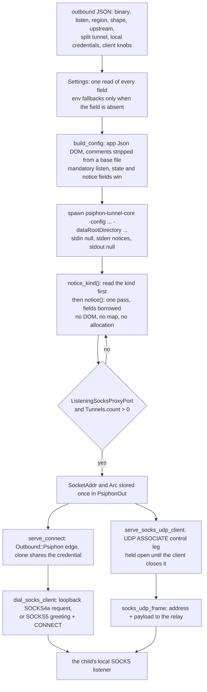

# Psiphon lane (its own client, its notices, and a local SOCKS hop)

The Psiphon console client (`psiphon-tunnel-core`) owns the tunnel, the server list, the shaping and the retry. This lane starts it once with a generated config, reads the one-line JSON notices it writes, waits for the port it announces and for a first tunnel, and then dials every flow through that local SOCKS server with the tree's own client lane. The process is a child of the lane and is ended with it; the flow path never formats a config, parses a notice or formats the announced endpoint again.

## Data path

## Measured

<!-- counts:begin -->
| key | value | checked by |
| --- | --- | --- |
| ops-retired-instructions | UNBLESSED | scripts/count-ops.sh |
| syscalls-per-notice-line | UNBLESSED | scripts/count-ops.sh |
| notice-scan-allocations-per-line | 0 | ferrox-core-psiphon::tests::a_notice_scan_takes_no_buffer_of_its_own |
| notice-line-copies-when-it-fits | 0 | ferrox-app-psiphon::tests::a_notice_line_is_visited_where_the_reader_holds_it |
| notice-line-allocations-when-it-fits | 0 | ferrox-app-psiphon::tests::a_notice_line_that_fits_the_reader_takes_no_buffer |
| flow-clone-allocations | 0 | ferrox-app-psiphon::tests::a_flow_clone_shares_the_credential_words |
| seconds-per-live-transfer | UNBLESSED | .github/workflows/psiphon-live.yml |
<!-- counts:end -->

`notice-scan-allocations-per-line` runs the scanner over a real `ListeningSocksProxyPort` line inside the counting allocator and holds the count at zero: the notice's kind, message and address point into the caller's line, so the readiness path allocates no DOM, no map and no owned string per line. The scanner's tests also pin the borrowed message and address, a malformed line, an escaped message, the tunnel count, and a line that is not one JSON object. `read_notice_line` visits the line inside the `BufReader`'s own buffer; `a_notice_line_is_visited_where_the_reader_holds_it` asserts the slice is the reader's buffer at the line's offset, and `a_notice_line_that_fits_the_reader_takes_no_buffer` holds the allocation count at zero. The `BufReader` buffer itself is allocated once when the reader starts, not once per notice; only a line longer than that buffer is copied into the spill, and `a_notice_line_longer_than_the_reader_is_joined_once` covers it.

`flow-clone-allocations` clones a started `PsiphonOut` inside the counting allocator and holds the count at zero. The credential is one `Arc<Credential>` shared by every clone, and the test checks both the allocation count and the two strings' pointer identity, so a future field that goes back to owning the words fails the row.

## Time

No bench cell and no conformance suite. Psiphon is an external program and a live network service, so a local duration measures the path to its servers, not this code. The readiness wait is bounded by `readySeconds` (default 180, capped at one day), and no duration is quoted. The only local gate is the fake client in `ferrox-app-psiphon`, which writes the two notices and holds the lane to the port it announced; it proves the startup contract, not throughput. `.github/workflows/psiphon-live.yml` is the live check: it builds the pinned console client, starts the lane, asserts an exact 1 MB transfer through the socks and mixed fronts, and sends a DNS query through the client's SOCKS5 UDP association. The runner's own egress and the console client with no lane are the controls. It runs on dispatch and weekly, never per push; its durations are reported against those controls and gate nothing. It also samples the lane and its client process after the warm leg and reports RSS and CPU in the summary. `.github/workflows/psiphon-windows.yml` runs the same lane on `windows-latest` twice, once with the pinned client and once with the console engine `Psiphon-Inc/psiphon-windows` bundles, then prints the pinned-over-Windows time and speed ratios for the same three legs, plus each process's RSS and cumulative CPU seconds. It is dispatch-only, fetches the GPLv3 pin at run time, commits neither its source nor its binary, and its ratios suggest rather than gate.

The notice scan itself is pure CPU, so two earlier versions were compared in release builds while the changes below were chosen. No CI job reports this scan's duration, so no figure is quoted here: what is quoted is the emitted code, which is the same on every host of an architecture. Two of those changes moved and one did not. The field scan now costs no call, which the emitted code named below is the evidence for. A one-pass reader that classified each 64-byte window into a quote mask and a backslash-run parity mask, so that the grammar stepping was a `trailing_zeros` over the line instead of a scan per field, was written and measured slower: a notice's fields are eight to fifteen bytes, so the scan stops inside its first block and the per-window classification was the larger cost. It is not in this tree, and the byte walk stays. The 16-byte SSE2 tail and the kind-first skip ship on the byte-equality sweeps and the kind comparison, not on a new duration.

## What we removed against the reference

Xray-core, `sing-box` and ZeroNet carry no Psiphon lane and no `psiphon-tunnel-core` child, so there is no equivalent method to remove against; the only overlap is the SOCKS5 client, compared on [socks.md](socks.md), and the reference for this page is the pinned console client, with the live workflow's direct client control as its own baseline.

**The JSON DOM on the readiness path.** The reference writes each notice through a JSON decoder and an owned value tree. This lane scans the line once and borrows the fields where they landed, which is the zero-allocation row above. A message with an escape is left out rather than half-decoded, because the scanner refuses what it cannot return as a borrowed slice.

**A full parse of a notice the lane does not act on.** The watch loop parsed every diagnostic line, including the many kinds whose fields it never reads. `notice_kind` now reads the leading `noticeType` first, and a line outside the eight kinds the lane acts on is dropped there rather than walking its data payload. The acted-on kinds still take the same full scan, so the readiness and warning paths see the same fields; `the_kind_is_read_before_the_data_is_parsed` holds the prefix reader to the full reader for a `noticeType` first and for one written after its data.

**A credential copied into every flow.** The outbound used to own its two credential strings, so every `Outbound::Psiphon` clone copied both. It now owns one `Arc<Credential>`; a flow clone bumps one refcount and shares the same bytes, and `a_flow_clone_shares_the_credential_words` holds the clone to zero allocations and the same string pointers.

**A stdout drain thread that read nothing.** The console client writes its notices to stderr; stdout was piped only to keep a full pipe from blocking the child, and a thread drained it. `Stdio::null()` gives the child a null sink instead, so the lane starts one thread fewer and never wakes for bytes it does not use.

**A config assembled through a serializer.** The client config is a small, fixed set of fields. It is written with the app's existing `Json` writer into one `String`; the lane does not add a serializer dependency, and a base config's comments are stripped in place with the core scanner before the overlay. The mandatory `DataRootDirectory`, `LocalSocksProxyPort` and notice fields are applied after the base file, so a sample config cannot silently move the lane's own state or port. The state directory must be owned by the current uid, and the config is opened with `O_NOFOLLOW` and 0600 on the open handle, so a planted symlink cannot redirect the write.

**The SOCKS5 greeting on every loopback flow.** The client's local listener exempts a loopback peer from RFC 1929 authentication, though it still answers SOCKS4a. A loopback listener with an IPv4 or named destination now takes one SOCKS4a request and one reply instead of a greeting round trip, a request and a reply; an IPv6 destination has no SOCKS4 form and keeps SOCKS5. A configured local credential is still validated and written to the client config, but the loopback lane sends none, because the listener it talks to never asks. `a_loopback_listener_takes_socks4a_without_the_credential` and `a_non_loopback_listener_keeps_socks5_and_its_credential` hold the choice on both sides.

**The endpoint formatted and parsed per flow.** The scanner hands the announced port to the readiness thread, which stores one parsed `SocketAddr` in `PsiphonOut` beside the credential and version a flow needs. A flow borrows those fields; it does not join or parse `127.0.0.1:port` again, and it does not build a `SocksOut` of its own to reach the local listener.

**A 32-byte scan where the CPU can walk 128.** The AVX2 paths load four 256-bit blocks per turn, combine each pair of movemasks into one 64-bit word, and hand a sub-128-byte tail to the 16-byte SSE2 block, then the eight-byte SWAR word. A 16- to 31-byte field stays on SSE2 rather than dropping to two eight-byte SWAR words, and an AVX2-less x86-64 CPU walks two 16-byte blocks per turn through the same path. The NEON paths load two 128-bit vectors per turn and use the same low-then-high order. The order is the same as the byte scan: the first matching byte in the low block wins, then the high block, then the tail. `the_wide_scan_is_the_byte_scan` and `the_single_byte_scan_is_the_byte_scan` sweep every alignment and length through the public dispatch on the x86_64 and aarch64 CI jobs; x86_64 takes the AVX2 path only when the runner reports it, and an input shorter than a block uses the SSE2 or SWAR tail on either architecture, so the sweep tests whichever path that job has.

**A call and a returned struct per scanned field.** The NEON scanner could not be written with intrinsics and stay cheap: `#[target_feature]` is a boundary the inliner will not cross, so every field cost a call, a 64-byte frame and an out-pointer struct round trip, which the emitted code shows as `bl` plus a store and three reloads. It is now one block of assembly with no feature boundary, so it inlines: the compare, the four eight-lane finds and the loop sit inside the field scan, and one `fmov` per half carries the lanes to the integer registers where the find is a `clz` over their trailing zeros. aarch64 has NEON in its base ISA, so the runtime feature test is gone with it, and `find_byte` uses the same block with the needle in both lanes rather than a second copy. The same sweeps hold it to the byte scan, and the emitted code no longer contains the symbol.

**An uninitialized relay window.** The non-Linux poll pump handed `Read` a `Vec` with a length but no initialized bytes, which is undefined behavior even when the read fills the whole window. The window is now initialized once at the start of the leg, so a read only ever writes into memory it owns; the length, the headroom, the pointer and the capacity are unchanged across a read, and `a_relay_leg_window_keeps_its_quantum_after_leaving_the_buffer` holds them. The zero pass is not removed: it is the cost of a sound window, and it happens once per leg rather than once per flow byte.

**A second walk over every quoted field, and a trim before the parser.** The scanner stepped a quoted field byte by byte and `text` walked it twice, once to find the end and once to ask whether a backslash was inside. `next_quote_or_backslash` finds either byte one eight-byte block at a time and returns the field and its escaped flag from the same walk, so a readiness line costs one pass per quoted field. `strip_comments` uses the same word scan: outside a string it jumps to the next quote or slash, inside one to the next quote or backslash, and a block comment to its `*`. The notice reader's newline, the comment's `*` and its newline use `find_byte`, which on x86 spends one lane instead of two, half the marks `next_of` would on the same block, and on aarch64 reuses the inlined block with the needle in both lanes. `the_word_scan_is_the_byte_scan` holds the field scan to the byte scan at every alignment, `the_single_byte_scan_is_the_byte_scan` holds the one-lane scan to it over every pad and length, and `the_word_strip_is_the_byte_strip` holds the comment strip to the byte strip over twenty thousand random documents. The watch loop also handed `notice` a trimmed line built by `line_body`; the scanner already steps over leading and trailing space, so the raw line with its newline goes in and the copy is gone. `a_notice_is_read_from_the_line_with_its_newline` proves the raw line parses to the same notice.

**A byte-at-a-time config writer and reader.** The writer pushed one byte at a time and the parser pushed one `char` at a time, which also double-encoded non-ASCII text. `next_json_special` finds the next quote, backslash or control byte a word at a time; the writer copies the run before it with one `push_str`, and the parser copies the run as a UTF-8 `&str`. `the_word_scan_is_the_byte_scan_for_a_json_string` holds the scanner to the byte scan, and `a_written_string_is_the_bytes_the_parser_reads` round-trips control bytes and non-ASCII text.

**A copy of every notice line.** The watch loop read each line into a reusable `Vec` before parsing it. `read_notice_line` now visits the line where the reader holds it; only a line longer than the reader's buffer is copied, once, into a spill. `a_notice_line_is_visited_where_the_reader_holds_it`, `a_notice_line_that_fits_the_reader_takes_no_buffer` and `a_notice_line_longer_than_the_reader_is_joined_once` are the three checks.

What is **not** removed: the client's own TLS, server-list fetch, tunnel and pacing; one config write and one `create_dir_all` at startup; one `BufReader` per client; one process and one notice thread; the one-time zero pass over each relay window; and the SOCKS handshake every flow pays to the local listener. A loopback listener takes the SOCKS4 request — its `SOCKS4a` form when the destination is a name, so an IPv4 literal never carries one — for one write and one read; an IPv6 destination or a non-loopback listener stays on SOCKS5, where a no-auth flow writes the greeting, waits for the method reply, then writes the request, because the Psiphon client's Go SOCKS server rejects a request already sitting in its buffer. A credentialed non-loopback flow writes the greeting, the credential and the request in the same order. The lane carries TCP and UDP. A stream flow pays that SOCKS4 request, or the SOCKS5 `CONNECT` greeting and request when the destination is IPv6 or the listener is not loopback; a datagram flow opens one SOCKS5 `UDP ASSOCIATE` control leg and frames every payload through the relay address the client names, so the client's local listener owns the datagram path; the upstream handshake is bounded by the handshake budget, and the client closing its control leg ends the lane rather than waiting out the idle budget. The client may still use its own QUIC transport to a server; that is the client's tunnel, not a datagram the lane claims to carry. The reference's modes, region validation, CDN fronting fields, split-tunnel regions, local proxy credentials, client features, latency multiplier, TLS/QUIC profile limits, tunnel and worker pool sizes, aggressive establishment, buffer/CPU limits, initial protocol limits, comments in a base config, server-entry file and `AETHER_PSIPHON_*` environment spellings are kept. The Shirokhorshid Android knobs are carried too, under both the client's own names and the Android preference names: `protocolSelection` for the shape, `egressRegion` for the region, `shareProxyOnNetworkUsername`/`Password`, `conduitTimeout`, `RemoteServerListURLs`, `cdnFrontingCustomIpList`/`Sni`, `unsafeTrafficAlerts`, numeric `deviceLocationPrecision`, `beastMode` and `inproxyClientPersonalCompartmentId`, plus `shareProxyOnNetworkSocksPort`/`HttpPort` for the shared listeners. The feature set itself is unchanged: a `conduit` shape over the in-proxy WebRTC protocols, a personal compartment, the censored-proxy country list with its GeoIP database, `disableTimeouts` as a 0.1 latency lambda, alternate DNS resolvers, the device location/region/network id, base64 `AdditionalParameters`, the establishment timeout, byte-transfer notices and the built-in CDN edge profile with its custom SNI. The relay side of the same mode is carried as well: the proxy's own compartment, common and personal client caps, per-second upstream and downstream budgets, rejected proxy CIDRs, relay activity notices, and the establishment pause and worker stagger, held to the generated config by `the_relay_side_knobs_reach_the_config`. A cap switches the relay on: `InproxyEnableProxy` is written whenever one is set, because the client creates and runs its proxy inside `if config.InproxyEnableProxy` and merely validates the caps under it, so a config with caps and no flag runs no relay at all. A relay setting that only the relay acts on and no cap is refused in one line rather than written into a config the client starts no proxy for, which `a_relay_setting_without_a_cap_is_refused` holds. The same block carries a scheduled reduced window — `inproxyReducedStartTime`/`EndTime` in the client's `HH:MM`, the reduced common cap and the reduced per-second budgets — read only when all three required parts are present, so an absent schedule stays absent; the client's own refusals are kept (two equal ends, and a reduced cap above the common cap it reduces or with no common cap at all), and its deprecated `InproxyReducedMaxClients` is read as the modern field it promotes into. `a_reduced_relay_reaches_the_config_in_the_clients_own_clock` holds the window, `a_time_of_day_is_the_clients_own_clock` holds the parser, `the_clients_deprecated_reduced_cap_is_read_as_the_modern_one` holds the promotion, and `a_reduced_relay_needs_a_whole_window_inside_the_cap` holds each refusal. The reachability toggles (`inproxyDisablePortMapping`, `inproxyDisableSTUN`, `inproxyDisableIPv6ICECandidates`, `inproxyDisableInboundForMobileNetworks`), the activity notice period, both STUN server lists, the announce delay, its jitter, the destination dial timeout and WebRTC debug logging reach the config too, held by `the_reachability_knobs_reach_the_config`. `disableTunnels` is the one relay knob that is refused rather than carried: the client creates its SOCKS server inside `if !config.DisableTunnels`, so that mode opens no tunnel and no local listener, and a lane waiting for `Tunnels.count` and `ListeningSocksProxyPort` would wait out `readySeconds` twice for a port that is never bound. `a_lane_that_only_donates_is_refused` holds the refusal and names the mode. A country list without a GeoIP database is not sent, because the client would ignore it; the lane says so in one line.

The defaults follow the Android reference rather than the older console sample: fronted CDN edges are enabled for `Auto`, `Cdn` and `Direct` (with the built-in scan always on and custom IPs additive), aggressive establishment is on unless `aggressiveEstablishment:false` or `--psiphon-no-aggressive` says otherwise, a direct lane keeps the fronted non-QUIC fallbacks, and an unchained `Auto` without a personal compartment leaves the protocol list to the client while keeping the in-proxy probability at zero. When `conduitMode` is `auto` with a personal compartment, any error from the personal attempt triggers one public retry without the compartment, not only a timeout; `shirokhorshid` keeps the compartment only, and `public` never sends it. `shareProxyOnNetwork` listens on every interface, and its SOCKS and HTTP port preferences become the shared listeners; a shared port named without sharing stays on loopback, so a port alone never puts the client's unauthenticated listener on every interface, which `a_shared_port_without_sharing_stays_on_loopback` holds. The client derives one listen address from `ListenInterface` and hands it to both its SOCKS and HTTP servers, so an HTTP address on the other side of that interface is refused rather than silently ignored, which `an_http_listener_cannot_be_bound_on_the_socks_listeners_other_side` holds. `serverListURLs`/`remoteServerListURLs` and `obfuscatedServerListRootUrls` feed the client's remote and obfuscated bootstrap lists; `serverEntrySignaturePublicKey` and `exchangeObfuscationKey` feed server-entry exchange.

## References

| what | where |
| --- | --- |
| the client, its modes, config fields and notice parsing | `upstream/aether/aether/src/psiphon.rs` |
| the Shirokhorshid Android knobs and CDN edge list | `upstream/psiphon-tunnel-core/psiphon/frontedMeekCDNScanBuiltIn.go`, the Shirokhorshid `TunnelManager` |
| the Windows console engine the comparison runs | `upstream/psiphon-windows/src/3rdParty/psiphon-tunnel-core.exe` |
| the SOCKS5 client handshake and relay used by a flow | `upstream/xray-core/proxy/socks` |

## CI scope

What a change here owes, read by `scripts/ci-scope.py`. The fake-client test drives the lane through process spawn, config write, notice scan, endpoint storage and drop; it is the only local gate for the app seam. The live client is built from the pin by `psiphon-live.yml`; local gates never download it.

<!-- scope:begin -->
- paths: crates/ferrox-core/src/psiphon.rs, crates/ferrox-app/src/psiphon.rs, dist/ferrox-cli.sh
- symbols: find_outbound
<!-- scope:end -->
