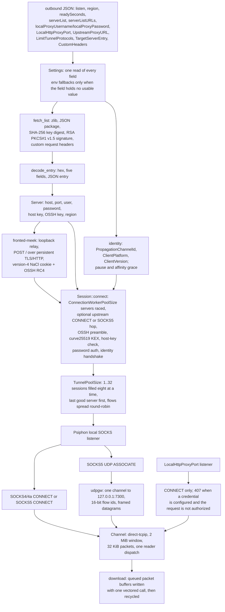

# Psiphon lane (native SSH/OSSH and fronted-meek, signed server list, local SOCKS and HTTP edges)

The lane no longer starts `psiphon-tunnel-core`. It fetches the signed server list, verifies the publisher's RSA signature, decodes the SSH entries, and speaks the OSSH/SSH transport itself: RC4 obfuscation with the seed message, curve25519 key exchange, AES-128-CTR with HMAC-SHA-256, password authentication, and multiplexed `direct-tcpip` channels. A server entry that carries `FRONTED-MEEK-OSSH` or `FRONTED-MEEK-CDN-OSSH` keeps the same SSH handshake but reaches it through a loopback relay: the relay carries the SSH bytes in `POST /` bodies over one persistent TLS/HTTP connection to the fronting host, and the first request carries the version-4 meek cookie sealed with NaCl box and obfuscated with the OSSH RC4 stream. The proxy still sees one local SOCKS endpoint (loopback by default; `listen` and `shareProxyOnNetwork` can widen it), so its TCP and UDP paths are unchanged, and `LocalHttpProxyPort` adds the CONNECT front the reference client also exposes. `TunnelPoolSize` runs one to thirty-two tunnels in parallel and spreads flows over them round-robin, and a download writes each packet straight from the SSH receive buffer instead of staging it through a relay buffer.

## Data path

## Measured

<!-- counts:begin -->
| key | value | checked by |
| --- | --- | --- |
| ops-per-ssh-handshake | UNBLESSED | scripts/count-ops.sh |
| syscalls-per-relayed-megabyte | UNBLESSED | scripts/count-ops.sh |
| relay-staging-copies-per-byte | UNBLESSED | not measured |
| download-staging-copies-per-byte | 0 | ferrox-app-psiphon-ssh::tests::a_channel_chunk_is_the_packet_allocation |
| flow-clone-allocations | 0 | ferrox-app-psiphon::tests::a_flow_clone_shares_the_credential_words |
| seconds-per-live-transfer | UNBLESSED | .github/workflows/psiphon-live.yml |
<!-- counts:end -->

`flow-clone-allocations` clones a validated `PsiphonOut` inside the counting allocator and holds the count at zero. The credential is one `Arc<Credential>` shared by every clone, and the test checks the allocation count and the `Arc` pointer identity, so a future field that goes back to owning the words fails the row.

`download-staging-copies-per-byte` is zero because `Channel::next_chunk` hands the receiver the pooled packet buffer itself, and `pump_channel` writes that slice to the client before handing it back to the pool; the test asserts the chunk's base pointer is inside the queued buffer, that the buffer's pointer does not move, and that its capacity does not grow. The upload path encrypts the caller's read buffer in place and sends it with one vectored write, so neither direction copies a payload into a relay staging buffer. The kernel copy into and out of those buffers is not a userspace copy, so `relay-staging-copies-per-byte` stays `UNBLESSED` rather than claiming it.

The reader asks for a packet's body and its HMAC tag in one read, so a packet costs two reads rather than three. `PACKET_POOL` is the window in packets plus eight, so the pool is sized to a whole channel window. A data packet's buffer moves into the channel queue and `recycle_chunk` returns it to the shared pool, so a saturated download reuses allocations instead of taking one per packet; `the_packet_pool_stops_at_its_ceiling` holds the cap. The reader's spare holds a control packet's buffer between reads, not the download path. The dispatcher wakes a reader only when the queue goes from empty to non-empty, not once per packet, and the download half takes the packets already queued and writes them with one `write_vectored`, held by `queued_packets_leave_in_one_vectored_write`; the bytes and their order are unchanged. `TunnelPoolSize` adds sessions, not paths inside one TCP stream: a flow stays on one tunnel so ordering is unchanged, and separate flows spread over the pool, which is what raises aggregate throughput without a reorder buffer. The pool fills eight tunnels at a time, so a wide pool costs one handshake window, and the last server that answered leads the next reconnect for `EstablishTunnelServerAffinityGracePeriodMilliseconds`.

The operation and syscall rows are unmeasured: the transport is new and `scripts/count-ops.sh` has no blessed count for it yet. `UNBLESSED` is an open claim, not a figure. The live workflows are the only checkers that see the path to a real Psiphon server.

`ferrox-app psiphon-regions -c FILE` reads the same signed server list, groups its entries by the `region` field, and prints `CC<TAB>count`; `ferrox-cli locations --psiphon` formats those rows. The public Android build's private-compartment ID is the default for `InproxyClientPersonalCompartmentID`, and `--psiphon-compartment ID` overrides it; the native transport carries the value for the conduit path that is not built here. Fronted-meek is built here: `protocolSelection` `cdn_fronting` keeps only entries with a CDN front and the relay speaks the reference's version-4 cookie, TLS SNI, `Host` header and `FRONTED-MEEK-OSSH` relay protocol.

## Time

No bench cell and no conformance suite. Psiphon is a live network service, and a local duration measures the path to its servers, not this code. The local edge is bound before a tunnel exists, so a refused startup is a retried dial rather than a lane that refuses to run; each dial gets at most `EstablishTunnelTimeoutSeconds` (12 by default), scaled by `NetworkLatencyMultiplier`, `readySeconds` (default 180, capped at one day) bounds the whole race, and `ConnectionWorkerPoolSize` servers (ten by default, thirty or more with `beastMode`/`AggressiveEstablishment`) form one batch, spaced by `StaggerConnectionWorkersMilliseconds` only when the last delay plus a full dial budget still fits `readySeconds`; a server that accepts and then stalls costs one slot instead of the whole window, held by `a_stalled_server_does_not_hold_the_one_that_answers`. A batch that answers nothing is cut at the same dial budget, held by `a_stalled_batch_is_cut_at_its_budget`, so one slow batch cannot spend the whole readiness window; a session that finishes after its batch was decided is dropped and closes its own socket. `.github/workflows/psiphon-live.yml` starts the lane, asserts an exact 1 MB transfer through the SOCKS, mixed and HTTP fronts and a DNS query through the SOCKS5 UDP association, then runs the pinned Go console client on the same runner and pins it to the server and SSH/OSSH protocol the native lane selected, its SOCKS front on the same 10808 and its HTTP front on 10809 (the native lane's own HTTP edge is 10819, since its mixed inbound holds 10809), and prints native/reference speed, RSS and CPU. `.github/workflows/psiphon-windows.yml` runs the same SOCKS, HTTP and mixed transfer legs beside the engine `Psiphon-Inc/psiphon-windows` ships, checked against the blob hash the pin names; it does not run the UDP DNS check. The native legs gate; the reference legs are measurements, and the runner's own egress is the control. The Linux workflow runs on dispatch and weekly; the Windows one runs on dispatch only; neither runs per push, and their durations gate nothing.

## What we removed against the reference

The protocol reference is the pinned `psiphon-tunnel-core` console client; both live workflows now run it (or the engine the Windows client bundles) on the same runner and server as the native lane, with the SOCKS fronts on the same port, each HTTP front on its own port, and `TargetServerEntry` plus `LimitTunnelProtocols` pinning the server and SSH/OSSH shape, so a ratio compares the implementations rather than two carriers. Xray-core, `sing-box` and ZeroNet carry no Psiphon lane.

**The child process and its config.** The lane used to generate a client config, spawn `psiphon-tunnel-core`, read its stderr notices, and wait for `ListeningSocksProxyPort` plus a non-zero tunnel count. That is gone, with the config writer, notice scanner, `BufReader`, stdout drain, and the kill-on-drop path. The lane now owns the socket from the first byte.

**A second SOCKS server.** The reference's local SOCKS listener was a second server between the flow and the tunnel. The local edge here is the lane's own SOCKS4/4a and SOCKS5 server; it speaks the same wire shape the proxy already dials, so `proxy.rs` keeps one code path for both TCP and UDP.

**The reference's server-list client.** The lane fetches the list over its existing HTTPS account client, verifies the publisher digest and signature with `ring`, and decodes entries in place. It keeps the reference's local `serverList`/`serverEntries` file, the remote URL spellings (`RemoteServerListURLs` objects with base64 `URL` values included), custom request headers, the region filter, and the cached `server_entries.txt`.

**The reference's UDP gateway multiplexer.** One SSH channel to `127.0.0.1:7300` carries every flow. A 16-bit id selects the flow, the first write carries `rebind`, and a keepalive is ignored. Each SOCKS UDP association gets a local relay socket and a reader per destination, so replies return to the client that sent the datagram.

**The reference's second front and its upstream hop.** `LocalHttpProxyPort` binds the edge's IP on its own port and serves CONNECT there, answers `407` with a Basic challenge when `localProxyUsername`/`localProxyPassword` name a credential and the request is not authorized, and compares it in constant time; a credentialed edge refuses SOCKS4, which carries no credential exchange, rather than serving it open. `UpstreamProxyURL` dials the SSH server through an HTTP CONNECT or SOCKS5 hop, so a network that only permits its own proxy still reaches a Psiphon server.

**The fork's configuration surface.** `LimitTunnelProtocols` (and the legacy `TunnelProtocol`), `InitialLimitTunnelProtocols` with `InitialLimitTunnelProtocolsCandidateCount`, `TargetServerEntry`, `CustomHeaders` (a string or an array of strings per name, as the reference accepts), `DisableRemoteServerListFetcher`, `SponsorId`, `EgressRegion`, `DataRootDirectory`, `DisableLocalHTTPProxy`, `TunnelPoolSize` (one to thirty-two, forced to one for a targeted entry as the reference does), `ConnectionWorkerPoolSize` (the race width, one to thirty-two) and `ConnectionWorkerPoolMaxSize` (its cap), `DisableConnectionWorkerPool`, `EstablishTunnelTimeoutSeconds`, `EstablishTunnelPausePeriodSeconds` (the wait between establishment cycles), `EstablishTunnelServerAffinityGracePeriodMilliseconds` (the head start the last good server gets), `StaggerConnectionWorkersMilliseconds`, `LimitRelayBufferSizes` (a 4 KiB relay read instead of 32 KiB), `NetworkLatencyMultiplier` (the dial and handshake budget), `PropagationChannelId`, `ClientPlatform` and `ClientVersion` (the handshake identity), `ListenInterface` (`any` or an IP address names the edge's bind; an interface name is not resolved and keeps the default bind), and the `shareProxyOnNetwork*` spellings are read, with the same meaning the console client gives them. The Android client's `protocolSelection` accepts `auto`, `direct` and `cdn_fronting`; `conduit` falls back to the SSH list with one line because it needs volunteer relays. `cdn_fronting` keeps only entries with a CDN front; a list with no such entry falls back to the whole SSH list with one line. Its `beastMode`, and the reference's `AggressiveEstablishment`, raise the worker pool to at least thirty; `TargetServerEntry` pins both the worker pool and the tunnel pool to one, is the only candidate, and the active protocol limit still applies to it: the initial limit while its candidate count is in force, otherwise `LimitTunnelProtocols`; a targeted entry whose effective shape the active limit does not name is refused rather than allowed to bypass the limit. A protocol limit keeps only the shapes this transport speaks (`SSH`, `UNFRONTED-SSH`, `OSSH`, `UNFRONTED-OSSH`, `FRONTED-MEEK-OSSH`, `FRONTED-MEEK-CDN-OSSH`); it names the values it ignores in one line, and a limit that leaves nothing falls back to the whole list rather than an empty lane. A credential is read the way the console client reads it: `localProxyUsername` and `localProxyPassword` must both be non-empty, and an empty word means no credential rather than an empty one.

**The read copy and the write copy.** The SSH reader used to pull every packet through a 256 KiB `BufReader` and then copy it into the pooled packet; it now reads the pool buffer directly. The client-to-tunnel relay used to copy every 32 KiB chunk into the writer scratch before encrypting it; it now encrypts the read buffer in place and sends header, ciphertext, padding and MAC with one vectored write. Both remove a memcpy per byte without changing the SSH payload, padding rules or MAC input.

**The download staging copy.** The reader handed each payload to the flow through a relay buffer, so every downloaded byte was copied out of its packet before the socket write. `Channel::next_chunk` now lends the packet buffer to the relay, which writes it and returns it to the pool; the pointer-identity test is the witness. The upload side already encrypted in place, so no direction stages a payload copy.

**The third read per packet.** A packet used to cost a header read, a body read and a separate tag read. The tag follows the body, so the pool buffer reserves its thirty-two bytes and one read takes body and tag together; a packet now costs two reads and the tag is still checked against the plaintext before it is trusted.

**The packet pool under a full window.** The pool held eight buffers while the window allowed sixty-four 32 KiB packets in flight, so a saturated download allocated a buffer for almost every packet and then dropped it. `PACKET_POOL` now covers the whole window plus the packets a flow is writing, and a download returns each packet's allocation through `recycle_chunk`, so the allocator stays out of the steady state; the pool lock remains, once to take and once to return.

**The single tunnel.** The lane used to replace its one session on every reconnect, so every flow shared one TCP connection and one send window. `TunnelPoolSize` keeps up to thirty-two live sessions and picks one per flow round-robin; a flow is still one `direct-tcpip` channel on one session, so byte order and the SSH stream are unchanged, while independent flows use independent connections. `TargetServerEntry` pins the pool to one, as the reference does. The live workflow takes a `pool` dispatch input and, above one, runs eight parallel downloads as the aggregate gate.

**The serial pool fill.** A wide pool used to cost one full handshake window per tunnel, so eight tunnels took eight races before the pool was warm. `fill` now dials eight at a time and spreads each dial to a different starting entry, so the same pool costs one handshake window; a refusal still leaves the tunnels that did answer and the next cycle fills only the gap. The affinity lead and `EstablishTunnelPausePeriodSeconds` decide which server starts first and how long the warm loop waits between cycles.

**The per-packet wake and write.** The dispatcher woke the download reader once per packet, and the reader wrote one packet per call. A wake now happens only when the queue goes from empty to non-empty, and the reader drains the queued packets and writes them with one vectored call; `queued_packets_leave_in_one_vectored_write` holds the call count and the byte order. The kernel copy and the packet buffer identity are unchanged.

**The reference's 128 KiB channel window.** The console client opens a channel with `ChannelWindowSize` packets of 32 KiB, four by default, and its own comment names the trade: a large window backlogs a bulk transfer ahead of new channels. The lane advertises a 2 MiB window and adjusts at 1 MiB, sixteen times the in-flight allowance on one flow, so a copy on a high-RTT path is capped by the path rather than by the window; the live workflows' 1 MB leg is the measurement.

**What is still refused.** QUIC noise profiles (`QUICNoiseProfile` presets, junk and signature datagrams before a QUIC handshake) and the built-in fronted-meek CDN scan candidate sets are not carried; in-proxy WebRTC conduits, split-tunnel regions, Conjure and Tapdance, and the relay-side knobs have no native transport here. The lane names every setting it does not read in one line rather than pretending to honour it.

## References

| what | where |
| --- | --- |
| the signed package and server-list format | `upstream/psiphon-tunnel-core/psiphon/common/authPackage.go`, `psiphon/remoteServerList.go` |
| the server entry fields | `upstream/psiphon-tunnel-core/psiphon/common/protocol/serverEntry.go` |
| the OSSH seed message and RC4 key derivation | `upstream/psiphon-tunnel-core/psiphon/common/obfuscator/obfuscator.go` |
| the fronted-meek relay, cookie and polling | `upstream/psiphon-tunnel-core/psiphon/meekConn.go` |
| the fronting address, SNI and Host selection | `upstream/psiphon-tunnel-core/psiphon/frontingDialParameters.go` |
| the SSH client and `direct-tcpip` | `upstream/psiphon-tunnel-core/psiphon/common/crypto/ssh` |
| the udpgw framing and flags | `upstream/psiphon-tunnel-core/psiphon/udpgw.go` |
| the local SOCKS client and UDP relay | `upstream/xray-core/proxy/socks` |
| the local HTTP front and its credential | `upstream/psiphon-tunnel-core/psiphon/httpProxy.go`, `psiphon/localProxyAuth_test.go` |
| the QUIC noise presets the fork adds | `upstream/psiphon-tunnel-core/psiphon/common/noise/noise.go` |
| the fronted-meek CDN scan sets the fork adds | `upstream/psiphon-tunnel-core/psiphon/frontedMeekCDNScanBuiltIn.go` |

## CI scope

What a change here owes, read by `scripts/ci-scope.py`. The unit tests cover the RC4 vector, key derivation, the RSA DER wrapper, the signed-package shape, entry decoding, the SOCKS UDP frame, the udpgw frame, the HTTP proxy credential and the allocation-free clone. The live lane is built and run beside the pinned console client by `psiphon-live.yml`, and beside the engine `psiphon-windows` ships by `psiphon-windows.yml`; local gates never download or start a Psiphon client.

<!-- scope:begin -->
- paths: crates/ferrox-core/src/psiphon.rs, crates/ferrox-app/src/psiphon.rs, crates/ferrox-app/src/psiphon_ssh.rs, crates/ferrox-app/src/psiphon_meek.rs, dist/ferrox-cli.sh
- symbols: psiphon_ssh
<!-- scope:end -->
