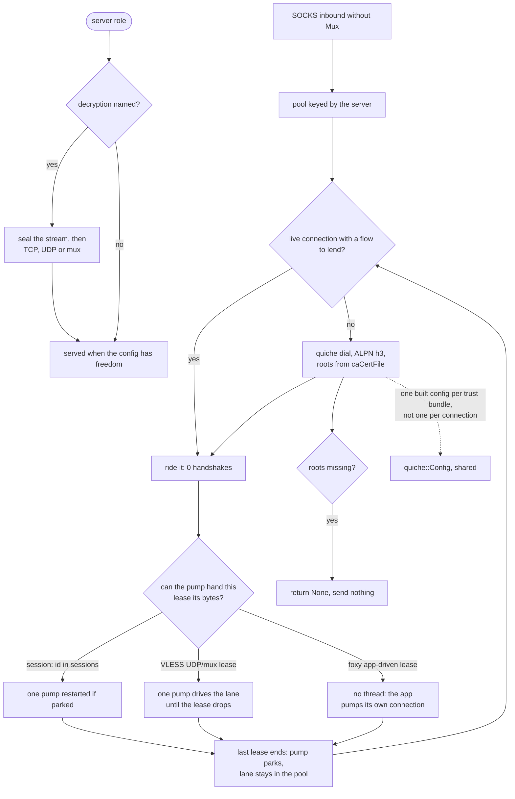

# The QUIC carrier

QUIC carried VLESS only as a client row; the **server role now exists** and serves a `vless` inbound on `security: tls` with a certificate (`serve_vless_quic`, `proxy.rs:5307`) when the config has a `freedom` outbound or an unbuilt one; a config without either closes every stream. Each bidirectional stream is one VLESS session, all three of the reference's kinds: TCP, UDP (`[0,0]` then the length-framed datagrams of `serve_udp_stream`) or mux (`serve_sealed_mux_split`). The UUID and flow check happens before the accept, and a stranger, a Vision flow or a reverse account closes the stream before anything is relayed. The client dials the same three: `dial_quic_udp_uplink` and `open_vless_mux_quic` take a `pumped_stream_within` lease, and the lane's pump drives the connection while the lease reads its own stream. The ALPN is the default lane one (`h3`). The server's `tlsSettings.certificates` is the whole list it serves, not just the first entry: BoringSSL picks the one the client's SNI names. With `rejectUnknownSni` off an absent name answers the first; with it on an absent or unmatched name is refused. `quic::tests::the_certificate_the_sni_names_is_the_one_served`, `quic::tests::a_hello_without_a_name_answers_the_first_certificate`, `quic::tests::a_hello_without_a_name_is_refused_when_the_list_rejects_it` and `quic::tests::an_unknown_name_is_refused_when_the_list_rejects_it` are the gates, and hysteria v2 and v1 share the same builder.

quiche is the default QUIC stack for this rung, and that is a rule rather than a preference: whenever a rung needs QUIC and quiche is feasible, quiche. The pin `upstream/quiche` at `3fc9bc1c` exists for reading.

The one thing this carrier actually decides is how many handshakes a connection costs. A naive dialer handshakes per stream; this one dials once per server and shares the connection, so N streams on one server cost one handshake, not N — including the N that arrive one after another rather than at once. `quic_pool_shares_one_connection_between_two_streams` gates the overlapping half, `a_lane_outlives_its_leases_and_the_next_flow_rides_it` the sequential half.

A lane that outlives its last lease is parked, not closed: `pump` ends its own thread when the socket is quiet and no lease rides the table, and the connection, its stream ids and its bound socket stay in the pool for the next flow. A lease takes that flag back only when the pump can serve the lease — `lend` starts a thread for a lease sitting in `sessions`, because `hand_off` skips an id still `opening`. A foxy h3 tunnel (`pooled_stream_within`, never a `dial_pooled` session) starts nothing, because the app pumps its own connection and a thread that cannot deliver this flow's bytes is still a **second reader of one file description**: `Datagram::try_clone` dups the lane's socket and shares its armed-wait record, so the thread takes datagrams as they land and re-arms `SO_RCVTIMEO` to its own poll, and the flow's `pump_once` wakes late on a wait it did not set. A VLESS UDP or mux lease has no app-side pump, so it takes `pumped_stream_within` and the lane's pump is its driver; the id stays in `opening` for the lease's life, which is what keeps the pump from parking under it, and `Drop` returns it. `pump-threads-started-by-an-app-driven-lease` is that rule's count, and `quic_dials_loopback_echo` is where the thread still runs — it asserts the flag is taken while a session lease rides and set again after the lease ends, which is the only shape in which a parked lane's report means anything. Two bounds keep a parked lane from becoming a pin: the edge's own idle timeout, advanced by one `on_timeout` call at lookup so the gap is quiche's arithmetic rather than a budget of ours, and `flows-per-lane-before-it-is-handed-back`, which is inside the 100-stream grant `MAX_STREAMS` advertises.

Every socket `bind_datagram` opens — a lane's, hysteria's client and the server's listen socket — asks for a receive buffer at bind, one `setsockopt` each and off the hot path, because a parked socket is the only thing holding what the edge sent while no thread owns it, and a Windows default (64 KB) drops it. The ask is read back rather than assumed; `receive-buffer-floor-bytes-armed-per-lane` is the floor it has to land as.

The other buffer a lane carries is quiche's own, and it is the bigger one: every byte the edge delivers parks in this process until the application reads it, and the credit the lane advertises is the size of that parking lot. `tune` and `quiche_config` name two numbers for it, not one. The opening credit stays `MAX_DATA` 2 MiB across a connection and `MAX_STREAM_DATA` 1 MiB per stream; `quic-bytes-parked-per-unread-stream` and `quic-bytes-parked-per-unread-connection` are that credit measured from the edge's side by `an_edge_cannot_park_more_than_the_window_unread`: a writer addressing a lane that never reads stops at exactly 1 MiB on one stream, at exactly 2 MiB across the connection (the third stream finds no credit at all), and the credit rolls back when the lane drains what was parked — a window is a rolling credit, not a throttle. The gate has to tell flow control from pacing to see this: quiche caps a `stream_send` by congestion-control capacity as well as by credit (`update_tx_cap` takes the tighter of the two), so the test ferries packets between writes — transport acks keep the send window open while an unread lane keeps the credit closed — and calls a writer stalled for forty whole ferry rounds flow-control-blocked rather than paced.

The ceiling over that credit is the throughput arithmetic, and it is a different number: **a window is a rate times a delay**. A flow cannot put more than one window in flight per round trip, so its throughput is `window / rtt`, and a 1 MiB window is 80 Mbit/s at 100 ms no matter how fat the link is — on the long-haul and mobile paths this lane exists for, the window, and not the line, is what the flow measures. quiche grows a receive window by two every time it is drained twice inside two round trips, and stops at `max_window`; the lane used to hand it the initial credit as that ceiling (`set_max_connection_window(MAX_DATA)`), which makes every one of those doublings a no-op in a single store. The ceilings are now `in_flight(1 Gbit/s, 256 ms)` = 32 000 000 bytes across a connection and `in_flight(1 Gbit/s, 64 ms)` = 8 000 000 per stream: one flow can saturate a gigabit at 64 ms, four can share the connection at that distance, and anything slower than that product was never window-limited to begin with. `stream-window-ceiling-bytes` and `connection-window-ceiling-bytes` are the numbers, and `the_window_ceiling_leaves_the_autotuner_room` is their checker.

This trades memory for rate, and the trade is the product, not a leak. Under load the process holds the bytes actually in flight — the bandwidth-delay product, 8 MB at a gigabit and 64 ms — because that is exactly what "a gigabit at 64 ms" means; a lane nobody reads grows nothing, since the autotuner only doubles on consumption and the two `quic-bytes-parked…` rows are unchanged. What the live lane's 22 MB reading was, when this was first capped, is a window doing its job on a flow that was not being drained; the cap bought 20 MB of idle headroom and paid for it with a rate ceiling on every path whose product is larger than a megabyte.

The hand-back itself is a pool decision, not a protocol one: a lane that has lent its whole grant leaves the pool's table so the caller's `or_else` dials a fresh one, and only a lane no lease rides is given the `done` frame. `a_lane_that_lent_its_whole_grant_of_flows_is_handed_back` asserts both halves — the entry gone from the pool, and the flow that stayed on it still carrying bytes, which is the witness that no goodbye was sent over it.

Roots are required. A dial without `caCertFile` returns `None` and sends nothing, which `quic_outbound_reads_ca_cert_file` covers — the refusal is deliberate, not a fallback to the system store.

## Data path



## Measured

<!-- counts:begin -->
| key | value | checked by |
| --- | --- | --- |
| ops-retired-instructions | UNBLESSED | scripts/count-ops.sh |
| zero-filled-bytes-per-relayed-frame | 3 | ferrox-app-quic::tests::a_relayed_datagram_frames_its_target_ahead_of_its_payload |
| handshakes-per-server | 1 | ferrox-app-proxy::tests::quic_pool_shares_one_connection_between_two_streams |
| streams-left-open-per-flow | 0 | ferrox-app-proxy::tests::quic_pool_shares_one_connection_between_two_streams |
| server-roles | 1 | ferrox-app-proxy::tests::quic_serves_vless_echo_over_loopback |
| dialled-without-ca-cert-file | 0 | ferrox-app-proxy::tests::quic_outbound_reads_ca_cert_file |
| lanes-held-after-the-last-lease | 1 | ferrox-app-foxy::loopback::a_lane_outlives_its_leases_and_the_next_flow_rides_it |
| pump-threads-owned-by-an-idle-lane | 0 | ferrox-app-proxy::tests::quic_dials_loopback_echo |
| pump-threads-started-by-an-app-driven-lease | 0 | ferrox-app-foxy::loopback::a_lane_outlives_its_leases_and_the_next_flow_rides_it |
| flows-per-lane-before-it-is-handed-back | 64 | ferrox-app-foxy::loopback::a_lane_that_lent_its_whole_grant_of_flows_is_handed_back |
| receive-buffer-floor-bytes-armed-per-lane | 262144 | ferrox-app-quic::tests::a_quic_socket_arms_both_of_its_buffers |
| send-buffer-floor-bytes-armed-per-lane | 262144 | ferrox-app-quic::tests::a_quic_socket_arms_both_of_its_buffers |
| quic-bytes-parked-per-unread-stream | 1048576 | ferrox-app-proxy::tests::an_edge_cannot_park_more_than_the_window_unread |
| quic-bytes-parked-per-unread-connection | 2097152 | ferrox-app-proxy::tests::an_edge_cannot_park_more_than_the_window_unread |
| stream-window-ceiling-bytes | 8000000 | ferrox-app-quic::tests::the_window_ceiling_leaves_the_autotuner_room |
| connection-window-ceiling-bytes | 32000000 | ferrox-app-quic::tests::the_window_ceiling_leaves_the_autotuner_room |
| send-datagram-bytes | 1350 | ferrox-app-quic::tests::the_lane_sends_the_datagram_its_buffer_holds |
| route-key-copies-per-packet | 0 | ferrox-app-quic::tests::a_route_key_is_a_window_into_the_packet |
| route-key-allocations | 0 | ferrox-app-quic::tests::the_route_key_replaces_the_allocating_header_parse |
| quic-config-builds-per-warm-dial | 0 | ferrox-app-quic::tests::one_trust_bundle_shares_its_built_config |
| quic-config-lookup-allocations | 0 | ferrox-app-quic::tests::a_warm_config_lookup_allocates_nothing |
<!-- counts:end -->

- **A datagram 150 bytes short of the buffer it was read into, and a ceiling that could not move.** Two numbers in the lane's transport were quiche's defaults rather than the lane's own. The packet builder was left at quiche's 1200-byte floor while the receive path was already sized for 1350, so a mebibyte left in 874 datagrams where 777 carry it — 11.1 percent more sends, ACKs, receive interrupts and per-packet AEAD invocations for the same bytes — and the transport parameter was left at quiche's 65527 while every read lands in a 1350-byte buffer, an advertisement the lane cannot honour. Both are 1350 now (`set_max_send_udp_payload_size`, `set_max_recv_udp_payload_size`), and `send-datagram-bytes` is read where quiche uses it: `the_lane_sends_the_datagram_its_buffer_holds` handshakes a loopback pair, reads the established connection's packet size, then measures the datagrams the peer actually receives. The second number is the receive-window ceiling: the initial credit was also handed to `set_max_connection_window`/`set_max_stream_window`, which is the ceiling quiche's autotuner doubles up to, so no window could ever grow and every flow was paced by `1 MiB / rtt`. The ceilings are `in_flight(1 Gbit/s, 64 ms)` and `in_flight(1 Gbit/s, 256 ms)` now, `stream-window-ceiling-bytes` and `connection-window-ceiling-bytes`, checked by `the_window_ceiling_leaves_the_autotuner_room`. What is **not** removed: the opening credit (2 MiB across a connection, 1 MiB per stream, still gated by `an_edge_cannot_park_more_than_the_window_unread`), because the autotuner only doubles on consumption — an unread lane still stops at those numbers, which is why the parked-bytes rows did not move. What it costs, named: 1350 bytes of UDP payload plus 28 of IPv4 or 48 of IPv6 header is 1378/1398 on the wire, safe on a 1500-byte path and over the 1280-byte IPv6 minimum — a path narrower than that fragments or drops, which the live relay job on all three runners is what would show; and under load the process holds the bandwidth-delay product it is now able to put in flight, which is the same statement as the rate it gains.

## Ops

```bash
./scripts/count-ops.sh report proxy::tests::quic_pool_shares_one_connection_between_two_streams 'quic::dial_pooled'
./scripts/count-ops.sh report foxy::loopback::the_quic_carrier_rides_a_socks5_upstream_and_carries_the_bytes 'quic::flush_egress' 'quic::pump_once'
./scripts/count-ops.sh report proxy::tests::quic_dials_loopback_echo 'quic::pump'
./scripts/count-ops.sh report foxy::loopback::a_lane_outlives_its_leases_and_the_next_flow_rides_it 'quic::pooled_stream_within'
./scripts/count-ops.sh report quic::tests::a_quic_socket_arms_its_receive_buffer 'quic::bind_datagram'
./scripts/count-ops.sh report foxy::loopback::the_h3_downlink_hands_the_caller_the_frame_without_staging_it 'quic::flush_egress' 'quic::flush_burst'
./scripts/count-ops.sh report proxy::tests::quic_serves_vless_echo_over_loopback 'quic::serve_loop'
./scripts/count-ops.sh report quic::tests::a_two_entry_identity_builds_every_context 'quic::tls_config'
```

`UNBLESSED`: the blessed symbol this QUIC discussion reads is `append_pem`, a PEM helper rather than a carrier, so the carrier row stays open until a Linux run reads it. The row reads `append_pem` rather than `der_to_pem` because the exact-capacity reservation left `der_to_pem` a thin wrapper that release inlines away; `pem_capacity` opens the output at its exact length and `append_pem` fills it by memcpy into live capacity. The second command is what that slice moved — `flush_egress` and `pump_once` under a filter that does send datagrams, where the stores those buffers used to zero would show in a callee's inclusive cost; the batch's peer slots are the fourth zero pass, and `pump_once` is where its 1 KiB per call leaves. The third and fourth are what this one moved: the pump thread now belongs to the session-lease filter, and the foxy filter — every one of whose leases is app-driven — must not show `quic::pump` at all, which is the machine-code side of `pump-threads-started-by-an-app-driven-lease`. The fifth is the one `setsockopt` per lane socket.

Both were read on a Linux runner against `main`'s own artefact. Those readings are the shape before this change moved the filter: they give `quic::pump` 2 427 217 and `quic::pooled_stream_within` 3 474 798 inclusive under the foxy lane's filter, and neither number survives the second reader going, so a Linux run has to re-read both rows. `quic::bind_datagram` comes back `inlined-not-a-frame` — release folds it into its callers, so the arm is not a frame the profiler can name. What it does name is the syscall table of the second filter, where this slice moves exactly one row: `setsockopt` 37 → 40, one per datagram socket the filter binds, with `recvfrom` 66 and `sendto` 63 unchanged. `flush_egress` 1 014 011 → 1 014 259 and `pump_once` 2 436 499 → 2 462 978 are inside the band a loopback-driven row moves run to run, which is why no count here is blessed against it.

The sixth command is what the batched sweep owes a reading: `quic::flush_burst` is measured under the filter that carries a whole h3 downlink over a plain lane, which is the only shape in the list where the batch can run at all — the socks5-upstream filter above is a wrapped lane and never reaches it, so no row is published there. Expect the symbol itself to answer `inlined-not-a-frame`, as `bind_datagram` does; the witness is that filter's syscall table, where `sendto` is the row that has to fall and `sendmmsg` the one that appears beside it. Not read yet: `scripts/count-ops.sh` needs valgrind, which has no macOS/aarch64 build, so the numbers are a Linux runner's and no count here is blessed against them.

The seventh is the server side of the same read: `quic::serve_loop` under the echo filter moved from `3 395 264` to `3 273 322` retired instructions between ops run `40403400545` and `40405173692`, and that filter's syscall table gave `recvfrom 84 → 15` and `recvmmsg 74 → 88` with `futex 48 → 27` beside them. It is a loopback-driven row, so no number from it is blessed; `quic::route` and `quic::reap` answer `inlined-not-a-frame` under the same filter and the row that carries the work is `serve_loop`.

The added command is the serving identity through `quic::tls_config`, on a two-entry list built by minting and no socket: the fixture's mint is not a callee of `tls_config`, so the frame is the DER-to-BoringSSL build and the SNI context it installs. It is an `ops.yml` reading of the new path (run `41198664823`: `quic::tls_config Ir=520125`), not a before-and-after — the PEM-and-temp-file serve it replaced no longer exists to measure — and like the rest it is published, not blessed.

The routing key and the per-run sweep are the eighth reading, and they are the same `quic::serve_loop` row: between ops run `40405173692` and `40419359148` it moved from `3 273 322` to `2 924 361` retired instructions, and the echo filter's syscall table gave `sendmmsg 91 → 48`, `recvmmsg 88 → 55` and `futex 27 → 17` while `recvfrom` held at `15`; `clock_nanosleep 13 → 15` is the test's own sleep and not a count this page gates. The key removes one allocation and one copy per established-lane datagram and the run all but one lock and one egress sweep per batch, so the work stays on `serve_loop`. It is a loopback-driven row, so no number from it is blessed; the two unit rows above are the gates that run anywhere: `a_route_key_is_a_window_into_the_packet` and `the_route_key_replaces_the_allocating_header_parse`.

## Time

**Measured on the live lane, and only for the waits a live lane can see.** QUIC throughput belongs to `.github/workflows/speedtest.yml`, which is dispatch-only because it downloads a real target per config per core; a number from a machine behind a VPN measures the tunnel. `.github/workflows/foxy-relay.yml`'s `Lane durations` table cannot see a parked lane at all: it restarts the lane for every carrier row (`a port per carrier, because a lane that outlives its stop still holds the port`) and takes one flow per row, so every row is a cold lane and a spent handshake. What that table can gate is what a cold lane pays per packet, and the h3 rows are where it shows — read on ubuntu over the runs of this job on 2026-10-21, `carrier h3` is 1.04–2.40 MiB/s and `carrier h3 bulk` 1.48–5.65 where `carrier h2 bulk` is 24.68–88.41, and h3's 200 KiB warm legs take 0.36–0.58 s where h2's take 0.08–0.21 s. That spread is the shape the second-reader removal above was made against, and it is now a before-and-after rather than a range: on the same ubuntu runner, `39617369647` then `39626100848`, `carrier h3 bulk` answers the same 10 MiB in 0.46 s instead of 6.68 s and the 1 MB leg in 0.72 s instead of 0.92 s, while no row of the carriers the change does not touch moved the other way. It is still a duration, not a gate: no loopback test can see a wait between two packets. A sequential-flow number needs a row that takes N flows on one lane; no such row exists yet, so the reuse is gated by pointer identity in `a_lane_outlives_its_leases_and_the_next_flow_rides_it` and its rate is an open claim. The window ceiling is the one throughput claim a 1 MB leg cannot see at all: 1 MB is inside the opening credit, so every leg of that size is paced by the link rather than by the window. `foxy-relay.yml`'s bulk leg is 10 MiB per carrier for exactly that reason — it is ten times the old 1 MiB window, so a lane whose ceiling is still its opening credit answers in tens of seconds where a growing one answers in seconds, and the same `MiB/s` column reads the difference. It is a duration, not a gate. The one wall-clock number this page does hold is the harness's rather than the lane's: `quic_pool_shares_one_connection_between_two_streams` costs 0.66 s now against the 120.12 s it measured when its edge left on its bound instead of on the FINs it had already read, and every `ci` test job was paying that on each platform. The matrix's `vless-quic-down-8`, `vless-quic-up-1` and `vless-quic-duplex-8` cells are the throughput rows that replace the missing carrier: ferrox and sing-box serve, ferrox, sing-box and xray-core-rust dial, and xray-core is skipped because its pin removed the transport. A duration from those cells is a suggestion, not a gate.

## What we removed

- **A handshake per stream.** sing-box pools QUIC connections the same way; the difference is that this tree makes the pool the *only* way in, so there is no per-stream dial path to regress into. Gates: `quic_pool_shares_one_connection_between_two_streams`, `sixteen_flows_at_once_all_arrive_whole`.
- **The 24 MiB an edge could spend against the process.** The lane advertised `initial_max_data` 10,000,000 and one million per stream, and named no ceiling, so quiche's auto-tuning pulled the receive window toward its built-in 24 MiB and an edge writing to a lane that had not read yet got to spend that much of this process's heap — the 22 MB the live lane showed. The credit is 2 MiB and 1 MiB now, and the auto-tuning ceiling is the same numbers, each set beside the opening credit in the two places configs are built (`tune`, `quiche_config`) and in the test builders that read the same constants. `an_edge_cannot_park_more_than_the_window_unread` is the witness, and its two rows above are what it observes; the rolling half of the test is what says the cap is a window and not a rate limit. What was **not** removed: quiche's copy of every delivered byte into its stream buffer — that copy is the floor of a userspace QUIC stack — and the auto-tuning itself, which still grows the window on time, only up to the ceiling named below rather than to quiche's built-in 24 MiB.
- **Three of every four lock passes on the drain.** The pump handed quiche's stream buffers to the waiting streams in 8 KiB chunks and the uplink read the client in 8 KiB chunks, and every chunk paid the connection mutex twice — once to take it, once for the egress sweep behind it. Both chunks are 32 KiB now: same bytes in the same order, one quarter the trips through the lock. No row carries this, because a loopback test cannot see an operation count — `scripts/method-ops.txt` publishes `quic::pump` and the `ops.yml` artefact is where the shrink will show, on a Linux runner rather than here.
- **A silent trust fallback.** A dial with no `caCertFile` sends nothing rather than reaching for the platform store. A security property, not a speed one, and it belongs here because it is a refusal that costs a connection.
- **A refusal where the engine already fit.** A QUIC outbound or inbound that named a VLESS `decryption` engine was refused, so the sealed stream could only be read as an open row. The engine is generic over `Read + Write`; the only missing piece was a stream whose timed reads retry under the handshake's clock and whose halves can split. `SealHandshake` wraps one `QuicStream` with a deadline, and `SplitIo` hands the sealed halves the same two stream handles the plain relay uses. Both roles now seal before the VLESS header for TCP, UDP and mux: `socks_dials_encrypted_vless_quic_to_echo`, `socks_associate_reaches_udp_echo_via_encrypted_quic_vless` and `socks_dials_encrypted_vless_quic_mux_to_echo`. What this costs, named: one engine handshake before the VLESS header and the engine's framing on every relayed block; no count row moves, because the gates read bytes and FINs rather than operations, and the handshake is the feature rather than a removal.
- **A PEM buffer that grew, and one that was copied.** `der_to_pem` opened on `Vec::new()` and let each `extend_from_slice` double it, re-copying the prefix every time; `quiche_config` then built each certificate as its own `Vec` and copied it into the chain. One `pem_capacity` reservation now sizes the whole buffer and `append_pem` writes blocks straight into it. `a_pem_buffer_is_reserved_to_its_exact_length` gates the reservation (`len == capacity`, so no realloc fired), `appending_into_a_reserved_buffer_does_not_move_it` proves the removed copy by pointer identity, and `pem_survives_the_pad_and_wrap_boundaries` shows the bytes did not change.
- **Three zero passes per datagram.** `flush_egress`, `pump_once` and a relayed `Datagram::send_to` each opened a zeroed array — 1350, 1350, 1372 bytes — that the packet or the read then overwrote in full. All three take `quic::Unfilled` now, a stack array of `MaybeUninit<u8>`, so the first store to a byte is the writer's. A relay frame's two reserved bytes and fragment flag are what the hop reads before the target, so those three are filled explicitly, and `a_relayed_datagram_frames_its_target_ahead_of_its_payload` asserts the whole frame and goes red if that fill changes. The removal is checked in machine code: the `mov w1, #0x546`/`#0x55c` + `bl` zeroing pair is gone from every frame that carried it, and `send_to` inlines into three of them, so the release binary drops from 9 sites to 4. It carries no counts row — the filter `scripts/expected-ops.txt` blesses never sends a datagram, and a loopback test sees packets, not the stores behind them — but `scripts/method-ops.txt` now publishes `flush_egress` and `pump_once`, where a callee's inclusive cost would show the stores. The bytes did not change: the QUIC echo, SOCKS-hop and foxy tests check the same packets end to end.
- **A PEM round trip and a temp file before every serve.** `serve_config` used to PEM-encode the serving chain and key into fresh buffers, write them to a temp file, give quiche that path, and unlink it; the identity now goes to BoringSSL as DER through `tls_config`, so the PEM pass, the file create and the unlink leave the serve path, and one BoringSSL context is built per certificate entry for the SNI callback to pick. Two things this does not remove, named: the first context still parses the same DER, and a `quiche_config` trust bundle still stages PEM because quiche 0.30 has no in-memory trust loader. The correctness gates are the three SNI tests above; the removal itself is not a count, and the probe below prices only the new path.
- **A datagram the kernel refused, dropped.** `flush_egress` threw away the result of `send_to`, and the batched sweep returned on a `sendmmsg` the kernel would not take in full, so a peer whose queue was momentarily full silently lost the tail; quiche never retransmits a DATAGRAM frame, so each lost packet was an inner TCP hole that only a retransmit timer repaired — which is the `masque` server leg stopping the reference client at under a megabyte with `EAGAIN` and the matrix reporting `no-reference`. A refusal that clears (`EWOULDBLOCK`, `EINTR`, `ENOBUFS`) is now held on the lane in quiche's order and retried before the next sweep, and the batched sweep holds the tail it could not send and stops pulling, so the order the peer sees is the order quiche wrote. What is **not** removed: the hold is bounded at `HELD_LIMIT` (256) datagrams, so a peer that never reads is dropped as before once it is that far behind; and a lane that never refuses pays one atomic load per sweep and no allocation. `a_refusal_that_clears_is_the_only_one_held` is the decision on every OS and `a_held_datagram_is_retried_in_order` is the queue: a halt leaves eight datagrams held and the next sweep hands all eight to the peer once, in order. A live refusal cannot be staged on loopback, which drops what a full queue cannot take instead of failing the write, so the cell that proves it end to end is the masque matrix's server leg: it read `no-reference` while the reference client stalled at under a megabyte, and the reference client finishes there now. No count row moves: the happy path's syscalls, copies and stores are what they were.
- **A batch that zeroed the peer slots it was about to overwrite.** `Batch::new` built 64 `sockaddr_storage` peers, 64 name lengths and 64 datagram lengths as zeroed arrays, and `recv_batch` overwrote every entry it published from the kernel's own `msg_namelen` and `msg_len` before `at` ever read one. The peers, names and lens are `MaybeUninit` now, written only for the slots the kernel fills and read only for the slots `len` publishes; a `pump_once` call no longer pays the 8 KiB peer zero pass, and a pump thread pays it once instead of once per batch. The bytes and the addresses are unchanged: every QUIC echo, SOCKS-hop and foxy lane test still reads the peer the kernel named. No blessed row carries it; the `quic::pump_once` line of the `ops` artefact is where the stores fall, and the page's Ops section already reports that symbol.

- **A pump that visited the socket once per datagram.** A 16 KiB h3 DATA frame arrives as a dozen packets, and each of them used to be one whole visit: a `setsockopt` to arm the wait, one `recvfrom`, one egress sweep under the lock, and only then the next. The pump now takes up to `PUMP_BURST` (64) datagrams in the visit it is already in and sweeps once, and the armed wait expires into the same stop an empty queue gives, so a busy socket cannot hold the lock past the burst. The drain is bounded twice, by two different clocks: `PUMP_BURST` caps how many datagrams one visit takes, and after the packet the visit waited for, the arm drops to `PUMP_TAIL` (1 ms) so the rest of the drain sweeps only what the queue already holds. The callers hand this function their whole remaining budget as `wait` — `stream_recv_exact` and `send_credit_wait` both pass the deadline that is left — and the first shape of this change kept that arm across the drain, so it held a flow for seconds after the packet it came for had landed: the `ferrox-app` suite went from 134.9 s to 1014 s and `quic_serves_two_streams_on_one_connection` failed. What the fix costs, named: one extra `setsockopt` and up to a millisecond on a visit that receives; a visit that receives nothing pays exactly what it paid before. `a_pump_that_absorbs_its_burst_does_not_hold_the_wait_it_armed` is the bound on the hold (one second armed, a quarter of it is the ceiling) and `one_pump_absorbs_the_whole_datagram_burst_on_the_socket` reads the queue, not the bytes: three datagrams on the socket, one pump, and a fourth read must find nothing. Each is red on the shape it names. CI's `ops` artefact is the witness with exact numbers, and it is informational rather than a blessed row: for the one test that carries 1 MB down an h3 lane it reads `recvfrom 617 → 242`, `sendto 619 → 222`, `setsockopt 621 → 65`, `getsockname 161 → 4` and `foxy::H3::read` Ir `140,460 → 119,175` against the pre-drain tip `737c6bf`, which is 2,036 syscalls for those bytes down to 551 with no row risen. The live relay cannot see a change this size: three samples of each ref on each OS put `carrier h3` inside the spread of the same ref run twice, with main's own macOS readings swinging 0.51–1.85 MiB/s and the drain's at 0.46–0.56.
- **The wait each holder remembered for itself.** `SO_RCVTIMEO` is a property of the file description, not of the handle: a `try_clone` shares it, so two handles over one socket arm the same clock. `pump` polls at `PUMP_POLL` (500 ms) on the socket `lend` cloned for its thread, while a flow's `pump_once` arms that same description at its own timer and leaves it at `PUMP_TAIL` (1 ms) once a burst lands. Each side used to keep its own note of what it had armed, so the pump's next turn read its note, said "500 ms already applied", and waited on the millisecond the flow had left behind: a lane's pump waking a hundred times a second, each wake taking the connection mutex every other session on the lane waits on, instead of sleeping out its poll. The note is one cell inside `Datagram` now, behind an `Arc` that `try_clone` passes on, so a read through any handle arms only what the description does not already carry. `a_clone_carries_the_socket_it_was_cloned_from_one_arm_record` pins the sharing by pointer identity — the cell is one object, not two that happen to agree — and `a_wait_undone_by_another_handle_is_armed_again_before_the_read` is the hang: one handle asks 400 ms, a second arms 4 ms through the same description, and the first read must still get its 400; it returns at 4.5 ms on the per-handle shape. What this costs, named: an arm the old note skipped is paid now, so a socket with two holders on different budgets makes one `setsockopt` each time the value moves instead of none, and every datagram socket carries one small shared cell. What is kept is the dedupe that made the note worth having, and it is now correct for both sides: `pump_once` on a drive loop whose timer has not moved re-arms nothing. No blessed row carries any of this — the gate that can see a `setsockopt` is CI's `ops` artefact, informational, and the `setsockopt` line quoted above (65 for the 1 MB h3 read) is what it will be read against.
- **A pool entry pinned by a flow that had already ended.** A stream id was reserved in the pooled table's `opening` set and given back only by a caller that remembered `release_stream(dial, id)`: a failed open, a front that returned early, a CONNECT-IP lane the edge granted no address to and every UDP lane left it behind, and an id behind keeps the entry, its `quiche::Connection` and its bound socket alive for the life of the process. `PooledStream` now carries the entry it came from and its `Drop` pays the table back, so `release_stream`, the `(dial, id)` pairs threaded through the caller's types and the `PooledDatagram` wrapper that held one are gone. What the give-back is now checked by is the park: `pump` ends its thread only over a table no lease rides, so `a_lane_outlives_its_leases_and_the_next_flow_rides_it` goes red on an id that was never returned. Not counted: the second `QuicDial`, root list included, that a successful open built just to carry the release, because no gate here measures allocations per open.
- **A handshake per flow, and a thread per idle lane.** `leave_session` closed the pooled connection with a `done` frame and cut the pool entry when the last lease ended, so every flow after the first re-handshaked against the same edge: the page's own claim, `handshakes-per-server 1`, held only for streams that overlapped in time, and on a foxy lane, where one flow is one request, that is every flow. `quic::pump` parks instead — the thread ends, the flag says so under the same lock the next lease that needs it takes it on, and the connection, its stream ids and its bound socket stay in the pool — and `leave_session` is down to the id it came to return. Three flows on one handshake is `a_lane_outlives_its_leases_and_the_next_flow_rides_it`, which asserts the connection by pointer identity rather than by another dial; the bound on how long a lane may be kept is `a_lane_that_lent_its_whole_grant_of_flows_is_handed_back`. A parked lane that the edge let go is found by quiche's own idle timer, read at lookup with one `on_timeout` call, so no constant of ours guesses the peer's patience; a lane whose grant is spent leaves the pool at the next lookup, and only gets the `done` frame when nothing rides it. What this costs, named: one `Mutex::lock` and one timer pass per lease on a warm lane, one `thread::spawn` per park rather than per dial, a `try_clone` of the lane's socket that only a parked lane pays for, and a spent lane that still carries flows leaving the pool without a goodbye — its last lease parks it and the connection goes with the leases that held it. Parking is the lane-level version of the seam [`docs/concurrency.md`](../concurrency.md) proposes tree-wide: a parked lane already frees its thread, and the poller would free the one a leg holds while blocked mid-read.
- **A second reader of a flow's own socket.** `lend` took the parked flag and spawned `pump` for whichever lease landed on a lane with no thread, before asking whether that thread could serve the lease at all. A foxy h3 lease is taken by `pooled_stream_within`, which hands the flow a stream id that stays in `opening` for the flow's whole life, and `hand_off` skips an id still opening — the pump cannot deliver this flow's bytes, so for this lease it is only a second reader of the one file description. Two readers on one description split the datagrams and, since the armed-wait record became shared, fight over its timeout: `pump_once` drops the arm to `PUMP_TAIL` (1 ms) after the packet it came for, `pump` re-arms the same description at `PUMP_POLL` (500 ms), and whichever set last is what the other's next `recvfrom` waits on. A stolen packet is then a tail's expiry and an inherited arm is a poll, both per packet rather than per burst, which is what the live lane read while it was there: `.github/workflows/foxy-relay.yml`'s ubuntu runner puts `carrier h3` at 1.04–2.40 MiB/s and `carrier h3 bulk` at 1.48–5.65 where `carrier h2 bulk` on the same job reads 24.68–88.41, and h3's 200 KiB warm legs take 0.36–0.58 s against h2's 0.08–0.21 s. The small transfer being the slower one per byte is the witness that this is a wait between packets and not a window — a window cannot make 200 KiB, which is inside the opening credit, cost more per byte than 10 MiB. `lend` now asks before it spawns, so a session lease (`dial_pooled`, the only caller with a handle for the pump to write into) still starts exactly one thread and a flow that reads its own socket starts none. The counters are one cell already lying around: the flag a thread clears to run is the flag the test reads, so `pump-threads-started-by-an-app-driven-lease 0` is `a_lane_outlives_its_leases_and_the_next_flow_rides_it` finding the lane still parked under its third lease, and `pump-threads-owned-by-an-idle-lane 0` moved to `quic_dials_loopback_echo`, which is where a pump does run — it asserts the flag taken while the session rides and set again after the lease ends. What this costs, named: a datagram that lands while the flow is doing something else now waits in the kernel's receive buffer instead of quiche's, which is what the 256 KiB arm at bind was made for and what `receive-buffer-floor-bytes-armed-per-lane` still gates. The second reader hid how load-bearing that floor is: it fed quiche while the flow was busy elsewhere, so a pause could absorb a kernel buffer *plus* the stream window before the edge felt it, and its ACKs went out on the pump's clock rather than the flow's. Now the flow's own pause is the only clock, and on a platform that grants the floor rather than the 1 MiB ask, a downlink leg blocked on a slow caller has 256 KiB of absorption before the buffer overflows and the edge reads the drop as loss instead of as flow control. That is the one case this change can make slower, and it is the case the bulk row of the relay job would show. What was **not** removed: the pump itself, the park, or the shared arm record — a lane whose sessions the pump does serve still needs both, and `hand_off`'s drain of a stream nobody rides is unchanged. The rate this wins is not a row here: no loopback gate sees a wait between packets, so it was read on the live lane, same runner, same day — run `39617369647` with the second reader against run `39626100848` without it. `carrier h3 bulk` (10 MiB) goes from 6.68 s to 0.46 s, 1.50 to 21.77 MiB/s, and against that runner's own egress from 0.25 to 2.07; the two 200 KiB warm legs go 0.52/0.58 s to 0.34/0.31 s; the 1 MB leg 0.92 s to 0.72 s; `h3 over socks5 upstream` 0.97 s to 0.44 s. The earlier run's control read 6.00 MiB/s where the later read 10.54, so its minute was the noisier one and the 14.5x on the bulk leg cannot be a quieter edge. No carrier this change does not touch moved against it: `h1`, `h2`, `auto`, the three fronts and both upstreams all read faster in seconds on the later run. What is still open, and this slice does not close: `trace h3` spends 0.32 s to carry 230 bytes where `trace h2` spends 0.07 s, and the 1 MB leg (0.72 s) is still five times the bulk leg's own megabyte (0.046 s), so a fixed per-flow cost stands on the h3 path after the steady-state rate is fixed.

- **A `sendto` per datagram out of a sweep.** One `flush_egress` call drains everything quiche is ready to hand over, and on a plain lane that is a burst rather than a packet: a 64 KiB relay read queues about fifty datagrams behind each other, and every one of them used to be a syscall of its own. The sweep now writes each packet straight into its own slot of a sixty-four-deep `mmsghdr` array — quiche's own store is the only copy and the batch adds none — addresses each slot with the peer quiche named for that packet, and hands the set to one `sendmmsg`, retried from the first message the kernel did not take, then fills again while quiche still has packets. The width is `SEND_SLOTS`, and it moved from 8 to 64: CI `ops` run `40533594837` reads `quic::serve_loop` at 2,820,616 instructions against the base run's 2,960,228 (-4.7%), `sendmmsg` in `quic_serves_vless_echo_over_loopback` at 36 calls against 44, and `quic::flush_egress` at 936,935 against 930,339. The pump's own `pump` and `pump_once` move 0.2% and 1.3% (2,401,031 and 2,426,528 against 2,395,731 and 2,394,764), because its visits are paced by its wait, not by its slots. `an_egress_sweep_drains_its_whole_queue` is the witness and it is the exact one: immediately after the call the connection is asked whether it still has a datagram ready, so a sweep that stopped at its slots goes red instead of losing the tail to a retransmission nobody scheduled; the same test handshakes the lane *through* the batched path and checks that what the peer reads is the frame's prefix, in order, whole. The matrix agrees at the cell level: `vless-quic-down-8` run `40533603454` at five repeats puts ferrox's medians at 114.4 and 215.2 MiB/s against sing-box's 101.4 and 209.0, 1.13x and 1.03x; the run before the rebase (`40527568321`) read 181.4/321.6 against 163.5/303.8, so the ratio is a suggestion and the absolute rate moves with the runner. xray-core lands no `vless-quic` run, so the row stays `unproven`. What the batch does not ride on, named: a gecko fragment, a hop, an obfuscation or a relay frame each wrap `send_to` in work that is per-datagram by shape, so those lanes keep the loop, and every platform but Linux keeps it too, because `sendmmsg` is a Linux call. What it costs: sixty-four `Unfilled` datagram buffers — some 86 KiB of the sweep's own stack, unwritten until a packet lands in one — where the loop reused one, a `sockaddr_storage` and a header wired per packet the sweep takes, and a refusal now drops the batch it was aimed at rather than the packet it was aimed at, which quiche retransmits either way. The `serve_loop`, `sendmmsg` and `flush_egress` numbers are CI's `ops` artefact, informational, not a blessed row; the gate above sees datagrams, not the calls behind them.
- **A 120-second wait standing where a FIN assertion belongs.** `quic_concurrent_echo_server` — the edge `quic_pool_shares_one_connection_between_two_streams` dials — could leave only on `conn.is_closed()` or its `QUIC_TEST_TIMEOUT` bound, and a lane that parked after its last lease closes no connection by design, so that test ran out its budget every run: 120.12 s measured single-threaded, and because it holds `quic_serial` for all of it, the four QUIC tests queued behind each printed "has been running for over 60 seconds" while it spun. The edge now leaves once every stream it accepted has read its FIN, and that count is asserted, so `streams-left-open-per-flow 0` is the FIN `uplink_stream` already sent at the end of every lease and nothing had ever checked. The gate was proven to bite: with that `stream_send(id, &[], true)` turned into a non-final send the edge reads no FIN, the bound fires, and the row answers `0` against the `2` it must reach. Same test after the fix: 0.66 s — the ~120 s this cut is per `ci` test job, on each of the three platforms. What was not removed: the bound, which is now the failure path rather than the exit, and the parked lane's silence about the connection itself, which still ends only when its grant is spent or quiche's idle timer says the edge let go.
- **A `dup` per burst on the downlink.** `hand_off` looked the flow's socket up in the pooled table and `try_clone`d it, because the write had to happen after the connection lock went back — the pump cannot block on one flow's upstream while every other session waits on the mutex — and a write needs an owned handle. So every visit in which a stream read as non-empty paid a `dup` (one syscall on Linux, two where the cloexec `fcntl` is separate) for a handle that was thrown away lines later, and paid it *inside* the lane's table lock, which every `lend` and `leave_session` on that lane waits for. The table now holds each flow's handle behind an `Arc` and the drain writes through `&Connection`, which `conn.rs` already implements for the relay's by-reference legs, so a burst costs a refcount instead of a syscall. What it costs, named: one `Arc` allocation per flow, where the map used to keep the `Connection` inline, and a flow's socket outlives its table entry by as long as the pump still has it in hand — which is the write it came for, not a queue. What was not removed: the `dup` `lend` makes to put that handle in the table and the one `uplink_stream` makes to read through its own handle, both once per flow, nor the `try_clone` of the lane's UDP socket a flow flushes with. The checker that can see this is the release disassembly, not a count: `quic::hand_off` inlines into the pump, so the row `scripts/method-ops.txt` now publishes answers `inlined-not-a-frame`, and the tests CI's `ops` artefact traces carry their downlink through `pump_once` rather than the table hand-off, which is why that table reads the same `close 23` before and after. Disassembling the pump's frame (the `lend` closure's `__rust_begin_short_backtrace` symbol) in a release build of `main` against this change: two `drop_glue<conn::Connection>` calls and 45 libc stub calls there, none and 41 here — the four are the dup path, `dup` and `fcntl` and their error branches. No blessed count row carries it: a loopback test sees the echo, not the calls behind it.
- **A `recvfrom` per datagram in.** The send side was already a batch — one `sendmmsg` for eight packets — and the receive side was not: the queue was drained one `recvfrom` at a time, so a QUIC packet is 1350 bytes and a fast link delivers one every ten microseconds, which a syscall per packet cannot keep up with. The read is now the mirror of the write: up to 64 datagrams come off the socket in one `recvmmsg`, each written straight into its own slot of the batch and each named by the peer the kernel filled in beside it, so a datagram costs no copy and no name of its own. The batch starts at the *first* read of a visit rather than after it, which is the asymmetry this closes: the earlier attempt at this batched only the tail of a visit, so the first datagram of every visit still paid its own `recvfrom` and the shrink it measured was flat. What the batch does not ride on, named: a gecko fragment, a hop, an obfuscation or a relay frame each make the read a shape of its own, so those lanes keep the one-datagram read; and every platform but Linux keeps it, because `recvmmsg` is a Linux call. The wait is the socket's own arm and not the call's, and the kernel is what makes that safe: the first receive of a batch runs without `MSG_DONTWAIT`, so it waits exactly as long as a `recvfrom` on that socket waits — which is the `SO_RCVTIMEO` the lane armed — while the reads behind it carry `MSG_DONTWAIT` and take only what is already queued. A call's own deadline would have been checked *between* the reads and never against the first one, which is why the timeout argument is null rather than a `timespec`. A read that ran dry after some datagrams answers with the count it took, not with the error, so a partial batch is a batch and not a failure. No counts row carries the shrink: the checker that can see a `recvfrom` is CI's `ops` artefact, informational, and a loopback test's datagram count is the scheduler's, not the syscall's. What is **not** removed: the `setsockopt` that arms the wait, which a receiving visit still pays once; and the per-datagram `conn.recv` into quiche, which is that library's floor.

- **One stream, one lock, one hundred milliseconds per buffer.** `serve_vless_quic` handed `relay_stream` one `QuicStream` behind one lock, so a read that found nothing in the stream parked its whole `STREAM_QUANTUM` (100 ms) holding the lock the opposite direction's write wanted, and that direction moved one 16 KiB relay buffer per grain: 0.16 MB/s is what the shape allowed, by arithmetic, not a rate a lane was measured at. Nothing about the stream needed the hold — its `read` puts the connection lock back between polls and its `write` never holds a lock across a wait — and a stream is two `Arc`s and an id, so its half is two handles of it now (`Duplicate` for `QuicStream`). The duplicate costs two refcounts and no syscall. The armed handle keeps the read: `Half::socket` gives the caller's own handle to the reader and the duplicate to the writer, because a duplicated socket is an independent handle on Windows that inherits no arm, and a read with no bound never learns that its sibling ended. No counts row carries either half of this: the matrix has no `QUIC` arm, `speedtest.yml` is dispatch-only, and the loopback gates on this path (`quic_serves_two_streams_on_one_connection`, `socks_dials_vless_quic_to_echo`) read bytes and FINs, not the grain between them, while `the_socket_half_reads_on_the_armed_handle` sees which handle served a call rather than how fast it went. What it costs, named: the two legs now contend on quiche's connection lock instead of being serialised by the half lock, which is the same mutex every other stream on that lane already waits on.

- **A relayed `h3` leg's wait inside the lane's lock.** The backward leg of a foxy flow reads its stream through `pump_once`, and a stream with nothing on it makes the pump visit the socket — with the flow's `Arc<Mutex<Tunnel>>` held, so the forward leg stood behind it for a quantum. The leg now parks on the `Datagram` itself: one `poll` row (`WSAPoll` on Windows) for the quantum the relay armed, with no `SO_RCVTIMEO` in it, because a readiness wait carries its own clock and must not re-time the file description every holder of that socket shares. `waits_here()` is the guard — a lane fronted by a hopper or a gecko has its bytes land on another descriptor, so readiness on the socket its pump no longer reads would wake the leg for nothing, and that lane keeps sleeping on a timer. The witness is the `h3` case of `a_parked_downlink_leg_does_not_hold_the_uplink_behind_its_wait` in [`carrier-foxy.md`](carrier-foxy.md): 525 ms with the wait put back, 2.71 ms parked. What it costs: one `Arc` bump per hand-back, and on a pooled connection every parked leg of that connection wakes for one datagram — the losers of that race pay a pump turn that finds nothing and re-park. The bound the wait carries is `conn.timeout()`, not the quantum alone: a foxy lane is the only thing that pumps its connection, since a pump thread serves no foxy lease, so a wait that outran the next tick would hold a retransmission hostage to the whole quantum. It is a guard, not a row — a quiet lane has only its idle timer pending, and no loopback run of this harness leaves a loss timer nearer than the wait for it to cut.

- **A trust bundle staged once per connection.** `quiche_config` PEM-encodes every anchor it is handed, writes the result to a temp file, gives quiche the file's *name* — `load_verify_locations_from_file` and `…_from_directory` are quiche 0.30's whole trust-loading surface, there is no in-memory form — and deletes the file, once per connection, for a `Config` that quiche documents as shared between connections. The live lane's own phase stamps now split a dial into its three parts, in two runs of one commit (`39698887675`, `39700348032`): on `windows-latest` `foxy-debug: quic config staged in` reads 78–88 ms in the first run and 142–175 ms in the second against wire loops (`foxy-debug: quic hand ok`) of 52–87 and 33–54 ms and `foxy-debug: quic pool … hand=` of 139–169 and 191–232 ms; ubuntu reads 20–22 and 21–24 staged, and macOS 35–56. The sum closes everywhere — `hand=` minus staged minus wire is 1–6 ms — so **the staged bundle is the entire non-wire cost of a dial**, and `quiche::connect`'s object build is that 1–6 ms. The same file pass costs `windows-latest` 4–8× what it costs ubuntu, and it swings 2× between two runs of the same code on the same image, which is why the removal is carried by a count and not by a duration. The config is built once per trust bundle now and dialed through under its own lock, so a second dial of a bundle pays neither the PEM pass nor the file: `quic-config-builds-per-warm-dial 0`, gated by `one_trust_bundle_shares_its_built_config`, which asserts by address that the config a second dial is handed is the *same object* — the cache holds the first, so a rebuilt config could not share its address — and that a bundle which refuses to build is not filed away as one that built. The cache's key is the bundle and the lookup is a slice of the caller's own anchors, so asking costs no copy of them: `quic-config-lookup-allocations 0` is `a_warm_config_lookup_allocates_nothing`, the allocator window over 4096 lookups of the platform bundle reading `0` allocations. What the live lane shows of it is one build per `h3` flow, because `h3` dials two connections on one bundle: in both runs and on all three runners the four `h3` dials print `quic config staged` twice, never four times, so the removed build is one per flow on windows — 78–175 ms of PEM-and-file work it no longer does. What it cannot show is a faster dial, and the reason is the harness itself: `for carrier in h1 h2 h3 auto` starts a fresh `run` per carrier row, so a lane sees one or two dials of one bundle and no reuse across rows, and within an `h3` row the second dial waits on the builder's lock instead of paying its own file pass — both `hand=` of the pair read the same value (`153/153` and `148/148` in the first run, `199/199` in the second). So the row is a count, not a duration, and no duration is claimed for it. What this costs, named: two dials of one bundle serialize for the length of the first one's staged file, so a concurrent pair's worst dial is no later than it was while the pair's total work drops by one build; and the process keeps one `quiche::Config` per distinct bundle for its life. What is **not** removed: the first dial of a bundle still stages the file, which is the point — `foxy-debug: quic config staged in Nms` names it once per bundle and its absence is what a warm dial says — and on `windows-latest` that first build is 78–175 ms, which no dial escapes; quiche's own `new_handshake` per connection from the shared context, which is that library's floor; the file pass itself, which needs an in-memory trust loader quiche 0.30 does not have; and hysteria's per-dial build, which mutates its config after building it (`enable_dgram`) and so is not this shape. No blessed number moves: the one row `scripts/expected-ops.txt` carries here is `append_pem`, checked by `pem_wraps_at_sixty_four_columns`, which builds its own bundle and never dials.

- **A FIN that was a reset, and a finish that held the lane.** `serve_vless_quic_tcp` relayed through `relay_stream`, whose normal EOF calls `close`; the close shut both QUIC directions, which resets the stream and discards whatever quiche still had queued. A 16 MiB flow therefore ended 64 KiB short — `flow 0 download stopped early: ... after 16711680 of 16777216 bytes` — and the `fin` that followed saw a finished stream and returned. The server relays through `relay_shared_then` now, the close only stops the TCP uplink, and the FIN runs after both lanes instead of a reset discarding the queue. `QuicStream::fin` also takes the connection lock one poll at a time and treats a finished stream as done, so a lane finishing cannot park every other stream behind a ten-second `SEND_WAIT`. The checker is the matrix's `vless-quic-down-8--srv-ferrox` cell, run `40497687037` at five repeats: ferrox's median is 101.6 MiB/s against sing-box's 99.5, and every flow moved its whole 16 MiB. The cell is a suggestion, not a gate — xray-core lands no `vless-quic` run, so the row is `unproven` — and `quic_serves_vless_echo_over_loopback` is the loopback gate that reads the FIN and the bytes.
- **A receive batch eight wide.** `RECV_SLOTS` was 8, so a pump or a server visit paid one `recvmmsg` per 10.8 KiB and one connection lock and egress sweep behind it. It is 64 now: one call takes 86 KiB, and the same bytes reach quiche in the same order with an eighth of the receive calls and lock passes. The matrix's `vless-quic-down-8--srv-sing-box` cell, run `40497687037` at five repeats, puts ferrox's median at 224.1 MiB/s against sing-box's 205.4; the same cell before the widening (`40485899354`) read 105.9/110.2/106.7 against 393.2/405.9/377.6. What it costs, named: the `Batch` scratch is 64 slots, about 86 KiB of stack in `pump`, `pump_once` and `serve_loop`, unwritten until a datagram lands in a slot; and a sparse visit wires 64 headers for one datagram. What is **not** removed: the kernel's per-datagram receive, quiche's per-datagram `conn.recv`, and the `setsockopt` that arms the wait. No count is blessed; the CI `ops` artefact's `recvmmsg` row is where the syscall shrink is read, and it is informational.

Not removed, and named rather than claimed: `pump`'s per-connection scratch, `pump_once`'s `setsockopt` on every visit (a receiving visit pays two arms, the wait and the `PUMP_TAIL`; the arms a shared record makes redundant are still deduped — one record per file description now rather than one per holder, which is what the wait that was being missed cost; the burst above cuts the *visits*, and with them the arms, not the arm one visit needs), quiche's packet build inside `send_on_path`, and 0-RTT and client-initiated connection migration — those are quiche's and stay unexposed, 0-RTT because early data is replayable and a client-initiated move because a pooled lane's path is shared by every lease on it; a peer's rebind is quiche's path validation and `a_peer_rebind_keeps_the_quic_lane` is its gate; key updates are quiche's own key phase and need no knob here; and VLESS encryption over this carrier is carried for all three session kinds, so the sealed stream pays one engine handshake before the VLESS header and the engine's framing on every relayed block rather than the open row it was. The park is not instant either: `PUMP_POLL` is how long an idle lane can still hold its thread, and a lane parked past the edge's idle timeout is only found when the next lease looks at it. And the window cap trades a bound for a rate: a lane that reads slower than one 2 MiB round trip per window now paces its edge, which is what the roll-back half of the gate shows it survives; on a fat line the old 24 MiB could absorb a longer stall before the writer felt it.

## Pins

| what | where |
| --- | --- |
| the QUIC and HTTP/3 stack for this rung | `upstream/quiche` @ `3fc9bc1c` |
| connection pooling, 0-RTT, migration | `upstream/sing-box/common/` |
| multiplexed QUIC schedulers, reorder and reinjection | `upstream/mqvpn` |

## CI scope

What a change here owes, read by `scripts/ci-scope.py`; see [`docs/ci-scope.md`](../ci-scope.md).

<!-- scope:begin -->
- paths: crates/ferrox-app/src/quic.rs
- symbols: quic
- scenarios: vless-quic
- engines: xray-core, sing-box, xray-core-rust
<!-- scope:end -->

- **A visit per datagram, and three passes per reap, on the server.** The serving lane read one datagram, routed it, and reaped before it went back to the socket, so a burst paid a receive call and a full reap for every packet. It now takes up to `RECV_SLOTS` (64) datagrams in the visit it is already in, routes each into the same scratch buffers, and reaps once for the batch; the empty-queue arm runs the same one time pass. `reap` itself took the connection mutex three times per connection — a retain for closed entries, a snapshot pass for new source ids, then a readable pass — and allocated two `Vec`s on every visit. One lock now answers `learn_ids`, `readable` and the finished-stream retain, the snapshot table and the fresh-stream table live in `Scratch` across calls, and the closed-entry retain is unchanged. `recv_batch` also wires its 64 `mmsghdr`s directly instead of zeroing them and overwriting every field. Bytes, ids, stream order and the routing table are unchanged; `quic_serves_vless_echo_over_loopback`, `quic_serves_two_streams_on_one_connection` and `quic_server_refuses_wrong_id` pass on Linux, Windows and macOS. Measured on the filter above: `quic::serve_loop` `3 395 264 → 3 273 322` Ir, 121 942 fewer (−3.6%), with receive calls `158 → 103` and `futex 48 → 27`; it is a loopback-driven row, informational and unblessed. What it costs, named: a batch that finds one datagram pays the 64-header wiring and gains no batching, so the sparse case leans on the fused reap; the measured filter contains the handshake's sparse phase and still falls, but no row isolates a one-datagram visit. The one connection lock is held across the readable walk and the `seen` retain where the old shape released it between passes, and no wall-clock row watches that hold. What is **not** removed: the kernel's per-datagram receive, quiche's per-datagram `conn.recv` into the stream buffer, the connection mutex (once, not zero), and the one reap per batch rather than per packet.
- **A heap copy of every datagram's connection id, and a lock and sweep per packet.** The server routed each datagram by building a `quiche::Header`, whose short-header arm copies the DCID out of the packet into a `Vec` — one allocation, one copy and one free for every packet on an established lane, which is every packet that carries data. `packet_key` now reads the key where the packet already holds it: a short header's DCID is the fixed-width server id at a known offset, a long header names its DCID length at byte five, and only a long-header miss builds a `Header` at all, because only that path needs a type, a version and a token. The key is a window into the caller's buffer, proved by pointer identity rather than by reading the code: `a_route_key_is_a_window_into_the_packet` asserts the returned slice's base is the packet's own byte, and `the_route_key_replaces_the_allocating_header_parse` measures the two side by side under the counting allocator — the old parse allocates and the key does not. The two rows above are those tests. The same slice also groups the batch: consecutive datagrams naming one lane are taken under one connection lock and answered with one egress sweep, so a burst that is one data frame pays one lock and one `sendmmsg` sweep instead of one of each per packet. Bytes, ids, stream order and the routing table are unchanged; `quic_serves_vless_echo_over_loopback`, `quic_serves_two_streams_on_one_connection`, `quic_server_refuses_wrong_id` and the client-side pool tests pass, and the ops artefact's `quic::serve_loop` row is where the Ir and syscall delta is read on a Linux runner. What it costs, named: the connection lock is held across a run of up to `RECV_SLOTS` datagrams where the old shape released it per packet; and an ACK that would have left after the first packet of a burst now leaves after the run, so its wire timing is the batch's rather than the packet's — the relayed payload bytes are unchanged, and the client lane's pump already batches before it sweeps. What is **not** removed: the kernel's per-datagram receive, quiche's per-datagram `conn.recv` and its AEAD, the per-packet `learn_ids` pass that keeps a mid-connection source id routable, one lock per run rather than zero, and the full header parse on a long-header miss.
