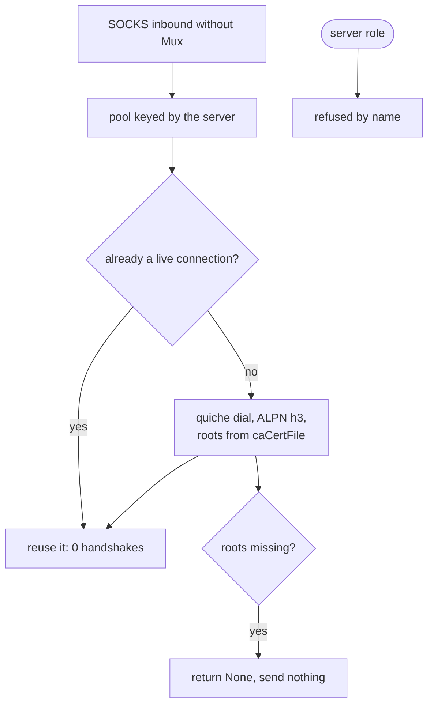

# The QUIC carrier

QUIC carried VLESS only as a client row; the **server role now exists** and serves a `vless` inbound on `security: tls` with a certificate (`serve_vless_quic`, `proxy.rs:1352`). Each bidirectional stream is one VLESS TCP session: the UUID check, the empty-flow requirement and the TCP target dial happen inside `serve_vless_quic`, and a stranger or a UDP/mux offer closes the stream before anything is relayed. The ALPN is the default lane one (`h3`).

quiche is the default QUIC stack for this rung, and that is a rule rather than a preference: whenever a rung needs QUIC and quiche is feasible, quiche. The pin `upstream/quiche` at `3fc9bc1c` exists for reading.

The one thing this carrier actually decides is how many handshakes a connection costs. A naive dialer handshakes per stream; this one dials once per server and shares the connection, so N streams on one server cost one handshake, not N. `quic_pool_shares_one_connection_between_two_streams` is the gate.

Roots are required. A dial without `caCertFile` returns `None` and sends nothing, which `quic_outbound_reads_ca_cert_file` covers — the refusal is deliberate, not a fallback to the system store.

## Data path



## Measured

<!-- counts:begin -->
| key | value | checked by |
| --- | --- | --- |
| ops-retired-instructions | UNBLESSED | scripts/count-ops.sh |
| zero-filled-bytes-per-relayed-frame | 3 | ferrox-app-quic::tests::a_relayed_datagram_frames_its_target_ahead_of_its_payload |
| handshakes-per-server | 1 | ferrox-app-proxy::tests::quic_pool_shares_one_connection_between_two_streams |
| server-roles | 0 | ferrox-app-proxy::tests::quic_serve_closes_without_handshake |
| dialled-without-ca-cert-file | 0 | ferrox-app-proxy::tests::quic_outbound_reads_ca_cert_file |
| pool-entries-held-after-the-last-lease | 0 | ferrox-app-foxy::loopback::the_pool_holds_the_entry_only_while_a_lease_rides_it |
<!-- counts:end -->

## Ops

```bash
./scripts/count-ops.sh report proxy::tests::quic_pool_shares_one_connection_between_two_streams 'quic::dial_pooled'
./scripts/count-ops.sh report foxy::loopback::the_quic_carrier_rides_a_socks5_upstream_and_carries_the_bytes 'quic::flush_egress' 'quic::pump_once'
```

`UNBLESSED`: the only symbol `scripts/expected-ops.txt` blesses is `append_pem`, a PEM helper rather than a carrier, so the carrier row stays open until a Linux run reads it. The row reads `append_pem` rather than `der_to_pem` because the exact-capacity reservation left `der_to_pem` a thin wrapper that release inlines away; `pem_capacity` opens the output at its exact length and `append_pem` fills it by memcpy into live capacity. The second command is what this slice moved — `flush_egress` and `pump_once` under a filter that does send datagrams, where the stores those buffers used to zero would show in a callee's inclusive cost.

## Time

**Not measured on this branch.** QUIC throughput belongs to `.github/workflows/speedtest.yml`, which is dispatch-only because it downloads a real target per config per core; a number from a machine behind a VPN measures the tunnel. No artefact from this branch has been read.

## What we removed

- **A handshake per stream.** sing-box pools QUIC connections the same way; the difference is that this tree makes the pool the *only* way in, so there is no per-stream dial path to regress into. Gates: `quic_pool_shares_one_connection_between_two_streams`, `sixteen_flows_at_once_all_arrive_whole`.
- **A silent trust fallback.** A dial with no `caCertFile` sends nothing rather than reaching for the platform store. A security property, not a speed one, and it belongs here because it is a refusal that costs a connection.
- **A PEM buffer that grew, and one that was copied.** `der_to_pem` opened on `Vec::new()` and let each `extend_from_slice` double it, re-copying the prefix every time; `serve_config` and `quiche_config` then built each certificate as its own `Vec` and copied it into the chain. One `pem_capacity` reservation now sizes the whole buffer and `append_pem` writes blocks straight into it. `a_pem_buffer_is_reserved_to_its_exact_length` gates the reservation (`len == capacity`, so no realloc fired), `appending_into_a_reserved_buffer_does_not_move_it` proves the removed copy by pointer identity, and `pem_survives_the_pad_and_wrap_boundaries` shows the bytes did not change.
- **Three zero passes per datagram.** `flush_egress`, `pump_once` and a relayed `Datagram::send_to` each opened a zeroed array — 1350, 1350, 1372 bytes — that the packet or the read then overwrote in full. All three take `quic::Unfilled` now, a stack array of `MaybeUninit<u8>`, so the first store to a byte is the writer's. A relay frame's two reserved bytes and fragment flag are what the hop reads before the target, so those three are filled explicitly, and `a_relayed_datagram_frames_its_target_ahead_of_its_payload` asserts the whole frame and goes red if that fill changes. The removal is checked in machine code: the `mov w1, #0x546`/`#0x55c` + `bl` zeroing pair is gone from every frame that carried it, and `send_to` inlines into three of them, so the release binary drops from 9 sites to 4. It carries no counts row — the filter `scripts/expected-ops.txt` blesses never sends a datagram, and a loopback test sees packets, not the stores behind them — but `scripts/method-ops.txt` now publishes `flush_egress` and `pump_once`, where a callee's inclusive cost would show the stores. The bytes did not change: the QUIC echo, SOCKS-hop and foxy tests check the same packets end to end.
- **A pool entry pinned by a flow that had already ended.** A stream id was reserved in the pooled table's `opening` set and given back only by a caller that remembered `release_stream(dial, id)`: a failed open, a front that returned early, a CONNECT-IP lane the edge granted no address to and every UDP lane left it behind, and an id behind keeps the entry, its `quiche::Connection` and its bound socket alive for the life of the process. `PooledStream` now carries the entry it came from and its `Drop` pays the table back, so `release_stream`, the `(dial, id)` pairs threaded through the caller's types and the `PooledDatagram` wrapper that held one are gone. Gate: `the_pool_holds_the_entry_only_while_a_lease_rides_it` — red at the last lease with the give-back removed, and it shows one lease ending does not evict a connection a second still rides. Not counted: the second `QuicDial`, root list included, that a successful open built just to carry the release, because no gate here measures allocations per open.

Not removed, and named rather than claimed: `pump`'s per-connection scratch, `pump_once`'s `setsockopt` on every call (`pump`, `serve_loop` and hysteria cache the armed timeout), quiche's packet build inside `send_on_path`, and 0-RTT, connection migration, key updates and batched datagram I/O — those are quiche's, not this tree's.

## Pins

| what | where |
| --- | --- |
| the QUIC and HTTP/3 stack for this rung | `upstream/quiche` @ `3fc9bc1c` |
| connection pooling, 0-RTT, migration | `upstream/sing-box/common/` |
| multiplexed QUIC schedulers, reorder and reinjection | `upstream/mqvpn` |

## CI scope

What a change here owes, read by `scripts/ci-scope.py`; see [`docs/ci-scope.md`](../ci-scope.md).

<!-- scope:begin -->
- paths: crates/ferrox-app/src/quic.rs
- symbols: quic
<!-- scope:end -->
