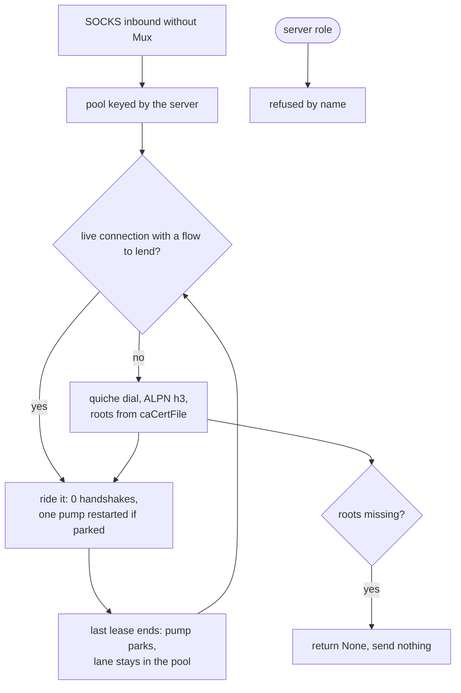

# The QUIC carrier

QUIC carried VLESS only as a client row; the **server role now exists** and serves a `vless` inbound on `security: tls` with a certificate (`serve_vless_quic`, `proxy.rs:1352`). Each bidirectional stream is one VLESS TCP session: the UUID check, the empty-flow requirement and the TCP target dial happen inside `serve_vless_quic`, and a stranger or a UDP/mux offer closes the stream before anything is relayed. The ALPN is the default lane one (`h3`).

quiche is the default QUIC stack for this rung, and that is a rule rather than a preference: whenever a rung needs QUIC and quiche is feasible, quiche. The pin `upstream/quiche` at `3fc9bc1c` exists for reading.

The one thing this carrier actually decides is how many handshakes a connection costs. A naive dialer handshakes per stream; this one dials once per server and shares the connection, so N streams on one server cost one handshake, not N — including the N that arrive one after another rather than at once. `quic_pool_shares_one_connection_between_two_streams` gates the overlapping half, `a_lane_outlives_its_leases_and_the_next_flow_rides_it` the sequential half.

A lane that outlives its last lease is parked, not closed: `pump` ends its own thread when the socket is quiet and no lease rides the table, and the connection, its stream ids and its bound socket stay in the pool for the next flow. The next lease restarts exactly one pump, taking the flag on the same lock the thread left it on. Two bounds keep a parked lane from becoming a pin: the edge's own idle timeout, advanced by one `on_timeout` call at lookup so the gap is quiche's arithmetic rather than a budget of ours, and `flows-per-lane-before-it-is-handed-back`, which is inside the 100-stream grant `MAX_STREAMS` advertises.

Every socket `bind_datagram` opens — a lane's, hysteria's client and the server's listen socket — asks for a receive buffer at bind, one `setsockopt` each and off the hot path, because a parked socket is the only thing holding what the edge sent while no pump owned it, and a Windows default (64 KB) drops it. The ask is read back rather than assumed; `receive-buffer-floor-bytes-armed-per-lane` is the floor it has to land as.

The hand-back itself is a pool decision, not a protocol one: a lane that has lent its whole grant leaves the pool's table so the caller's `or_else` dials a fresh one, and only a lane no lease rides is given the `done` frame. `a_lane_that_lent_its_whole_grant_of_flows_is_handed_back` asserts both halves — the entry gone from the pool, and the flow that stayed on it still carrying bytes, which is the witness that no goodbye was sent over it.

Roots are required. A dial without `caCertFile` returns `None` and sends nothing, which `quic_outbound_reads_ca_cert_file` covers — the refusal is deliberate, not a fallback to the system store.

## Data path



## Measured

<!-- counts:begin -->
| key | value | checked by |
| --- | --- | --- |
| ops-retired-instructions | UNBLESSED | scripts/count-ops.sh |
| zero-filled-bytes-per-relayed-frame | 3 | ferrox-app-quic::tests::a_relayed_datagram_frames_its_target_ahead_of_its_payload |
| handshakes-per-server | 1 | ferrox-app-proxy::tests::quic_pool_shares_one_connection_between_two_streams |
| server-roles | 0 | ferrox-app-proxy::tests::quic_serve_closes_without_handshake |
| dialled-without-ca-cert-file | 0 | ferrox-app-proxy::tests::quic_outbound_reads_ca_cert_file |
| lanes-held-after-the-last-lease | 1 | ferrox-app-foxy::loopback::a_lane_outlives_its_leases_and_the_next_flow_rides_it |
| pump-threads-owned-by-an-idle-lane | 0 | ferrox-app-foxy::loopback::a_lane_outlives_its_leases_and_the_next_flow_rides_it |
| flows-per-lane-before-it-is-handed-back | 64 | ferrox-app-foxy::loopback::a_lane_that_lent_its_whole_grant_of_flows_is_handed_back |
| receive-buffer-floor-bytes-armed-per-lane | 262144 | ferrox-app-quic::tests::a_quic_socket_arms_its_receive_buffer |
<!-- counts:end -->

## Ops

```bash
./scripts/count-ops.sh report proxy::tests::quic_pool_shares_one_connection_between_two_streams 'quic::dial_pooled'
./scripts/count-ops.sh report foxy::loopback::the_quic_carrier_rides_a_socks5_upstream_and_carries_the_bytes 'quic::flush_egress' 'quic::pump_once'
./scripts/count-ops.sh report foxy::loopback::a_lane_outlives_its_leases_and_the_next_flow_rides_it 'quic::pump' 'quic::pooled_stream_within'
./scripts/count-ops.sh report quic::tests::a_quic_socket_arms_its_receive_buffer 'quic::bind_datagram'
```

`UNBLESSED`: the only symbol `scripts/expected-ops.txt` blesses is `append_pem`, a PEM helper rather than a carrier, so the carrier row stays open until a Linux run reads it. The row reads `append_pem` rather than `der_to_pem` because the exact-capacity reservation left `der_to_pem` a thin wrapper that release inlines away; `pem_capacity` opens the output at its exact length and `append_pem` fills it by memcpy into live capacity. The second command is what that slice moved — `flush_egress` and `pump_once` under a filter that does send datagrams, where the stores those buffers used to zero would show in a callee's inclusive cost. The third and fourth are what this one moved: the pump thread a lease starts and ends, the lease that takes the flag, and the one `setsockopt` per lane socket.

Both were read on a Linux runner against `main`'s own artefact. The new filter gives `quic::pump` 2 427 217 and `quic::pooled_stream_within` 3 474 798 inclusive, and `quic::bind_datagram` comes back `inlined-not-a-frame` — release folds it into its callers, so the arm is not a frame the profiler can name. What it does name is the syscall table of the second filter, where this slice moves exactly one row: `setsockopt` 37 → 40, one per datagram socket the filter binds, with `recvfrom` 66 and `sendto` 63 unchanged. `flush_egress` 1 014 011 → 1 014 259 and `pump_once` 2 436 499 → 2 462 978 are inside the band a loopback-driven row moves run to run, which is why no count here is blessed against it.

## Time

**Not measured yet.** QUIC throughput belongs to `.github/workflows/speedtest.yml`, which is dispatch-only because it downloads a real target per config per core; a number from a machine behind a VPN measures the tunnel. `.github/workflows/foxy-relay.yml`'s `Lane durations` table cannot see a parked lane at all: it restarts the lane for every carrier row (`a port per carrier, because a lane that outlives its stop still holds the port`) and takes one flow per row, so every row is a cold lane and a spent handshake. What that table can gate is the arm a cold lane pays at bind, and the h3 rows are where it would show: 1.00 MB/s against a 5.91 MB/s control on macOS, 1.84 against 3.00 on Windows, 2.22 against 5.49 on Ubuntu. A sequential-flow number needs a row that takes N flows on one lane; no such row exists yet, so the reuse is gated by pointer identity in `a_lane_outlives_its_leases_and_the_next_flow_rides_it` and its rate is an open claim.

## What we removed

- **A handshake per stream.** sing-box pools QUIC connections the same way; the difference is that this tree makes the pool the *only* way in, so there is no per-stream dial path to regress into. Gates: `quic_pool_shares_one_connection_between_two_streams`, `sixteen_flows_at_once_all_arrive_whole`.
- **A silent trust fallback.** A dial with no `caCertFile` sends nothing rather than reaching for the platform store. A security property, not a speed one, and it belongs here because it is a refusal that costs a connection.
- **A PEM buffer that grew, and one that was copied.** `der_to_pem` opened on `Vec::new()` and let each `extend_from_slice` double it, re-copying the prefix every time; `serve_config` and `quiche_config` then built each certificate as its own `Vec` and copied it into the chain. One `pem_capacity` reservation now sizes the whole buffer and `append_pem` writes blocks straight into it. `a_pem_buffer_is_reserved_to_its_exact_length` gates the reservation (`len == capacity`, so no realloc fired), `appending_into_a_reserved_buffer_does_not_move_it` proves the removed copy by pointer identity, and `pem_survives_the_pad_and_wrap_boundaries` shows the bytes did not change.
- **Three zero passes per datagram.** `flush_egress`, `pump_once` and a relayed `Datagram::send_to` each opened a zeroed array — 1350, 1350, 1372 bytes — that the packet or the read then overwrote in full. All three take `quic::Unfilled` now, a stack array of `MaybeUninit<u8>`, so the first store to a byte is the writer's. A relay frame's two reserved bytes and fragment flag are what the hop reads before the target, so those three are filled explicitly, and `a_relayed_datagram_frames_its_target_ahead_of_its_payload` asserts the whole frame and goes red if that fill changes. The removal is checked in machine code: the `mov w1, #0x546`/`#0x55c` + `bl` zeroing pair is gone from every frame that carried it, and `send_to` inlines into three of them, so the release binary drops from 9 sites to 4. It carries no counts row — the filter `scripts/expected-ops.txt` blesses never sends a datagram, and a loopback test sees packets, not the stores behind them — but `scripts/method-ops.txt` now publishes `flush_egress` and `pump_once`, where a callee's inclusive cost would show the stores. The bytes did not change: the QUIC echo, SOCKS-hop and foxy tests check the same packets end to end.
- **A pool entry pinned by a flow that had already ended.** A stream id was reserved in the pooled table's `opening` set and given back only by a caller that remembered `release_stream(dial, id)`: a failed open, a front that returned early, a CONNECT-IP lane the edge granted no address to and every UDP lane left it behind, and an id behind keeps the entry, its `quiche::Connection` and its bound socket alive for the life of the process. `PooledStream` now carries the entry it came from and its `Drop` pays the table back, so `release_stream`, the `(dial, id)` pairs threaded through the caller's types and the `PooledDatagram` wrapper that held one are gone. What the give-back is now checked by is the park: `pump` ends its thread only over a table no lease rides, so `a_lane_outlives_its_leases_and_the_next_flow_rides_it` goes red on an id that was never returned. Not counted: the second `QuicDial`, root list included, that a successful open built just to carry the release, because no gate here measures allocations per open.
- **A handshake per flow, and a thread per idle lane.** `leave_session` closed the pooled connection with a `done` frame and cut the pool entry when the last lease ended, so every flow after the first re-handshaked against the same edge: the page's own claim, `handshakes-per-server 1`, held only for streams that overlapped in time, and on a foxy lane, where one flow is one request, that is every flow. `quic::pump` parks instead — the thread ends, the flag says so under the same lock the next lease takes it on, and the connection, its stream ids and its bound socket stay in the pool — and `leave_session` is down to the id it came to return. Three flows on one handshake is `a_lane_outlives_its_leases_and_the_next_flow_rides_it`, which asserts the connection by pointer identity rather than by another dial; the bound on how long a lane may be kept is `a_lane_that_lent_its_whole_grant_of_flows_is_handed_back`. A parked lane that the edge let go is found by quiche's own idle timer, read at lookup with one `on_timeout` call, so no constant of ours guesses the peer's patience; a lane whose grant is spent leaves the pool at the next lookup, and only gets the `done` frame when nothing rides it. What this costs, named: one `Mutex::lock` and one timer pass per lease on a warm lane, one `thread::spawn` per park rather than per dial, a `try_clone` of the lane's socket that only a parked lane pays for, and a spent lane that still carries flows leaving the pool without a goodbye — its last lease parks it and the connection goes with the leases that held it.

Not removed, and named rather than claimed: `pump`'s per-connection scratch, `pump_once`'s `setsockopt` on every call (`pump`, `serve_loop` and hysteria cache the armed timeout), quiche's packet build inside `send_on_path`, and 0-RTT, connection migration, key updates and batched datagram I/O — those are quiche's, not this tree's. The park is not instant either: `PUMP_POLL` is how long an idle lane can still hold its thread, and a lane parked past the edge's idle timeout is only found when the next lease looks at it.

## Pins

| what | where |
| --- | --- |
| the QUIC and HTTP/3 stack for this rung | `upstream/quiche` @ `3fc9bc1c` |
| connection pooling, 0-RTT, migration | `upstream/sing-box/common/` |
| multiplexed QUIC schedulers, reorder and reinjection | `upstream/mqvpn` |

## CI scope

What a change here owes, read by `scripts/ci-scope.py`; see [`docs/ci-scope.md`](../ci-scope.md).

<!-- scope:begin -->
- paths: crates/ferrox-app/src/quic.rs
- symbols: quic
<!-- scope:end -->
