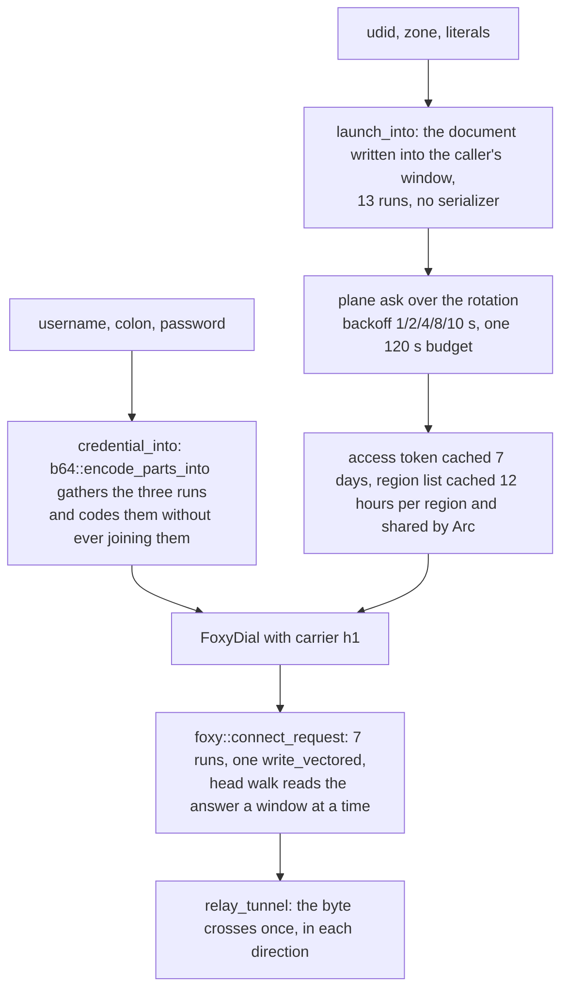

# VeePN lane (an anonymous launch, a region's list, a `Basic` CONNECT)

The plane a free browser extension speaks — `POST /v3/launch/` for a token, a region's server list for a pair, and an HTTPS `CONNECT` upstream that answers `Basic` for it. The record this lane writes is the `Foxy` lane's: the same seven-run gather, the same window walk of the answer, the same relay. What is new here is only the arithmetic in front of it — the credential, the two request bodies, and the domain validator — and each of those was written to cost less than the reference implementation it stands against.

## Data path



## Measured

<!-- counts:begin -->
| key | value | checked by |
| --- | --- | --- |
| ops-retired-instructions | UNBLESSED | scripts/count-ops.sh |
| credential-window-allocations-per-pair | 0 | ferrox-core-veepn::tests::the_credential_lands_in_the_callers_window_and_not_in_one_of_its_own |
| launch-body-window-allocations-per-ask | 0 | ferrox-core-veepn::tests::a_launch_body_is_the_document_the_api_reads |
| connect-request-allocations-per-open | 0 | ferrox-core-tls::rustls_backend::tests::the_connect_request_gathers_without_a_heap_buffer |
| write-calls-per-h1-open | 1 | ferrox-core-tls::rustls_backend::tests::the_connect_request_gathers_without_a_heap_buffer |
| region-list-copies-per-flow | 0 | ferrox-app-veepn::tests::a_cached_list_is_shared_not_copied_per_flow |
<!-- counts:end -->

`credential-window-allocations-per-pair` is pointer identity, not bytes: the returned slice's base is asserted to be the caller's own base, the length to be exactly `credential_len`, and every octet past it to be the zero the caller left there — so the pair was coded into that window and never staged in a buffer of its own. A byte-level test passes with the staging and without it, which is why the row cannot be that. `launch-body-window-allocations-per-ask` is the same witness for the document, and `a_name_that_would_need_escaping_is_refused_and_leaves_the_window_untouched` is its forged-input half: a name the string form would have to escape is refused before a byte is written. The `connect-request-allocations-per-open` and `write-calls-per-h1-open` rows are [`carrier-foxy`](carrier-foxy.md)'s, named again because this lane is their second caller: `connect_request` takes the `Proxy-Authorization` head as a parameter so `Bearer` and `Basic` share the one seven-run builder — a scheme folded into the value would need an eighth run, and the record lane's `IoSlice` stack holds seven.

What the rows cannot see stays in prose. The pair is coded when a region's list is read, not when a flow opens, so a flow spends no coder: `servers_of` writes each entry's pair into a window sized by `credential_len` and keeps the text in the `Server`. `region-list-copies-per-flow` is the same kind of witness at the other end: two flows read the cached region and `Arc::ptr_eq` says they hold the *same* list, host and pair text included, so a dozen entries cost a refcount bump instead of two dozen `String` clones. Nothing in the harness counts codings per flow, so no row claims it.

## Ops

```bash
./scripts/count-ops.sh report \
  veepn::tests::the_credential_lands_in_the_callers_window_and_not_in_one_of_its_own 'veepn::credential_into'
```

`UNBLESSED`, as every page here says of it. `scripts/count-ops.sh` needs valgrind, which does not exist on macOS/aarch64, so this count is CI-only (`ops.yml`); nothing quotes it until the artefact has been read.

## Time

**Not measured against the live plane.** `bench.yml` has no `veepn` cell and `conformance.yml` has no upstream suite for it, and no local run can stand in: every developer sits behind a VPN and a proxy, so a local dial measures a tunnel, not this code. What was measured is the coder alone — 2 000 000 pairs per cell, no socket in sight, the reference's own route (`base64.b64encode(f"{u}:{p}".encode())`: build the `String`, then code it with this tree's `b64::encode`) against the gathered write into the caller's window, three quiet runs on one machine:

| pair | concatenated, then coded | gathered |
| --- | --- | --- |
| 11 + 6 bytes | 307.4 – 329.6 ms | 31.0 – 33.7 ms |
| 1 + 1 bytes | 155.2 – 177.6 ms | 9.9 – 10.6 ms |
| 32 + 24 bytes | 428.2 – 458.6 ms | 88.7 – 90.2 ms |

That is 4.8x–5.1x at the long pair, 9.8x–10.0x at the ordinary one and 15.2x–17.9x at the smallest. A third shape was measured and lost: stage the pair in a stack buffer and code the whole of it one group at a time costs 1.06x to 1.28x *more* than the gather at the same three cells — the wider load never pays for the concatenation it has to keep — so that route is not in the tree and the gather ships as the only window coder. Durations, not counts: the same cells read up to 2.9x higher in absolute time while a `cargo` build shared the cores — the ratios moved far less than the durations — nothing here reproduces either, and no `bench.yml` cell blesses them, so they suggest and prove nothing.

## What we removed

**The pair that was built to be encoded.** Both references reach the credential through a `String` they then throw away: `base64.b64encode(f"{username}:{password}".encode())` allocates the concatenation, copies it, encodes it, and copies the answer into the header. `encode_parts_into` reads the username, the colon and the password as one stream through a cursor and writes six output octets per input octet nowhere but the caller's window, so the concatenation never exists. Priced above against that route: 4.8x to 17.9x, three pair shapes, spread named.

**The regex per candidate domain.** The reference validates every API origin with a compiled pattern, backtracking over a string that either has a port or does not. `api_domain` walks it once — prefix, the control-byte and `/` refusals, one `rsplit_once(':')`, then the label rule — and returns the host it read rather than a slice the caller has to cut again.

**The head read a line at a time.** The extension's proxy reads the CONNECT answer with `readline()` in a loop, one syscall and one Python-level buffer per line, then a `Content-Length` parse it does not need. This lane pays the `Foxy` head walk: one read of a window, `\r\n\r\n` found where the octets landed, and whatever the record carried past the delimiter handed to the relay instead of discarded. Those are `carrier-foxy`'s rows — `head-read-calls-per-open 1` — and this lane inherits them.

**A server list re-coded per flow.** The reference re-encodes the pair inside every `CONNECT` it serves. Here the coding sits in `servers_of`, once per region per 12 hours, and a flow reads the text already there.

**The whole region copied to reach one upstream.** `servers()` handed back a `Vec<Server>` cloned from the cache, so a flow rebuilt a host `String` and a pair `String` for *every* entry of the region — a dozen entries, two dozen allocations — to dial one of them. The cache holds an `Arc<Vec<Server>>` and a flow bumps it, which is what `a_cached_list_is_shared_not_copied_per_flow` witnesses by pointer equality rather than by bytes.

What is **not** removed. A flow still allocates for its dial: the host `String` and the pair `String` cloned out of the one `Server` it picks (`FoxyDial` owns its edge name, as the `Foxy` lane's dial does), the `authority` `String` the front hands in, and the copy every plaintext pays into the TLS record. The rotation is cloned per ask — `Vec<Endpoint>` copied under the lock so no lock is held across the network — which is a few allocations per *ask*, at a 7-day and 12-hour cadence, and none per flow. The plane's two request bodies are built into a `Vec` in the app before they are sent, because `foxy_account::ask` takes `&[u8]` and the window has to outlive the call. Nothing here has a benchmark cell yet, so none of it is quoted as a duration; the coder is, and it is named as one.

One byte of the launch diverges, and it is named rather than slipped past: `platformVersion` carries this tree's browser-UA shape — `Chrome/130.0`, the way `foxy_challenge` spells its `Chrome/126.0` — instead of the extension's four-field build tail, which no reader at either end compares and which this tree's own fixture gate reads as a routable address.

## References

| what | where |
| --- | --- |
| the plane: launch, rotation, backoff, budget, server list, basic upstream | `github.com/SirBNL/VPeeN` (`api.py`, `core.py`, `localproxy.py`) |
| a second reading of the same upstream: `CONNECT` with `Proxy-Authorization: Basic`, TLS to the listed address | `github.com/Mamootov/chrome-veepn-gateway` (`proxy_server.py`) |
| HTTP `CONNECT` hop and grant shapes this lane keeps byte-identical | `upstream/xray-core/proxy/http/` |

## CI scope

What a change here owes, read by `scripts/ci-scope.py`. No upstream suite speaks `VeePN` — neither xray-core nor sing-box has this plane at the pinned revision — so the oracle is this tree's own loopback. `the_plane_launches_lists_and_carries_a_flow` is the whole control plane with no network in it: one TLS listener plays the API and the upstream at once, and the lane launches anonymously, caches the token it answered, asks the list with that `Bearer`, drops the entry with no port, and dials the pair the surviving entry coded. It is the only thing that runs `access`, `ask`, `walk` and `region`, and it dials a numeric origin, so the address-shaped TLS name against an IP `SAN` is a checked fact rather than an assumption. `a_veepn_outbound_starts_on_the_rotation_it_names_or_ships` is the config half: the shipped rotation, a configured origin, and the origins that are refused at boot. `an_upstream_reads_the_pair_and_carries_the_tunnel` is the open on its own: the golden `Basic` request bytes read off a real TLS edge, and a payload carried both ways. What these gates do not reach is the front: `serve_veepn_front` is `serve_foxy_front` with this lane's `open` in place of the dial, and no local test drives either one — the `foxy` front is proven by the live `foxy-relay.yml` legs, and this lane has no leg there yet, so its front is the shape of a proven one rather than a proven shape.

<!-- scope:begin -->
- paths: crates/ferrox-core/src/veepn.rs, crates/ferrox-app/src/veepn.rs
- symbols: veepn, find_veepn_outbound, serve_veepn_front
<!-- scope:end -->
