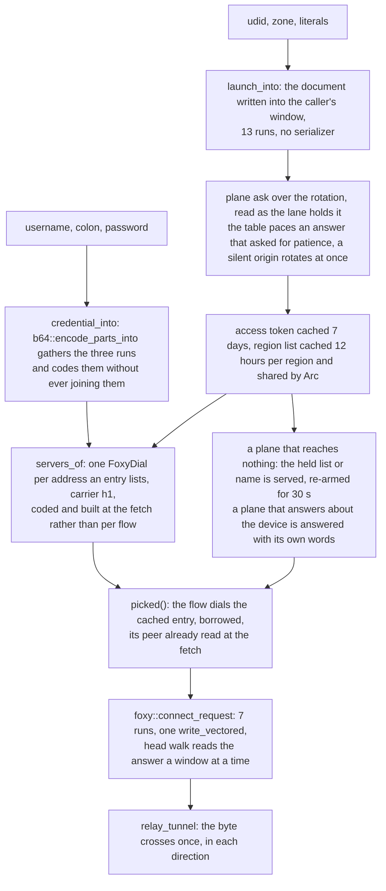

# VeePN lane (an anonymous launch, a region's list, a `Basic` CONNECT)

The plane a free browser extension speaks — `POST /v3/launch/` for a token, a region's server list for a pair, and an HTTPS `CONNECT` upstream that answers `Basic` for it. The record this lane writes is the `Foxy` lane's: the same seven-run gather, the same window walk of the answer, the same relay. What is new here is only the arithmetic in front of it — the credential, the two request bodies, and the domain validator — and each of those was written to cost less than the reference implementation it stands against.

## Data path



## Measured

<!-- counts:begin -->
| key | value | checked by |
| --- | --- | --- |
| ops-retired-instructions | UNBLESSED | scripts/count-ops.sh |
| credential-window-allocations-per-pair | 0 | ferrox-core-veepn::tests::the_credential_lands_in_the_callers_window_and_not_in_one_of_its_own |
| launch-body-window-allocations-per-ask | 0 | ferrox-core-veepn::tests::a_launch_body_is_the_document_the_api_reads |
| connect-request-allocations-per-open | 0 | ferrox-core-tls::rustls_backend::tests::the_connect_request_gathers_without_a_heap_buffer |
| write-calls-per-h1-open | 1 | ferrox-core-tls::rustls_backend::tests::the_connect_request_gathers_without_a_heap_buffer |
| region-list-copies-per-flow | 0 | ferrox-app-veepn::tests::a_cached_list_is_shared_not_copied_per_flow |
| dial-clones-per-flow | 0 | ferrox-app-veepn::tests::a_flow_dials_the_cached_entry_and_not_a_copy_of_it |
| region-name-copies-per-flow | 0 | ferrox-app-veepn::tests::the_named_region_is_shared_not_copied_per_flow |
| origin-list-copies-per-ask | 0 | ferrox-app-veepn::tests::the_rotation_starts_where_the_last_one_left_off |
| edge-peer-read-allocations-per-entry | 0 | ferrox-core-foxy::tests::a_literal_edge_address_is_read_without_a_buffer_of_its_own |
| declined-edge-visits-per-two-flows | 1 | ferrox-app-veepn::tests::a_declined_edge_is_skipped_while_its_silence_lasts |
| silent-region-edges-probed-per-flow | 1 | ferrox-app-veepn::tests::a_silent_region_probes_one_edge_instead_of_its_whole_list |
| refused-target-edge-dials-per-flow | 1 | ferrox-app-veepn::tests::a_refused_target_stops_the_walk_and_keeps_the_region |
| refused-target-plane-asks-per-flow | 0 | ferrox-app-veepn::tests::a_refused_target_stops_the_walk_and_keeps_the_region |
| refusal-field-allocations-per-refusal | 0 | ferrox-core-foxy::tests::head_field_reads_the_names_the_edge_sent |
| unreachable-plane-asks-per-two-flows | 1 | ferrox-app-veepn::tests::a_plane_that_answers_nothing_carries_the_list_it_gave |
| unreachable-plane-edge-dials-per-flow | 1 | ferrox-app-veepn::tests::a_plane_that_answers_nothing_carries_the_list_it_gave |
| unreachable-plane-region-asks-per-two-flows | 1 | ferrox-app-veepn::tests::the_region_the_plane_named_survives_its_own_outage |
| unanswered-plane-pause-seconds-per-ask | 0 | ferrox-core-veepn::tests::a_plane_that_answered_nothing_is_rotated_away_from_not_waited_on |
| answered-plane-pause-seconds-per-ask | 35 | ferrox-core-veepn::tests::a_plane_that_answered_nothing_is_rotated_away_from_not_waited_on |
<!-- counts:end -->

`credential-window-allocations-per-pair` is pointer identity, not bytes: the returned slice's base is asserted to be the caller's own base, the length to be exactly `credential_len`, and every octet past it to be the zero the caller left there — so the pair was coded into that window and never staged in a buffer of its own. A byte-level test passes with the staging and without it, which is why the row cannot be that. `launch-body-window-allocations-per-ask` is the same witness for the document, and `a_name_that_would_need_escaping_is_refused_and_leaves_the_window_untouched` is its forged-input half: a name the string form would have to escape is refused before a byte is written. The `connect-request-allocations-per-open` and `write-calls-per-h1-open` rows are [`carrier-foxy`](carrier-foxy.md)'s, named again because this lane is their second caller: `connect_request` takes the `Proxy-Authorization` head as a parameter so `Bearer` and `Basic` share the one seven-run builder — a scheme folded into the value would need an eighth run, and the record lane's `IoSlice` stack holds seven.

What the rows cannot see stays in prose. The pair is coded when a region's list is read, not when a flow opens, so a flow spends no coder: `servers_of` writes each entry's pair into a window sized by `credential_len` and keeps the text as the dial's own `pass`. `region-list-copies-per-flow` is the same kind of witness at the other end: two flows read the cached region and `Arc::ptr_eq` says they hold the *same* list, host and pair text included, so a dozen entries cost a refcount bump instead of two dozen `String` clones. Nothing in the harness counts codings per flow, so no row claims it.

`dial-clones-per-flow` and `region-name-copies-per-flow` read one level in (their two checks live in different tests, so the table names each one): `picked` is asserted `std::ptr::eq` to the cached entry at five indices, three of them wrapped past the end; the credential run `connect_request` hands back is asserted to point at the cached dial's own `pass.token`; and the region name a flow reads is `Arc::ptr_eq` to the one the lane or the plane holds, on both paths: the configured lane's own text, and the name the plane chose for a lane that configured none. `origin-list-copies-per-ask` is the seam on the ask side: the slice `rotation()` hands the walk starts at the same address as the lane's own `domains`. A flow that rebuilt its dial, or an ask that cloned the origins, answers the same bytes and fails all three — which is why these rows are pointer identities and not counts.

`edge-peer-read-allocations-per-entry` is [`carrier-foxy`](carrier-foxy.md)'s helper named again because this lane is where it pays: the plane lists addresses, and a listed address was kept as text and re-read by every flow's dial. `servers_of` now reads it once into the shell's `address`, so a flow reaches the socket with the peer already a `SocketAddr` and takes the known-peer path — no name spelled, no peer list collected, no resolver asked. The row's value is the core window's (4096 reads of a literal and of a name, `0` allocations, `0` bytes, `0` zeroed, arguments behind `black_box`), and what the fetch actually stores is pinned by `a_list_answer_keeps_the_entries_this_lane_can_dial`, which asserts the literal entry's `address` is the parsed `192.0.2.12:443`, that the same entry's second address is read as `192.0.2.13:443` and carries the same coded pair, and that a listed *name* keeps `None` rather than a half-read address. The arithmetic the row does not carry: a region's list of N entries, dialled by F flows, used to spend F name formats, F resolver calls and F one-peer buffers on text the fetch had read once; now the fetch spends N parses that take no heap and the flows spend nothing. The resolver calls are a syscall count, and no loopback gate may claim one — the CI `ops.yml` artefact is this removal's only witness.

The three refusal rows read the same peer side of the lane, and one of them is a pointer. `refused-target-edge-dials-per-flow 1` is exact where the silence rows could only be a difference: an edge that names the target completes its TLS handshake, so `dial_peers` never reaches the retry leg behind it and one flow is one accept — the test reads it as an absolute, `1` at the edge the rotation picked and `0` at the one behind it, which is also the claim that the walk stops instead of asking the rest of the list for an answer the first edge already gave. `refused-target-plane-asks-per-flow 0` is the same flow read at the API listener, which counts accepts and answers nothing: a refusal that names the host leaves the region's cached list and the token behind it alone, and the older reading — retire the region, ask again — is what that counter would have moved before failing the flow the same way. `refusal-field-allocations-per-refusal 0` is [`carrier-foxy`](carrier-foxy.md)'s `head_field` named again because this lane is where it is called: 4096 reads of a name out of a head window take `0` allocations, `0` bytes and `0` zeroed with the arguments behind `black_box`, and the value's own offset is asserted to lie inside the caller's head, so the marker was read where the answer landed instead of parsed into a table the way the reference's `Header.Get` builds one per response. What these rows cannot see is what the check costs on the path that opens: a `200` pays one test of a status that is already in a register and never has its head walked again, and `Foxy`, which configures no marker, pays that one test too.

The three outage rows read one API listener that counts accepts and answers nothing, which is what a seized API domain looks like from inside a lane. `unreachable-plane-asks-per-two-flows 1` is the claim that an outage is walked once: the region's held entry is seeded with a deadline already past, the first flow asks the plane and reaches nothing, and the flow after it reads that same held list without touching the listener again — a lane that re-asked per flow moves this to `2`. `unreachable-plane-edge-dials-per-flow 1` is the same two flows read at the edge, one accept each, and the edge asserts the exact `CONNECT` bytes, so the pair that came out of the held list is the pair that was dialled rather than a default that happens to open. `the_region_the_plane_named_survives_its_own_outage` reads the same shape at the other cache, where what is held is a region name instead of a list (`unreachable-plane-region-asks-per-two-flows 1`), because a lane that follows the plane's optimal region has to answer the same question twice. What none of them can see is the window's length: `veepn::PLANE_RETRY` is a deadline no test runs out, so the second flow's silence proves the re-arm happened and not that it expires, and the one failed ask a window does pay costs a connect and a handshake against an origin that answers nothing — no sleep, since `veepn::pause` earns one only for an answer that asked for patience — which is a duration no row here claims.

The two silence rows are counted at the edge, not in the lane, and as a difference rather than a total: one visit to a dead edge is not one dial, because `dial_peers` gives every address it reaches `EDGE_ATTEMPTS` quick asks before the walk moves on (`crates/ferrox-app/src/foxy.rs:156-197`). `a_declined_edge_is_skipped_while_its_silence_lasts` stands up one listener that hangs up on every handshake and one that answers `200`, snapshots the hang-up edge's accept count after the first flow, and requires it **unchanged** after the second — the skip is the whole claim, and an absolute number could not be read while the leg retries. Clearing the deadline makes the third flow move that count again, which is what `declined-edge-visits-per-two-flows 1` means: one flow found the edge, the flow after it never reached it. `a_silent_region_probes_one_edge_instead_of_its_whole_list` hangs both listeners up: the first flow's error names `2 of 2 upstream(s) declined` and moves both counters, the flows after it name `1 of 2` and move exactly one of the two — asserted as `delta(A) != delta(B)`, so the pair of deltas says "one edge per probe" without the harness needing to know how many asks a probe spent — and over two probes both edges are reached, so the walk rotates instead of hammering the entry it last found gone. An accept count is what a peer observes of a dial, so neither row claims a syscall or an instruction: a lane that re-dialled a gone edge every flow, and a lane that skipped nothing, both answer the same bytes and fail these.

The two pause rows are arithmetic on the table, read by a sweep that runs no clock and no socket: `unanswered-plane-pause-seconds-per-ask 0` is the sum of `veepn::pause` over the seven origins this crate ships for a plane that never answered, and `answered-plane-pause-seconds-per-ask 35` is the same sum with every answer a `429` — `1+2+4+8+10+10`, the closing attempt earning nothing because no attempt follows it. What the sweep cannot see is that `walk` calls the function it swept, and that half is gated over a real port: `an_unreachable_plane_answers_without_a_pause` binds one, closes it, and requires the flow's error inside 700 ms, where the walk this row replaces slept the whole first step of the table before it returned. The bound is well under that step rather than just under it, so a loaded runner can neither pass the old code nor fail the new one. Neither row is a duration measured against a live plane: no `bench.yml` cell speaks `veepn`, and these are seconds the constants add up to.

## Ops

```bash
./scripts/count-ops.sh report veepn::tests::the_domain_walk_costs_the_labels_and_nothing_else 'ferrox_core::veepn::api_domain'
./scripts/count-ops.sh report veepn::tests::the_pair_coder_costs_the_coder_and_nothing_else 'ferrox_core::veepn::credential_into'
./scripts/count-ops.sh report veepn::tests::the_pair_coder_costs_the_coder_and_nothing_else 'ferrox_core::b64::encode_parts_into'
```

`UNBLESSED`, as every page here says of it: `scripts/count-ops.sh` needs valgrind, which does not exist on macOS/aarch64, so these counts are CI-only (`ops.yml`) and nothing quotes them until the artefact has been read. Both are probes rather than fixtures — 64 walks of the seven origins this crate ships, 512 codings of one `user:pass` into one stack window, each pass folded into a running `u32` whose expected value is pinned (`0xe2ea_d240`, `0xe88e_0600`) so the loop cannot be optimized out and a changed answer fails the row instead of measuring nothing. A probe's number is its frame: the fold, the loop and the frame entry ride inside it, so a row is read as the difference between two runs of the same row and never as the cost of the method alone. `the_domain_walk_costs_the_labels_and_nothing_else` is what puts a count behind the walk that replaced `_API_DOMAIN_RE` (`api.py:72`, applied per candidate origin at `api.py:91`); the regex's own cost is a code read of CPython's engine, not a number this harness measures. `the_pair_coder_costs_the_coder_and_nothing_else` is the instruction-side half of the coder claim priced in durations above.

Read from the artefact now, in the first run that measured them (`ops.yml`, PR #243's head, scope `carrier-veepn`, four rows). The walk costs `ferrox_core::veepn::api_domain` **340 997 Ir over 448 origins** — 64 passes of the seven shipped names — which is 761 Ir to accept one origin of eleven to thirteen bytes; its probe frame reads 381 683, so the difference, 40 686 or 91 a call, is the loop's own fold and iteration rather than the walk. The coder's symbol reads `Ir=inlined-not-a-frame`: the profile held 523 frames and none of them names `credential_into`, so at `lto = "thin"` a fifteen-byte input dissolves into the caller and the coder's figure is its probe frame — **265 246 Ir over 512 pairs**, 518 Ir a pair, about 35 Ir per plain byte coded into the caller's window. Those are published numbers, not gated ones. `ops.yml` runs the check against one hard-coded filter — `count-ops.sh check quic::tests::pem_wraps_at_sixty_four_columns scripts/expected-ops.txt` — so a row blessed here would be profiled inside a PEM test and read back as a blank, which is why `scripts/expected-ops.txt` holds one row and this page's `ops-retired-instructions` stays `UNBLESSED`. What the two rows do give is a baseline: any change to the walk or the coder re-measures these rows in its own ops job, and the delta between two runs of the same row is the claim, while the absolute figures stay what the artefact said.

The third report line above points at the coder instead of at the `credential_into` that dissolves into it, and whether `ferrox_core::b64::encode_parts_into` survives as a frame of its own at `lto = "thin"` is what the run answers — `Ir=inlined-not-a-frame` is a labelled answer, not a figure. The run is for the group read: the same filter, the same 512 pairs, the same fold and the same pinned answer, so its count is a before/after pair against the `265 246` #243 published, and only the difference is quoted here.

Read from this run (`ops.yml`, 68 rows, one job). The pair frame is **244 254 Ir** against the **265 246** #243 published: `20 992` off 512 pairs, **41 Ir a pair**, about 8% of the frame — twelve cursor asks retired, and 41 over twelve is about 3.4 Ir each, which is the size of the part test, the bounds test and the `Option` the fast read no longer runs. The untouched row in the same run is the noise floor: `api_domain` reads 339 635 against the 340 997 #243 read, so 0.4% of a frame moves between runs of code nobody changed, and the 8% is read against that, not against zero. What the change also did is make the coder answer as its own frame — `ferrox_core::b64::encode_parts_into` **163 328 Ir over 512 pairs**, 319 Ir for a fifteen-byte pair, where #243's run reported `inlined-not-a-frame` for the symbol and its caller: the fast path grew the body past what the inliner takes, so the figure is now readable per coder rather than only per probe. A frame's absolute is still not a cost per byte — and none of this is a figure anyone should quote as one, because this coder runs once per region per twelve hours. What it buys is the shape of the measurement: `b64::encode`, the coder that does run per connection, now has its own baseline on `carrier-websocket`.

## Time

**Not measured against the live plane.** `bench.yml` has no `veepn` cell and `conformance.yml` has no upstream suite for it, and no local run can stand in: every developer sits behind a VPN and a proxy, so a local dial measures a tunnel, not this code. What was measured is the coder alone — 2 000 000 pairs per cell, no socket in sight, the reference's own route (`base64.b64encode(f"{u}:{p}".encode())`: build the `String`, then code it with this tree's `b64::encode`) against the gathered write into the caller's window, three quiet runs on one machine:

| pair | concatenated, then coded | gathered |
| --- | --- | --- |
| 11 + 6 bytes | 307.4 – 329.6 ms | 31.0 – 33.7 ms |
| 1 + 1 bytes | 155.2 – 177.6 ms | 9.9 – 10.6 ms |
| 32 + 24 bytes | 428.2 – 458.6 ms | 88.7 – 90.2 ms |

That is 4.8x–5.1x at the long pair, 9.8x–10.0x at the ordinary one and 15.2x–17.9x at the smallest. A third shape was measured and lost: stage the pair in a stack buffer and code the whole of it one group at a time costs 1.06x to 1.28x *more* than the gather at the same three cells — the wider load never pays for the concatenation it has to keep — so that route is not in the tree and the gather ships as the only window coder. Durations, not counts: the same cells read up to 2.9x higher in absolute time while a `cargo` build shared the cores — the ratios moved far less than the durations — nothing here reproduces either, and no `bench.yml` cell blesses them, so they suggest and prove nothing.

## What we removed

**The pair that was built to be encoded.** Both references reach the credential through a `String` they then throw away: `base64.b64encode(f"{username}:{password}".encode())` allocates the concatenation, copies it, encodes it, and copies the answer into the header. `encode_parts_into` reads the username, the colon and the password as one stream through a cursor and writes six output octets per input octet nowhere but the caller's window, so the concatenation never exists. Priced above against that route: 4.8x to 17.9x, three pair shapes, spread named.

**Twelve cursor asks per pair.** The gathered coder asked the byte path three times for every group, and every ask re-read the part table, tested the cursor against that part's own length and carried an `Option` back: fifteen asks to move a fifteen-byte pair's fifteen bytes. A group the run under the cursor already holds is one slice read at that cursor now, so the pair's four whole groups pay four reads where they paid twelve asks. What is **not** removed: the group that straddles the colon still walks its three bytes, the 1..=2 leftover bytes still take the byte path, and every output octet is still an alphabet load — the fast read returns the same three octets the three asks did, which is what `the_window_coder_matches_the_alphabet_at_every_length` and the every-split sweep in `the_gathered_coder_puts_the_concatenation_in_the_callers_buffer` hold byte for byte. Its price is the `the_pair_coder_costs_the_coder_and_nothing_else` delta named in Ops above.

**The regex per candidate domain.** The reference validates every API origin with a compiled pattern, backtracking over a string that either has a port or does not. `api_domain` walks it once — prefix, the control-byte and `/` refusals, one `rsplit_once(':')`, then the label rule — and returns the host it read rather than a slice the caller has to cut again.

**A region name copied per open.** A lane that configures no region asks the plane which one to use and keeps the answer for the list's 12-hour window; every flow that then opened read it out of the cache with a `String` clone behind a `Cow`, so one malloc and one copy of the name stood in front of a dial that was already shared. The lane and the plane now hold one `Arc<str>` each side and an open takes a reference count, which `the_named_region_is_shared_not_copied_per_flow` witnesses as pointer identity on both paths. `region-name-copies-per-flow` read `0` against this row before: the checker could only see the configured lane, whose name was borrowed all along, so the number stood for a half that had always held and the half that copied stayed invisible to it — the reason the row's checker moved rather than its value. What is **not** removed: the name is still copied once when the plane answers it (one allocation per 12 hours per lane), and the list's own cache key is still a `String` of its own, because that copy is on the fetch side, where a flow never reaches it. The references do the same thing cheaper in a language that aliases text: `upstream/VPeeN/vpeen/core.py:145-152` asks `optimal_location` once at startup and holds the answer in a variable the whole run reuses, so it pays no copy per connection — and no re-ask either, which is the thing the 12-hour window here exists to do.

**The head read a line at a time.** The extension's proxy reads the CONNECT answer with `readline()` in a loop, one syscall and one Python-level buffer per line, then a `Content-Length` parse it does not need. This lane pays the `Foxy` head walk: one read of a window, `\r\n\r\n` found where the octets landed, and whatever the record carried past the delimiter handed to the relay instead of discarded. Those are `carrier-foxy`'s rows — `head-read-calls-per-open 1` — and this lane inherits them.

**A server list re-coded per flow.** The reference re-encodes the pair inside every `CONNECT` it serves. Here the coding sits in `servers_of`, once per region per 12 hours, and a flow reads the text already there.

**The whole region copied to reach one upstream.** `servers()` handed the region's entries cloned from the cache, so a flow rebuilt a host `String` and a pair `String` for *every* entry — a dozen entries, two dozen allocations — to dial one of them. The cache holds an `Arc<Vec<FoxyDial>>` and a flow bumps it, which is what `a_cached_list_is_shared_not_copied_per_flow` witnesses by pointer equality rather than by bytes.

**The dial built again by every flow.** One step short of that, `open()` still assembled a `FoxyDial` per flow out of the one entry it picked: the host `String` and the pair `String` cloned, a `Pass` written field by field, the anchors `Arc::clone`d and the pins defaulted — a shell thrown away as soon as the upstream answered, and rebuilt for the next entry when that one had left the pool. The fetch builds the shells now and `picked` hands the flow a `&FoxyDial`, so `dial-clones-per-flow` is 0 and the record gathers the cached entry's own credential bytes.

**The addresses an entry lists past its first.** `servers_of` took the first non-empty string of an entry's `addresses` and threw the rest away, so a plane that lists `["192.0.2.12","192.0.2.13"]` for one pair gave this lane one edge where the pair serves both — and one address that had left the pool took the whole entry with it. The fetch now emits a dial per address, all of them carrying the pair the entry coded once, so the walk of a region reaches every edge the plane published: at the ordinary list of twelve entries that is twelve chances to reach an edge instead of up to twelve entries whose second and third addresses were never in the pool, and the extra entries cost one pass over a `Vec` of `&str` and one text copy per address of one entry — fetch-side, once per region per twelve hours, where a flow never reaches it. The references each pay for the same reach somewhere a flow does see it: `for host in addresses:` sits inside `connect_via_server`, so VPeeN walks the list per connection and re-runs `base64.b64encode(f"{u}:{p}")` for every address it tries (`upstream/VPeeN/vpeen/upstream.py:119-139`); chrome-veepn-gateway flattens each address into its own proxy entry, but only when it scrapes the config (`config_extractor.py:129-143`); `veepn-proxy` dials `ips.Addresses[0]` and no other (`main.go:271`), which is the same blind spot this change removes. What is **not** removed: the pair's text is one `String` per address rather than one per entry, because `FoxyDial` owns its pass and sharing it would mean an `Arc<str>` in a core type every carrier dials with.

**The origin list cloned per ask.** `rotation()` took the plane's mutex and returned `plane.domains.clone()` — a `Vec`, plus the host and prefix `String` of every origin, and a lock held by each flow that only wanted to read them — so that no lock was held across the network. The origins are fixed at boot, so they live outside the plane in an `Arc<[Endpoint]>` and only the cursor moves, now in an `AtomicUsize`: an ask reads the list where the lane holds it (`origin-list-copies-per-ask 0`), and two flows no longer serialize to start one.

**The body copied before it was posted.** Both request bodies were written into a window sized by the core and then `.to_vec()`d, because the ask takes `&[u8]` and the buffer had to outlive the call. The window already is a `&[u8]` and already outlives it, so the slice goes straight in and the second buffer is gone.

**The credential read back through a lossy pass.** `String::from_utf8_lossy(coded).into_owned()` scanned the coded text and then copied it into a `String` of its own. Base64 output is ASCII by construction, so the check is `String::from_utf8(window)` and the window's allocation *is* the text: same bytes, one scan instead of two, one buffer instead of two. The one input where the two routes differ is a pair that is not UTF-8, and base64 cannot produce one; had it been reachable, the lossy route would have shipped replacement characters into a `CONNECT` and this one drops the entry with the `unusable` count, which is the better refusal of the two.

**The request target formatted per attempt.** `walk()` built `format!("{}{path}", endpoint.base)` for every domain it tried. An origin of this lane is refused at boot if it carries a prefix, so `base` is always empty and `path` already is the whole request target.

**The listed address re-read by every flow.** `servers_of` kept each entry's address as text and set `address: None`, so the dial that used it spelled `host:port` into a `String`, handed it to `to_socket_addrs`, collected one peer into a `Vec` and walked it — on every flow, for an address the fetch had already seen. The fetch reads it once through `ferrox_core::foxy::edge_peer` now, and the flow that picks the entry takes the known-peer path with nothing to read. Both references keep the per-connection read: VPeeN's `connect_via_server` walks the entry's `addresses` and hands each `(host, port)` pair to `asyncio.open_connection`, which resolves the host it was given on every call, and codes the pair with `base64.b64encode` in the same loop (`upstream.py`); `veepn-proxy`'s `FixedDialer.DialContext` joins its fixed address and the port with `net.JoinHostPort` for every dial (`fixed.go`). Neither is handed a parsed peer to dial.

**A gone edge dialled by every flow.** An upstream that has left the pool used to decline each and every flow that picked it: a TCP connect, a ClientHello and a handshake timeout before the next entry answered, repeated because nothing in the lane remembered the decline. Each entry of a region's list now carries a silence deadline — one `AtomicU64` beside the dial the cache already holds — and a flow that picks an entry whose window is open walks past it, so a dead edge costs the flow that found it and nothing to the flows after it (`declined-edge-visits-per-two-flows 1`). When a whole region has gone quiet the walk lifts the earliest window and probes that one entry, so a dead network costs a flow one handshake instead of the list, a recovered edge rejoins the moment it answers, and a probed edge that declines again lands behind the windows still open — the scan starts at the flow's own rotation, so entries whose windows tie are probed in turn rather than hammered one after another (`silent-region-edges-probed-per-flow 1`). The state is a fixed 60-second window and one relaxed store per decline, with no counter and no lock: two flows that decline the same edge at once write the same deadline, which is idempotent, and the list's own 12-hour refresh rebuilds the breaker along with the entries. What is **not** copied from the reference is its escalation. VPeeN keeps a `server index → deadline` dict plus a `server index → consecutive failures` dict and doubles a window from 20 s to a 600 s ceiling (`upstream/VPeeN/vpeen/localproxy.py:52-53, 406-430`); its pass 2 probes the index closest to expiry the same way this walk does. A streak here would be a second field per entry and a read-modify-write per decline, to save a handshake this lane already saves by skipping the entry at all — and the 12-hour refresh already forgets a window the dict has no way to forget. A browser that reloads into a full outage sees one probe per reload on both routes.

**A refusal that named the host, read as a refusal of the pair.** A `403` carrying `X-Hola-Error: Forbidden Host` is the edge saying it will not carry *this target*; a bare `403` or a `401` is the edge saying the pair is no good. This lane read them the same way: it retired the region's cached list and the token behind it, and the front answered `0x01` — a general failure — so one refused host cost the next flow a plane round trip, and every flow after it got an answer that blamed the proxy instead of the destination. `ferrox_core::foxy::head_field` reads the marker where the answer landed, and `open_h1` asks for it only after a status that already failed to open, so a target refusal becomes `Failure::BlockedHost(status)`: the walk stops there rather than paying the rest of the region's list, the plane's caches survive (`refused-target-plane-asks-per-flow 0`), and the client hears `0x04` — host unreachable, which is what actually happened. `Refusal { why, code }` is the seam that lets the lane hand that byte to the front at all; `refusal_reply`, the tree's one exhaustive match on `Failure`, gained the matching arm because it is exhaustive, though `Foxy` passes no marker and cannot reach it. Both references conflate the two answers, so the claim here is function rather than speed: `upstream/veepn-proxy/upstream.go:190-196` builds exactly this check (`StatusCode == http.StatusForbidden && proxyResp.Header.Get("X-Hola-Error") == "Forbidden Host"`) and nothing in its `main.go` answers it differently from any other upstream failure; `upstream/VPeeN/vpeen/upstream.py:59-60` reads `401` and `403` alike as bad or expired credentials and re-launches, and the host-unreachable reply it does have comes only from `404` or `410` (`upstream.py:61-62`) — so the answer this plane actually gives for a refused host still reads as a credential failure there. What is **not** removed: a refused answer's head is walked a second time — once for the delimiter, once field by field — because the record lane's `head` hands back a status and not a parsed message, so a refusal pays a window scan it did not pay before, and only a refusal does; the `200` path pays one branch on a status already in a register; and the marker is a `const` in the core, so a plane that renames its error header is a source edit rather than a config field.

**A plane that could not be reached, answered as a refusal of the pair.** A region's list is worth 12 hours, and when that window closed while the plane was out — a seized API domain, a quiet network — the flow that found it failed, and every flow after it failed the same way, each buying another walk of the rotation before the identical error: up to `MAX_ATTEMPTS` 14 origins inside a 120 s budget, so the second flow of an outage bought another walk. `ask` now answers `Miss { answered, why }`, and `answered` is a fact about which half of the lane spoke rather than a string to re-read: a launch that reaches the plane and refuses this device, or carries no token, is `Miss::spoken` and the flows hear it, because no held list makes a revoked pair good. Everything else — no bytes back, a budget that ran out, a token even a fresh launch cannot make work — is the network talking, and the expired-but-held answer is served for `PLANE_RETRY` (30 s) with its deadline re-armed at the end of that window, so an outage costs the lane one ask per window instead of one per flow (`unreachable-plane-asks-per-two-flows 1`, and the flows in the window spend `unreachable-plane-edge-dials-per-flow 1` each: the pair that came out of the held list is the pair that reaches the socket). The same rule on the other cache keeps the region the plane named (`unreachable-plane-region-asks-per-two-flows 1`), because a lane that configures no region asks that question too. What is **not** removed: a held answer is still an answer from the past — an outage outliving `SERVERS_TTL` serves a pair the plane may have retired, which then declines at the edge and lands behind `EDGE_SILENCE` like any other decline, and a plane that never comes back keeps handing out its last list for as long as the lane runs; the 30 s re-arm is a deadline no local test runs out, which is why the rows count the asks rather than the window; `forget`, the retirement a refused pair calls for, still clears the region's list and the token that asked for it, so a refusal the plane *answered* never reads a held list; and the token's own 7-day window is untouched, because a launch is not per-flow work. The references split this three different ways. VPeeN added exactly this rule to the list that never carries a flow and not to the one that does: `upstream/VPeeN/vpeen/api.py:290-308` keeps a stale non-empty reserve list "until a fresh one arrives" after a 24-hour poisoning bug, while `server_list` (`api.py:413-433`) reads a TTL-bounded cache and writes it only after a successful request, so when the window closes on an outage `_request` raises `All API attempts failed` at the connection that needed the list (`api.py:264-265, 284`) — and its `optimal_location` (`api.py:408-409`) caches nothing, because `core.py:145-152` asks it once at startup, where a plane that is down then is down for the run. `veepn-proxy` keeps the flows off the API entirely with a `-refresh` 4-hour ticker and a `-refresh-retry` 5 s pause (`main.go:81-82`, walked at `main.go:233`): an outage costs the ticker a retry instead of a flow, and a pair serves up to 4 hours past its fetch with no deadline behind it. chrome-veepn-gateway reaches no plane at all — it scrapes the extension's LevelDB once at startup and exits on a failed read (`main.py:70-77`) — so it has no outage to survive and no route to learn that the credential it scraped has since been retired, while its per-connection failover re-runs the whole list with a 5 s timeout on each entry (`proxy_server.py:61-66`).

**A pause the plane never asked for.** The walk slept a step of `BACKOFF` after every attempt that did not carry: after its last attempt, where no attempt follows to pace, and after an origin that returned no octet at all, where the rotation away from it already is the retry. Over the seven origins this crate ships that is 45 s of sleep standing between a flow and an error the lane already had — and the reference caps its own unreachable path at 3 s a step for exactly this reason, calling the uncapped version "the single biggest `it just hangs` complaint" (`api.py:149-152, 266`). `veepn::pause` reads the answer instead of the counter: a `429` or a `5xx` is the plane asking for patience and gets the whole table (`answered-plane-pause-seconds-per-ask 35`, against the reference's 45 s, whose loop still sleeps after its closing attempt), and a domain that answered nothing is rotated away from with no wait in front of it (`unanswered-plane-pause-seconds-per-ask 0`, against 45 s here and 18 s there). What is **not** removed: the table and its shape, because a plane that says *slow down* is owed one — this moves no `sleep` syscall off a rate-limited walk, it moves 45 s off a dead one's; the `REQUEST_BUDGET` test, which is now the only wall between a long rotation and a late error; and the pause is not what kept the plane un-hammered, since an origin that answers nothing is not the same origin being retried. One dead rotation is seven connects and seven handshakes against seven different hosts, each with `Connection: close`, which is exactly what the sleeping walk already sent.

What is **not** removed. A flow still pays exactly what the `Foxy` record pays: the handshake behind `tls_to_edge`, the copy every plaintext makes into the TLS record, and the exactly-sized `Vec` the head walk hands back as the tunnel's first bytes — those are [`carrier-foxy`](carrier-foxy.md)'s rows, and a per-flow dial shell removed none of them. A plane that lists a *name* rather than an address keeps the resolver ask per flow, because nothing before the socket can answer it, and a `serverAddresses` config entry that is a name behaves the same way. `FoxyDial` owns its edge name, so a cached entry is a real dial of the record lane rather than a borrowed one; its `roots` and `pins` are per entry, built once per fetch. When the lane follows the plane's optimal region instead of a configured one, the name is read where the cache holds it and the copy that used to sit there is named above. An ask still builds its `Vec<(&str, &str)>` header stack, and `foxy_account::ask` still forms the origin and TLS name it dials per call — that is the account lane's side, untouched here. The answer still parses into this tree's owning JSON DOM: 370 reads across twelve files is not a slice, and no row claims a byte of it. Nothing here has a benchmark cell yet, so none of it is quoted as a duration; the coder is, and it is named as one.

One byte of the launch diverges, and it is named rather than slipped past: `platformVersion` carries this tree's browser-UA shape — `Chrome/130.0`, the way `foxy_challenge` spells its `Chrome/126.0` — instead of the extension's four-field build tail, which no reader at either end compares and which this tree's own fixture gate reads as a routable address.

## References

| what | where |
| --- | --- |
| the plane: launch, rotation, backoff, budget, server list, basic upstream | `github.com/SirBNL/VPeeN` (`api.py`, `core.py`, `localproxy.py`) |
| the same lane's edge breaker: two dicts of state, a streak-doubled window, a closest-to-expiry probe | `github.com/SirBNL/VPeeN` (`localproxy.py:52-53, 406-430`) |
| a second reading of the same upstream: `CONNECT` with `Proxy-Authorization: Basic`, TLS to the listed address | `github.com/Mamootov/chrome-veepn-gateway` (`proxy_server.py`) |
| a Go reading of the same upstream: per-dial base64, a one-byte-per-syscall head read, and the target refusal it detects but does not answer differently | `github.com/mbrmail/veepn-proxy` (`upstream.go:190-196`, `resolver.go`, `utils.go`) |
| a Python reading of the same refusal: `401` and `403` alike taken as bad or expired credentials, and a host-unreachable reply that only `404` and `410` earn | `github.com/SirBNL/VPeeN` (`upstream.py:59-62`) |
| the same outage rule kept for the bucket list and not for the list that carries flows, and an optimal-region ask that is never re-asked | `github.com/SirBNL/VPeeN` (`api.py:290-308`, `api.py:413-433`, `core.py:145-152`) |
| a plane kept off the flow path by a 4-hour refresh ticker with a 5 s retry pause | `github.com/mbrmail/veepn-proxy` (`main.go:81-82, 233`) |
| no plane at all: one LevelDB scrape at startup, `sys.exit(1)` on a failed read, and a per-connection failover with a 5 s timeout per entry | `github.com/Mamootov/chrome-veepn-gateway` (`main.py:70-77`, `proxy_server.py:61-66`) |
| the same rotation's pause: a `min(BACKOFF, 3)` cap on the unreachable path, a full-table wait on the `429` path, and a sleep after the closing attempt on both | `github.com/SirBNL/VPeeN` (`api.py:149-152, 266, 277-280`) |
| HTTP `CONNECT` hop and grant shapes this lane keeps byte-identical | `upstream/xray-core/proxy/http/` |

## CI scope

What a change here owes, read by `scripts/ci-scope.py`. No upstream suite speaks `VeePN` — neither xray-core nor sing-box has this plane at the pinned revision — so the oracle is this tree's own loopback. `the_plane_launches_lists_and_carries_a_flow` is the whole control plane with no network in it: one TLS listener plays the API and the upstream at once, and the lane launches anonymously, caches the token it answered, asks the list with that `Bearer`, drops the entry with no port, and dials the pair the surviving entry coded. The address expansion needs no socket: `a_list_answer_keeps_the_entries_this_lane_can_dial` reads a list whose first entry carries two addresses and asserts four dials — the two addresses each with their own parsed peer and the same coded pair, a blank address skipped while the one behind it is kept, and a name still left for the resolver. It is the only thing that runs `access`, `ask` and `walk` to an answer, and the only thing that reaches `picked` through `open` rather than directly; it dials a numeric origin, so the address-shaped TLS name against an IP `SAN` is a checked fact rather than an assumption. The three pointer rows are gated without a socket: `a_flow_dials_the_cached_entry_and_not_a_copy_of_it` seeds a region and reads it back, and `the_rotation_starts_where_the_last_one_left_off` walks the origins the lane was built with. The two silence rows are gated over sockets too: `a_declined_edge_is_skipped_while_its_silence_lasts` and `a_silent_region_probes_one_edge_instead_of_its_whole_list` stand up real loopback listeners — hang-up edges, and for the first one also a minted TLS edge that answers `200` and reads to EOF — and count accepts at the peer, so a walk that re-dialled a silent entry or swept a whole dead region fails the row. They hold no timeout assumption: a hang-up edge fails at the handshake rather than on a clock, and the live edge reads to EOF so a flow's close is never a reset. The refusal rows are gated over two edges and one API listener: `a_refused_target_stops_the_walk_and_keeps_the_region` stands up two minted TLS edges that answer `403` with `X-Hola-Error: Forbidden Host`, reads the flow's `0x04` reply byte and its one accept at one edge and none at the other, and then reads the plane's accept counter and the region's silence windows, so a lane that armed a breaker or retired the list for a target refusal fails the row. `a_veepn_outbound_starts_on_the_rotation_it_names_or_ships` is the config half: the shipped rotation, a configured origin, and the origins that are refused at boot — including one carrying a prefix, which is what lets `walk` post the path as the whole target. `an_upstream_reads_the_pair_and_carries_the_tunnel` is the open on its own: the golden `Basic` request bytes read off a real TLS edge, and a payload carried both ways. `head_field` is gated where it is written, in the core: `head_field_reads_the_names_the_edge_sent` reads the marker spelled four ways, a value with no space after its colon, the same text inside another field's value, a line with no colon, and a head that never reached its blank line, and puts the value's offset inside the caller's own window. The two outage rows are gated the same way, over one API listener that accepts and answers nothing: `a_plane_that_answers_nothing_carries_the_list_it_gave` seeds the region with a list whose deadline is already past, lets a flow reach the dead plane and time out to the held answer, then reads the plane's accept counter and the two edges' — one ask for the pair of flows, and one dial each — while the edges themselves assert the exact `CONNECT` head, so the pair served from a held list is the pair the socket saw rather than a default that happens to open, and the entry's silence windows are read as untouched, which is the claim that a held list is not a declined one. `the_region_the_plane_named_survives_its_own_outage` is the same shape on the other cache: a lane that configured no region, a plane that named `US` and then went silent, and a second flow that still resolves the name and opens. Both hold one origin in the rotation, so a failed ask walks one origin and no more. The pause rows are gated twice, once without a clock and once with a port: `a_plane_that_answered_nothing_is_rotated_away_from_not_waited_on` sweeps `veepn::pause` over the seven shipped origins — no wait for an unanswered attempt at any index, the table for an answered one, nothing on the attempt that closes the walk, and both sums pinned (`0` and `35`) so a changed table or a re-earned trailing pause fails the row — and `an_unreachable_plane_answers_without_a_pause` is the half that reaches `walk` itself: it binds a port, closes it, and holds the flow's error to under 700 ms, where a walk that still pauses an unanswered attempt cannot go below the table's first second. What these gates do not reach is the front: `serve_veepn_front` is `serve_foxy_front` with this lane's `open` in place of the dial, and no local test drives either one — the `foxy` front is proven by the live `foxy-relay.yml` legs, and this lane has no leg there yet, so its front is the shape of a proven one rather than a proven shape. The byte the front answers is the one the lane named, and `serve_veepn_front`'s use of `Refusal.code` is read the same way — from `open`'s own gate, not from a client handshake.

<!-- scope:begin -->
- paths: crates/ferrox-core/src/veepn.rs, crates/ferrox-app/src/veepn.rs
- symbols: veepn, find_veepn_outbound, serve_veepn_front
<!-- scope:end -->
