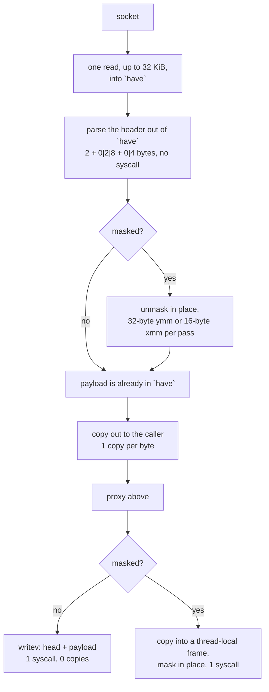

# The WebSocket carrier

`ferrox-app`'s WebSocket carrier is where the syscall shape was worst. A frame
header is 2 bytes, then 0, 2 or 8 bytes of length, then a 4-byte mask, then the
payload — and this tree used to spend one `read` syscall on each of those three
groups plus one on the payload. Three syscalls per message, for a header that is
at most 14 bytes.

Now there is one buffer. A `read` fills as much of it as the socket offers — up
to 32 KiB — a frame header is parsed out of it without touching the socket, and
the payload is unmasked where it lies. So a read covers a window, not a frame
header: 64 frames of 21 472 bytes come out of one `read`, where the old path
spent three per message before it delivered the first payload byte.

The write side was already right and is left alone: an unmasked frame goes out
with `writev`, one syscall and zero copies; a masked frame is copied once into a
thread-local buffer, masked in place there, and written once. What is a floor
and what is not: the mask has to be applied somewhere, so the copy that stages
the payload is not the removable step — the caller hands over a `&[u8]`, and
masking it in place there would widen every carrier's signature. What was
removable was the *width* of the step: `apply_mask` is now a rung ladder, one
32-byte `ymm` pass per iteration on a host that reports `avx2`, the 16-byte
`xor_block` ladder below it, and the byte tail under both.

## Data path



## Measured

<!-- counts:begin -->
| key | value | checked by |
| --- | --- | --- |
| ops-retired-instructions | UNBLESSED | scripts/count-ops.sh |
| read-syscalls-per-64-frames | 1 | ferrox-app-ws::tests::a_read_covers_a_window_not_one_frame_header |
| read-ahead-window-bytes | 32768 | ferrox-app-ws::tests::a_read_covers_a_window_not_one_frame_header |
| write-syscalls-per-frame | 1 | ferrox-app-ws::tests::frames_round_trip_masked_and_plain |
| user-space-copies-per-byte-unmasked-write | 0 | ferrox-app-ws::tests::frames_round_trip_masked_and_plain |
| user-space-copies-per-byte-masked-write | 1 | ferrox-app-ws::tests::frames_round_trip_masked_and_plain |
| user-space-copies-per-byte-read | 1 | ferrox-app-ws::tests::a_read_covers_a_window_not_one_frame_header |

<!-- counts:end -->

## Ops

```bash
./scripts/count-ops.sh report \
  ws::tests::a_read_covers_a_window_not_one_frame_header 'ws::WsReader::pull'
./scripts/count-ops.sh report \
  ws::tests::the_masked_frame_costs_the_walk_over_its_payload_and_nothing_else \
  'ws::tests::the_masked_frame_costs_the_walk_over_its_payload_and_nothing_else'
```

`UNBLESSED`, as above, and deliberately so: a probe frame charges its own loop
entry, its asserts and its fixture fill, so `294378` is a baseline to difference
against and not this method's cost. The two rows read above are the in-memory
ones — the masked-write probe and the mask loop's own differential — and both
hold their bytes across runs; `ws::write_frame` is driven over a loopback
socket, so its movement is reported as movement, never as a figure.

## Time

**Not measured on this branch.** The carrier is timed end to end rather than in
isolation: `.github/workflows/parity.yml` runs `scripts/run-parity.sh` for
`upload`, `download` and `full-duplex` across the pinned engines, and
`.github/workflows/benchmark-matrix.yml` runs the `vless-ws` scenario. Both are
CI-only because every developer machine is behind a VPN. No artefact from this
branch has been read, so no duration is quoted. The wide mask pass in
particular has no duration row to ask for: every `vless-ws` cell the matrix
plans measures a *download*, where the server writes unmasked frames, so the
masked direction never reaches the timer. Its evidence is the instruction count
above, which is what `ops.yml` can see.

## What we removed

- **An unbounded `realloc` chain in the read-ahead buffer.** `WsReader::pull`
  asks for `reserve_exact(READ_AHEAD)`, which requests exactly the leftover plus
  32 KiB — one byte more than the previous capacity whenever the leftover grew,
  so a stream that lands mid-frame reallocates and memcpys once per read.
  `reserve` amortises that. In the good case, where a read lands on a frame
  boundary, the branch was already false and this changes nothing.
- **Widening the mask loop's stride the naive way is a regression; unrolling the
  loop over four 16-byte lanes ships.** `apply_mask` XORs 16 bytes
  per iteration, so about a quarter of its work on a long masked frame is loop
  counter and bounds check rather than XOR. Striding 64 bytes was tried — same
  vector op count, same bytes at the same offsets, since 64 is a multiple of the
  4-byte mask — and it is a **regression**, and the arithmetic says so without a
  benchmark: the remainder is taken scalar, so `as_chunks_mut::<64>()` makes the
  scalar tail up to 63 bytes where `as_chunks_mut::<16>()` kept it under 16. At 63
  bytes it is 63 scalar XORs against 3 vector ops plus 15. Every length that is
  not a multiple of 64 is worse, and the lengths that are multiples of 64 are
  unchanged, so the change only ever helped frames that were already
  vector-aligned. Reverted. What ships instead keeps the 16-byte op and strides
  the *loop* 64: four `xor_block` lanes per iteration, the sub-64 remainder
  through the old 16-loop, scalar tail still under 16 — same vector ops, a
  quarter of the loop overhead, identical tail by construction since 64, 16 and
  the tail start are all multiples of the 4-byte mask. `mask_chunks_match_the_byte_loop`
  pins it against the byte loop at every 16- and 64-boundary ±1.
- **Two read syscalls per message, unconditionally, forever.** The old
  `frame_head` called `read_exact` for 2 bytes, then `read_exact` again for the
  extended length and the mask, then `read_exact` for the payload. Comparing the
  three implementations: Xray uses gorilla/websocket with a **4 KiB** read
  buffer, so it spends roughly one syscall per 4 KiB and splits every 8 KiB
  payload across two buffers and two writes; sing-box uses `sagernet/ws` over a
  32 KiB `buf.Buffer`; Zray reads into `read_buf`'s spare capacity with
  `ReadBuf::uninit`, then `split_to`s the frame out — a view, not a copy. Three
  syscalls for a 14-byte header is worse than all three, and the new
  `a_read_covers_a_window_not_one_frame_header` drives the reader over a fixed
  byte source, where a `read` returns everything it is asked for, and asserts
  that 64 frames of 21 472 bytes cost exactly **one** read.
- **The `unsafe { set_len }` that zero-filled first.** The old `data_into` grew
  the backlog with `reserve` + `set_len`, which is right, but the buffer was then
  cleared and refilled per message. `pull` keeps one buffer sized once per
  connection and grows it only when a single frame needs more room than the
  window holds — a 16 MiB frame costs one `reserve_exact` and then no
  compaction.
- **A second buffer.** `backlog`/`bat` and `have`/`at`/`msg_end` were two ways
  of holding the same thing; there is now one, which is both smaller and one
  fewer place for a copy to hide.

- **Half the instructions per masked byte, on every `avx2` host.** The masked
  pass walked sixteen bytes with a load, an xor and a store, and the sixteen
  above it with three more of the same, so the arithmetic of the loop was fixed
  at three instructions per sixteen bytes however long the frame was. One
  `ymm` does the same work over thirty-two, still three instructions, which is
  why the rung is a dispatch on `std::is_x86_feature_detected!("avx2")` above a
  buffer of at least one pass, with everything else — including every byte
  past the last whole pass — still through the old ladder. The bytes do not
  change: xor has no width. `ops.yml` read
  `ws::tests::the_masked_frame_costs_the_walk_over_its_payload_and_nothing_else`
  at `330417` on the gate commit (`9020d7f`, run 38849151187) and `294378` on
  the wide pass (`d202c28`, run 38851963288): **−36 039 Ir, −10.9%** for the
  same 16 rounds of the relay's 16 KiB chunk. The mask loop's own probe,
  `ws::tests::mask_chunks_match_the_byte_loop`, moved `452984` → `437971`, and
  `ws::write_frame`, which is driven over a loopback socket and so moves between
  runs, moved `168227` → `150445`. All three are in the same direction, and the
  two in-memory rows are the ones to read.

What is unchanged, deliberately: the **aarch64** step stays 16 bytes per
`xor_block` with a tail loop, mirroring Zray's measured `u128` step ("Measured
on Apple Silicon at opt-level = s, 1 KiB 121 → 71 ns and 16 KiB 1189 → 793",
with a note that a 32-byte step is slower because four stores into one cache
line each wait on the three before them). That measurement is the reason the
NEON rung does not widen — 128 bits is the whole vector width there, so a wider
pass is more stores per byte, not fewer, and SVE is not baseline anywhere this
tree ships to. The same note does not cover the x86 rung, where one `vmovdqu`
of a `ymm` replaces two of `xmm`. sing-box's `ws.Cipher` uses an 8-byte
`uint64` step; that is a regression against the measurement Zray published, so
it was not copied.

The staging copy is **not** removed. Masking while copying into the frame would
save a pass over the payload, but the carrier hands over a borrowed `&[u8]`, so
doing it there means changing `CarrierSink::send`, which four carriers
implement — a wider slice than this method, and one no count here would price:
`memcpy` for the copy retires in libc's own frame, so the fused version puts
work *into* the counted frame and reads worse while touching less memory. The
row is retired instructions, and the change is the one that row can see.

## Pins

| what | where |
| --- | --- |
| 4 KiB read buffer, 2-copies-per-byte read path | `upstream/xray-core/transport/internet/websocket`, gorilla v1.5.3 |
| 32 KiB buffer, `split_to` frame views, `u128` mask step | `upstream/zeronet/crates/zero-transport/src/ws/` |
| early data (`Sec-WebSocket-Protocol`) | `ferrox-core-transport::early_decode` |

## CI scope

What a change here owes, read by `scripts/ci-scope.py`; see [`docs/ci-scope.md`](../ci-scope.md).

<!-- scope:begin -->
- paths: crates/ferrox-app/src/ws.rs
- symbols: ws, websocket
- scenarios: vless-ws
- oracle: websocket, ws
- go: ./transport/internet/websocket/...
<!-- scope:end -->
