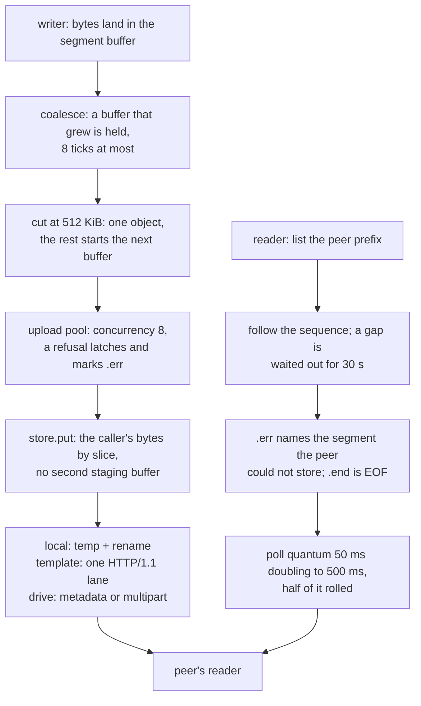

# The xdrive cloud-drive carrier

A cloud drive is the slowest link in this tree and the only one a provider can revoke: `PUT` a segment, `GET` it back, and a session's bytes cross a folder of objects instead of a socket. Xray names three stores for it — `local`, `template`, `Google Drive` (`storage.go:36-42`) — and this row carries all three in both roles, because the carrier is a `Carrier` arm on every dialled outbound and an inbound `streamSettings` whose accept loop is a poll rather than a `bind`.

Nothing here is fast per byte; the claim is the other three. **Fewer** objects and requests per session than the references: one kept-alive lane per store instead of a handshake per call, a token asked once per session and once more only when the service says it is dead, one `POST` per object of any size, segment buffers that come back to the writer's pool. **Leaner**: the writer's 512 KiB buffer, the lane's read buffer, and the shared-store table are the only heap this carrier owns per session. **More functional** than any one reference: xray's `template` service plus its `Google Drive` service plus a `local` store that lets the whole thing be tested and benched with no network at all.

Byte-identity is gated in-tree, and it is gated as bytes. Six of the tests below record every octet the fake origin was handed and compare against the string the reference's own client would have written — object names, the `%09d` sequence, the flatten (`/` → `~`), the sorted-and-escaped query, the metadata key order, and the two length rules Go's `net/http` applies (`POST`/`PUT`/`PATCH` with no body declares `Content-Length: 0`; `GET`/`HEAD`/`DELETE` declares nothing).

**The conformance seam this row does not have**: every xray test for this transport is in-package Go (`drive_test.go`, `template_test.go`, `xdrive_test.go` call unexported constructors), so nothing can inject `ferrox-app` and `conformance.yml` runs no xdrive cell. `upstream/pins.toml` names no xdrive test in any enabled suite, which `scripts/ci-scope.py` reads directly. The one honest seam would be the reference's own `local` service over a folder both binaries can see — no network, no token — and `crates/ferrox-prompt/prompts.md` carries it as an add-on rather than this page claiming it.

## Data path

## Measured

<!-- counts:begin -->
| key | value | checked by |
| --- | --- | --- |
| ops-retired-instructions | UNBLESSED | scripts/count-ops.sh |
| connections-per-five-templated-asks | 1 | ferrox-app-xdrive::tests::the_templated_store_sends_the_reference_bytes |
| connections-per-five-drive-asks | 1 | ferrox-app-xdrive::tests::the_drive_service_asks_in_the_reference_shape |
| token-asks-per-two-oauth2-uploads | 1 | ferrox-app-xdrive::tests::an_oauth2_template_fetches_its_token_once_and_again_after_a_401 |
| asks-per-waited-out-refusal | 2 | ferrox-app-xdrive::tests::a_configured_answer_is_asked_again |
| store-instances-per-two-identical-configs | 1 | ferrox-app-xdrive::tests::a_store_is_shared_by_the_settings_that_name_it |
| held-ticks-per-growing-segment | 8 | ferrox-app-xdrive::tests::coalescing_holds_a_growing_buffer_for_a_bounded_run_of_ticks |
| segment-buffer-reallocations-per-upload-cycle | 0 | ferrox-app-xdrive::tests::a_finished_upload_hands_its_buffer_back_empty_and_whole |
| socket-reads-per-pipelined-answer | 0 | ferrox-app-xdrive::tests::a_lane_keeps_what_arrives_past_the_answer_it_read |
| lane-buffer-reallocations-per-answer | 0 | ferrox-app-xdrive::tests::a_lane_keeps_what_arrives_past_the_answer_it_read |
<!-- counts:end -->

`connections-per-*` counts `accept` on the origin's own counter, so it is exact rather than inferred: five asks, one connection, which is what makes the lane a lane. `socket-reads-per-pipelined-answer` and `lane-buffer-reallocations-per-answer` are the same test from the other side — three status lines walked out of the buffer one read loop had already filled, with `read_into_tail` the only thing that touched the handle, and the buffer's base and `capacity()` unchanged across one push and three drains. `token-asks-per-two-oauth2-uploads` is the token held once for the session and re-asked only after the `401` (`asks() == 3` for two uploads, `== 6` for the refused ask, the fresh token, and the ask again). `asks-per-waited-out-refusal` is the retry ladder: a status the config named is asked again, one rung waited out and one taken.

`held-ticks-per-growing-segment` is `MAX_COALESCED_TICKS`, the bound that keeps a WAL-style hold from postponing a flush forever; the ninth growth cuts whatever the size. `segment-buffer-reallocations-per-upload-cycle` is the writer's pool: `adopt` returns the allocation the last upload handed back, empty and at the same address and capacity — pointer identity, not a byte test, which would pass with the copy and without it.

## Ops

`UNBLESSED`, and it stays that way until CI reads the artefact. `ops.yml` blesses per-method instruction counts as an informational artefact, never red, and this platform has no valgrind (`scripts/count-ops.sh` cannot run on macOS/aarch64), so `./scripts/check.sh` reports the count gate as CI-only here. The bulk of this carrier is not an instruction loop at all: a session's cost is the store's `PUT` and `GET` round trips and the JSON in between, and the per-byte work is the writer's one `extend_from_slice` into the segment buffer and the reader's one copy out of the object it fetched.

## Time

**Not measured, and no cell measures it yet.** `scripts/lib-matrix.sh`'s `scenario_config` knows no xdrive id, `run-parity.sh` walks that same list, and a cell cannot simply be added: a `Google Drive` or `template` scenario needs a live token and a real remote, which is exactly what no contributor machine can produce (everyone sits behind a VPN and a proxy, so a local cell would measure a tunnel). A `local` cell needs no network — two processes and one directory — but the references' `local` store keeps its objects under a path one machine owns, so a cross-engine comparison over it is a harness of its own, and it is the shared-folder interop add-on in `prompts.md`, not this page's number. The scope block therefore declares no `scenarios:` key, and `scripts/ci-scope.py`'s plan for a change here prints `matrix=false`: the run that follows is unit, doc and leak gates only.

## What we removed

**A store instance per config, and the lane pool that came with it.** `client.go:29-132` builds one `http.Client` per store — its own `http.Transport` or `http2.Transport`, its own connection pool sized by `maxConns` — and the reference constructs a store for every transport instance, so two outbounds that name the same remote each pay a handshake set, an id cache and a token. Here one `HTTP/1.1` lane pool per `host:port` is borrowed under a `Gate` of the store's inflight cap (32 by default, 256 at most, a `template` may name its own), and two configs that name one store get one `Arc<dyn Storage>`: same service, folder, secrets, transport security, fronting address and template text (`a_store_is_shared_by_the_settings_that_name_it`, `store-instances-per-two-identical-configs 1`). A lane also keeps whatever arrived after the answer it was reading, which is `a_lane_keeps_what_arrives_past_the_answer_it_read`: three status lines walked out of one buffer with `socket-reads-per-pipelined-answer 0` between them. `local` is left out of that table on purpose: two configs naming one folder path in two processes are not one store, and pooling a per-process path would share state that is not shared.

**A reflected `map[string]interface{}` per Drive metadata body.** `drive.go:377` and `drive.go:411` call `json.Marshal(map[string]interface{}{...})`: one map allocation, reflection over four fields, a sort, an escape pass, and a `bytes.Buffer` that grows to hold it, twice per uploaded object on the inline path (metadata plus the media body). Here the metadata is written into the request buffer in the order the reference's marshaller emits it — `description,name,parents` — with `crate::json::write`, and the base64 payload is encoded straight into it. Pinned byte-for-byte at 82 bytes by `the_drive_service_asks_in_the_reference_shape`, and the shape of the body for a 12 001-byte object — metadata part, payload part, closing boundary — by `a_large_drive_object_rides_the_multipart_body`.

**A `url.Values` map and a `bytes.Buffer` per token ask.** `template.go:212` and `drive.go:111` hand `strings.NewReader(form.Encode())` to `http.NewRequestWithContext`: the form is a map (allocated, sorted, escaped), then a `strings.Reader`, then a `Request` with its `URL` struct and `Header` map, then Go's transport writes the head through a `bufio.Writer` into its own buffer. Here the form is `push`ed into one string in the config's own key order and the head is written into the request buffer beside it — `write!(…)` per line, no per-request map. The exact POST is pinned by `an_oauth2_template_fetches_its_token_once_and_again_after_a_401` (`client_id=cid&refresh_token=rtok`, `Content-Length: 32`).

**An `io.ReadAll` per answer.** `drive.go:242` and `template.go:318` read a response body with `io.ReadAll(resp.Body)`: one `[]byte` that starts at 512 bytes and grows geometrically, so every step of that growth copies what a segment body had already arrived in. Here the answer is read into the lane's buffer, which is sized once and never moved (`lane-buffer-reallocations-per-answer 0`), and the body is taken out of it by `append_body`. A chunked body is framed one chunk at a time so a chunk boundary is never a copy boundary.

**A writer that loses the tail of an interrupted session.** `wal.go` in the reference keeps coalesced bytes in a log so a restart resumes; a reader that never saw them has nothing to fetch. The hold here is bounded at 8 ticks and the cut is at the segment size, and both are gates in this page's table, so an interrupted writer's bytes are at most one flush quantum (20 ms) and one segment (512 KiB) from being visible.

**Three failure modes the references leave silent.** A segment that never arrives while later ones did, a store that refuses one `PUT` while accepting the rest, and an announcement nobody closed are each a named object and a named error: `.err` marks the sequence the peer could not store and the reader's error says which one (`a_refused_put_marks_the_segment_and_the_peer_names_it`), a hole times out at `hole` and the session ends with the gap named (`a_segment_that_never_arrives_while_later_ones_did_times_out`), and `collect_loop` clears an announcement older than `ttl` and a session nobody is on (`an_old_announcement_and_an_idle_session_are_swept_out_of_the_folder`). `xray-core` has `.end`; the `.err` marker and the sweep are this carrier's, and they are what makes the `local` store usable as a real transport.

## What was not removed

Being honest about the row, and about what a `planned` cell cannot claim:

- **HTTP/1.1, not HTTP/2.** Go's Drive client reaches `www.googleapis.com` over HTTP/2 with HPACK, so its head is smaller than ours on a repeat ask. This lane writes `HTTP/1.1` with the header lines in the order the config spells them. Header *order* is therefore ours, not the reference's, and no claim here is made about it.
- **The header parse allocates.** `Lane::reply` makes a lowercased `String` for each header name and a trimmed `String` for each value — two allocations per header line, once per ask. The reference's `http.ReadResponse` builds a `map[string][]string` and is not cheaper, but the copy here is not removed; a fixed four-header parse would remove it and is not this row.
- **A body still crosses one copy into the caller.** `Answer.body` is a `Vec<u8>`, so the payload that landed in the lane's buffer is copied out once more. Handing the caller a slice of the lane buffer instead is the same trick the `?ed` reader plays on httpupgrade, and it would need the lane to hold the buffer while the caller reads; not done here, and not claimed.
- **The poll loop is a poll.** A real cloud drive is metered per request; nothing removes the round trip, only the *redundant* ones (`token-asks-*`, `connections-per-*`). The listing is asked page by page with the reference's `pageSize` and `fields`, and a Drive delete resolves an id by listing when the cache missed (`a_drive_listing_is_the_reference_query`), which is the reference's own shape.
- **No `Yandex` service.** The reference ships `yandex_live_test.go`; `storage.go` names only `local`, `Google Drive` and `template`, and a fourth is built from `template` there. An unknown `service` is refused by name, not served as something else, and `reality` is refused outright — a store lane's TLS peer *is* the destination, so there is nothing to hide behind.
- **Fronting, and no `carrier` inside a carrier.** `config.proto` has twelve fields and none of them is a host: the reference dials whatever the url says. The `front` this carrier takes is the outbound's own `server`/`port`, held into the store's identity so a store lane can be spoken to a masquerade address the way every other carrier's dial is; that is an addition, and the address is part of the share key because a lane to a front speaks for the origin. An xdrive outbound nested under kcp/quic/hysteria is refused by `refused_carriers!()` like every other carrier arm.
- **The token cache is the reference's shape, not a removal.** `template.go:189-194` holds one token per store and re-asks when its expiry passes; `drive.go` invalidates on a `401`. `token-asks-per-two-oauth2-uploads 1` is the same rule read back as bytes — the refused try still carried the old token and the retry the new one — and it is a bound on the asks, not a saving against the reference.
- **Two bugs this slice found in itself, and only because the gates were written first.** A recycled segment buffer kept the previous segment's tail (`Sink::reclaim` now clears it before pooling), `Writer::close` reported the store's latched failure *after* it had written `.end` — so a peer read a clean end over a truncated session — and `Vars::sub` could not substitute a placeholder inside a JSON body template, because a nested `}` in `{"raw":"{data}"}` ended the scan at the wrong brace. The third is pinned directly (`a template name substitutes only what it holds` asserts `{"at":"{folder}"}` → `{"at":"inbox"}`) and by the exact 18-byte body in `a_templated_body_carries_the_data_and_the_credential`.

## Pins

| what | where |
| --- | --- |
| `sessions/` announcement, `%09d.seg`, `.end`, poll loop | `upstream/xray-core/transport/internet/xdrive/xdrive.go`, `conn.go` |
| `local` store: temp prefix, atomic rename, `path.Clean("/"+name)` | `upstream/xray-core/transport/internet/xdrive/local.go` |
| op templates, `namesRegex`, `flatten`, auth forms, retry ladder | `upstream/xray-core/transport/internet/xdrive/template.go` |
| Drive inline limit, multipart, sorted query, `fields=id`, backoff | `upstream/xray-core/transport/internet/xdrive/drive.go` |
| WAL coalescing and its hold bound | `upstream/xray-core/transport/internet/xdrive/wal.go` |
| service names the store dispatch reads | `upstream/xray-core/transport/internet/xdrive/storage.go:36-42` |
| json-path walk for `tokenPath`/`expiryPath` | `upstream/xray-core/transport/internet/xdrive/jsonpath.go` |
| budgets, defaults and caps | `upstream/xray-core/transport/internet/xdrive/params.go` |

sing-box, xray-core-rust and zeronet carry no cloud-drive transport, so the four references reduce to one for this row; what each contributed is the store abstraction (`storage.go`'s four-method `Storage`), the template as the general case with Drive as one of its instances, and the `local` store as the thing that makes the whole method testable offline.

## CI scope

What a change here owes, read by `scripts/ci-scope.py`; see [`docs/ci-scope.md`](../ci-scope.md).

<!-- scope:begin -->
- paths: crates/ferrox-app/src/xdrive.rs
- symbols: xdrive_dial_session, xdrive_relay, xdrive_close, serve_xdrive_loop
- go: ./transport/internet/xdrive/...
<!-- scope:end -->
