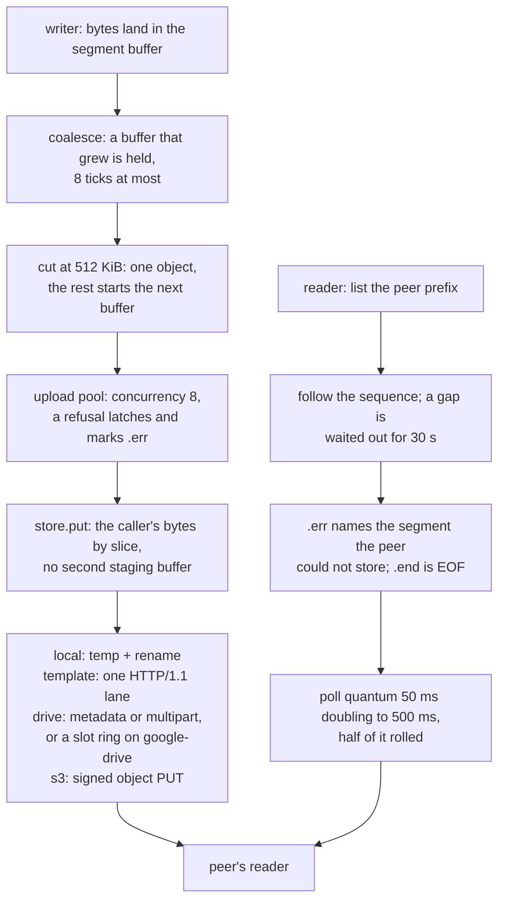

# The xdrive cloud-drive carrier

A cloud drive is the slowest link in this tree and the only one a provider can revoke: `PUT` a segment, `GET` it back, and a session's bytes cross a folder of objects instead of a socket. Xray names four stores for it — `local`, `template`, `google-drive` and `s3` (`storage.go:43-57`) — and this row carries all four in both roles, because the carrier is a `Carrier` arm on every dialled outbound and an inbound `streamSettings` whose accept loop is a poll rather than a `bind`. A row that declares `security: tls` is carried, not refused: `client.go:134` hands `tls.ConfigFromStreamSettings` to the store, so the name is the lanes' handshake and the session above the store adds none. A row that declares `security: reality` now rides the `RealityClientSession` on the same lanes, with the decoy name the transport named or the endpoint's own host. Trojan, VLESS and VMess all keep such a row (`an_xdrive_outbound_keeps_the_stores_lanes_tls`) and `a_trojan_xdrive_dial_under_tls_reaches_the_store` dials one over a `local` store and holds the echo; a folder has no lanes, so the handshake itself is `transport_tls`'s config rather than something a loopback can witness. VMess command 2 rides the store too: `vmess_serves_udp_over_xdrive` holds a datagram echo through both roles. Mux and XUDP ride the same session: VLESS and VMess name command 3, Trojan names the mux host with command 1, and Shadowsocks names it in its request header (its AEAD methods; Shadowsocks 2022 stays direct). `open_vless_mux_xdrive`, `open_trojan_mux_xdrive`, `open_ss_mux_xdrive` and `open_vmess_mux_xdrive` write the request, read the response and hand the session to the pool, gated by `an_xdrive_{vless,trojan,shadowsocks,vmess}_mux_carries_a_tcp_stream` and the matching `an_xdrive_*_xudp_association_carries_a_datagram` tests.

Nothing here is fast per byte; the claim is the other three. **Fewer** requests and heap objects per session than the reference: one store, one lane pool and one token for every session a config dials instead of a fresh set per connection, a segment buffer that comes back to the writer's pool, one `POST` per object of any size, and no reflection or map on the metadata path. **Leaner**: the writer's 512 KiB buffer, the lane's read buffer and the shared-store table are the only heap this carrier owns per session. **As functional as the reference, and two seams wider**: all four of its services (`local`, `template`, `google-drive`, `s3`) in both roles, the template `hrefPath`/`hrefMethod` leg that Yandex Disk uses, plus the fronting address every other carrier's dial already takes, plus a store table two identical configs share. `tlsSettings` now reaches the TCP store lane whole: `fingerprint` shapes the hello, `echConfigList`/`echSockopt` seal it, pins, roots, curves, versions and client certificates are read, and an unnamed `serverName` still takes the url's host. When `alpn` is exactly `["h3"]` the store leaves TCP for a kept QUIC connection (`xhttp_h3::H3Client`), with the reference's ECH list on the QUIC handshake and `quicParams` applied to the receive windows, idle timeout, stream cap and PMTU; BBR is the default as it is in the reference. quiche cannot shape the QUIC ClientHello, so a `fingerprint` applies to the TCP lane, and pinned quiche exposes no QUIC keepalive, stateless-reset or Chrome-parrot knob, so those fields are read and named rather than silently claimed. Every other ALPN offers `http/1.1`, the only protocol the lane speaks. `xmux` bounds are parsed and the mutually exclusive pair is refused as the reference refuses it; `maxConnections`, `maxConcurrency`, `cMaxReuseTimes`, `hMaxRequestTimes` and `hMaxReusableSecs` now steer the per-session lane pool and connection gate.

**The Drive slot path is carried, not a second store.** When the service is `google-drive`, `SlotStore` names an id-addressed object instead of a `streams/` prefix: `XDRVSL01` frames carry `seq`, mode, size and CRC; inline bodies stop at 14 KiB, larger segments put the body in the same object's media and carry only its size and checksum, and `end`/`err` close the direction. A reader polls the head slot, advances a watermark and pages the writer's ring; a slot that is not yet the next sequence is hunted at 10 ms and capped at 25 ms, then backed off to 150–800 ms, and a stalled ring ends the stream after 60 s. `a_slot_frame_round_trips_and_rejects_a_forged_body`, `a_slot_ring_round_trips` and `a_slot_ring_carries_a_stream_both_ways` pin the frame checksum, the ring shape and both connector directions. `make_ring` allocates two slots per direction and the client warms two spare rings after the first session, so a burst of new connections skips the ring-creation round trips. Ring creation or announcement failure falls back to the WAL, as the reference does, rather than refusing a config that xray would have served.

**XMUX is the reference's connection pool, not a parse-only block.** `maxConnections` bounds both the idle lanes kept per origin and the concurrent H1 connections; `maxConcurrency` bounds the session's request gate; `cMaxReuseTimes` and `hMaxRequestTimes` retire a lane after the lower request budget; `hMaxReusableSecs` retires it by age. The H3 lane is one QUIC connection carrying independent request streams, so the request/age caps apply to the H1 lanes and the connection/concurrency bounds still gate H3 asks. `hKeepAlivePeriod` is accepted by the same `xmux` parser and left unused: this tree's H1 lane has no HTTP/2 ping and pinned quiche has no keepalive setter, so it is named rather than claimed as carried. `xmux_retires_a_lane_at_its_request_budget` holds the request cap; `quic_params_reach_the_h3_lane_and_refuse_brutal` holds the H3 fields, and `a_brutal_h3_param_is_refused_before_a_socket` holds the reference's refusal of a Hysteria-only controller without refusing the same config's TCP store.

Byte-identity is gated in-tree, and it is gated as bytes. Six of the tests below record every octet the fake origin was handed and compare against the string the reference's own client would have written — object names, the `%09d` sequence, the flatten (`/` → `~`), the sorted-and-escaped query, the metadata key order, and the two length rules Go's `net/http` applies (`POST`/`PUT`/`PATCH` with no body declares `Content-Length: 0`; `GET`/`HEAD`/`DELETE` declares nothing).

**The conformance seam this row does not have**: every xray test for this transport is in-package Go (`drive_test.go`, `template_test.go`, `xdrive_test.go` call unexported constructors), so nothing can inject `ferrox-app` and `conformance.yml` runs no xdrive cell. `upstream/pins.toml` names no xdrive test in any enabled suite, which `scripts/ci-scope.py` reads directly. The one honest seam would be the reference's own `local` service over a folder both binaries can see — no network, no token — and `crates/ferrox-prompt/prompts.md` carries it as an add-on rather than this page claiming it.

## Data path

## Measured

<!-- counts:begin -->
| key | value | checked by |
| --- | --- | --- |
| ops-retired-instructions | UNBLESSED | scripts/count-ops.sh |
| connections-per-five-templated-asks | 1 | ferrox-app-xdrive::tests::the_templated_store_sends_the_reference_bytes |
| connections-per-five-drive-asks | 1 | ferrox-app-xdrive::tests::the_drive_service_asks_in_the_reference_shape |
| token-asks-per-two-oauth2-uploads | 1 | ferrox-app-xdrive::tests::an_oauth2_template_fetches_its_token_once_and_again_after_a_401 |
| asks-per-waited-out-refusal | 2 | ferrox-app-xdrive::tests::a_configured_answer_is_asked_again |
| store-instances-per-two-identical-configs | 1 | ferrox-app-xdrive::tests::a_store_is_shared_by_the_settings_that_name_it |
| held-ticks-per-growing-segment | 8 | ferrox-app-xdrive::tests::coalescing_holds_a_growing_buffer_for_a_bounded_run_of_ticks |
| segment-buffer-reallocations-per-upload-cycle | 0 | ferrox-app-xdrive::tests::a_finished_upload_hands_its_buffer_back_empty_and_whole |
| socket-reads-per-pipelined-answer | 0 | ferrox-app-xdrive::tests::a_lane_keeps_what_arrives_past_the_answer_it_read |
| lane-buffer-reallocations-per-answer | 0 | ferrox-app-xdrive::tests::a_lane_keeps_what_arrives_past_the_answer_it_read |
| head-header-allocations-per-reply | 0 | ferrox-app-xdrive::tests::a_reply_head_costs_no_buffer_for_its_headers |
<!-- counts:end -->

`connections-per-*` counts `accept` on the origin's own counter, so it is exact rather than inferred: five asks, one connection, which is what makes the lane a lane. `socket-reads-per-pipelined-answer` and `lane-buffer-reallocations-per-answer` are the same test from the other side — three status lines walked out of the buffer one read loop had already filled, with `read_into_tail` the only thing that touched the handle, and the buffer's base and `capacity()` unchanged across one push and three drains. `token-asks-per-two-oauth2-uploads` is the token held once for the session and re-asked only after the `401` (`asks() == 3` for two uploads, `== 6` for the refused ask, the fresh token, and the ask again). `asks-per-waited-out-refusal` is the retry ladder: a status the config named is asked again, one rung waited out and one taken.

`held-ticks-per-growing-segment` is `MAX_COALESCED_TICKS`, the bound that keeps a WAL-style hold from postponing a flush forever; the ninth growth cuts whatever the size. `segment-buffer-reallocations-per-upload-cycle` is the writer's pool: `adopt` returns the allocation the last upload handed back, empty and at the same address and capacity — pointer identity, not a byte test, which would pass with the copy and without it.

## Ops

`UNBLESSED`, and it stays that way until CI reads the artefact. `ops.yml` blesses per-method instruction counts as an informational artefact, never red, and this platform has no valgrind (`scripts/count-ops.sh` cannot run on macOS/aarch64), so `./scripts/check.sh` reports the count gate as CI-only here. The bulk of this carrier is not an instruction loop at all: a session's cost is the store's `PUT` and `GET` round trips and the JSON in between, and the per-byte work is the writer's one `extend_from_slice` into the segment buffer and the reader's one copy out of the object it fetched.

## Time

**Not measured, and no cell measures it yet.** `scripts/lib-matrix.sh`'s `scenario_config` knows no xdrive id, `run-parity.sh` walks that same list, and a cell cannot simply be added: a `Google Drive` or `template` scenario needs a live token and a real remote, which is exactly what no contributor machine can produce (everyone sits behind a VPN and a proxy, so a local cell would measure a tunnel). A `local` cell needs no network — two processes and one directory — but the references' `local` store keeps its objects under a path one machine owns, so a cross-engine comparison over it is a harness of its own, and it is the shared-folder interop add-on in `prompts.md`, not this page's number. The scope block therefore declares no `scenarios:` key, and `scripts/ci-scope.py`'s plan for a change here prints `matrix=false`: the run that follows is unit, doc and leak gates only.

## What we removed

- **The two buffers a header line cost.** `Lane::reply` made a lowercased `String` for each header name and a trimmed `String` for each value, so an ask paid two allocations a header line for three names it reads and every name it does not. The name and the value are read where they lie now — the name is compared in place and the value is borrowed — so a head costs no buffer for its headers at all. `a_reply_head_costs_no_buffer_for_its_headers` is the witness: it drives a reply with six header lines and holds the counting allocator at zero allocations, where the old shape paid eleven. The bytes on the wire do not move: the same three names are read, the same three values are parsed, and a value that is not ASCII is still read through the same lossy conversion. **A store, a client, an id cache and a token per dial.** `xdrive.go:86` calls `newStorage` inside `Dial`, so every connection the outbound opens builds its own `Storage` — and `client.go:29-132` gives that store its own `http.Client` with its own `http.Transport` or `http2.Transport` and its own connection pool sized by `maxConns`, and `drive.go` gives it an empty id cache and no token. A proxy that serves ten flows to one drive therefore pays ten lane sets, ten Drive `refresh_token` exchanges and ten cold TLS handshakes to the same origin. Here two configs that name one store — same service, folder, secrets, transport security or REALITY identity, fronting address and template text — resolve to one `Arc<dyn Storage>` keyed by a sha256 of exactly those parts, so a session rides a lane the last session left open (`a_store_is_shared_by_the_settings_that_name_it`, `store-instances-per-two-identical-configs 1`; `connections-per-*`). A lane also keeps whatever arrived after the answer it was reading, which is `a_lane_keeps_what_arrives_past_the_answer_it_read`: three status lines walked out of one buffer with `socket-reads-per-pipelined-answer 0` between them. `local` is left out of that table on purpose: two configs naming one folder path in two processes are not one store, and pooling a per-process path would share state that is not shared. The pool itself is bounded, not a fan-out: lanes are borrowed under a `Gate` of the store's inflight cap (64 by default, 256 at most, a `template` may name its own) and uploads run on a pool of `Params::concurrency` (8 by default, 256 at most) — the same bound the reference puts on its client pool through `maxConns`, held where the writer can wait on it instead.

**A reflected `map[string]interface{}` per Drive metadata body.** `drive.go:377` (`putInline`) and `drive.go:411` (`putMedia`) each call `json.Marshal(map[string]interface{}{...})`: a map allocation, reflection over three or four fields, a key sort and an escape pass, and then `putMedia` writes the whole object again through a `bytes.Buffer` that grows geometrically. Here the metadata is written into one buffer in the order that marshaller emits — `description,name,parents` inline, `name,parents` for the media part — through `crate::json::write`, and the multipart body is reserved to `metadata + payload + 128` in one allocation instead of growing into it. Pinned byte-for-byte at 82 bytes by `the_drive_service_asks_in_the_reference_shape`, and the shape of a 12 001-byte object's body — metadata part, payload part, closing boundary — by `a_large_drive_object_rides_the_multipart_body`.

**A `url.Values` map and a `bytes.Buffer` per token ask.** `template.go:212` and `drive.go:111` hand `strings.NewReader(form.Encode())` to `http.NewRequestWithContext`: the form is a map (allocated, sorted, escaped), then a `strings.Reader`, then a `Request` with its `URL` struct and `Header` map, then Go's transport writes the head through a `bufio.Writer` into its own buffer. Here the form is `push`ed into one string in the config's own key order and the head is written into the request buffer beside it — `write!(…)` per line, no per-request map. The exact POST is pinned by `an_oauth2_template_fetches_its_token_once_and_again_after_a_401` (`client_id=cid&refresh_token=rtok`, `Content-Length: 32`).

**An `io.ReadAll` per answer.** `drive.go:242` and `template.go:318` read a response body with `io.ReadAll(resp.Body)`: one `[]byte` that starts at 512 bytes and grows geometrically, so every step of that growth copies what a segment body had already arrived in. Here the answer is read into the lane's buffer, which is sized once and never moved (`lane-buffer-reallocations-per-answer 0`), and the body is taken out of it by `append_body`. A chunked body is framed one chunk at a time so a chunk boundary is never a copy boundary.

## What was not removed

Being honest about the row, and about what a `planned` cell cannot claim:

- **The `.err` marker, the hole timeout and the sweep are the reference's design, not additions.** `wal.go:20,174` marks a segment the peer could not store, `params.go:11` and `wal.go:315` bound a hole, `xdrive.go:199` drops a stale announcement and `session_ttl_seconds` ages out an idle session. This row's claim is that they are carried, that the hold is bounded the way `wal.go` bounds it, and that each one is a test: `a_refused_put_marks_the_segment_and_the_peer_names_it` holds the message the reference writes — `"the peer could not store segment 0"` — and that the mark is read once and then cleared out of the store, `a_segment_that_never_arrives_while_later_ones_did_times_out` holds the hole, `an_old_announcement_and_an_idle_session_are_swept_out_of_the_folder` the sweep. An interrupted writer is therefore at most eight flush quanta (8 × 20 ms) and one segment (512 KiB) from being visible, which is `held-ticks-per-growing-segment 8`.
- **An object's payload is staged once before it goes out.** `putMedia` here reserves one `Vec` and `extend_from_slice`s the payload into it, so a large upload copies its bytes once — the same trip Go's `bytes.Buffer` makes, and no less. The metadata's three key strings and the flattened name are allocated per object too. Removing both means writing the multipart body as three segments beside the caller's payload, which `Connection` can do (`write_slices`) but no test here counts, so it is prose and not a row.
- **HTTP/1.1, not HTTP/2, unless the config asks for h3.** Go's Drive client reaches `www.googleapis.com` over HTTP/2 with HPACK, so its head is smaller than ours on a repeat ask. This lane writes `HTTP/1.1` with the header lines in the order the config spells them; `alpn: ["h3"]` takes the QUIC path instead, and every other ALPN is narrowed to `http/1.1` because the H1 lane cannot read an h2 connection. Header *order* is therefore ours, not the reference's, and no claim here is made about it. On the H3 lane, `quicParams` windows/idle/streams and BBR are applied; `keepAlivePeriod`, `disableStatelessReset` and `disableChromeParrot` have no setter in pinned quiche, and a QUIC `fingerprint` is not replayable through its ClientHello, so those four are named gaps rather than silent no-ops.
- **A body still crosses one copy into the caller.** `Answer.body` is a `Vec<u8>`, so the payload that landed in the lane's buffer is copied out once more. Handing the caller a slice of the lane buffer instead is the same trick the `?ed` reader plays on httpupgrade, and it would need the lane to hold the buffer while the caller reads; not done here, and not claimed.
- **The poll loop is a poll.** A real cloud drive is metered per request; nothing removes the round trip, only the *redundant* ones (`token-asks-*`, `connections-per-*`). The listing is asked page by page with the reference's `pageSize` and `fields`, and a Drive delete resolves an id by listing when the cache missed (`a_drive_listing_is_the_reference_query`), which is the reference's own shape.
- **`Yandex` is a template, not a service.** The pinned `yandex_live_test.go` is direct WebDAV (`PUT`, `GET`, `DELETE`, `PROPFIND`) and sets neither `hrefPath` nor `hrefMethod`; the two-step leg is `template.go`'s REST contract, and Ferrox calls the URL the first answer names, with the payload and without the service's auth. An unknown `service` is still refused by name, not served as something else.
- **Fronting, and no `carrier` inside a carrier.** `config.proto` has twelve fields and none of them is a host: the reference dials whatever the url says. The `front` this carrier takes is the outbound's own `server`/`port`, held into the store's identity so a store lane can be spoken to a masquerade address the way every other carrier's dial is; that is an addition, and the address is part of the share key because a lane to a front speaks for the origin. An xdrive outbound nested under kcp/quic/hysteria is refused by `refused_carriers!()` like every other carrier arm.
- **The token cache is the reference's shape, not a removal.** `template.go:189-194` holds one token per store and re-asks when its expiry passes; `drive.go` invalidates on a `401`. `token-asks-per-two-oauth2-uploads 1` is the same rule read back as bytes — the refused try still carried the old token and the retry the new one — and it is a bound on the asks, not a saving against the reference.
- **Two bugs this slice found in itself, and only because the gates were written first.** A recycled segment buffer kept the previous segment's tail (`Sink::reclaim` now clears it before pooling), `Writer::close` reported the store's latched failure *after* it had written `.end` — so a peer read a clean end over a truncated session — and `Vars::sub` could not substitute a placeholder inside a JSON body template, because a nested `}` in `{"raw":"{data}"}` ended the scan at the wrong brace. The third is pinned directly (`a template name substitutes only what it holds` asserts `{"at":"{folder}"}` → `{"at":"inbox"}`) and by the exact 18-byte body in `a_templated_body_carries_the_data_and_the_credential`.

- **A slot ring is a second transport, not a faster WAL.** It removes the listing and the object-name sequence, but it does not remove the round trip: the reader still polls the head, the writer still waits for the watermark, and a provider that throttles a metadata `PATCH` costs the same as a segment `PUT`. Two spare rings are warmed per config and dropped after two thirds of the session ttl; an expired spare is not announced, so the listener never sees a session the sweep would immediately retire. The H3 lane carries one QUIC connection and independent streams, so `cMaxReuseTimes`/`hMaxRequestTimes`/`hMaxReusableSecs` are H1-only counters; claiming them for H3 would be a count no test observes.

- **A discard the reader promised used to die with the reader.** `Reader::drop` closed the discard queue by throwing away its contents, so the deletes already queued behind a slow one never ran and the last segments a relay had read stayed in the store until the sweep's ttl. That is why `a_session_carries_every_byte_both_ways_over_one_folder` went red on a loaded runner and passed on a re-run of the same commit. The drop now shuts the queue, and the workers that already hold an `Arc` of it land every promised delete. `a_session_ends_with_every_uplink_object_deleted` is the bound: one worker, one delete held at a gate, the session ended beside it, and the uplink folder read back empty — four objects on the shape it replaces. No count moves, because the deletes were always promised; only some of them had ever run.

## Pins

| what | where |
| --- | --- |
| `sessions/` announcement, `%09d.seg`, `.end`, poll loop | `upstream/xray-core/transport/internet/xdrive/xdrive.go`, `conn.go` |
| h3 lane, fingerprint and ECH | `upstream/xray-core/transport/internet/xdrive/client.go`, `upstream/xray-core/transport/internet/tls/config.go` |
| `local` store: temp prefix, atomic rename, `path.Clean("/"+name)` | `upstream/xray-core/transport/internet/xdrive/local.go` |
| op templates, `namesRegex`, `flatten`, auth forms, retry ladder, `hrefPath`/`hrefMethod` | `upstream/xray-core/transport/internet/xdrive/template.go` |
| S3 endpoint/bucket validation, SigV4, list XML, delete prefix | `upstream/xray-core/transport/internet/xdrive/s3.go` |
| Drive inline limit, multipart, sorted query, `fields=id`, backoff | `upstream/xray-core/transport/internet/xdrive/drive.go` |
| WAL coalescing and its hold bound | `upstream/xray-core/transport/internet/xdrive/wal.go` |
| service names the store dispatch reads | `upstream/xray-core/transport/internet/xdrive/storage.go:43-57` |
| json-path walk for `tokenPath`/`expiryPath` | `upstream/xray-core/transport/internet/xdrive/jsonpath.go` |
| budgets, defaults and caps | `upstream/xray-core/transport/internet/xdrive/params.go` |

sing-box, xray-core-rust and zeronet carry no cloud-drive transport, so the four references reduce to one for this row; what each contributed is the store abstraction (`storage.go`'s four-method `Storage`), the template as the general case with Drive, S3 and Yandex as instances, and the `local` store as the thing that makes the whole method testable offline.

## CI scope

What a change here owes, read by `scripts/ci-scope.py`; see [`docs/ci-scope.md`](../ci-scope.md).

<!-- scope:begin -->
- paths: crates/ferrox-app/src/xdrive.rs
- symbols: xdrive_dial_session, xdrive_relay, xdrive_close, serve_xdrive_loop
- go: ./transport/internet/xdrive/...
<!-- scope:end -->
