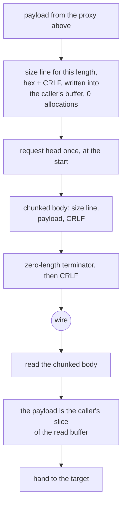

# The xHTTP carrier

The modes the hub serves are `stream-one`, `stream-up` and `packet-up`, on the
padding and placement rules the reference ships: `x_padding` in the `Referer` by
default, or in the configured header, cookie or query parameter once
`xPaddingObfsMode` is on, with the session id and sequence number in a path
segment, header, cookie or query parameter as configured. `multi` is not, and
neither is the `xmux` connection pool under it.

The framing is the chunked encoding and nothing else: a hex length, CRLF, the
payload, CRLF, and a zero-length terminator. There is no envelope, no type byte
and no session header beyond the request head.

The settings a server honours come from `extra` when the config carries one: the
reference builds its `Config` from that block and lets it replace every knob
except host, path and mode, because that is how a share link carries obfuscation.
A parser that reads only the outer block answers its own padding check with a
`400`; "What we removed" names the tests that pin the precedence and the status
code that falls out of it.

The size lines are the part worth naming. A `Size` line for a given length is a
pure function of the length, so `size_lines_match_format_without_allocating`
builds them into the caller's buffer and allocates nothing. That is the whole
optimisation available on a framing this thin: do not allocate for a string you
already know.

## Data path



## Refusal teardown

An H2 connection we refuse — oversized frame, header block past `HEAD_CAP` — writes its
GOAWAY and then closes. Closing with the peer's bytes still sitting unread in our receive
queue makes the stack abort instead of shut down, and the RST can swallow the GOAWAY a few
microseconds before it: `winsock` delivers `ConnectionReset` with nothing read. So a refused
connection now stays open for `budgets::GOAWAY_GRACE` (100 ms, the window a peer already
blocked in `recv` takes the refusal in) before it is killed. The grace is a window, not a
guarantee: a peer slower than 100 ms one-way still loses the refusal to our close, and this
slice does not fix that — making the close orderly needs a read deadline the plaintext
carrier does not arm.

## Measured

<!-- counts:begin -->
| key | value | checked by |
| --- | --- | --- |
| ops-retired-instructions | UNBLESSED | scripts/count-ops.sh |
| framing-size-lines-without-an-allocation | 0 | ferrox-app-xhttp::tests::size_lines_match_format_without_allocating |
| framing-read-syscalls-per-16KiB-chunk | 1 | ferrox-app-xhttp::tests::a_chunk_costs_two_reads_not_three |
| framing-read-syscalls-per-16KiB-chunk | 1 | ferrox-app-xhttp::tests::a_chunk_costs_two_reads_not_three |
| read-syscalls-per-16KiB-chunk | 2 | ferrox-app-xhttp::tests::a_chunk_costs_two_reads_not_three |
| framing-read-syscalls-per-16KiB-chunk | 1 | ferrox-app-xhttp::tests::a_chunk_costs_two_reads_not_three |
| user-space-copies-per-byte-written | 1 | ferrox-app-xhttp::tests::exchange_carries_an_echo_over_loopback |
<!-- counts:end -->

## Ops

```bash
./scripts/count-ops.sh report \
  xhttp::tests::size_lines_match_format_without_allocating 'xhttp::push_size_line'
```

`UNBLESSED`, as above.

## Time

**Not measured on this branch.** xHTTP scenarios run in
`benchmark-matrix.yml` and `parity.yml`. No artefact from this branch has been
read.

- **A framing read syscall per chunk, and the second one was two bytes.** The
  reader spent three reads per 16 KiB chunk: one to fetch the size line, one for
  the body, and one `read_exact` for the two-byte CRLF that closes the chunk. The
  CRLF read now fills a 128-byte window instead, and the bytes past the CRLF are
  the *next* size line, which `read_line_into` then finds without asking the
  socket again — so the framing reads amortise to one per chunk and the count is
  `2 * chunks + 1`, measured: **33 reads for 16 chunks against 49** for the old
  shape over the same loopback socket, with the payload byte-identical.

  Two things this needed to get right, both of which the worst case caught
  rather than the average:

  - The window must be looped until two bytes are buffered, and the loop has to
    take those bytes from *wherever they are*: a first version took one read and
    refused on `n < 2`, and a second refused whenever the prefix held only the
    ` CR`, so a peer that segments the CRLF across two packets still died.
    `a_trickling_stream_still_drains_whole` drives a one-byte-per-read stream and
    `a_crlf_split_across_reads_still_drains` delivers `…ping<CR>` in one segment
    and `<LF>…` in the next; the first cannot see the second, because a trickle
    leaves the prefix empty at that point.
  - The exhausted prefix has to be **cleared** before the window lands in it. The
    first version appended to the drained prefix and took the CRLF from stale
    bytes, which broke four existing xHTTP tests immediately.

  The count is gated by `a_chunk_costs_two_reads_not_three`, which drives an
  in-memory stream that always answers the whole buffer — so the count is exact
  and deterministic. A real socket may segment, so
  `a_real_socket_drains_the_same_bytes` asserts only the bytes and bounds the
  count loosely; a scheduler-dependent number is not a gate.

## What we removed

- **An allocation per size line.** A hex length plus CRLF is at most five bytes
  and is a function of the length alone, so it is written in place. Neither
  Xray nor sing-box ships an xHTTP carrier in the pinned trees, so there is no
  comparator here to beat — which is exactly why this page says what it removed
  and does not claim a ratio.
- **A third copy of the config walk.** `xhttp.rs` carried its own
  byte-identical `header_value` copy and a third head reader; the roadmap has a
  slice for folding both into `proxy.rs`, and it is open. Until that lands, this
  carrier duplicates them, which is a code-size debt rather than a data-path
  cost, and it is named here rather than quietly counted as a win.
- **A settings parse that read one block only.** Every knob was taken from the
  outer `xhttpSettings`, so a config whose obfuscation lives in `extra` — which
  is how a share link carries it, and what the oracle's `extra=true` cases send —
  silently fell back to the defaults: `xPaddingObfsMode` false, padding range
  100-1000, `Referer` placement. The hub then applied the *default* padding check
  to a request built to the configured one, and every such request was refused
  with `HTTP/1.1 400 Bad Request` before any byte of the tunnel moved; that is
  the `xhttp_requests_match_the_oracle` line in the interop baseline. `extra` now
  replaces the block the rest of the parse reads, keeping host, path and mode on
  the outer object as the reference does, and accepting either the object form or
  the JSON-string form a link query holds. The object form costs one key lookup
  and no allocation; a shape that is neither object, `null` nor a string of an
  object is refused rather than ignored.
  `the_extra_block_replaces_every_knob_but_path_and_mode` pins the precedence and
  the replace-not-merge rule (`scMaxEachPostBytes` set outside and omitted inside
  ends up at the default, not at the outer value);
  `xhttp_refusals_carry_their_statuses` pins what the hub does with the result —
  the configured header padding is accepted, the default `Referer` padding is now
  refused, so the knobs demonstrably reach the accept path and not just the
  parser.

## Open rows

- The dialer is one mode: `connect` and `connect_split` write a single
  `stream-one` POST head, so an outbound on `stream-up` or `packet-up` does not
  exist yet, and neither does the `xmux` pool under `multi`.
- Six knobs in the reference's `Config` are not parsed at all:
  `uplinkChunkSize`, `sessionIDTable`, `sessionIDLength`, `serverMaxHeaderBytes`,
  `scStreamUpServerSecs` and `xmux`. The first two shape a client's requests, so
  they belong with the modes above rather than with the hub.
- The pinned conformance row
  `rust_socks_client_reaches_target_through_remote_xhttp_profile` panics unless
  `XRAY_REMOTE_XHTTP_CONFIG` names an owner-only file. The mode assertion in the
  pinned tree must not be weakened to make it pass; that is stated in the
  roadmap and repeated here so the row is not quietly rounded off.

## Pins

| what | where |
| --- | --- |
| the carrier Xray-core and sing-box do not ship | — |
| the carrier ZeroNet does ship | `upstream/zeronet/crates/zero-transport/src/xhttp.rs` |
| `extra` replacing every knob but host, path and mode, in object and string form | `upstream/zeronet/crates/zero-config/src/xhttp.rs:446` |
| the padding value, its placements and the tokenish length bound | `upstream/zeronet/crates/zero-transport/src/xhttp_request.rs:619` |

The `extra` precedence is cited from ZeroNet's port, not from the Xray pin: the
`Config` message at `upstream/xray-core/transport/internet/splithttp/config.proto`
carries all of these knobs as top-level fields and has no `extra` at all, so the
block is newer than the commit `upstream/pins.toml` names. The rule is the same
one the reference's own `SplitHTTPConfig.Build` applies.
