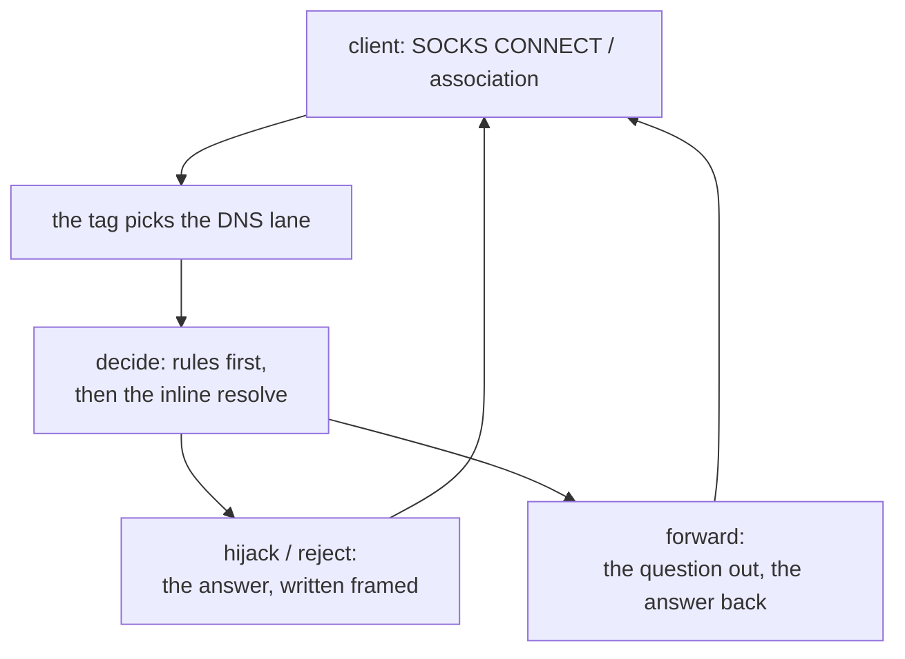

# The DNS outbound

<!-- scope:begin -->
- paths: -
- symbols: find_dns_outbound, build_dns_outbound, decode_dns_rules, decode_dns_rule, decode_dns_legacy, decode_dns_network, serve_dns_tcp, serve_dns_udp, dns_lookup, dial_dns, read_dns_source, answer_handle, write_dns_frame, send_dns_query, dns_lane_tests
- go: ./proxy/dns/..., ./features/dns/...
<!-- scope:end -->
Row 26: a `dns` outbound answers DNS questions the way the reference's `proxy/dns` does. One flow opens a SOCKS CONNECT or a SOCKS association with the `dns` tag, and the lane behind it reads framed questions, decides each one against the rules, and answers from the resolver or relays the question out.

The decision is `ferrox-core`'s `dns` module, and its bytes are the reference's own. The oracle (`scripts/dns-oracle`) drives the pinned `xray-core`'s handler over every case the script carries — hijack, reject, drop, direct, oversize, a malformed name — over both networks, TCP framed and UDP raw; `ferrox-core`'s decisions are replayed octet for octet against that record (`ferrox-core-dns::tests::the_answer_is_the_bytes_the_pinned_go_writes`). The header the replies carry is the reference's own first block, AA bit included, and the A/AAAA answers point at the name with `C00C` the way its server punts.

The refusals are the reference's refusals. A query longer than `MESSAGE_MAX` (8192) is refused by the lane's own framing read before any decision; a compressed name that hops more than 10 pointers is refused; a name longer than 254 bytes is refused; a `0x40`/`0x80` question type is refused. The script's `broken` lines are the reference's own malformed inputs, and a replay of them writes nothing.

The config is the reference's shape — `{"settings": {"rewriteNetwork": "tcp"|"udp", "rewriteAddress": "...", "rewritePort": n, "rules": [{"action": "return"|"direct"|"hijack"|"block", "rCode": n, "qType": "1,28"|"...", "domain": "..."}]}}` — with the legacy `network`/`address`/`port` aliases filling the fields the rewrite spelling skips, as an unknown network name keeps the asked lane. A rule without an action, a `qType` that is neither string nor array-of-strings, and an `rCode` outside the 16-bit range build errors, and legacy `nonIPQuery`/`blockTypes` standalone build the reference's three-rule form. Mixed, they are a build error.

## Data path

## The lanes

The stream lane rides `serve_connect` after the refuse gate: one connection, framed questions each carrying their own two-byte length, answers framed by `write_all_parts` from the question's own buffers — the header and body leave in one loop and no third buffer exists. A lane end is the upstream's idle read, the reference's 300-second `ConnectionIdle` read, and a reply the lane cannot read whole (the length prefix over the maximum, the read ending early) ends the lane with the connection.

The datagram lane is `serve_socks_udp`'s shape: one association, one lane per client address keyed by the rewritten destination, the first datagram the payload that opens the lane, and the answers written back from the client-named destination. An upstream that has not dialled when the first datagram arrives dials it there, and the handoff parks the answer thread on the dial instead of polling.

The direct rule resolves inline: the name minus its root, the literal-IP fast path, then the engine's cached lookup, and an empty answer writes the reference's empty-answer reply. Name what is left: each message lands in its own heap buffer, the per-message allocation the sharing rules do not remove, and the syscalls a loopback lane spends are only gated over real sockets as bytes — the counts a dial spends belong to CI's profile, not to a loopback test.

## Time

Nothing here is timed by a local run — every dial through this outbound is a connection a contributor's tunnel would measure, so the duration numbers are CI's `bench.yml` and `parity.yml` cells alone. The lane's own waits are the reference's: the upstream read that ends a lane is its idle timeout, and nothing in the decision path spins between a question and its answer.

## Measured

<!-- counts:begin -->
| key | value | checked by |
| --- | --- | --- |
| ops-retired-instructions | UNBLESSED | scripts/count-ops.sh |
| answer-cases-replayed | 21 | ferrox-core-dns::tests::the_answer_is_the_bytes_the_pinned_go_writes |
| parse-refusals-replayed | 8 | ferrox-core-dns::tests::the_parse_refuses_what_the_reference_refuses |
| pointer-hop-cap | 10 | ferrox-core-dns::tests::the_pointer_loop_refuses_at_the_cap |
| maximum-name-bytes | 254 | ferrox-core-dns::tests::the_name_bound_matches_the_reference |
| stream-answer-bytes-per-query | 38 | ferrox-app-proxy::dns_lane_tests::the_dns_stream_lane_relays_a_direct_query_byte_for_byte |
| datagram-query-bytes-per-datagram | 43 | ferrox-app-proxy::dns_lane_tests::the_dns_datagram_lane_relays_a_direct_datagram_byte_for_byte |
| datagram-answer-bytes-per-datagram | 58 | ferrox-app-proxy::dns_lane_tests::the_dns_datagram_lane_relays_a_direct_datagram_byte_for_byte |
<!-- counts:end -->
