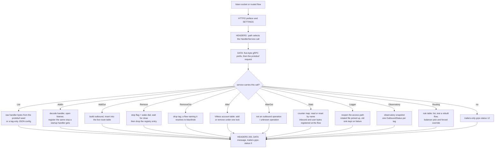

# Commander gRPC management API

The API is xray's `app/commander`: a `HandlerService` spoken over HTTP/2 in clear text, reached either on its own `listen` address or by routing a flow to the app's tag. This tree carries all ten HandlerService calls, all seven StatsService calls, `LoggerService.RestartLogger`, `ObservatoryService.GetOutboundStatus` and the routing service's `ListRule`, `TestRoute`, `GetBalancerInfo` and `OverrideBalancerTarget`. `AddInbound` decodes the handler, serves it through the same inbound path the startup config used, and registers it for later removal. `AddOutbound` builds the handler and inserts it into the live route table, so a rule can reach a tag that did not exist at startup; `RemoveOutbound` drops it and blocks a flow that still names it. `AlterInbound` carries the VMess account add/remove operations, and `AlterOutbound` answers with the reference's two errors because no outbound operation exists at this pin. `GetInboundUsers`, `GetInboundUsersCount`, `ListInbounds` and `ListOutbounds` are carried too.

A `listen` config binds a TCP (or unix) socket and answers every connection in its own thread. A config without `listen` names a tag instead: the router sends a flow there and the routed connection itself is the HTTP/2 transport, so no second socket exists to be reached from outside. Both roles parse from xray's protobuf `core.Config` and from JSON, and a handler is served only when the app lists `HandlerService` (case-insensitively in JSON, `xray.app.proxyman.command.Config` in protobuf); the logger service follows the same rule under `LoggerService` / `xray.app.log.command.Config`, the observatory under `ObservatoryService` / `xray.app.observatory.command.Config`, the router under `RoutingService` / `xray.app.router.command.Config`, and any other service name is skipped with one line.

`RestartLogger` reopens the access sink from the path the `log` block installed, so a file rotated under a running process is picked up without a restart. The new handle is opened before the old one is dropped; a path that cannot be opened leaves the current sink in place and answers `grpc-status 13` with the open error, and a config that does not list the service answers `12` as every other unselected service does. The error stream is the process's stderr, so there is nothing to reopen for it.

`GetOutboundStatus` serializes the snapshot the balancers already read: one `OutboundStatus` per observed tag, with aliveness, delay, the last error, the seen/try seconds and the burst health counters. The answer is an `ObservationResult` with the status repeated under it; a service selected without an observatory app answers the same empty result rather than `12`, because the service table was configured and the table is simply empty.

`ListRule` walks the same rule table the flows do and answers each rule's target tag and its `ruleTag`; a balancer rule leaves the tag empty because the reference's one-of never fills it. `TestRoute` rebuilds a flow from the request's `RoutingContext` — inbound, network, the address lists as any-of, ports, domain, protocol, user and attributes — and asks the live table which rule it reaches, so a tested context and a real flow get the same verdict from the same code; the answer echoes exactly the request fields the call's selectors name, plus the picked tag, and a balancer rule resolves to the tag the strategy picked. A context no rule reaches answers `no clue` with status 2 the way the reference's `ErrNoClue` does, and the default outbound is never the answer because the reference leaves that to the caller. `GetBalancerInfo` reports the balancer's forced target and its strategy's principle target (every candidate for `random`/`roundRobin`, the picked one for `leastPing`, the selected set for `leastLoad`), and `OverrideBalancerTarget` forces the pick, empty clearing it. `SubscribeRoutingStats` answers `Routing statistics not enabled.` because the reference registers this service without a statistics channel, so `PublishResult` has nothing to publish into.

`ListInbounds` and `ListOutbounds` answer with the handler and outbound configurations **exactly as they arrived** in protobuf, raw bytes and all, because a re-encoded config this tree did not build would not compare equal to the config the operator sent. A JSON-sourced handler or outbound has no protobuf form here; it lists its tag only, and that gap is named rather than passed off as the original.

`AddInbound` builds from the request's `InboundHandlerConfig`, merges a port list into one handler, opens every port it names, and records the same stop a startup handler gets, so `RemoveInbound` stops all of them. A duplicate non-empty tag is an error (`existing tag found: ...`); in routed mode the API's own outbound tag is a duplicate too; a handler this tree does not serve is an error rather than a silent success. A listener that cannot bind stops the process in its serving thread, exactly as a startup listener does, rather than returning a gRPC status. `RemoveInbound` stops the listener through a stop flag and wakes each blocked `accept` by dialing the address it owns; the call returns only after every socket is closed, so a client that dials in the next statement cannot still reach the removed handler. The registry records a stop for a VMess handler and for a dokodemo TCP-only handler; every other protocol (VLESS, Trojan, Shadowsocks, KCP, xdrive, QUIC, the UDP half of a dokodemo door) refuses the call by name rather than reporting a removal that did not happen.

The route table holds the startup outbounds behind a borrowed fast path and the API's additions behind one `RwLock`; the lock is not read until the first add or remove, so a process that never calls the API pays no per-flow lock. A removed tag resolves to the blackhole lane, so an in-flight rule that still names it is dropped rather than dialling a lane the operator removed. A re-added tag is visible to the next flow. `AddOutbound` on a tag the startup table already holds is a duplicate; `RemoveOutbound` of an unknown tag is a no-op, as the reference's manager is.

`AlterInbound` changes the VMess account set in place: the next handshake reads the table under one lock, and an already admitted flow keeps its session. A non-VMess handler refuses the operation by protocol name; a VMess account id that is not a UUID is a bad-request status, not a silently empty user.

`GetStats` reads or resets one counter by name, `QueryStats` matches a substring, and `GetSysStats` answers the ten fields of the reference's response with uptime as the only non-zero. A VMess TCP flow registers `inbound>>>{tag}>>>traffic>>>uplink` when the system policy enables it and `user>>>{email}>>>traffic>>>uplink` / `downlink` when the user's level does; the inbound counter wraps the raw connection, so it includes the VMess handshake, while the user counter wraps the plaintext after the seal. A level with no policy app, or an empty email, registers nothing. The online counters (`GetStatsOnline`, `GetStatsOnlineIpList`, `GetAllOnlineUsers`, `GetUsersStats`) answer not-found or empty: the pinned reference never populates an online map either, because no component calls `AddIP` at this pin, so the two servers agree on the observable answer.

## Data path

## Measured

<!-- counts:begin -->
| key | value | checked by |
| --- | --- | --- |
| ops-retired-instructions | UNBLESSED | scripts/count-ops.sh |
<!-- counts:end -->

The framing, both content paths, the dynamic registry, the stats read/reset, the rotated-logger reopen, the observatory snapshot and the routing calls have workspace tests in `commander.rs`, `accesslog.rs`, `observatory.rs`, `proxy.rs`, `stats.rs`, `router.rs` and `vmess.rs`; no per-method instruction count has been taken, so the ops row stays open rather than quoting a number.

## Time

No duration is claimed. Benchmarks and the upstream Commander suite run in CI only; a local run measures the network path between the developer and the reference, not this code.

## What is not removed

The API still does not reload the config: `AddInbound` and `AddOutbound` change one handler or one tag, not the route rules or the process's other lanes, and the old generation keeps running. `AddRule` and `RemoveRule` are served over the live table, so an added rule routes the next flow and a removed tag stops; a rule an add names for a server inbound must target a direct outbound, because that inbound never evaluates rules, so the call refuses it with an error and leaves the table unchanged (`a_rule_that_cannot_reach_a_server_inbound_is_refused_by_add_rule`). A tested context names its ports apart from its addresses, as the reference's does, so a context that names only a port still routes; a non-zero `vlessRoute` matches the rule's route list, though no live flow this tree routes carries an id. `TestRoute` fires the matched rule's webhook as the reference's `PickRoute` does, with a tested event's `originalTarget`, `routeTarget`, `level` and `inboundName` null because no session backs it. `GetOutboundStatus` reports only the fields the tree already keeps: the burst `max`/`min` health values are absent from its sample, so they marshal as zero. A JSON handler lists without its receiver and proxy settings, and a JSON outbound lists its tag only; the VMess account table is the only user store the API can change, so VLESS and Trojan users still come from startup only. The stats service counts bytes, not live users: the online counters answer as the reference does, and the policy's outbound gates parse but no outbound counter is registered.

## CI scope

<!-- scope:begin -->
- paths: crates/ferrox-app/src/commander.rs, crates/ferrox-app/src/accesslog.rs, crates/ferrox-app/src/stats.rs
- symbols: Stop, Runtime, serve_dynamic_inbounds, serve_inbounds_counted, serve_vmess_inbound, serve_inbounds, handler_tag, inbound, outbound
- engines: xray-core
- go: ./app/commander/..., ./app/proxyman/command/..., ./app/log/command/..., ./app/observatory/..., ./app/stats/..., ./app/policy/...
<!-- scope:end -->
