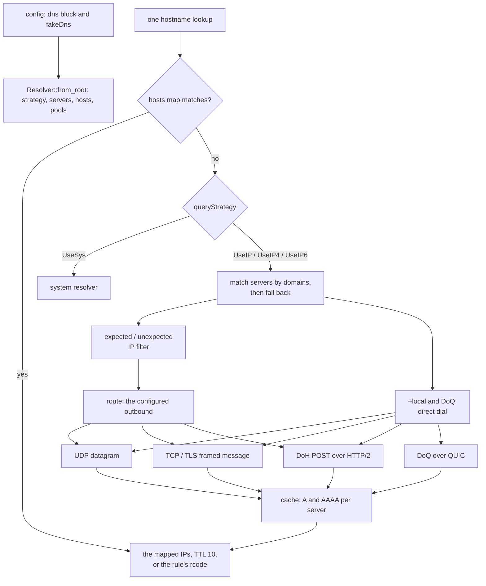

# The built-in DNS app

<!-- scope:begin -->
- paths: crates/ferrox-app/src/dnsapp.rs, crates/ferrox-app/src/dnsnet.rs
- symbols: build_query, parse_answer, resolve_endpoint
- go: ./app/dns/..., ./app/dns/fakedns/..., ./infra/conf/...
<!-- scope:end -->
Row 82: a `dns` block builds the resolver the relay's own name lookups use. A question rides one server's transport — UDP, a length-framed TCP stream, that stream under TLS, an HTTP/2 POST, or one QUIC bidirectional stream — and the answer is the small resolver's own bytes: the same core `build_query`/`parse_answer` the DNS outbound (row 26) already replays against the pinned Go. The app keeps A and AAAA apart per server, honours the reference's cache policy, serves the static `hosts` map with its ten-second TTL, and allocates fake addresses from the configured pools. Per-server `expectedIPs`/`unexpectedIPs` filter an answer before it can win, with `*` raising the filter to a priority that narrows rather than rejects; hosts `#rcode` answers as that rcode instead of falling through to a server. A protobuf `xray.app.dns.Config` decodes into the same block, including both filters and their `actPrior`/`actUnprior` flags. A server address is dispatched through the configured route and outbound, the way the reference's dispatcher carries it; the `+local` spellings and DoQ (always local in the reference) keep the direct dial, and a hostname in a UDP server address takes the system dial because the lane frames an address. `enableParallelQuery` and the Lua `script` are named on stderr and the server list is queried in order.

The server forms are Xray's: a bare address (UDP), `udp://`, `tcp://`, `tls://`, `https://`, `h2c://`, `quic://`, `localhost`, and `fakedns`, each with the `+local` spelling where the pin carries one. DoH keeps the configured path exactly; an empty path becomes `/`, never an implicit `/dns-query`. DoH and DoQ pin the message id to zero and carry the reference's EDNS0 record — 1350-byte UDP size, class `0xfe00`, the client-subnet option from `clientIp`, and a random 100–300 byte DoH padding option. UDP and TCP take an increasing per-server id. Per-server `domains`, `queryStrategy`, `clientIp`, `timeoutMs`, `disableCache`, `serveStale`, `serveExpiredTTL`, `skipFallback`, `finalQuery`, `port`, and the root `queryStrategy`, `hosts`, `useSystemHosts`, `disableFallback`, `disableFallbackIfMatch` decode with the reference's spellings and aliases.

The fake pools follow the pinned allocator: the network base, an offset from the current millisecond modulo the pool's room count, the first unused address, wrap, and an LRU of the configured size. The defaults are `198.18.0.0/15` and `2001:2::/48`, 32768 names each when both families are on, 65535 for the single-family form, and TTL 1. `lookup_fake` and `domain_of` are the forward and reverse seams a later sniffer calls; a normal `lookup` skips a `fakedns` server unless fake mode is asked for, matching the reference's `DisableFakeDNS` default.

## Data path

## What was removed

- **A cache key allocation on every lookup.** The cache was one map keyed by `(server, name.to_owned())`, so a hit built a `String` before it could find the entry. Each server now owns a map keyed by the name alone, and a hit borrows the caller's name. The answer vector is still copied out of the record, and the routing vectors are still opened: `allocations-per-cached-lookup 4` is the measured count, not a claim that the cache hands out the record's own bytes.
- **A lowercase copy for resolvers with no rules to match.** `lookup_inner` and `host_lookup` folded the name unconditionally. They now fold only when a host rule or a server matcher exists, so the common configured-server lookup reaches the cache without a fold.
- **A second DoH client alongside the first.** `ech_dns` carried its own UDP, TCP and HTTP/2 exchange. It now calls the same `dnsnet` functions, so one place owns the framing, the HTTP/2 preface, and the response read.
- **A DNS query for the proxy's own server name routed through that proxy.** Outbound addresses now resolve through the resolver's local dial, so opening the tunnel never asks the tunnel to resolve its own far end.

What is **not** removed: the cache record owns its `Vec<IpAddr>` and the answer is a clone of it; the routing order and focus vectors are per-lookup allocations; the DoQ path ignores configured socket options; `enableParallelQuery` and the Lua `script` warn and fall back to ordered server queries; a hostname in a UDP server address takes the system dial; and the routed datagram pays a loopback relay and a thread per uncached query.

## Time

Nothing here is timed by a local run — a contributor's tunnel would measure the dial, not this code. Neither `bench.yml` nor `parity.yml` has a built-in DNS cell, so this page carries no duration and quotes none. The operations and syscall counts are `UNBLESSED` until an `ops.yml` artefact measures this method; `scripts/count-ops.sh` does not exist on macOS/aarch64, so the gate is CI-only here.

## Gated counts

<!-- counts:begin -->
| key | value | checked by |
| --- | --- | --- |
| ops-retired-instructions | UNBLESSED | scripts/count-ops.sh |
| syscalls-per-udp-exchange | UNBLESSED | scripts/count-ops.sh |
| allocations-per-cached-lookup | 4 | ferrox-app-dnsapp::resolver_tests::a_cache_hit_copies_only_the_answer_vector |
| seconds-per-lookup | UNBLESSED | CI bench.yml (no cell yet) |
<!-- counts:end -->
