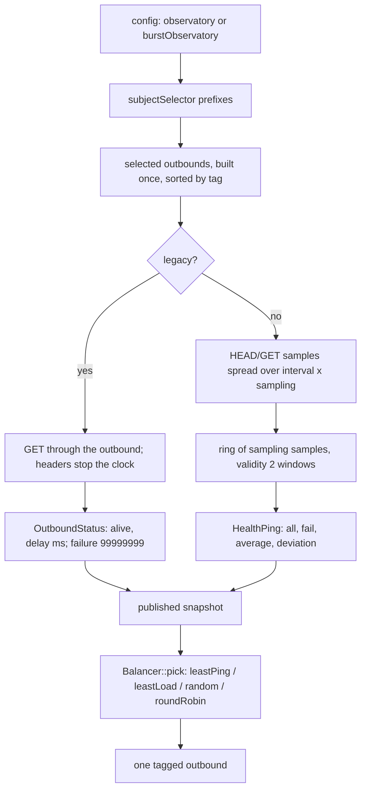

# The health observatory

<!-- scope:begin -->
- paths: crates/ferrox-app/src/observatory.rs
- symbols: probe_stream, tunnel_stream, observatory_settings, burst_observatory_settings, healthping_settings
- scenarios: vless-raw, vmess-raw, trojan-raw, shadowsocks-raw
<!-- scope:end -->
Row 149's engine half: xray's `observatory` and `burstObservatory` apps probe the outbounds a balancer selects, and the balancer's strategy reads that history. This page is the probe loop and the status it publishes; [`engine-router`](engine-router.md) is the rule scan that hands a flow to a balancer.

A config may name either app at the top level, in the JSON dialect or as the protobuf `xray.app.observatory.Config`/`xray.app.observatory.burst.Config` messages, which the bridge decodes to the same keys. `observatory` is the legacy loop: `subjectSelector` prefixes pick outbounds, `probeURL` defaults to `https://www.google.com/generate_204`, `probeInterval` defaults to 10 seconds, and `enableConcurrency` probes every selected tag at once instead of in sorted order. A probe is one HTTP `GET`; any response means alive and the time to its headers is the delay in milliseconds; a failure publishes `99999999`, the reference's sentinel. `burstObservatory.pingConfig` is required in the JSON dialect, as the reference's build is; a protobuf app with no ping settings decodes to an empty block and takes these defaults: `destination` defaults to the Chromium connectivity URL, `interval` to one minute (never below ten seconds), `sampling` to ten, `timeout` to five seconds and `httpMethod` to `HEAD`; a whitespace-only `httpMethod` sends `GET` but stops at the response head, as the reference's empty method does. A failed sample is stored unless `connectivity` is configured and that direct URL fails too, in which case the network is down and the sample is not put.

When both blocks are present the legacy app runs, as the reference's first-of-type observatory lookup does; both are parsed first, so a malformed burst block is still a startup refusal. The burst history is a ring of `sampling` samples with a validity of twice the sampling window; a sample expires on read, a failure counts in `fail`, and the published `average`/`deviation` are the reference's integer nanoseconds. An outbound with no reading is unknown to the balancer, not dead.

## Data path

## The probe

The probe speaks through the selected outbound, never around it. The tree has no dial-to-stream seam for an arbitrary outbound, so `probe_stream` opens a loopback TCP pair and runs `serve_connect` on the server half with a front that writes no grant; the client half is the HTTP connection. That means a probe pays the outbound's own handshake and carrier, and a SOCKS-only lane is not silently bypassed.

The request is HTTP/1.1 with a browser-shaped header set, `Connection: close`, and the URL's own authority as `Host` (a default port is omitted unless the URL named it). `https` wraps the stream in the tree's rustls client with `system_roots`; the SNI is the URL host. The response head is read to `\r\n\r\n` with a 64 KiB cap. A `GET` then consumes `Content-Length` when present and otherwise drains to EOF; a `HEAD` stops at the head, and a blank configured method sends `GET` without reading that body. The status code is not consulted, because the reference treats any response as alive. The clock starts before the dial and stops when the read the reference performs is done.

## The strategies

`leastPing` walks the published statuses, keeps the smallest `delay_ms` among candidates whose status is alive, and returns the first minimum (`99999999` is the initial floor). `leastLoad` takes only alive statuses that are candidates, rejects a sample at or over `maxRTT.Milliseconds()` when `maxRTT` is non-zero, and rejects a health ratio above `tolerance` when both are non-zero. Each node's cost is `deviation * sqrt(weight)`, where the weight is the first cost whose `match` is a non-empty substring (or regexp hit), its positive `value`, else the first number in that match, else 1. Sorting is cost, then average, then fewer failures, then more samples, then tag. `baselines` walk the sorted list until `expected` (at least one) is met; with `expected` positive and no baseline reaching it, the expected count still applies; with a non-positive expected and baselines that never reach, nothing is selected and the fallback answers. A final pick among the selected nodes is uniform.

`random` and `roundRobin` see only candidates whose status is absent or alive, and only when `fallbackTag` is set: the reference injects the observatory into those strategies under that condition, and without it they do not filter. The round-robin counter is per balancer, as the reference's is.

## What was removed

- **A per-probe HTTP client and its connection pool.** The reference builds `http.Client`/`Transport` per probe; this tree writes one request into the tunnel it already opened, so there is no idle pool, no redirect machinery and no cookie jar to allocate. The bytes that matter are the request line, `Host`, the browser headers and `Connection: close`; redirects are not followed either way.
- **A second copy of the response body.** A `GET` reads only enough to satisfy `Content-Length` (or drains an unframed answer to EOF); the reference's `io.Copy(io.Discard, resp.Body)` does the same work, but here there is no transport buffer to copy through.
- **A status map rebuilt on every read.** The burst ring stores each sample's value and instant in slots fixed at construction; a read walks those slots and allocates no sample vector. `a_burst_ring_holds_the_sampling_window_and_puts_without_allocating` holds the slot count and the zero allocations, and the sample put is the only mutation. The legacy statuses are one vector updated in place, not a map and a parallel vector.
- **A per-flow observatory lookup.** The route plan takes one snapshot reference per decision and hands its slice to the balancer; a flow never clones the status vector. The weight cache is per balancer and holds the computed weight by tag, because the reference's `WeightManager` caches too.

What was not removed: a selected outbound is built at startup even if no balancer ever reads it, exactly as the reference's outbound handler exists before the observatory starts; the probe loop still owns one thread per check, as the reference's goroutine does; and the legacy loop's status vector keeps every selected tag even after a failure, because `leastPing` needs the sentinel to rank it. A config that selects a loopback tag skips it with one warning: a re-inject has no stream to hand the probe. The Leaf healthcheck door is the other half of row 149 and lives on [`front-healthcheck`](front-healthcheck.md).

## Time

No duration is claimed here. Benchmarks are CI-only, and a local probe measures this machine's path to a connectivity URL, not the reference's. The operation-count gate needs valgrind, which does not exist for macOS/aarch64, so the ops row is `UNBLESSED` and the gate is the `ops.yml` artefact. The exact things a test here can see are the ring's window and the zero allocations of a sample put.

## Measured

<!-- counts:begin -->
| key | value | checked by |
| --- | --- | --- |
| ops-retired-instructions | UNBLESSED | scripts/count-ops.sh |
| burst-ring-samples | 10 | ferrox-app-observatory::tests::a_burst_ring_holds_the_sampling_window_and_puts_without_allocating |
| sample-allocations-per-put | 0 | ferrox-app-observatory::tests::a_burst_ring_holds_the_sampling_window_and_puts_without_allocating |
| failed-legacy-delay-ms | 99999999 | ferrox-app-observatory::tests::a_failed_legacy_probe_keeps_the_reference_delay |
| default-burst-samples | 10 | ferrox-app-observatory::tests::burst_settings_default_to_ten_samples_and_head |
<!-- counts:end -->

The ring's ten slots are `a_burst_ring_holds_the_sampling_window_and_puts_without_allocating`; the same test puts ten samples under `ferrox_core::alloc_count` and reads zero allocations, so a per-sample buffer fails it. The failure sentinel is `a_failed_legacy_probe_keeps_the_reference_delay`, which publishes a failed legacy status and reads `99999999` back. `burst_settings_default_to_ten_samples_and_head` pins the defaults an empty `pingConfig` block leaves, not a number a run measured.

## Pins

| what | where |
| --- | --- |
| legacy probe loop, status, sentinel | `upstream/xray-core/app/observatory/{observer.go,config.proto}` |
| burst scheduler, sampling defaults, ring validity, connectivity | `upstream/xray-core/app/observatory/burst/{healthping.go,healthping_result.go,ping.go,burstobserver.go,config.proto}` |
| JSON shapes and defaults | `upstream/xray-core/infra/conf/{observatory.go,router_strategy.go}`, `upstream/xray-core/infra/conf/xray.go` |
| leastPing, leastLoad, weight matching | `upstream/xray-core/app/router/{strategy_leastping.go,strategy_leastload.go,weight.go}` |
| browser headers | `upstream/xray-core/common/utils/browser.go`, `upstream/xray-core/app/observatory/{observer.go,burst/ping.go}` |

## CI scope

What a change here owes, read by `scripts/ci-scope.py`; see [`docs/ci-scope.md`](../ci-scope.md).

There is no harness that runs this loop against a pinned reference: the xray observatory tests are in-process Go and `testing/scenarios` has no observatory family. The scenarios named above are the relay cells that must still start with routing present; the exact bytes of a probe are covered by the local loopback test, not by a reference suite.
