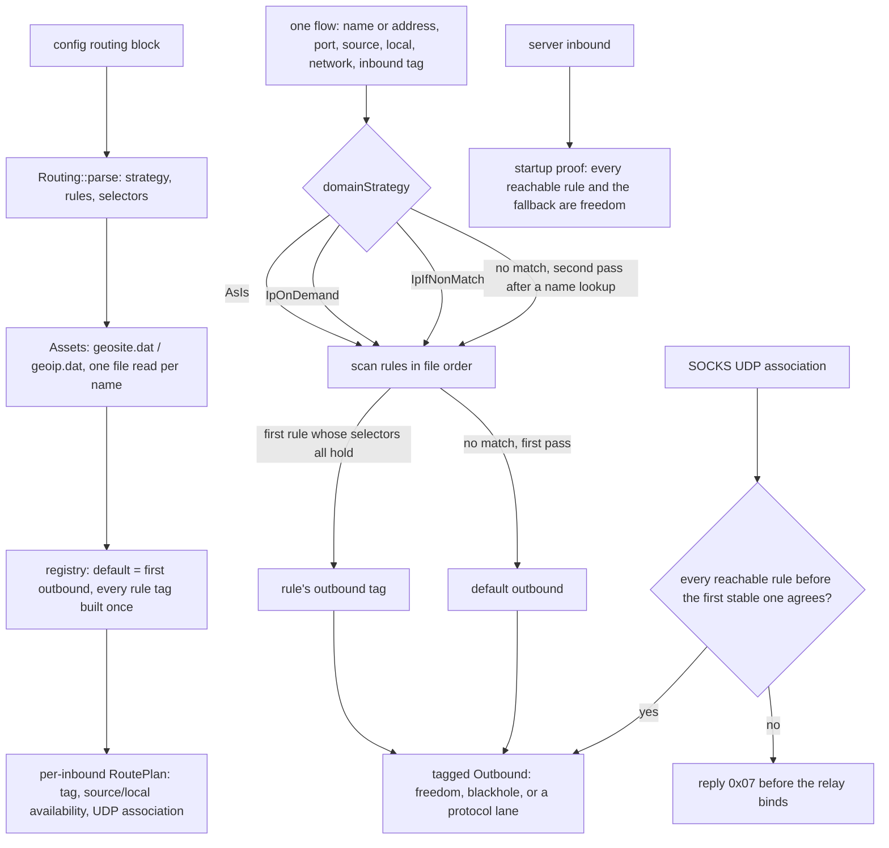

# Routing rules and the geosite/geoip assets

A rule is a set of selectors that must all hold, and one outbound tag the first match decides. The
default is the first configured outbound — the reference's `defaultHandler`, tag or no tag — so a
config that adds `routing` moves unmatched flows to that entry rather than to the protocol priority
this tree used before. Every tag a rule names is built once, at startup; a tag no outbound carries,
an outbound this tree cannot dial, and a missing asset file or code are startup refusals named by the
thing that is missing, never inert rules.

The asset containers are xray's protobuf `GeoSiteList` and `GeoIPList`, decoded here with the same
field walk the rest of the tree uses for xray's wire form. `geosite:CODE@attr@attr` keeps only the
domains that carry **all** listed attributes; codes are uppercased and attributes lowercased as the
reference does. For addresses, a leading `!` on a rule toggles that rule's own reverse flag, twice
toggles it back, and the positive and negative subsets OR together. A family that the negative set
never names is not matched by its reverse — the reference's `max4`/`max6` sentinel — so a v4-only
`!geoip:test` does not match a v6 address.

Domain forms: `geosite:` / `ext:` / `ext-domain:` / `ext-site:`, `domain:` (suffix), `full:`, `regexp:`,
`keyword:`, `dotless:`, and a plain value, which is a substring as in the reference. `ip:` /
`source` / `localIP` take CIDRs, `geoip:`, `ext:` or `ext-ip:`. Ports accept a number or a
comma/range string; `env:` is refused by name. `network` is `tcp` or `udp`; `unix` is refused by
name. `localOS` is compared case-insensitively with `darwin` for macOS.

## Data path

## What a flow carries

A flow has a network, a destination (a name stays a name; only a lane that carries no destination
resolves it), a port, and — where the transport can answer them — the client's source address and
the local address the inbound accepted on. An absent field matches no rule, which is what keeps a
selector from turning into an unconditional match. A rule with no effective selector is refused at
parse time, so no rule can match every flow by accident.

`AsIs` never looks a name up. `IpOnDemand` resolves on the first IP matcher the scan reaches.
`IpIfNonMatch` runs the match once, and only if nothing matched and the destination is a name does it
resolve and run the scan again. The literal address of an unchanged destination still short-circuits
the lookup: a test drives both passes and counts the resolver calls.

## Lanes the transport cannot route

A server inbound in this tree dials direct whatever the rules say. Rather than ignore the table per
flow, startup walks the rules that can reach the inbound (its tag, its network, the current OS) and
requires each to target a freedom outbound; it stops at a rule that matches every flow on that tag,
and otherwise requires the fallback to be freedom. Anything else refuses the config with the tag
named.

A `tun` flow has no source or local address the rules could read. If any rule that could reach the
tun tag names `source`, `sourcePort`, `localIP` or `localPort`, the config is refused naming that
selector instead of letting the rule silently never match.

A SOCKS UDP association carries one lane, but its datagrams each name their own destination. The
association decision is made with `network=udp` and no target: a per-destination rule that could
split it is a refusal (`0x07`, command not supported) written before the relay binds, with one log
line. A rule that matches every datagram on the association may fix its lane; when all such rules
agree with the fallback the association rides it. Per-destination datagram routing is not carried.

## Measured

<!-- counts:begin -->
| key | value | checked by |
| --- | --- | --- |
| ops-retired-instructions | UNBLESSED | scripts/count-ops.sh |
| flow-decision-allocations | 0 | ferrox-app-router::tests::a_flow_without_a_domain_matcher_allocates_nothing |
| host-lowercase-buffers-per-domain-match | 1 | ferrox-app-router::tests::a_domain_match_takes_one_lowercase_buffer |
| literal-route-allocations | 0 | ferrox-app-proxy::tests::a_route_decision_on_a_literal_address_allocates_nothing |
| dns-lookups-per-rule-matched-name | 0 | ferrox-app-router::tests::ip_if_non_match_resolves_only_after_no_rule_matched |
| dns-lookups-per-unmatched-name | 1 | ferrox-app-router::tests::ip_if_non_match_resolves_only_after_no_rule_matched |
<!-- counts:end -->

`flow-decision-allocations 0` is a rule table with no domain matcher: the scan reads ports and
networks and allocates nothing. `host-lowercase-buffers-per-domain-match 1` is the one buffer a
domain match needs, because the suffix and substring tables are stored lowercased and the flow's
name is not; the test asserts the count, so a second copy on the per-flow path fails it.
`literal-route-allocations 0` is the same claim for a routed flow on an address: the plan borrows the
chosen outbound and the decision touches no heap. `dns-lookups-per-rule-matched-name 0` and
`dns-lookups-per-unmatched-name 1` are the two halves of `IpIfNonMatch` — a name a rule already
matched is never resolved, and a name no rule matched is resolved exactly once before the second
pass.

What was not removed: a geosite code is expanded into the rule's sets at startup, so a rule naming a
large code pays that memory for the life of the process; keywords build one Aho-Corasick automaton
per rule that names them; and the rule scan is linear in the number of rules, as the reference's
first-match pass is. The registry keeps one outbound instance per named tag and clones the default
for its own tag, so a lane's shared state is not duplicated.

## Time

No duration is claimed here. Benchmarks are CI-only in this tree, and the pinned routing references
have no per-flow durations that a local run could compare without the tunnel this machine sits
behind. The operation-count gate (`scripts/count-ops.sh`) needs valgrind, which does not exist for
macOS/aarch64, so on this host the figure is `UNBLESSED` and the gate is the `ops.yml` artefact in CI.
The allocation and lookup counts above are the parts a test here can see exactly.

## Pins

| what | where |
| --- | --- |
| rule shape, first match, default handler, `IpOnDemand`/`IpIfNonMatch` | `upstream/xray-core/app/router/{config.proto,config.go,condition.go,router.go}`, `upstream/xray-core/infra/conf/router.go` |
| geosite/geoip containers, attributes, reverse semantics, invalid-entry skipping | `upstream/xray-core/common/geodata/{geodat.proto,rule_parser.go,geodat_loader.go,ip_matcher.go,domain_matcher.go,ip_registry.go}` |
| asset location and file checks | `upstream/xray-core/common/platform/{platform.go,others.go,filesystem/file.go}` |
| same-language reference | `upstream/zeronet/crates/zero-router/src/{router.rs,matcher.rs,assets.rs}` |

## CI scope

What a change here owes, read by `scripts/ci-scope.py`; see [`docs/ci-scope.md`](../ci-scope.md).

<!-- scope:begin -->
- paths: crates/ferrox-app/src/router.rs
- symbols: router, Reader, skip, Outbound, RouteShared, RoutePlan, Association, inbound_tag, build_outbound, route_shared, prove_server_route, serve_root, serve_socks, serve_connect, serve_socks_udp, serve_dokodemo, serve_tun_inbound, accept_loop, dial_socks_outbound
- scenarios: vless-raw, vmess-raw, trojan-raw, shadowsocks-raw
<!-- scope:end -->

No routing conformance seam exists: the pinned xray-core `app/router` tests are in-process Go and
never inject `ferrox-app`; `testing/scenarios` has no routing family; sing-box, xray-core-rust and
zeronet expose no suite that runs this binary's router. The scenarios named above are the server
cells whose configs carry `type: field` rules and must still start and serve.
