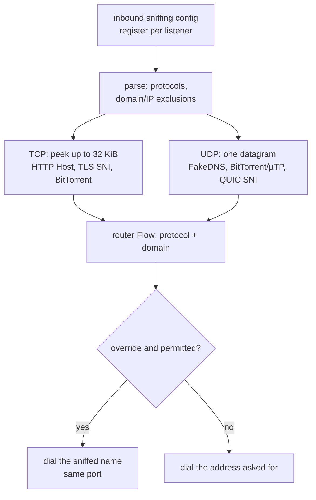

# Engine sniffing

An inbound's `sniffing` block reads the first bytes of a flow before routing and before the outbound dials, so a destination that arrived as an address can become the `Host` or SNI the client itself named. The engine registers one parsed config per listener, inspects TCP through a bounded `peek` and UDP per datagram, and hands the router both a `protocol` and a `domain`. The same result can override the dial target, replace a FakeDNS address with its domain, or leave the original destination in place while still selecting a `protocol` rule.

The carried protocols are xray's five: HTTP/1 (`GET`, `POST`, `HEAD`, `PUT`, `DELETE`, `OPTIONS`, `CONNECT`, with the first `Host` head, IPv6 brackets and an optional port), TLS 1.2/1.3 ClientHello SNI, QUIC Initial SNI for v1, v2 and draft-29, BitTorrent/µTP handshakes, and FakeDNS metadata. `destOverride` accepts `http`, `tls`/`https`/`ssl`, `quic`, `bittorrent`, and `fakedns`/`fakedns+others`; matching is prefix-based, so the `http1`/`http2`/`http3` protocol names a rule may read still match an `http` override. `domainsExcluded` and `ipsExcluded` use the router's own domain and IP matchers, and a blocked override keeps the original address. `metadataOnly` still resolves FakeDNS but reads no payload; `routeOnly` keeps the dial address unless the result is a FakeDNS domain. A loopback outbound applies its own block before the TCP re-inject, so the named inbound receives the sniffed name; its datagram half keeps the named dial's lane, as the reference's loopback handler is TCP-only.

A config that arrives through the protobuf bridge gets the same block: `enabled`, `destOverride`, `metadataOnly` and `routeOnly` decode into the JSON the engine parses.

## Data path



## Measured

<!-- counts:begin -->
| key | value | checked by |
| --- | --- | --- |
| ops-retired-instructions | UNBLESSED | scripts/count-ops.sh |
| http-host-and-tls-sni-recognized | 2 | ferrox-app-sniff::tests::reads_http_host_and_tls_sni |
| quic-initial-sni-recognized | 1 | ferrox-app-sniff::tests::reads_a_quic_initial_sni |
| bittorrent-and-utp-recognized | 2 | ferrox-app-sniff::tests::reads_bittorrent_and_utp |
| excluded-targets-kept | 2 | ferrox-app-sniff::tests::exclusions_keep_the_original_destination |
| loopback-sniffed-host-overrides | 1 | ferrox-app-proxy::tests::a_loopback_sniffing_overrides_the_re_inject_destination |
| routed-protocol-selectors | 1 | ferrox-app-router::tests::a_protocol_rule_reads_the_sniffed_protocol |
<!-- counts:end -->

Syscalls: one TCP probe issues `peek` calls on the client until the HTTP head or TLS ClientHello is whole, the 32 KiB buffer fills, or 200 ms pass; UDP adds no syscall beyond the datagram already read. Copies: the probe fills one 32 KiB buffer per TCP flow, and the detected domain is one `String`; neither has a pointer-identity test that separates it from the buffer it came from, so no copy row is claimed. The worst case the TCP tests do not reach is a header split across `peek` boundaries: the loop re-peeks with the same buffer until the 200 ms deadline, so a slow client delays the dial rather than truncating the name; a full 32 KiB buffer with no match falls through to the original destination.

## Ops

```bash
./scripts/count-ops.sh report \
  sniff::tests::reads_http_host_and_tls_sni 'ferrox_app::sniff::Sniffing::inspect'
```

`UNBLESSED`, as above.

## Time

**Not measured yet.** Durations in this repository come from CI runners (`bench.yml`, `parity.yml`); no cell isolates a sniffer, and no CI artefact has been read. A local run behind a VPN would measure a tunnel either way.

## What we removed

- **A buffer per protocol.** One 32 KiB `peek` buffer feeds HTTP, TLS and BitTorrent in order, and the parse functions borrow it; QUIC and µTP read the datagram the UDP lane already holds.
- **A second routing lookup for a sniffed name.** The probe returns `protocol` and `domain` together, the router reads both from one `Flow`, and the override is applied to the same plan that selected the outbound.
- **A byte-at-a-time line walk.** The HTTP sniffer found its request line's end, each following line's end and each field-name colon with `iter().position` over the peeked head; all three are now `ferrox_core::foxy::octet_in`, the eight-octet scan the http front's own head walk uses, and the rule that the name ends at the first colon and the line at the first `\n` is unchanged — `reads_http_host_and_tls_sni` and `parses_the_fields_xray_names` hold the fields the walk yields, and `an_attrs_rule_reads_the_head_the_sniffer_read` (in the app's proxy tests) holds that the attributes derived from it still route a sniffed flow.
- **A config rebuild for loopback.** A loopback outbound reuses its parsed `Sniffing` `Arc` on the re-inject; the named inbound's dial is unchanged.

What was **not** removed: the 200 ms wait on a TCP flow that sends nothing recognizable, and the 32 KiB probe buffer for every enabled TCP flow even when the first bytes do not parse. A plain HTTP forward sets `http/1.1` from its own request head and runs no second sniff over the forwarded origin-form bytes, so its `protocol` selector sees the forward without a content-domain override. The loopback outbound's own sniffing is carried, but the named inbound's second routing pass remains row 27 rather than an engine claim.

## Pins

| what | where |
| --- | --- |
| dispatcher sniff, 32 KiB cache, 200 ms deadline, override and `routeOnly` | `upstream/xray-core/app/dispatcher/default.go` |
| protocol order and `ErrNoClue` / `ErrProtoNeedMoreData` | `upstream/xray-core/app/dispatcher/sniffer.go` |
| FakeDNS metadata sniffer | `upstream/xray-core/app/dispatcher/fakednssniffer.go` |
| HTTP `Host`, TLS SNI, QUIC Initial, BitTorrent parsers | `upstream/xray-core/common/protocol/{http,tls,quic,bittorrent}/` |
| `protocol` routing selector | `upstream/xray-core/app/router/config.go` |

## CI scope

What a change here owes, read by `scripts/ci-scope.py`; see [`docs/ci-scope.md`](../ci-scope.md).

<!-- scope:begin -->
- paths: crates/ferrox-app/src/sniff.rs
- symbols: sniff_lane, inbound_sniffing, register_inbound_sniffing, serve_socks_udp_sniffed
- go: ./app/dispatcher/..., ./common/protocol/http/..., ./common/protocol/tls/..., ./common/protocol/quic/..., ./common/protocol/bittorrent/...
<!-- scope:end -->
