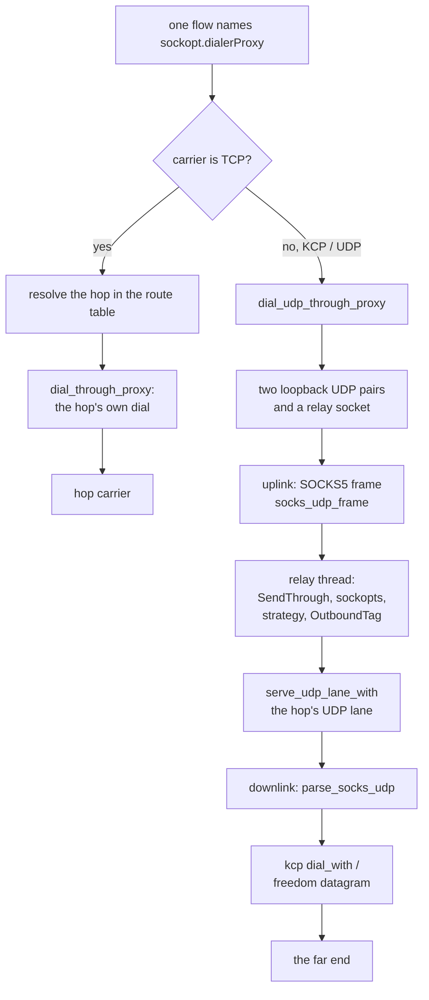

# The tagged outbound

<!-- scope:begin -->
- paths: -
- symbols: dial_through_proxy, dial_udp_through_proxy, kcp_dial_session, serve_connect_at
- scenarios: vless-raw, vmess-raw, trojan-raw, shadowsocks-raw
<!-- scope:end -->
Row 125: a `streamSettings.sockopt.dialerProxy` names another outbound, and every dial the socket
makes leaves through it instead of the machine's own route. The reference carries it at the socket
dialer (`transport/internet/dialer.go`) and at the tagged dialer the UDP carriers use
(`transport/internet/tagged/tagged.go`); this page is both arms. [`engine-router`](engine-router.md)
is the rule scan that chooses the outbound; the hop is resolved in the same table.

## The TCP arm

`serve_connect_at` enters the outbound's socket options for the life of one connection. A raw
carrier dial reads the tag from that table and calls `dial_through_proxy`, which resolves the named
outbound and repeats the dial under its settings (`SendThrough`, socket options, target strategy).
The hop sees the CONNECT exactly once, and the flow owns neither the hop's socket nor its source.
A tag that names the current outbound, or a chain that returns to it, is refused at startup rather
than recursing; a tag no outbound carries is a startup refusal, not a silent direct dial.

## The datagram arm

A carrier whose own transport is UDP cannot be hopped by a TCP proxy: the KCP packets are the
payload, and the hop must carry each one as a UDP datagram. `dial_udp_through_proxy` builds the
same hop for that shape:

- two loopback UDP pairs and a bound relay socket are opened for the flow;
- an uplink thread frames every datagram the carrier sends into the reference's SOCKS5 UDP shape
  (`socks_udp_frame`) and sends it to the relay;
- the relay thread enters the hop's `SendThrough`, socket options, target strategy and tag, then
  runs the hop's own UDP lane (`serve_udp_lane_with`), so the hop's carrier and its source are the
  hop's;
- a downlink thread parses the returned SOCKS5 frame and hands the payload back to the carrier.

`kcp_dial_session` takes this path when the KCP outbound names a tag, and passes the resulting
socket to `ferrox_core::kcp::dial_with`, which rides the caller's socket instead of binding its
own. A freedom UDP lane takes the same path per destination in `datagram_uplink`, so a routed
datagram whose outbound names a hop does not fall back to the machine's route. The socket is not
cached: each tagged destination or carrier owns its relay and its three threads, and the KCP
closer or the freedom lane's retirement sets the stop flag the threads read. A protobuf sender or receiver
socket config decodes field 9 (`dialer_proxy`) into the same `dialerProxy` key as the JSON dialect,
alongside `tproxy`.

## Data path

## What was removed

- **A KCP carrier bound to the machine's route while its outbound named a hop.** `dial` owned the
  `UdpSocket` and the per-peer cache, so a `dialerProxy` on a KCP outbound was read and ignored:
  the config started, the packets left directly and a loopback echo still passed. `dial_with`
  takes the socket the tagged shim already dialled and does not cache it, so the hop owns the
  carrier and the connection owns the shim's stop flag. The protobuf field 9 gap that made the
  same config a startup refusal is closed in the decoder, not by widening the refusal.
- **A direct freedom datagram under a tagged outbound.** `datagram_uplink` now asks the options
  for a tag before it binds, so a routed datagram whose outbound names a hop runs the hop's UDP
  lane rather than the machine's socket.

What is **not** removed: each tagged datagram pays two loopback copies, a SOCKS5 frame build, a
frame parse, and a relay thread plus two shim threads per tagged destination or carrier; the shim's buffers are
per-thread and are not pooled; a tagged flow does not share a carrier with an untagged flow; and
the relay thread ends on lane idle rather than on the caller's close, so a shim thread can wait
one `udpIdle` budget after its flow has gone.

## Time

Nothing here is timed by a local run — a contributor's tunnel would measure the dial, not this
code. `bench.yml` and `parity.yml` have no tagged-outbound cell, so this page carries no duration
and quotes none. The hop is gated by the reference's `TestDialerProxy` and
`TestDialerProxyOverKCP` in `conformance.yml`; the instruction, syscall and copy counts are
`UNBLESSED` until an `ops.yml` artefact measures this method, and `scripts/count-ops.sh` does not
exist on macOS/aarch64, so that gate is CI-only here.

## Gated counts

<!-- counts:begin -->
| key | value | checked by |
| --- | --- | --- |
| ops-retired-instructions | UNBLESSED | scripts/count-ops.sh |
| syscalls-per-tagged-datagram | UNBLESSED | scripts/count-ops.sh |
| copies-per-tagged-datagram | UNBLESSED | scripts/count-ops.sh |
| seconds-per-tagged-dial | UNBLESSED | CI conformance.yml (feature_test.go) |
| tcp-dialer-proxy-hops | 1 | ferrox-app-proxy::tests::a_dialer_proxy_hop_carries_the_outbound_dial |
| tagged-udp-hops | 1 | ferrox-app-proxy::tests::a_tagged_udp_dial_reaches_the_named_hop |
| kcp-tagged-carrier-echoes | 1 | ferrox-app-proxy::tests::a_kcp_dial_rides_the_tagged_hop_to_its_server |
| kcp-dial-with-stops-on-close | 1 | ferrox-core-kcp::listener::tests::a_dial_with_rides_the_callers_socket_and_stops_on_close |
| pb-dialer-proxy-fields-decoded | 1 | ferrox-app-xray_pb::tests::a_sender_socket_dialer_proxy_names_the_tagged_outbound |
<!-- counts:end -->
