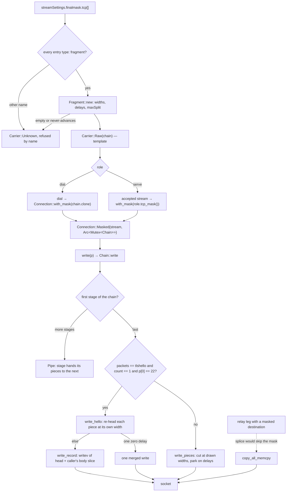

# The finalmask post-TLS TCP chain

Xray's `transport/internet/finalmask` wraps a TCP stream *below* the TLS layer, so
the records a handshake emits reach the wire cut at the ends the config names.
This tree carries that chain for both roles: the dial side arms it on the socket it
opens for an outbound whose `streamSettings` names a `finalmask.tcp` list, the serve
side arms it once per accepted stream in `accept_loop`, which is where the reference
wraps its listener's conn. It is a write mask only — reads, timeouts, addresses,
polling and teardown reach the socket itself — so `Connection::Masked`
(`crates/ferrox-app/src/conn.rs`) forwards everything else and puts the chain under
`write` and `write_vectored` alone.

The mask rewrites nothing: the octets a session writes are the octets the peer reads,
only at different record ends. A handshake message may legally span TLS records, so
the peer's own stack reassembles it, and that reassembly is what the pinned interop
rows assert (`fragment_observer` walks the record headers, asserts every piece is type
`22`, that the message reassembles to one ClientHello, and that `maxSplit` bounds the
count). Byte-identity is therefore proven on the wire, not on a hash:
`a_configured_fragment_chain_cuts_the_hello_on_the_wire` writes a hello through a real
socket and walks the record headers a peer reads back.

The config surface is `streamSettings.finalmask.tcp[]`. Only `type: fragment` ships;
`header-custom`, `sudoku` and `xmc` — the other three names `tcpmaskLoader` accepts —
refuse the carrier by name (`config.rs::tcp_mask`), the same fail-closed policy as
`kcp_mask`. Inside `fragment`, `packets` picks the writes cut (`tlshello`, a window, or
absent), `lengths`/`length` the piece widths, `delays`/`delay` the waits between them
and `maxSplit` the record bound. Every one of those is an `Int32Range`: a number, or a
string spelling one number, an empty string (`0`), or `a-b` in either order, including
the `splitFromSecondDash` spellings `-114-514` and `-1919--810`. The reference orders a
range inside its own `UnmarshalJSON`, so ordering belongs to this tree's reader:
`Range::ordered` runs before anything draws, and `range_text` refuses a spelling that
errors upstream rather than turning it into a silent `0`. Draws are half-open as the
reference's `RandBetween` is — `11-37` never answers 37.

Stages compose in config order on the write path: the first configured entry sees the
session's whole, and what it hands on is the next stage's whole, the last stage nearest
the socket. That is the reference's reverse-then-wrap order read from the other end,
and `a_chain_applies_its_stages_in_config_order` pins it with two widths that would
answer differently in either order.

A chain belongs to a TCP connection. A non-empty `finalmask.tcp` on a carrier that
rides another transport (`ws`, `httpupgrade`, `grpc`, `xhttp`, `http`, `quic`, `kcp`,
`hysteria`), or on a `socks`/`http`/`mixed` inbound that has no carrier at all, is
refused rather than dialled or served in the clear; `stream_carrier` applies that rule
after resolving, and `accept_loop` names it on the console for a front it cannot arm.
The reference puts the chain on the TCP layer under whichever transport rides it, so
this is narrower than upstream — the divergence is named under *What we removed*
rather than papered over.

## Data path



## Measured

<!-- counts:begin -->
| key | value | checked by |
| --- | --- | --- |
| ops-retired-instructions | UNBLESSED | scripts/count-ops.sh |
| pieces-restaged-per-hello | 0 | ferrox-core-finalmask::tests::a_delayed_piece_hands_the_body_over_where_it_lies |
| merged-buffer-regrowths-per-hello | 0 | ferrox-core-finalmask::tests::the_merged_run_is_the_only_buffer_the_mask_owns |
| records-past-max-split | 0 | ferrox-core-finalmask::tests::a_max_split_ends_the_run_on_the_whole_hello |
| socket-writes-for-a-merged-hello | 1 | ferrox-core-finalmask::tests::a_hello_record_is_cut_into_records_of_the_configured_widths |
| hello-records-from-the-config | 9 | ferrox-app-proxy::tests::a_configured_fragment_chain_cuts_the_hello_on_the_wire |
| unarmable-masks-dialled-unmasked | 0 | ferrox-app-proxy::tests::a_tcp_mask_this_tree_cannot_arm_is_refused |
| splices-past-a-masked-writer | 0 | ferrox-app-proxy::tests::a_masked_destination_is_not_fed_by_splice |
| pinned-fragment-interop-rows | 2 | scripts/run-upstream-suite.sh |
<!-- counts:end -->

## Ops

```bash
./scripts/count-ops.sh report finalmask::tests::a_hello_record_is_cut_into_records_of_the_configured_widths \
  'ferrox_core::finalmask::Chain::write' 'ferrox_core::finalmask::Fragment::write_hello'
./scripts/count-ops.sh report finalmask::tests::a_delayed_piece_hands_the_body_over_where_it_lies \
  'ferrox_core::finalmask::write_record'
./scripts/count-ops.sh report finalmask::tests::the_last_configured_width_governs_every_later_segment \
  'ferrox_core::finalmask::Fragment::write_pieces'
```

`UNBLESSED`, as every page here says: `scripts/expected-ops.txt` blesses exactly one
symbol tree-wide. Those four symbols are rows in `scripts/method-ops.txt`, so `ops.yml`
publishes their inclusive cost on the next Linux run; the count gate itself needs
valgrind, which does not exist on macOS/aarch64, so on this machine the row stays open
by platform and is read from CI rather than skipped.

## Time

**Not measured on this branch.** Durations in this repository come from a named runner;
`bench.yml` and `parity.yml` for this row have not been read yet, and a masked lane's
`delays` are sleeps the config asked for, so nothing here should be quoted as a
throughput claim until those two runs are.

## What each reference gave

- **xray-core** `transport/internet/finalmask/fragment/conn.go` — the whole semantics: the per-connection write count, the `tlshello` gate (`count == 1`, `len > 5`, `p[0] == 22`), the merged branch for a single zero delay, one write plus sleep otherwise, widths and delays clamped to their last entry, and the `to > len || maxSplit` clamp that ends a run on the whole.
- **zeronet** `zero-evasion/src/{fragment,rand_between}.rs` — the two `RandBetween` quirks kept as the reference's own behaviour: a span of 0 or 1 answers its low end, and a range never draws its top. Its `TlsSni`, `empty_records` and `lead_lengths` are not taken — no shipped code reaches them.
- **sing-box** `option/tls.go` — nothing: its `fragment`/`record_fragment`/`fragment_fallback_delay` are booleans that pad records *above* TLS, a different surface from cutting the ends a config names.
- **xray-core-rust** (Be90nia) — nothing: the tree carries no TCP fragment mask at all.
- **xray-rust** (aimalygin) — the conformance seam, which is this row's gate (`fragment_finalmask_tls_interop`, `fragment_finalmask_tls_vision_direct_interop`), and its `reject_unknown_fields` parser shape; its single-entry limit is not taken, because stages here compose in config order.

## What we removed

- **The per-`Write` scratch buffer and the two copies per piece it costs.** The
  reference's `fragment/conn.go:Write` allocates `buff := make([]byte, 2048)` on every
  call, re-grows it when a piece is wider, and copies each piece into it twice
  (`copy(buff[:3], p)` for the unchanged head, `copy(buff[5:], data[from:to])` for the
  body) before writing. The delayed lane here gathers the five-byte header and the
  caller's own body slice into one `write_vectored`
  (`ferrox-core::finalmask::write_record`), so the body never lands in a buffer of its
  own: `a_delayed_piece_hands_the_body_over_where_it_lies` pins each piece's base
  inside the caller's hello (`pieces-restaged-per-hello` 0). The header is still this
  stage's own five bytes, because a re-headed record cannot be the caller's bytes.
- **A fresh `hello` list per merged write.** The reference's merge branch starts from
  `var hello []byte` and `append`s every piece to it, so each hello reallocates as it
  grows. This tree keeps one `merged` buffer per stage and clears rather than drops it:
  `the_merged_run_is_the_only_buffer_the_mask_owns` gates the claim the way the rules
  ask — `capacity()` and the base pointer held steady over a push/drain cycle across a
  second and then a smaller hello (`merged-buffer-regrowths-per-hello` 0). What the
  stage still pays, named: one allocation for the first hello it cuts, and the merged
  copy itself — the burst is one socket write, so its bytes must be contiguous somewhere
  (`socket-writes-for-a-merged-hello` 1).
- **Two constructors that were one.** `NewConnClient` and `NewConnServer` have identical
  bodies upstream; the wrapped conn and its `count` here are a `Fragment` and a `Chain`,
  and the only thing the `server` flag survives into is `Splice()` (below).
- **A per-connection conn object on the serve side.** The reference wraps each accepted
  conn; a chain stored on the carrier would count writes across every connection, so
  `Connection::with_mask` clones the template per stream and shares it behind one
  `Arc<Mutex<Chain>>` — a cloned handle keeps counting the same writes, which is what
  lets a relay leg holding its stream by reference mask identically to one moved by
  value. What the lane still pays, named: one mutex guard per masked write. An unarmed
  connection pays nothing — `with_mask` leaves it a `Connection::Tcp`.

What is **not** removed, and is named rather than claimed:

- **`Splice()`.** Upstream a client fragment conn answers `true`, so its own relay path
  may hand the socket over without crossing the mask, and a server one answers `false`.
  This tree refuses to bypass: `copy_all` and the linux `poll_relay` lane check
  `Connection::masked()` and take the buffered copy instead. That is the deliberate
  divergence — a masked destination is cut on the wire whatever the cost — and it costs
  a masked client relay the zero-copy leg. Its checker is
  `a_masked_destination_is_not_fed_by_splice`, which compiles only on linux because the
  splice lane is `#[cfg(target_os = "linux")]`; on this macOS tree the gate is read from
  CI, not skipped.
- **A masked vectored write answers one run per call.** A chain is a byte writer, so
  `write_vectored` hands its first part over and the caller's loop brings the rest as
  the write it would have been. A multi-record batch therefore pays one socket write per
  record where a plain `TcpStream` takes them in one `writev`. That is the pass that got
  worse, and it exists only on the masked lane — rustls flushes handshake records through
  `write_vectored`, which is why this shape is on the ClientHello path and not only the
  relay's.
- **One `getrandom` per drawn width, delay and bound**, where the reference draws from a
  process-wide PRNG. A masked hello pays it per segment; batching the draws would be a
  second way of doing the same thing, so it is not here.
- **`header-custom`, `sudoku` and `xmc` on the TCP lane, and every `finalmask.udp` type
  except the `mkcp-legacy` masks KCP already carries.** They refuse by name and are
  routed as their own work in the `finalmask-refused-types` add-on under P1 of
  [`crates/ferrox-prompt/prompts.md`](../../crates/ferrox-prompt/prompts.md).
- **The sleeps.** `delays` are the config's schedule; a mask that cut faster would look
  like a different schedule to anything watching the wire, so `park` sleeps exactly what
  one draw answers. `a_delay_range_whose_top_is_zero_draws_zero` pins the draw a span of
  one answers (`0`), and the sleeps themselves are what `scripts/watch-test.sh` catches:
  a mask that parked when the config said zero would stall the test rather than fail an
  assertion.

## CI scope

What a change here owes, read by `scripts/ci-scope.py`; see [`docs/ci-scope.md`](../ci-scope.md).

<!-- scope:begin -->
- paths: crates/ferrox-core/src/finalmask.rs
- symbols: finalmask
- oracle: xray-rust=fragment_finalmask_tls_interop
- go: ./transport/internet/finalmask/...
<!-- scope:end -->
