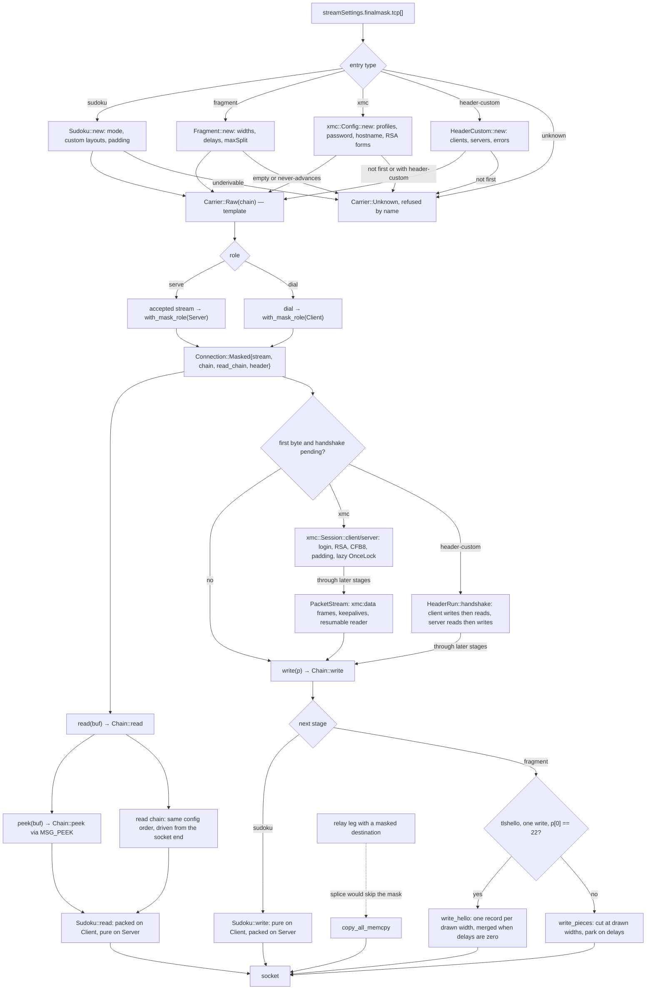

# The finalmask post-TLS TCP chain

Xray's `transport/internet/finalmask` wraps a TCP stream *below* the TLS layer, so the records a handshake emits reach the wire cut at the ends the config names. This tree carries that chain for both roles: the dial side arms it on the socket it opens for an outbound whose `streamSettings` names a `finalmask.tcp` list, the serve side arms it once per accepted stream in `accept_loop`, which is where the reference wraps its listener's conn. A `fragment` is a write mask, so reads reach the socket itself; `sudoku` is bidirectional and opens a second chain for `read`, `read_vectored`, `read_ready` and `peek`, and `Connection::Masked` (`crates/ferrox-app/src/conn.rs`) keeps the socket's timeouts, addresses, polling and teardown under either. `header-custom` and `xmc` sit above that byte mask and own a handshake: `header-custom` runs its configured ping-pong once in the side's role, and `xmc` runs a Minecraft login that turns the whole stream into a framed, encrypted session in both directions. Both are armed lazily on the first byte the flow moves, and both write their handshake through the stages beneath them. On the serve side, both handshakes finish at admission, inside one absolute deadline with each read clocked to the time that is left, so a stage split across segments is never read under the relay's one-millisecond poll clock and a dribbled byte cannot restart the budget.

The `fragment` mask rewrites nothing: the octets a session writes are the octets the peer reads, only at different record ends. A handshake message may legally span TLS records, so the peer's own stack reassembles it, and that reassembly is what the pinned interop rows assert (`fragment_observer` walks the record headers, asserts every piece is type `22`, that the message reassembles to one ClientHello, and that `maxSplit` bounds the count). Byte-identity is therefore proven on the wire, not on a hash: `a_configured_fragment_chain_cuts_the_hello_on_the_wire` writes a hello through a real socket and walks the record headers a peer reads back.

The config surface is `streamSettings.finalmask.tcp[]`. Five stage types ship: `fragment` writes the record cuts, `sudoku` is the bidirectional codec, `filter` applies a source-address allow/deny list before the stream is served, writing no byte and never entering the write chain, `header-custom` runs a ping-pong handshake of configured `clients`, `servers` and `errors` sequences before the session, and `xmc` runs a Minecraft login and then a framed, AES-CFB8 session in both directions.

Inside `sudoku`, `password` seeds the 288-grid table in Go `math/rand` v1 order: grids are a deterministic DFS over the 4x4 Latin-square constraints, clue positions are 1820 four-cell sets kept unique across grids, and the shuffle is the reference's SHA-256-first-eight-bytes `int64` seed. `ascii` selects `entropy`/`prefer_entropy` (the default) or `ascii`/`prefer_ascii`; `customTable`/`custom_table` is one 8-character layout with exactly two `x`, two `p` and four `v`, and `customTables`/`custom_tables` is a list whose new spelling wins only when non-empty. `paddingMin`/`paddingMax` clamp at 100 and `max < min` becomes `min`. A layout the reference cannot derive refuses the carrier. The reference's randomized wire means two runs never agree byte-for-byte; the provable checks are the Go shuffle fixture (`the_shuffle_matches_the_reference`), the Go-encoded wire fixture decoded here (`the_reference_wire_decodes_to_its_plaintext`), and the configured two-direction relay (`a_configured_sudoku_chain_decodes_both_directions`).

`header-custom` and `xmc` must each be the first TCP byte stage: a later position refuses the carrier, because a handshake beneath an earlier byte stage would have to write through that stage, and the flat chain here does not keep the split. A `filter` entry before either is accepted, because filters write no bytes. The two are mutually exclusive, and a `fragment` or `filter` after either one composes normally. The `clients` sequence is what the dial side writes and the serve side expects; `servers` is the answer in the other direction; `errors[i]` is what the serve side writes when `clients[i]` does not match. Every item names at most one source of bytes — a fixed `packet` (`type` `array` for a JSON array, `base64`, `str`, or `hex`), `rand` bytes in a `randRange` (default `0-255`), a captured `reuse` variable, or a `transform` expression — and an optional `capture` stores what it produced. The transforms are `concat`, `slice`, `xor16`, `xor32`, `be16`, `be32`, `le16`, `le32`, `le64`, `pad`, `truncate`, `add`, `sub`, `and`, `or`, `shl` and `shr`; args are bytes, a `u64`, a captured variable, one of the socket metadata names (`local_port`, `local_ip4_u32`, `remote_port`, `remote_ip4_u32`, `src_port_u16`, `src_ip4_u32`, `dst_port_u16`, `dst_ip4_u32`), or a nested transform. Captured variables live five seconds keyed by the full socket pair, ports included, as the reference's state store does, so a `reuse` survives only when that identical pair connects again. A `filter` stage parses `blockedSourceIPs` and `allowedSourceIPs` through the tree's geoip matcher, so a CIDR or `geoip:` rule is the same rule routing reads; a malformed rule refuses the carrier instead of serving every source. A blocked match rejects, and when an allowlist is present a source outside it — or one the transport cannot name — is rejected. Each filter stage is its own gate: a source must pass all of them. Inside `fragment`, `packets` picks the writes cut (`tlshello`, a window, or absent), `lengths`/`length` the piece widths, `delays`/`delay` the waits between them and `maxSplit` the record bound. Every one of those is an `Int32Range`: a number, or a string spelling one number, an empty string (`0`), or `a-b` in either order, including the `splitFromSecondDash` spellings `-114-514` and `-1919--810`. The reference orders a range inside its own `UnmarshalJSON`, so ordering belongs to this tree's reader: `Range::ordered` runs before anything draws, and `range_text` refuses a spelling that errors upstream rather than turning it into a silent `0`. Draws are half-open as the reference's `RandBetween` is — `11-37` never answers 37.

`xmc` reads `hostname`, `password` and one or more `profiles` of `username`, `uuid`, `texturesValue` and `texturesSignature`. The username must match `^[A-Za-z0-9_]{3,16}$`, the UUID must be one of the forms `google/uuid` parses (32 hex digits, the dashed 36-character form, a `urn:uuid:` prefix or any 38-byte wrapper), the textures must both be non-empty, and the password must be non-empty; a profile that fails any of these refuses the carrier instead of dialling a half-configured peer. Both RSA forms are derived from the password: PKCS#1 private for the serve side, PKIX public for the dial side, so a client that derives a different key rejects the server's Encryption Request before it sends a secret. The dial side writes protocol 775, the configured hostname (or the remote IP when the hostname is empty), the remote port (or 25565), state 2, then Login Start with a randomly drawn profile. It checks the advertised public key against its own, seals a 16-byte shared secret and the 4-byte token plus password with PKCS#1 v1.5, switches on CFB8 before reading the answer, rejects a disconnect packet and verifies the returned profile before sending Login Acknowledged. The serve side answers state 1 with a status response and echoes the ping payload for two packets, or, for state 2, looks the profile up by username and UUID, sends a random 4-byte token, decrypts both fields, requires exactly 16 secret bytes and the token prefix, switches the cipher before comparing the password in constant time, disconnects an unknown profile or bad password, writes Login Success with the configured textures, and requires an empty Login Acknowledged. Both sides then run the reference's startup padding schedule with the acknowledged packet's wire length as the first turn's prefix, and the session begins. `PacketStream` frames custom payloads on `xmc:data`, splits at 24 KiB, echoes keepalives from the client, and the reader keeps a partial frame in its buffer across `WouldBlock`/`TimedOut`, so a polled relay resuming mid-frame never loses a byte. `peek` cannot expose decrypted application bytes, so it answers `Unsupported`; a sniffing path falls back rather than reading the wire ahead. The handshake's reads share one absolute 120-second deadline (`conn.rs`'s `DeadlineReader`), each read clocked to the time that is left, so a peer that dribbles a byte per clock cannot hold the lane past it; an admission shortens it to what the lane has left, the socket's own clocks are restored afterwards, and the bound lives in the app because the core takes no wall clock.

Stages compose in config order on the write path: the first configured entry sees the session's whole, and what it hands on is the next stage's whole, the last stage nearest the socket. The read path drives the same stages from the socket end: the last configured stage, nearest the socket, decodes first, and each stage above it reads that one's output. `a_chain_applies_its_stages_in_config_order` pins the write order with two widths that would answer differently in either order, `a_codec_chain_decodes_in_reverse_stage_order` pins the read side with two sudoku passwords, and `a_configured_header_custom_stage_carries_both_directions` runs a handshake over a real socket with a fragment stage beneath it and reads the session back both ways.

A chain belongs to a TCP connection. A non-empty `finalmask.tcp` write stage on a carrier that rides another transport (`ws`, `httpupgrade`, `grpc`, `xhttp`, `http`, `quic`, `kcp`, `hysteria`), or on a `socks`/`http`/`mixed` inbound that has no carrier at all, is refused rather than dialled or served in the clear; a filter-only chain carries no write and is refused the same way on those fronts because this tree has nowhere to install its verdict; `stream_carrier` applies that rule after resolving, and `accept_loop` names it on the console for a front it cannot arm. The reference puts the chain on the TCP layer under whichever transport rides it, so this is narrower than upstream — the divergence is named under *What we removed* rather than papered over.

## Data path



## Measured

<!-- counts:begin -->
| key | value | checked by |
| --- | --- | --- |
| ops-retired-instructions | 323610 | scripts/count-ops.sh |
| sudoku-ops-retired-instructions | UNBLESSED | scripts/count-ops.sh |
| sudoku-encoder-capacity-growth | 0 | ferrox-core-finalmask-sudoku::tests::the_encoder_buffer_holds_its_capacity |
| sudoku-pure-octets-per-plaintext-octet | 4 | ferrox-core-finalmask-sudoku::tests::the_wire_ratio_is_the_reference_shape |
| sudoku-packed-octets-per-three-octets | 4 | ferrox-core-finalmask-sudoku::tests::the_wire_ratio_is_the_reference_shape |
| pieces-restaged-per-hello | 0 | ferrox-core-finalmask::tests::a_delayed_piece_hands_the_body_over_where_it_lies |
| filter-verdicts-from-one-list | 5 | ferrox-app-config::tests::a_finalmask_filter_reads_both_lists |
| merged-pieces-restaged-per-hello | 0 | ferrox-core-finalmask::tests::a_merged_run_gathers_the_callers_body_without_restaging_it |
| getrandoms-for-two-random-widths | 1 | ferrox-core-finalmask::tests::a_random_merged_hello_draws_only_the_random_widths_from_the_supply |
| records-past-max-split | 0 | ferrox-core-finalmask::tests::a_max_split_ends_the_run_on_the_whole_hello |
| socket-writes-for-a-merged-hello | 1 | ferrox-core-finalmask::tests::a_hello_record_is_cut_into_records_of_the_configured_widths |
| hello-records-from-the-config | 9 | ferrox-app-proxy::tests::a_configured_fragment_chain_cuts_the_hello_on_the_wire |
| unarmable-masks-dialled-unmasked | 0 | ferrox-app-proxy::tests::a_tcp_mask_this_tree_cannot_arm_is_refused |
| splices-past-a-masked-writer | 0 | ferrox-app-proxy::tests::a_masked_destination_is_not_fed_by_splice |
| pinned-fragment-interop-rows | 2 | scripts/run-upstream-suite.sh |
| header-custom-handshake-write-calls | 1 | ferrox-core-finalmask::header_custom::tests::a_client_writes_its_sequence_then_checks_the_answer |
| header-custom-error-bytes-on-mismatch | 1 | ferrox-core-finalmask::header_custom::tests::a_mismatch_writes_the_configured_error_and_stops |
| header-custom-captured-vars-per-handshake | 1 | ferrox-core-finalmask::header_custom::tests::a_captured_value_survives_into_the_next_connection |
| header-custom-ops-retired-instructions | UNBLESSED | scripts/count-ops.sh |
| xmc-ops-retired-instructions | UNBLESSED | scripts/count-ops.sh |
| xmc-syscalls-per-handshake | UNBLESSED | scripts/count-ops.sh |
| xmc-copies-per-handshake | UNBLESSED | scripts/count-ops.sh |
| xmc-time | UNBLESSED | bench.yml |
| xmc-paired-session-directions | 2 | ferrox-app-proxy::tests::a_configured_xmc_stage_carries_both_directions |
| xmc-unknown-profile-disconnects | 1 | ferrox-core-finalmask-xmc::tests::an_unknown_profile_is_disconnected |
| xmc-keepalives-echoed-by-client | 1 | ferrox-core-finalmask-xmc::tests::a_client_echoes_keepalives_and_skips_other_payloads |
| header-custom-handshake-time | UNBLESSED | not measured |
<!-- counts:end -->

## Ops

```bash
./scripts/count-ops.sh report finalmask::tests::the_merged_hello_costs_the_cuts_and_the_gather \
  'ferrox_core::finalmask::tests::merged_hello_probe'
./scripts/count-ops.sh report finalmask::tests::a_hello_record_is_cut_into_records_of_the_configured_widths \
  'ferrox_core::finalmask::Chain::write' 'ferrox_core::finalmask::Fragment::write_hello'
./scripts/count-ops.sh report finalmask::tests::a_delayed_piece_hands_the_body_over_where_it_lies \
  'ferrox_core::finalmask::write_record'
./scripts/count-ops.sh report finalmask::tests::the_last_configured_width_governs_every_later_segment \
  'ferrox_core::finalmask::Fragment::write_pieces'
```

`header-custom-ops-retired-instructions` and all four `xmc` rows stay `UNBLESSED`: no valgrind probe prices either handshake path yet, and `ops.yml` is the only reader that could turn them into numbers. The `xmc` behavioral rows are counts the named tests assert themselves — two directions in the paired real-socket session, one disconnect for an unknown profile, one echoed keepalive — not syscalls or instruction counts. The three handshake rows are counts the core tests assert themselves — one write per sequence, one error byte on a mismatch, one captured variable after a handshake — not syscalls over a socket, because the in-memory `Wire` answers the whole sequence and cannot witness a kernel call.

`323610` for 256 merged hellos (1264.1 a turn), read from the Linux `ops.yml` run and blessed in `scripts/expected-ops.txt`. The probe is an `#[inline(never)]` frame that drives 256 fixed 300-octet hellos at widths 11 and 37 through the merged path over a sink that takes the whole gathered write and keeps nothing, so the count is the mask's own cuts and gather rather than a harness copy. The other four symbols are rows in `scripts/method-ops.txt` too, and `ops.yml` read them as `Ir=inlined-not-a-frame` — the mask's writes inline into their test harnesses — which is why the probe exists. The count gate needs valgrind, which does not exist on macOS/aarch64, so the Linux run is the only one that read it. The sudoku lane's retired-instruction count is `UNBLESSED`: `count-ops.sh` cannot run on this host, and the wire ratios in the table are exact length assertions, not substitutes for an instruction count.

A sudoku write pays four table lookups and one shuffle draw per plaintext octet on the pure side, or four 6-bit groups per three octets on the packed side; `the_wire_ratio_is_the_reference_shape` gates the resulting lengths. The encoder buffer is kept across writes and its `capacity()` does not grow after the first 4096-octet write (`sudoku-encoder-capacity-growth` 0). The relay's masked write still answers one run per stage write because `Chain` is a byte writer; a gathered relay write becomes one encoded write per part.

## Time

**No row measures this lane.** `header-custom-handshake-time` is `UNBLESSED` by `not measured`. `bench.yml` and `parity.yml` both ran for this slice and were read: every row in them is a cipher or record-layer throughput lane, and neither has a masked-connection case, so there is no duration to quote for the mask here. `xmc-time` is `UNBLESSED` for the same reason: the startup padding's sleeps are the config's schedule, so timing the handshake would price the schedule and the tunnel, not the code. A `header-custom` handshake has no duration either: its `delay` and `rand` items are the config's schedule and entropy, so a measurement would price the config, not the code. What the slice is gated on instead is byte-identity — the record reassembly in `a_configured_fragment_chain_cuts_the_hello_on_the_wire` and the two pinned conformance rows. A masked hello's `delays` are sleeps the config asked for, so any timing on that lane measures the schedule, not the code, which is the other reason none is claimed here.

## What each reference gave

- **xray-core** `transport/internet/finalmask/header/custom/{tcp,state,evaluator,config}.go` — the handshake shape (client writes then reads, server reads then writes, `errors[i]` on the failed client sequence), the five-second capture store keyed by the socket pair, the transform set and its overflow rules, and the `PraseByteSlice` packet spellings. The first-position rule is this tree's narrowing, named above.
- **xray-core** `transport/internet/finalmask/xmc/{client,server,stream,deadline}.go` and `infra/conf/transport_finalmask.go` — the login/status exchange, the derived RSA key pair, the token-plus-password field, CFB8, the profile and textures check, the startup padding's first-prefix rule, the custom-payload framing and keepalive, and the 120-second handshake deadline. The validation rules and the first-position narrowing are this tree's, named above.
- **xray-core** `transport/internet/finalmask/fragment/conn.go` — the whole semantics: the per-connection write count, the `tlshello` gate (`count == 1`, `len > 5`, `p[0] == 22`), the merged branch for a single zero delay, one write plus sleep otherwise, widths and delays clamped to their last entry, and the `to > len || maxSplit` clamp that ends a run on the whole.
- **xray-core** `transport/internet/finalmask/sudoku/{table,codec,conn_tcp,conn_tcp_packed}.go` — the grid DFS and clue uniqueness, the Go v1 shuffle seed, the entropy/ascii/custom layouts, pure versus packed direction, padding pools and the 6-bit group stream. `config.proto` and `infra/conf/transport_finalmask.go` supply the two spellings and the new-key-wins fallback.
- **zeronet** `zero-evasion/src/{fragment,rand_between}.rs` — the two `RandBetween` quirks kept as the reference's own behaviour: a span of 0 or 1 answers its low end, and a range never draws its top. Its `TlsSni`, `empty_records` and `lead_lengths` are not taken — no shipped code reaches them.
- **sing-box** `option/tls.go` — nothing: its `fragment`/`record_fragment`/`fragment_fallback_delay` are booleans that pad records *above* TLS, a different surface from cutting the ends a config names.
- **xray-core-rust** (Be90nia) — nothing: the tree carries no TCP fragment mask at all.
- **xray-rust** (aimalygin) — the conformance seam, which is this row's gate (`fragment_finalmask_tls_interop`, `fragment_finalmask_tls_vision_direct_interop`), and its `reject_unknown_fields` parser shape; its single-entry limit is not taken, because stages here compose in config order.

## What we removed

- **The per-`Write` scratch buffer and the two copies per piece it costs.** The reference's `fragment/conn.go:Write` allocates `buff := make([]byte, 2048)` on every call, re-grows it when a piece is wider, and copies each piece into it twice (`copy(buff[:3], p)` for the unchanged head, `copy(buff[5:], data[from:to])` for the body) before writing. The delayed lane here gathers the five-byte header and the caller's own body slice into one `write_vectored` (`ferrox-core::finalmask::write_record`), so the body never lands in a buffer of its own: `a_delayed_piece_hands_the_body_over_where_it_lies` pins each piece's base inside the caller's hello (`pieces-restaged-per-hello` 0). The header is still this stage's own five bytes, because a re-headed record cannot be the caller's bytes.
- **The sudoku encoder's per-write output buffer.** The reference's `codec.encode` allocates a fresh `out := make([]byte, 0, len(in)*6+8)` on every write, so a long-lived masked stream allocates and re-grows on each record. This tree's `Encoder` keeps its `out` vector across writes and clears it in place; `the_encoder_buffer_holds_its_capacity` writes 4096 octets, then five writes including an empty one, and asserts `capacity()` never moves (`sudoku-encoder-capacity-growth` 0). The decoder also keeps its hint accumulator and bit buffer on the `Reader`, so a short read resumes where it stopped instead of replaying the stream.
- **The merged hello's own buffer and the body copy it cost.** The reference's merge branch starts from `var hello []byte` and `append`s every piece to it, so each burst copies the whole hello before its one write; this tree kept a `merged` buffer per stage and copied into it too. Each record's five-byte header is now built in a fixed 32-record stack scratch and each body is the caller's own slice gathered into one `writev`, so the stage owns no hello-sized buffer at all: `a_merged_run_gathers_the_callers_body_without_restaging_it` pins every body base to `whole[at..]` (`merged-pieces-restaged-per-hello` 0) and `socket-writes-for-a-merged-hello` stays 1. What got worse, named: a merged run that splits past 32 records pays one gathered write per 32 where the old merge paid one write plus a copy; `a_merged_run_past_the_gather_width_keeps_every_octet` holds 96 one-octet records across three batches and reassembles them whole.
- **A `getrandom` syscall per draw.** The reference asks the OS for entropy on every `RandBetween`, so a masked hello pays one syscall per width, per delay and for the bound. This tree keeps one `Entropy` supply per `Fragment`: `draw` refills a four-slot cache with a single 32-byte `getrandom` and hands out `u64`s until it runs dry, and every `pick_from`/`park` on the write path reads from it. The draws are the same shape either way — a `u64` off the OS reduced `mod span` — so the record ends are as random as before, only asked for four at a time. `a_random_merged_hello_draws_only_the_random_widths_from_the_supply` gates it: two random widths spread over ten records answer in a single refill (`getrandoms-for-two-random-widths` 1), and `a_delayed_piece_hands_the_body_over_where_it_lies` shows a wholly fixed config never touches the supply at all (0 refills). What the lane still pays, named: a refill every fourth draw, so a cut hello's first draw is still a syscall. The reference's process-wide PRNG is not reproduced value-for-value — finalmask widths are per-connection random and were never a fixed byte string, so the invariant held is the record reassembly, not a drawn-value match.
- **Two constructors that were one.** `NewConnClient` and `NewConnServer` have identical bodies upstream; the wrapped conn and its `count` here are a `Fragment` and a `Chain`, and the only thing the `server` flag survives into is `Splice()` (below).
- **A per-connection conn object on the serve side.** The reference wraps each accepted conn; a chain stored on the carrier would count writes across every connection, so `Connection::with_mask` clones the template per stream and shares it behind one `Arc<Mutex<Chain>>` — a cloned handle keeps counting the same writes, which is what lets a relay leg holding its stream by reference mask identically to one moved by value. What the lane still pays, named: one mutex guard per masked write. An unarmed connection pays nothing — `with_mask` leaves it a `Connection::Tcp`.

What is **not** removed, and is named rather than claimed:

- **`Splice()`.** Upstream a client fragment conn answers `true`, so its own relay path may hand the socket over without crossing the mask, and a server one answers `false`. This tree refuses to bypass: `copy_all` and the linux `poll_relay` lane check `Connection::masked()` and take the buffered copy instead. That is the deliberate divergence — a masked destination is cut on the wire whatever the cost — and it costs a masked client relay the zero-copy leg. Its checker is `a_masked_destination_is_not_fed_by_splice`, which compiles only on linux because the splice lane is `#[cfg(target_os = "linux")]`; on this macOS tree the gate is read from CI, not skipped.
- **The copy into the next stage of a chain.** A `Pipe` stage reads a `&[u8]`, so `write_vectored` coalesces the gathered parts into one run before the next stage; a chain with one stage and the socket path never copy. The coalescing is what keeps a later `tlshello` stage's write count on the whole record — without it the next stage saw a five-byte header and then a body it could not cut — and `a_second_tlshello_stage_sees_the_merged_records_whole` pins the next stage's count at 1 and the widths it cuts.
- **A masked vectored write answers one run per call.** A chain is a byte writer, so `write_vectored` hands its first part over and the caller's loop brings the rest as the write it would have been. A multi-record batch therefore pays one socket write per record where a plain `TcpStream` takes them in one `writev`. That is the pass that got worse, and it exists only on the masked lane — rustls flushes handshake records through `write_vectored`, which is why this shape is on the ClientHello path and not only the relay's.
- **Every `finalmask.udp` type except the `mkcp-legacy` masks and the `salamander` wrapper KCP already carries.** They refuse by name and remain their own work under P1 of [`crates/ferrox-prompt/prompts.md`](../../crates/ferrox-prompt/prompts.md); the UDP sudoku name is still refused because this row is a TCP chain. **`header-custom` and `xmc` that are not the first TCP byte stage are refused too**, because the flat chain keeps no split between the stages above and below a handshake; a `filter` before either writes no bytes and is accepted. That is narrower than the reference and named here rather than papered over.
- **`xmc`'s `peek`.** The reference can let a caller inspect the socket before the session starts; here the handshake and framing own the only readable bytes, so `peek` answers `Unsupported` and a sniffer falls back to a copy path. What the lane still pays, named: the handshake duplicates the socket for its reader and writer, and the session holds one `Arc<OnceLock<Result<..>>>` so a cloned handle resumes the same session instead of handshaking again.
- **The reference's per-connection header conn object and its own mutex.** `HeaderRun` keeps the per-connection captured variables and `HeaderCustom` shares only the five-second state store behind one `Arc<Mutex<..>>`; the handshake itself runs under `Masked`'s header mutex, so no second object wraps the socket.
- **The sleeps.** `delays` are the config's schedule; a mask that cut faster would look like a different schedule to anything watching the wire, so `park` sleeps exactly what one draw answers. `a_delay_range_whose_top_is_zero_draws_zero` pins the draw a span of one answers (`0`), and the sleeps themselves are what `scripts/watch-test.sh` catches: a mask that parked when the config said zero would stall the test rather than fail an assertion.

## CI scope

What a change here owes, read by `scripts/ci-scope.py`; see [`docs/ci-scope.md`](../ci-scope.md).

<!-- scope:begin -->
- paths: crates/ferrox-core/src/finalmask.rs, crates/ferrox-core/src/finalmask/, crates/ferrox-core/src/finalmask/sudoku.rs, crates/ferrox-core/src/finalmask/go_rand.rs, scripts/sudoku-oracle/
- symbols: finalmask
- oracle: xray-rust=fragment_finalmask_tls_interop
- go: ./transport/internet/finalmask/...
<!-- scope:end -->
