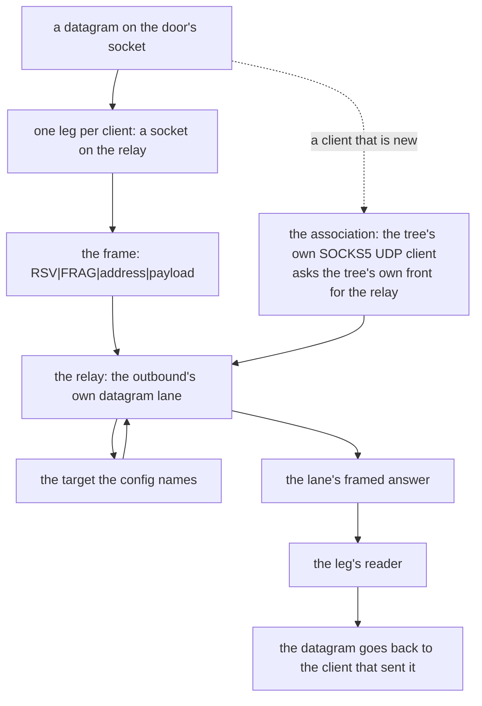

# dokodemo-door transparent inbound

Matrix row 24 of table A: a `dokodemo-door` inbound is a door, not a proxy. Every flow that arrives is rewritten to one target the config names — a TCP connection to it, a datagram through it — and the answer comes back to whoever sent it. The tcp half was already served; this slice adds the **udp** half, and the transparent redirect is refused by name rather than served as if it had been asked for.

## What the door does

The tcp flow is a plain rewrite: the accepted stream goes to `serve_connect` with the config's fixed target, over the same `Front::Socks` dial the `tun` front uses.

The udp flow is the same rewrite with a relay in the middle. A datagram arrives on the door's own socket, and it has to reach the outbound's datagram lane and come back to the client that sent it — so the door rides the lane over a **loopback SOCKS5 UDP association**: the tree's own SOCKS5 client (`ferrox_app::socks::associate`, the handshake the pinned Go client writes) asks the tree's own front (`serve_socks`) for the relay, and the front's datagram lane reads the relay from there.

The relay's address is not enough on its own: the lane answers *the address the request came from*, so one leg per client keeps the answers apart. Each client's leg is a socket connected to the relay; the door writes the framed datagram into the leg, and a reader on the leg sends the answer back to that client.

The door's own socket is bound by the front, before the inbound is armed, and the door's thread only reads from it. A datagram into a port nobody holds is answered with a refusal rather than with the door, so the port is held from the moment the config is served and a datagram that arrives before the door reads it waits in the kernel. A bind that fails leaves the udp half unarmed rather than armed and silent.

## Byte-identity

The association is the protocol's own handshake, not a private one: the greeting `[5, 1, 0]`, the method reply `[5, 0]`, the `UDP ASSOCIATE` request `[5, 3, 0, 1, 0, 0, 0, 0, 0, 0]` and the ten-byte reply that names the relay. Those bytes are the pinned Go client's own — `xray-core/proxy/socks/protocol.go`'s `ClientHandshake` — and the `socks` page's byte-identity check (`ferrox-core-socks::tests::the_client_writes_the_bytes_the_pinned_go_writes`) is the checker for them.

The datagram the door writes is the RFC 1928 frame: the two reserved bytes, the fragment byte, the address, the payload — the same frame the `socks` page's codec writes and the pinned Go `EncodeUDPPacket` writes.

## Data path



## Measured

<!-- counts:begin -->
| key | value | checked by |
| --- | --- | --- |
| ops-retired-instructions | UNBLESSED | scripts/count-ops.sh |
| datagrams-carrying-to-the-target | 1 | ferrox-app-proxy::tests::a_dokodemo_door_carries_a_datagram_to_its_target |
| associations-answering-with-the-relay | 1 | ferrox-app-proxy::tests::the_udp_association_carries_a_datagram_to_the_target |
| transparent-settings-refused | 2 | ferrox-app-proxy::tests::a_dokodemo_front_refuses_the_transparent_settings |
| xray-scenario-tests-passing | 2 | scripts/run-upstream-suite.sh |
<!-- counts:end -->

The datagram row is the shape: a datagram the door receives reaches the target the config names, and the answer comes back to the client that sent it. The association row is the wiring under it — the relay the lane reads from is named by the association's own reply, and a framed datagram through that relay reaches the target and comes back framed. The refusal row is the front's other half: `followRedirect` and `portMap` are refused by name, because the original destination is the kernel's to give and this tree asks for no such socket option. The scenario row is xray-core's own: `TestDokodemoTCP` and `TestDokodemoUDP` run against this tree unmodified through the `scripts/xray-scenarios.sh` seam, and the UDP one was red before this slice.

## Ops

```bash
./scripts/count-ops.sh report \
  proxy::tests::a_dokodemo_door_carries_a_datagram_to_its_target 'proxy::dokodemo_udp_door'
```

`UNBLESSED`, as above — macOS/aarch64 ships no `valgrind`, so this count is CI-only there and has not been read; it is not a number and is not quoted as one.

## Time

**Not measured yet.** Durations come from CI runners (`bench.yml`, `parity.yml`); no CI artefact has been read. `scripts/lib-matrix.sh` carries no dokodemo cell, so `bench.yml` and `compare.yml` gate nothing here, and a local dial would measure a tunnel rather than this code.

## What we removed

- **A private handshake between the device front and the lane.** The `tun` front and this door both need the outbound's datagram lane, and both reached it over a loopback pair whose two halves did not agree on the handshake: the client wrote a SOCKS5 greeting and a request and read twelve bytes, while the server side wrote the ten-byte reply and read nothing. The association is now one shape — the tree's own SOCKS5 UDP client asking the tree's own front — so the bytes on that loopback are the protocol's own, and the device front's production datagram lane works for the first time. `the_udp_association_carries_a_datagram_to_the_target` is the witness: the server half is the tree's own `serve_socks`, and a framed datagram through the relay reaches the target and comes back.
- **The door's own relay.** The door does not open a socket to the target and relay by itself; it rides the outbound's lane, so the datagram goes where the config's outbound says and the lane's framing is the one the rest of the tree already speaks.

## What was not removed

- **The transparent redirect is refused, not served.** `followRedirect` and `portMap` need the original destination, which lives in a socket option (`SO_ORIGINAL_DST` on Linux, TPROXY's mark) this tree asks for nothing; the `tun` front is the tree's transparent path, and it reads the destination off the packet header instead. A config naming either setting is refused by name — in the protobuf form the bridge already refused it, and now in the JSON form too, so neither dialect can read as served.
- **One leg per client, and a thread per leg.** The lane answers the address the request came from, so the answers can only be told apart by the source; a leg is that source. The cost is a socket and a thread per client address, reaped when the leg dies. A single socket with the client encoded in the frame would need the lane to carry a field the protocol does not have.
- **The datagram lane has no per-destination routing.** A datagram names its own destination, so a rule that could split an association refuses it (the socks front's own rule); the door's target is fixed, so this costs the door nothing.
- **The pb `streamSettings` on a receiver are still refused by name.** Every tls and reality scenario waits on that one, not on this row.
- **The syscalls and the copies are not counted.** A socket's read count cannot be gated by a loopback test, and the datagram's copies are the relay's own; no local check counts either, so the page names no number for them.
- **The router's protobuf app is still dropped**, so `TestSocksBridageUDPWithRouting` stays red: the rules never reach the tree from the pinned config.

## Pins

| what | where |
| --- | --- |
| the door's own request and its reply | `upstream/xray-core/proxy/dokodemo/dokodemo.go` |
| the config the pinned suite writes | `upstream/xray-core/proxy/dokodemo/config.proto` |
| the JSON spelling of that config | `upstream/xray-core/infra/conf/dokodemo.go` |
| the association's handshake and its datagram frame | `upstream/xray-core/proxy/socks/protocol.go` |
| the device front that rides the same relay | `upstream/zeronet/crates/zero-tun` |

## CI scope

What a change here owes, read by `scripts/ci-scope.py`; see [`docs/ci-scope.md`](../ci-scope.md).

<!-- scope:begin -->
- paths: -
- symbols: dokodemo_udp_door, dokodemo_target, dokodemo_networks, udp_association, relay_leg
- go: ./proxy/dokodemo/...
<!-- scope:end -->
