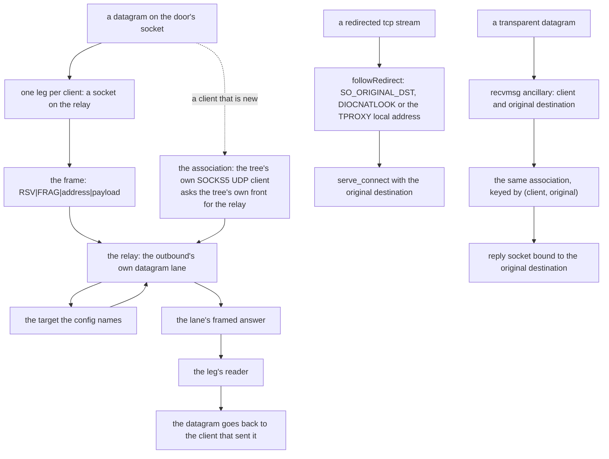

# dokodemo-door transparent inbound

Matrix row 24 of table A: a `dokodemo-door` inbound is a door, not a proxy. Every flow that arrives is rewritten to one target the config names — a TCP connection to it, a datagram through it — and the answer comes back to whoever sent it. The tcp and udp rewrites and the JSON `portMap` table were already served; this slice adds the protobuf `portMap` bridge, `followRedirect` over the kernel's original destination, the TPROXY listener and Linux UDP reply socket, and the inbound `finalmask` tcp chain.

xray registers `tunnel` as another name for the same handler, and a config written with either serves the door (`upstream/xray-core/infra/conf/xray.go:27-53`).

## What the door does

Without `followRedirect`, the tcp flow is a rewrite: the accepted stream goes to `serve_connect` with the config's fixed target, over the same `Front::Socks` dial the `tun` front uses. A `portMap` entry for the flow's own listener port replaces that target for the flow, and a miss keeps the config's address.

With `followRedirect`, the target is the kernel's. A bare `followRedirect` is xray's `REDIRECT` lookup (`SO_ORIGINAL_DST` on Linux, `DIOCNATLOOK` on macOS); a named `streamSettings.sockopt.tproxy` keeps its mode. `TPROXY` takes the accepted socket's local address, because the kernel rewrote it to the original destination. A destination equal to the listener's own address is the loopback xray closes: a direct connection to the door is not a redirected flow. If the lookup fails, a complete configured rewrite target is the fallback; `portMap` is bypassed in this mode, as it is in xray.

The udp flow is the same rewrite with a relay in the middle. A datagram arrives on the door's own socket, and it has to reach the outbound's datagram lane and come back to the client that sent it — so the door rides the lane over a **loopback SOCKS5 UDP association**: the tree's own SOCKS5 client (`ferrox_app::socks::associate`, the handshake the pinned Go client writes) asks the tree's own front (`serve_socks`) for the relay, and the front's datagram lane reads the relay from there.

The relay's address is not enough on its own: the lane answers *the address the request came from*, so one leg per client keeps the answers apart. Each client's leg is a socket connected to the relay; the door writes the framed datagram into the leg, and a reader on the leg sends the answer back to that client.

A Linux transparent udp door binds with `IP_TRANSPARENT` and `IP_RECVORIGDSTADDR` (`IPV6_RECVORIGDSTADDR` for v6) and reads each datagram with `recvmsg`: the ancillary data names the destination the sender really used, and the reply leaves from a socket bound to that destination. Legs are keyed by `(client, original destination)`, so two flows from one client to different addresses keep their answers apart.

The door's own socket is bound by the front, before the inbound is armed, and the door's thread only reads from it. A datagram into a port nobody holds is answered with a refusal rather than with the door, so the port is held from the moment the config is served and a datagram that arrives before the door reads it waits in the kernel. A bind that fails leaves the udp half unarmed rather than armed and silent.

## Byte-identity

The association is the protocol's own handshake, not a private one: the greeting `[5, 1, 0]`, the method reply `[5, 0]`, the `UDP ASSOCIATE` request `[5, 3, 0, 1, 0, 0, 0, 0, 0, 0]` and the ten-byte reply that names the relay. Those bytes are the pinned Go client's own — `xray-core/proxy/socks/protocol.go`'s `ClientHandshake` — and the `socks` page's byte-identity check (`ferrox-core-socks::tests::the_client_writes_the_bytes_the_pinned_go_writes`) is the checker for them.

The datagram the door writes is the RFC 1928 frame: the two reserved bytes, the fragment byte, the address, the payload — the same frame the `socks` page's codec writes and the pinned Go `EncodeUDPPacket` writes. The transparent path changes the frame's address, not its shape.

## Data path



## Measured

<!-- counts:begin -->
| key | value | checked by |
| --- | --- | --- |
| ops-retired-instructions | UNBLESSED | scripts/count-ops.sh |
| datagrams-carrying-to-the-target | 1 | ferrox-app-proxy::tests::a_dokodemo_door_carries_a_datagram_to_its_target |
| datagram-frame-allocations-per-frame | 0 | ferrox-app-proxy::tests::a_forwarded_datagram_is_the_frame_the_client_framed |
| associations-answering-with-the-relay | 1 | ferrox-app-proxy::tests::the_udp_association_carries_a_datagram_to_the_target |
| transparent-modes-decoded | 4 | ferrox-app-proxy::tests::dokodemo_transparency_reads_follow_and_tproxy |
| loopback-destinations-classified | 4 | ferrox-app-proxy::tests::dokodemo_loopback_is_the_listener_or_its_loopback_port |
| redirect-fallbacks-classified | 4 | ferrox-app-proxy::tests::dokodemo_redirect_uses_the_kernel_or_the_rewrite |
| protobuf-port-map-fields-decoded | 1 | ferrox-app-proxy::tests::a_dokodemo_port_map_decodes |
| protobuf-follow-redirect-fields-decoded | 1 | ferrox-app-proxy::tests::a_dokodemo_follow_redirect_decodes |
| xray-scenario-tests-passing | 2 | scripts/run-upstream-suite.sh |
<!-- counts:end -->

The datagram row is the shape: a datagram the door receives reaches the target the config names, and the answer comes back to the client that sent it. The frame row is what the door's own frame costs: the frame the door writes is the lane's buffer and the framing allocates nothing, so a datagram through the door costs no heap buffer of its own (the `socks` page's witness, `a_forwarded_datagram_is_the_frame_the_client_framed`, is the one that sees it). The association row is the wiring under it — the relay the lane reads from is named by the association's own reply, and a framed datagram through that relay reaches the target and comes back framed.

The transparent rows are the new surface. `dokodemo_transparency_reads_follow_and_tproxy` pins the four combinations of `followRedirect` and a named mode: a bare follow becomes `REDIRECT`, a named `TPROXY` or `REDIRECT` is kept, and no follow with no mode asks for no transparent socket. `dokodemo_loopback_is_the_listener_or_its_loopback_port` pins the four loopback outcomes: a wildcard listener closes another local address on its own port, keeps a different port, an exact listener address closes, and a named destination is never a loopback. `dokodemo_redirect_uses_the_kernel_or_the_rewrite` pins the fallback order: a failed lookup keeps the configured rewrite, no rewrite at all closes, a successful lookup wins, and a loopback answer closes even when a rewrite exists. The two protobuf rows pin the bridge's field numbers: `portMap` decodes into the JSON table, and `followRedirect` decodes to the switch the door reads; a miss in either is the reference's false/empty, not a refusal.

The scenario row is xray-core's own: `TestDokodemoTCP` and `TestDokodemoUDP` run against this tree unmodified through the `scripts/xray-scenarios.sh` seam. The reference suite has no `FollowRedirect` or TPROXY scenario, so those rows are unit-gated here and the Linux kernel behaviour is CI only.

Syscalls: a non-follow datagram is one `recvfrom(2)` and one `sendto(2)` per datagram on the door socket, and one `send(2)`/`recv(2)` per datagram on the leg; a transparent datagram is one `recvmsg(2)` carrying the ancillary destination, one `sendto(2)` on the reply socket bound to that destination, and one `bind(2)` per new `(client, original)` leg. A redirected tcp stream adds one `getsockopt(2)` (`SO_ORIGINAL_DST`) or one `ioctl(2)` (`DIOCNATLOOK`); TPROXY adds none. A loopback test cannot gate a syscall total, so no row claims one; the shape is prose.

## Ops

```bash
./scripts/count-ops.sh report \
  proxy::tests::a_dokodemo_door_carries_a_datagram_to_its_target 'proxy::dokodemo_udp_door'
```

`UNBLESSED`, as above — macOS/aarch64 ships no `valgrind`, so this count is CI-only there and has not been read; it is not a number and is not quoted as one.

## Time

**Not measured yet.** Durations come from CI runners (`bench.yml`, `parity.yml`); no CI artefact has been read. `scripts/lib-matrix.sh` carries no dokodemo cell, so `bench.yml` and `compare.yml` gate nothing here, and a local dial would measure a tunnel rather than this code.

## What we removed

- **A private handshake between the device front and the lane.** The `tun` front and this door both need the outbound's datagram lane, and both reached it over a loopback pair whose two halves did not agree on the handshake: the client wrote a SOCKS5 greeting and a request and read twelve bytes, while the server side wrote the ten-byte reply and read nothing. The association is now one shape — the tree's own SOCKS5 UDP client asking the tree's own front — so the bytes on that loopback are the protocol's own, and the device front's production datagram lane works for the first time. `the_udp_association_carries_a_datagram_to_the_target` is the witness: the server half is the tree's own `serve_socks`, and a framed datagram through the relay reaches the target and comes back.
- **The door's own relay.** The door does not open a socket to the target and relay by itself; it rides the outbound's lane, so the datagram goes where the config's outbound says and the lane's framing is the one the rest of the tree already speaks.
- **A frame buffer per datagram.** The door built the frame it writes in a buffer of its own, allocated for that datagram. The frame is the door's now — one buffer for the door's life, its capacity held across the datagrams it carries — and the framing itself allocates nothing.
- **The refusal of `followRedirect` and the protobuf `portMap` entry.** Both were refused by name because the original destination had no path here and the bridge did not decode the table. The JSON dialect already carried the table; the protobuf entry now decodes it. The original destination is a kernel lookup on Linux and macOS, and the listener, UDP socket and reply socket ask for the exact options the reference asks for. The refusal rows are gone rather than left beside the served path.
- **A second transparent stack.** The door does not grow a packet-level redirect or a userspace TCP stack. The kernel gives the original destination; the door hands that destination to the same `serve_connect`/association every other front uses.

## What was not removed

Named rather than claimed, with the worst input worked out first:

- **A non-follow door still refuses a config with no rewrite target.** xray fills a missing address and port from the accepted connection's local address (`dokodemo.go`'s `dokodemo.go:86-102`); this tree still requires both for the non-follow path. The follow path does serve with no rewrite target, because the kernel supplies the destination. The fallback is its own slice, not claimed here.
- **The `portMap` spelling is host:port.** The reference's `Build` validates each value with `net.SplitHostPort`, then applies the host and port independently, so `":9090"` and `"10.0.0.1:"` override one half. This tree's parser requires both halves and does not strip brackets from a bracketed IPv6 host. A map entry that names both halves works; the partial spellings are named open.
- **The transparent modes are Linux and macOS only, and only Linux carries transparent udp.** `TPROXY` is Linux; `REDIRECT` is Linux's `SO_ORIGINAL_DST` and macOS's `/dev/pf`; Windows has no arm here, so a config that names a transparent mode is refused by name on Windows rather than served silently. macOS has the tcp lookup but no `FakeUDP` analogue, matching the reference's `fakeudp_other.go`, so a macOS transparent udp half is unarmed.
- **The loopback classifier is the address, not the interface table.** xray's `IsLocal` enumerates every interface address. This tree treats loopback, unspecified, and an address a zero-port UDP bind accepts as local, which is the same set for a host's ordinary addresses; an interface address that cannot be bound this way is a named difference.
- **One leg per client, and a thread per leg.** The lane answers the address the request came from, so the answers can only be told apart by the source; a leg is that source. The cost is a socket and a thread per client address, reaped when the leg dies. A single socket with the client encoded in the frame would need the lane to carry a field the protocol does not have.
- **The transparent UDP reply socket is per flow, not pooled.** Each new `(client, original)` binds a reply socket; a pooled socket per original would save the bind for a second client to the same destination, but it would also share the reply port across sockets whose lifetimes differ. The bind is per flow and named, not hidden.
- **The datagram lane has no per-destination routing.** A datagram names its own destination, so a rule that could split an association refuses it (the socks front's own rule); the door's target is fixed, so this costs the door nothing.
- **The pb `userLevel` is still refused by number.** The reference reads it as a policy level; this front has no account for the door's flows, so the bridge refuses the field rather than dropping it. `streamSettings` on a receiver does decode to the network and security this tree's JSON dialect spells, so the tls and reality scenarios reach the door instead of stopping at the receiver.
- **The tcp mask carries `fragment` only.** A `finalmask.tcp` fragment list wraps the accepted stream; the other tcp stages are not carried here, as the `finalmask` page names.
- **The syscalls and the copies are not counted.** A loopback transaction cannot gate a syscall total, and the datagram's copies are the relay's own; no local check counts either, so the page names no number for them.

## Pins

| what | where |
| --- | --- |
| the door's own request and its reply | `upstream/xray-core/proxy/dokodemo/dokodemo.go` |
| the config the pinned suite writes | `upstream/xray-core/proxy/dokodemo/config.proto` |
| the JSON spelling of that config | `upstream/xray-core/infra/conf/dokodemo.go` |
| the original-destination lookup and the tproxy listener | `upstream/xray-core/app/proxyman/inbound/worker.go` |
| the socket options per host | `upstream/xray-core/transport/internet/sockopt_linux.go`, `sockopt_darwin.go` |
| the association's handshake and its datagram frame | `upstream/xray-core/proxy/socks/protocol.go` |
| the compact transparent socket layer | `upstream/zeronet/crates/zero-net/src/transparent.rs` |
| the device front that rides the same relay | `upstream/zeronet/crates/zero-tun` |

## CI scope

What a change here owes, read by `scripts/ci-scope.py`; see [`docs/ci-scope.md`](../ci-scope.md).

<!-- scope:begin -->
- paths: crates/ferrox-app/src/transparent.rs
- symbols: dokodemo_udp_door, dokodemo_transparent_udp_door, dokodemo_target, dokodemo_networks, dokodemo_original_destination, dokodemo_loopback, dokodemo_transparent, dokodemo_port_map, udp_association, relay_leg, original_destination, inbound_tproxy
- go: ./proxy/dokodemo/...
<!-- scope:end -->
