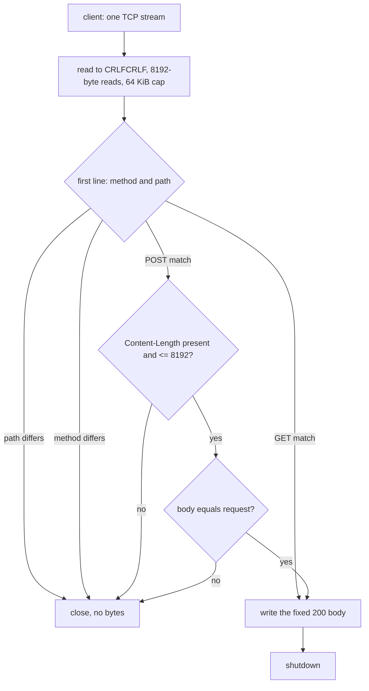

# The healthcheck inbound

<!-- scope:begin -->
- paths: -
- symbols: serve_hc_inbound, HcHandler, hc_content_length
- scenarios: vless-raw, vmess-raw, trojan-raw, shadowsocks-raw
<!-- scope:end -->
Row 149's front half: a `hc` inbound answers one HTTP path with one fixed body, so a remote urltest or `leastPing` probe can ask "is this server up?" without a real destination. The config is Leaf's shape:

```json
{"protocol": "hc", "settings": {"path": "/health", "request": "optional body", "response": "ok"}}
```

`path` and `response` are required; `request` is optional. The inbound binds TCP on its `listen`/`port` like every other front. `GET path` is the expected request when `request` is absent; when it is present the expected method is `POST` and the body must equal `request` exactly. The answer is fixed, whatever the request headers after the first line are:

```
HTTP/1.1 200 OK
Content-Length: <response bytes>
Content-Type: text/plain
Connection: close

<response>
```

A path mismatch, a method mismatch, or a POST body mismatch closes the connection with no bytes. A request head over 64 KiB also closes. This is the reference's refusal behavior minus its random delay before the close: a gate that holds a socket for up to ten seconds is a denial-of-service surface, so this tree closes at once and reports the close. The difference is timing only; the bytes a successful peer sees are the reference's.

## Data path



## The exchange

The reader keeps one growing head buffer and one 8192-byte read buffer. It stops at the first `\r\n\r\n`, keeps whatever bytes followed as the body's prefix, and reads the rest of the declared `Content-Length`. The length is read case-insensitively from any header line; a POST with no length, a zero length, or a length over 8192 closes without reading a body, exactly as the reference leaves the body empty in those cases. The successful answer is one prebuilt byte string and one write; the body is the configured string, not a value built from the request.

## What was removed

- **The per-request answer allocation.** The reference formats the response on every successful probe; this tree formats it once when the inbound is built and writes that same buffer, so an answer allocates nothing.
- **A body buffer beyond the configured signature.** The reference allocates a fresh `Vec` in each remaining-body read; this tree reuses one 8192-byte stack read buffer and appends into the body it already has, so a POST body costs the body vector and no per-read allocation. The head grows only as far as the request sends it; a 64 KiB cap ends a peer that never sends the terminator.
- **A per-connection copy of the configured strings.** The path, request and prebuilt answer are built once into an `HcHandler`, and each accepted stream takes one `Arc` reference to it instead of cloning three `String`s and reparsing the settings block.
- **The reference's failure delay.** Named under "what was not removed" instead: the random delay before a refused close is not carried. It changes no successful response and no refusal byte, but it does change how long a refused socket lives.

What was not removed: the inbound still accepts one connection per probe and closes it after one answer; it does not keep a connection pool. A malformed request is still read up to 64 KiB before the close, as the reference's `read_until_eoh` is.

## Time

No duration is claimed. The answer is one write of a fixed string; benchmarks are CI-only and no matrix cell names this front. The refusal path is bounded by the client's request and the 64 KiB cap, not by a timer.

## Measured

<!-- counts:begin -->
| key | value | checked by |
| --- | --- | --- |
| ops-retired-instructions | UNBLESSED | scripts/count-ops.sh |
| answer-allocations | 0 | ferrox-app-proxy::hc_tests::an_hc_answer_is_prebuilt_without_allocating |
| answer-bytes | 85 | ferrox-app-proxy::hc_tests::an_hc_answer_is_prebuilt_without_allocating |
<!-- counts:end -->

`an_hc_answer_is_prebuilt_without_allocating` reads the answer for the empty-body `"ok"` case under `ferrox_core::alloc_count`: zero allocations, 85 bytes including the response head and the body. The returned slice starts at the handler's own buffer, that pointer and the buffer's capacity do not change across reads, so a copy or a reallocation fails the identity assertions; a changed header or body fails the byte count. The GET and POST round trips are gated by `an_hc_get_answers_the_configured_body_after_the_exact_path` and `an_hc_post_checks_the_body_and_a_mismatch_answers_nothing`, which assert the exact bytes and the empty refusal.

## Pins

| what | where |
| --- | --- |
| settings shape, request parsing, body rule, response bytes, refusal delay | `upstream/leaf/leaf/src/proxy/hc/inbound/{mod.rs,stream.rs}` |
| JSON settings | `upstream/leaf/leaf/src/config/common.rs` |
| registration | `upstream/leaf/leaf/src/app/inbound/manager.rs` |

## CI scope

What a change here owes, read by `scripts/ci-scope.py`; see [`docs/ci-scope.md`](../ci-scope.md).

No pinned suite drives a `hc` inbound: Leaf's tests are in-process and no `testing/scenarios` cell names it. The scenarios above are the relay cells that must keep starting while the front exists; the exact answer and refusal are local tests.
