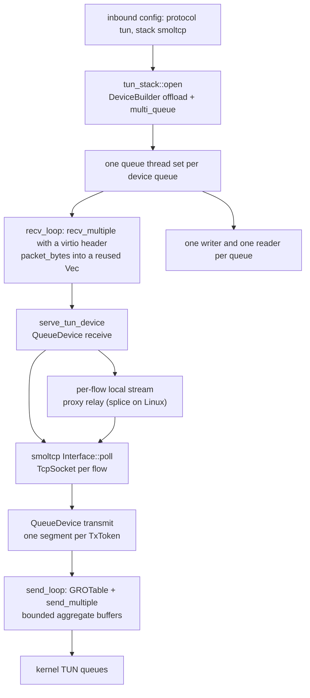
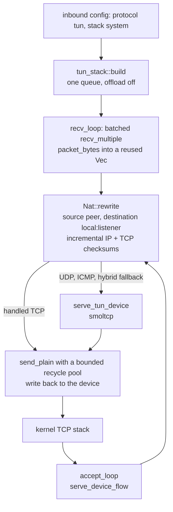

# TUN stacks (system, userspace, hybrid)

A `tun` inbound with no `stack` setting, or `stack: "smoltcp"` / `"userspace"`, opens the device through `tun-rs` and terminates TCP in a userspace `smoltcp` interface. On Linux the device is multi-queue when `queues` exceeds one and setup succeeds; non-Linux platforms and `queues: 1` use one queue. Each queue is one reader, one smoltcp server stack and one writer, so flows hash across queues without a lock between them when more than one queue is active. The device negotiates virtio GSO/GRO when the platform offers it. A flow still reaches the proxy machinery through the same per-flow local stream every other front uses.

On Linux, `stack: "system"` hands TCP to the kernel instead. It binds a listener on the TUN address and rewrites an outgoing SYN onto a second address inside the prefix and an allocated port on that listener, updating the IP and TCP checksums incrementally over the changed addresses and ports before writing it back to the device. The kernel completes the handshake, owns the receive window and retransmits, and `accept_loop` relays each accepted stream through the same per-flow proxy seam. UDP and ICMP stay on the userspace stack. `stack: "hybrid"` adds one rule: a TCP packet the NAT loop cannot map (a non-SYN segment with no mapping, an exhausted NAT table) goes to the userspace stack instead of being dropped, and a failed system setup warns once and takes the whole inbound to userspace. A flow handed to the userspace stack stays there until a FIN or RST releases it, so a retransmitted SYN cannot be claimed by the kernel after NAT capacity returns. `system` and `hybrid` open one queue with virtio offload off, and need a prefix with a second address — IPv4 /30 or wider, IPv6 /126 or wider; a narrower prefix is an error for `system` and a userspace fallback for `hybrid`. On non-Linux platforms `system` is refused and `hybrid` warns and uses userspace.

`stack: "loopback"` keeps the native packet handler in `docs/function/front-tun.md` as the fallback for an IPv4 or IPv6 address. An unknown stack name warns once and takes the userspace path rather than silently changing protocol.

## Data path

The system path replaces the smoltcp TCP hop for a handled flow:

## Measured

<!-- counts:begin -->
| key | value | checked by |
| --- | --- | --- |
| ops-retired-instructions | 32598 | scripts/count-ops.sh |
| syscalls-per-tun-packet | UNBLESSED | no syscall checker yet |
| user-space-copies-per-tun-packet | UNBLESSED | no copy checker yet |
| time-tcp-down-1 | ferrox=13.694Gbit/s,zeptun=24.779Gbit/s,ratio=0.55 | tun-bench.yml |
| time-tcp-down-10 | ferrox=20.155Gbit/s,zeptun=37.995Gbit/s,ratio=0.53 | tun-bench.yml |
| time-tcp-up-1 | ferrox=18.249Gbit/s,zeptun=25.497Gbit/s,ratio=0.72 | tun-bench.yml |
| time-tcp-up-10 | ferrox=21.682Gbit/s,zeptun=34.407Gbit/s,ratio=0.63 | tun-bench.yml |
| time-rr | ferrox=8777tps,zeptun=20447tps,ratio=0.43 | tun-bench.yml |
| time-rr-8x1k | ferrox=57098tps,zeptun=113654tps,ratio=0.50 | tun-bench.yml |
| time-udp-100k | ferrox=96226pps,zeptun=99950pps,ratio=0.96 | tun-bench.yml |
| cpu-cores-at-tcp-down-10 | ferrox=2.9cores,zeptun=1.8cores | tun-bench.yml |
| rss-mb-at-ten-flows | ferrox=74MB,zeptun=5MB | tun-bench.yml |
| writes-after-a-refused-packet | 2 | ferrox-app-tun-stack::tests::a_refused_packet_is_dropped_and_the_next_still_goes_out |
<!-- counts:end -->

`scripts/count-ops.sh` measures `Nat::rewrite` over the payload lengths in `a_rewrite_keeps_the_checksum_of_every_payload_length`; no pointer-identity or copy-count checker yet covers this path, so the syscall and copy rows stay open. The writer copies each smoltcp segment into an aggregate buffer; the reader hands each device slot to the stack without a copy, and `a_received_slot_keeps_its_allocation` holds its base pointer and capacity fixed. The `time-*` rows measure the userspace stack; no `system` or `hybrid` row has been measured, so this page makes no speed claim for either.

## Time

The `time-*` rows above are the same-run `tun-bench.yml` cells; a later single-engine run is host-sensitive, so the same-run ratios are the comparable figure. The `cpu-*` and `rss-*` rows name the remaining gap: stack CPU, not the device. No duration outside those rows is claimed.

## What we removed

Against the native handler the userspace path removes the hand-written TCP reassembly and the single-queue limit: `smoltcp` supplies retransmit, receive windows and congestion control, and `tun-rs` supplies multi-queue and GSO/GRO. The writer batches a queue's segments so GRO can coalesce same-flow packets into one aggregate, and the reader asks for a batch instead of one packet per syscall. The `tun` config keeps one stack knob (`smoltcp`, `userspace`, `system`, `hybrid`, `loopback`) instead of growing a second inbound protocol. The system path removes smoltcp's TCP state machine from the handled flow: the kernel owns the handshake and retransmits, and the userspace stack keeps only UDP, ICMP and (under hybrid) the flows the kernel cannot take. That is one packet rewrite and an incremental checksum update over the changed addresses and ports, not a second userspace TCP implementation. The changed words are folded into one delta, so the IPv4 header and TCP checksum each take one `checksum_update` call instead of one per field.

The kernel can refuse a whole packet — `EMSGSIZE` when the MTU moved under the stack, `EINVAL` when the packet no longer matches the device's format — and one refusal used to end the queue's writer, taking every uploading flow with it. Both writers now classify the error: a refusal drops that packet and the loop keeps reading, while any other error still marks the device failed. The Linux batch path already attempts every buffer inside `send_multiple` and reports the last error, so a refused batch leaves the other packets written and the loop running. `a_refused_packet_is_dropped_and_the_next_still_goes_out` holds the first half (two writes, the second packet delivered) and `a_dead_descriptor_still_stops_the_send_loop` the second (one write, the device marked failed).

Against the pinned references, xray-core and sing-box open the platform device and hand packets to their configured stack, ZeroNet's zero-tun is its own device wrapper, and this tree's native handler remains the `loopback` fallback. None of those references carries this per-queue smoltcp server, so the comparison is the same-run Time rows rather than a removed pass; this page does not claim their code was removed. What is not removed is the userspace stack's per-byte copying, priced in the rows above.

## What was not removed

- **The userspace stack itself.** `smoltcp` per-socket receive and send buffers still copy every byte: `smoltcp` copies from the device slot into the socket ring, the pump copies to the local stream, and the writer copies into the aggregate. The device read no longer copies the slot. The reference's custom stack does less of that; this is the measured CPU gap, not a device limitation. `system` and `hybrid` still keep that stack alive for UDP and ICMP, so they do not remove it.
- **The system path's copies.** A handled TCP packet is parsed, rewritten in place and written back to the device, and the payload is still copied there; the accepted flow then copies through the relay pair like every other front. The checksum pass over the segment is gone, but no pointer-identity or copy-count checker covers the remaining copies yet, so it stays out of the Measured table.
- **System-mode offload and multi-queue.** The kernel path opens one queue and leaves virtio GSO/GRO off; `queues > 1` warns once and runs one queue. No benchmark says the single-queue kernel path is faster or slower than the userspace multi-queue path.
- **The native handler.** It remains the path for `stack: "loopback"` with an IPv4 or IPv6 address; a failed userspace open returns its error instead of falling back. Its page stays the description of that path.
- **Per-flow buffers and relay threads.** A flow still owns a pair of fixed smoltcp socket buffers and the relay's local pair; the RSS row above carries the post-flow cost. Reducing the buffers is a tuning cell, not a proven win yet.
- **The download scale cell.** The larger download cell does not reach the reference; the ratio row above is the claim. The gap is open and is not claimed as done.
- **UDP lane scheduling.** The UDP cell has varied across runners; no lane change is claimed until a focused repeat separates variance from a limit.

## Pins

| what | where |
| --- | --- |
| the device API, multi-queue, GSO and GRO | `tun-rs` 2.8.18 (`platform/linux/device.rs`, `platform/linux/offload.rs`) |
| the TCP state machine and socket buffers | `smoltcp` 0.14 |
| the stack tuning reference | `upstream/zeptun/src/stack/tcp.zig`, `src/engine.zig` |
| the native fallback | `docs/function/front-tun.md`, `crates/ferrox-app/src/tun.rs` |
| the system NAT loop, accepted flow and relay | `crates/ferrox-app/src/tun_system.rs` |
| the kernel-TCP stack shape | `upstream/zeptun/src/stack/system.zig`, `upstream/zeptun/src/flow/nat.zig` |

## CI scope

What a change here owes, read by `scripts/ci-scope.py`; see [`docs/ci-scope.md`](../ci-scope.md).

<!-- scope:begin -->
- paths: crates/ferrox-app/src/tun_stack.rs, crates/ferrox-app/src/tun_system.rs
- symbols: tun_stack, tun_system
<!-- scope:end -->
