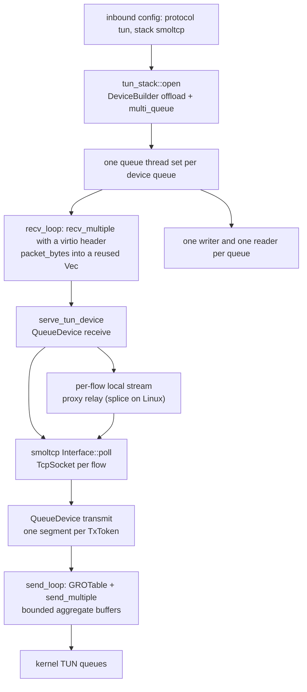

# TUN userspace stack (tun-rs + smoltcp)

A `tun` inbound with no `stack` setting, or `stack: "smoltcp"` / `"userspace"`, opens the device through `tun-rs` and terminates TCP in a userspace `smoltcp` interface. The kernel device is multi-queue and negotiates virtio GSO/GRO when the platform offers it; each queue is one reader, one smoltcp server stack and one writer, so flows hash across cores without a lock between them. A flow still reaches the proxy machinery through the same per-flow local stream every other front uses.

`stack: "loopback"` keeps the native packet handler in `docs/function/front-tun.md` as the fallback. An unknown stack name warns once and takes the userspace path rather than silently changing protocol.

## Data path

## Measured

<!-- counts:begin -->
| key | value | checked by |
| --- | --- | --- |
| ops-retired-instructions | UNBLESSED | scripts/count-ops.sh |
<!-- counts:end -->

No pointer-identity row yet covers this path: the writer copies each smoltcp segment into an aggregate buffer, and the reader copies each device packet into a stack slot. The rows above name only what the current tests observe, so the operation count stays an open claim rather than a number.

## Time

Measured in CI, `tun-bench.yml` artefact `tun-bench-42379982423` (repeat 2, queues 4, MTU 1500), same runner for both engines:

| cell | ferrox | zeptun-userspace | ratio |
| --- | ---: | ---: | ---: |
| tcp-down-1 | 9.883 Gbit/s | 17.937 Gbit/s | 0.55 |
| tcp-down-10 | 14.309 Gbit/s | 23.950 Gbit/s | 0.60 |
| tcp-up-1 | 12.860 Gbit/s | 20.331 Gbit/s | 0.63 |
| tcp-up-10 | 15.854 Gbit/s | 26.821 Gbit/s | 0.59 |
| rr | 6 581 tps | 11 504 tps | 0.57 |
| rr-8x1k | 38 261 tps | 64 001 tps | 0.60 |
| udp-100k | 99 920 pps | 99 962 pps | 1.00 |

A later single-engine run reached 18.8 Gbit/s down-1, so the cell is host-sensitive; the same-run ratios above are the comparable figure. The remaining gap is stack CPU, not the device: ferrox burns roughly 2.9 cores for 14 Gbit/s where the reference burns 1.7, and its RSS is 60–75 MB against the reference's 2–8 MB.

## What we removed

Against the native handler the userspace path removes the hand-written TCP reassembly and the single-queue limit: `smoltcp` supplies retransmit, receive windows and congestion control, and `tun-rs` supplies multi-queue and GSO/GRO. The writer batches a queue's segments so GRO can coalesce same-flow packets into one aggregate, and the reader asks for a batch instead of one packet per syscall. The `tun` config keeps one stack knob (`smoltcp`, `userspace`, `loopback`) instead of growing a second inbound protocol.

## What was not removed

- **The userspace stack itself.** `smoltcp` per-socket receive and send buffers still copy every byte: the device read copies into a stack slot, `smoltcp` copies into the socket ring, the pump copies to the local stream, and the writer copies into the aggregate. The reference's custom stack does less of that; this is the measured CPU gap, not a device limitation.
- **The native handler.** It is still the fallback for `stack: "loopback"` and for a failed `tun-rs` open. Its page stays the description of that path.
- **Per-flow buffers and relay threads.** A flow still owns two 1 MiB smoltcp buffers and the relay's local pair; RSS after ten flows is 60–75 MB. Reducing the buffers is a tuning cell, not a proven win yet.
- **The download scale cell.** `tcp-down-10` reaches 0.60 of the reference while `tcp-down-1` reaches 0.55 here; neither is 1.2×. The gap is open and is not claimed as done.
- **UDP lane scheduling.** The UDP cell is at 1.00 in this run but has varied between 56% and 100% across runners; no lane change is claimed until a focused repeat separates variance from a limit.

## Pins

| what | where |
| --- | --- |
| the device API, multi-queue, GSO and GRO | `tun-rs` 2.8.18 (`platform/linux/device.rs`, `platform/linux/offload.rs`) |
| the TCP state machine and socket buffers | `smoltcp` 0.14 |
| the stack tuning reference | `upstream/zeptun/src/stack/tcp.zig`, `src/engine.zig` |
| the native fallback | `docs/function/front-tun.md`, `crates/ferrox-app/src/tun.rs` |

## CI scope

What a change here owes, read by `scripts/ci-scope.py`; see [`docs/ci-scope.md`](../ci-scope.md).

<!-- scope:begin -->
- paths: crates/ferrox-app/src/tun_stack.rs
- symbols: tun_stack
<!-- scope:end -->
