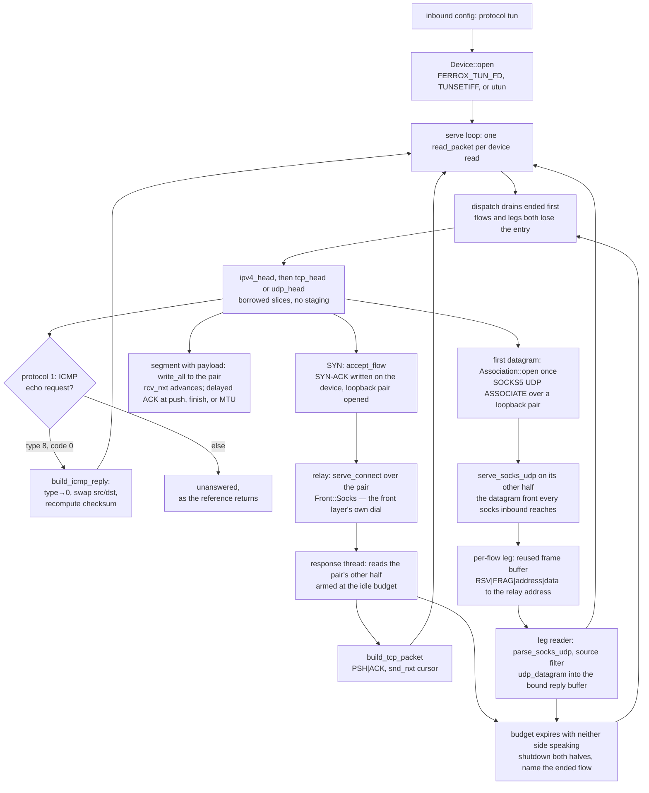

# TUN device inbound (native)

A `tun` inbound opens a virtual network device and reads raw IPv4 packets off it; every TCP flow the packets form becomes a proxy dial through the machinery the tree already had, every UDP flow becomes a datagram dial through the SOCKS5 UDP association the same front layer serves, an ICMP echo request is answered as the device's own destination would rather than dropped, and the bytes that come back leave again as IP packets on the same descriptor. Both roles the row has are served and both are proved: device-to-dial and dial-to-device. A flow also *ends*: the response read is armed at the idle budget, so a peer that stops speaking hands its thread, its pair and the relay leg it holds back instead of parking them for the life of the process.

A device carries no wire byte-stream to diff, so this row's identity claim is the (target, payload) dial set: the pairs the inbound produces from a pinned packet stream must equal the pairs the pinned reference stack produces from it. The oracle is `scripts/tun-oracle` — smoltcp 0.12, the userspace stack the pinned zero-tun crate builds on — run over `script.txt`, and `the_dial_set_matches_the_pinned_stream` diffs the handler's own dials against the golden `expected.txt` that run recorded. The convention the golden pins (dial on handshake, deliver the reassembled payload in order, EOF at FIN) is also what xray's `proxy/tun/tcp_lightweight.go` reaches at `input`, `receive` and `ReadMultiBuffer`, and the SYN-ACK numbers follow its `newTCPConn` rule. The datagram half now rides the same oracle: `scripts/tun-oracle` also binds smoltcp's UDP socket and records the (target, datagram) set the reference stack delivers from `script.txt`, and `the_datagram_dial_set_matches_the_pinned_stream` diffs the (target, datagram) pairs the inbound hands its association against that golden. So the cases where UDP and TCP part ways — two bodies to one port staying two dials rather than one concatenated stream, a body shaped like a frame header surviving verbatim, an odd length delivered whole — are pinned against the reference run, not merely against the RFC 1928 frame `a_datagram_flow_frames_the_association_and_returns_the_echo` already asserts byte-for-byte.

The platform opens are Linux (`/dev/net/tun` + `TUNSETIFF`, `IFF_TUN|IFF_NO_PI` so no protocol-info header to strip), macOS (`AF_SYSTEM` utun control channel) and an inherited descriptor (`FERROX_TUN_FD`) — zero-tun's `inherited.rs` seam, which is also the only path a CI runner or a test can exercise, since no runner holds `CAP_NET_ADMIN`. The privileged opens are compile-checked only, and the tests drive an `AF_UNIX` `SOCK_DGRAM` socketpair through the same `read_packet`/`write_packet` pair the device does — datagram because a TUN delivers whole packets, and `SOCK_SEQPACKET` does not exist on macOS.

## Data path



## Measured

<!-- counts:begin -->
| key | value | checked by |
| --- | --- | --- |
| ops-retired-instructions | UNBLESSED | scripts/count-ops.sh |
| dial-set-flows-matching-the-pinned-stack | 3 | ferrox-app-tun::tests::the_dial_set_matches_the_pinned_stream |
| reverse-role-response-round-trips | 1 | ferrox-app-tun::tests::the_response_bytes_come_back_as_ip_packets |
| parse-copies-per-packet | 0 | ferrox-app-tun::tests::the_payload_is_borrowed_from_the_read_buffer |
| flows-handed-back-at-the-idle-budget | 2 | ferrox-app-tun::tests::a_quiet_tun_flow_hands_its_threads_back |
| datagram-association-round-trips | 1 | ferrox-app-tun::tests::a_datagram_flow_frames_the_association_and_returns_the_echo |
| datagram-parse-copies-per-packet | 0 | ferrox-app-tun::tests::the_datagram_is_borrowed_from_the_read_buffer |
| datagram-reply-packets-checksummed | 1 | ferrox-app-tun::tests::the_reply_packet_verifies_at_the_reference_reader |
| datagram-dial-set-flows-matching-the-pinned-stack | 5 | ferrox-app-tun::tests::the_datagram_dial_set_matches_the_pinned_stream |
| icmp-echo-replies-verified | 1 | ferrox-app-tun::tests::an_icmp_echo_request_is_answered_as_a_reply |
| icmp-non-echo-messages-refused | 3 | ferrox-app-tun::tests::a_non_echo_icmp_message_is_refused |
| emit-packet-reallocations-per-render | 0 | ferrox-app-tun::tests::an_emitted_packet_reuses_its_render_buffer |
<!-- counts:end -->

The first row is the identity claim itself: three flows — a request line, a four-byte blob, and a two-chunk payload whose lengths are not a segment boundary — dialed with exactly the (target, payload) pairs the smoltcp run recorded. The reverse-role row sends bytes out through the relay and requires them back as an IP packet carrying those bytes on the same descriptor. The copies rows are gated by pointer identity, not bytes: `the_payload_is_borrowed_from_the_read_buffer` and `the_datagram_is_borrowed_from_the_read_buffer` assert each parsed payload's base *is* the read buffer plus the fixed headers, because a byte test passes with a parsing copy and without one. The emit-reuse row is the same discipline on the other side of the device: `an_emitted_packet_reuses_its_render_buffer` warms one render and then requires the reused buffer's base pointer and `capacity()` to hold steady across a run of TCP and ICMP renders — the gate that a steady-traffic emit allocates nothing — and requires each reused render's bytes to equal a fresh build, which is what proves the reuse leaks no stale byte a throwaway vector would not have carried. The flows-handed-back row is the lifetime claim: two flows opened against a relay that reads to EOF and reports back — one ended by silence past the armed idle budget, one ended by the client's RST inside it — and both must report back, with the quiet flow's entry already gone from the table at the next packet and the reset flow's gone at once. Before the arm, a peer that stopped speaking left the response thread parked in an untimed `read(2)` for the life of the process: one thread, one loopback pair, one relay leg and — under a `foxy` outbound — one tunnel and its lane, per dead flow, which is what a long `--vpn` session's thread count was climbing.

The datagram rows are the same claim on the other front: one flow that frames onto the association and returns the echo, with the frame asserted byte-for-byte (`[0,0,0,1,198.51.100.7,0,53] ++ b"who-is"`) and the answer required to carry both checksums a peer's stack verifies. The dial-set row is the reference half of it: five datagrams rendered from `script.txt` are handed to a recording association, each frame parsed back to its (target, datagram) pair, and that set required to equal the five `UDIAL` lines smoltcp's UDP socket recorded — the no- coalescing case (`61626364`, `6566` staying two dials where the TCP flow above concatenates them) is the one this row and no frame-only test can see. A leg is reaped by the same channel: silent past `budgets::udp_idle()`, its reader shuts, names its key, and `dispatch` drops the socket it held.

The ICMP rows are the third protocol `dispatch` answers: an IPv4 echo request (type 8, code 0) is returned as an echo reply — the message's type flipped to 0, its identifier, sequence and data carried back unchanged, its checksum recomputed and its IP header rebuilt with source and destination swapped — witnessed by `an_icmp_echo_request_is_answered_as_a_reply` reading the reply off the socketpair and requiring both the ICMP checksum (`checksum(&message) == 0`, the all-ones fold a receiver verifies) and the header checksum to hold. A reply to a non-request, a message with a non-zero code, or one shorter than the eight-byte ICMP header is left unanswered, the same three refusals `a_non_echo_icmp_message_is_refused` pins — matching the reference's `handleICMP`, which returns without writing anything it would not answer as an echo.

Syscalls: the serve loop is one `read(2)` per inbound packet and one `write(2)` per emitted packet — SYN-ACK, pure ACK, response, ICMP reply — plus one `setsockopt` per flow to arm the response read at the idle budget and one `shutdown` per flow when it dies. A loopback socketpair test cannot gate a syscall total, so no row claims one; the shape is prose. The one allocation the emit path makes is named under what was not removed. Time: not measured locally, see below.

## Ops

```bash
./scripts/count-ops.sh report \
  tun::tests::the_dial_set_matches_the_pinned_stream 'tun::Handler::dispatch'
```

`UNBLESSED`, as above — macOS/aarch64 ships no `valgrind`, so this count is CI-only there and has not been read; it is not a number and is not quoted as one.

## Time

**Not measured yet.** Durations come from CI runners (`bench.yml`, `parity.yml`); no CI artefact has been read. A device read over a real interface involves the kernel routing the packet, and every contributor machine sits behind a VPN — a local dial would measure that, not this code.

## What we removed

Against the pinned references, which is where the bar is:

- **The whole userspace stack, for the traffic a relay can answer without one.** Xray's `proxy/tun/tcp_lightweight.go` is ~1 000 lines: `hold`/`loss` reassembly lists, SACK blocks, an RTO timer goroutine per connection, delayed-ACK and PTO timers, and window growth. zero-tun instantiates a real smoltcp `TcpSocket` per flow with 32 KiB rx/tx buffers, and sing-box's tun runs its own netstack over its device API. This inbound keeps three numbers per flow — `rcv_nxt`, `snd_nxt`, `last_acked` — one delayed-ACK rule (answer at a push, at the finish, or once a full MTU has gone unacknowledged, never for a segment that brought nothing), and no timer at all. What was kept is the convention the differential can see and the handshake-number rule of `newTCPConn`; the stack machinery was removed down to the smallest thing that still produces the reference's dial set, and the removed reassembly and retransmit are named below rather than claimed away. The same rule holds the flow's *lifetime*: xray keeps a reassembly list and an RTO goroutine per connection and smoltcp a socket timer per flow, here one armed `SO_RCVTIMEO` on the pair's read half plus a channel of ended keys expires a quiet flow and reaps it — no timer, no reaper thread, and no clock read in the serve loop.
- **A second dialer.** The tun2socks shape this tree could have grown is a bespoke outbound call from the packet handler. It does not: `accept_flow` opens a loopback `TcpStream` pair and calls the same `serve_connect(conn, out, dest, Front::Socks, &[])` every other front reaches, and `handle_udp` opens one loopback association whose other half runs the same `serve_socks_udp` the SOCKS inbound reaches — the greeting, the `UDP ASSOCIATE` request and the relay-address reply are the bytes a SOCKS5 client writes, so the outbound's UDP arms cannot tell a device from a proxy client. The destination from the IP header rides the existing front either way and no protocol code is duplicated — the idea zeptun sells (translate the device onto the SOCKS machinery, do not re-implement it), taken without its translator thread. `is_device` refuses `utun`/`wintun`/`tun2socks` as *protocol* names while serving `tun` with all three device spellings, so the config surface keeps one way in.
- **The parsing copy.** The references stage each packet: xray's stack reads through a `buf.Buffer` it copies into segments, smoltcp parses into its own `IoBuffers`. Here `ipv4_head` and `tcp_head` hand back slices *of the read buffer*, the payload goes from that borrowed slice straight into the pair's `write_all`, and the pointer-identity rows above are the gate. A segment with TCP options parses at its real data offset (`a_syn_with_options_leaves_the_payload_where_the_header_ends`), and a forged length or short header is refused, not repaired (`a_forged_packet_is_refused_not_repaired`, `udp_head_refuses_a_forged_length`).
- **The datagram reply's buffer.** `open_leg` renders each answer with `connectip::udp_datagram` into one `Vec` allocated before the thread starts and `clear()`ed per packet, and `handle_udp` frames onto the association through the handler's reused buffer, so a steady-state datagram both ways allocates nothing. Reusing the read buffer for the outbound frame would need a vectored send, and the row does not count that yet.
- **The emitted packet's allocation, zero-fill, and pseudo-header copy.** Every device-bound packet — SYN-ACK, pure ACK, response, ICMP reply — used to render into a fresh `vec![0u8; ip_len]`, and the TCP builder materialised the twelve-byte pseudo-header into a *second* heap `Vec` and copied the whole segment into it just to take the checksum. Now `render_tcp_packet`/`render_icmp_reply` extend stack-built headers and the payload into one caller-owned reused buffer — the handler's `emit`, the per-flow response thread's `pkt` — so steady-traffic emit neither mallocs nor reallocates, gated by `an_emitted_packet_reuses_its_render_buffer` (`emit-packet-reallocations-per-render 0`: capacity and base pointer held across a run of TCP and ICMP renders, each byte-identical to a fresh build). The pseudo-header is not written at all: the segment is checksummed in place by the streaming `connectip::tcp_checksum`, which `the_tcp_checksum_is_the_materialised_pseudo_header_words` requires to equal the old materialised-header sum at every segment length, odd tail and all-ones carry chain included. No pass got worse — the only bytes still written are the payload `extend` every reference also does, and the one-per-buffer growth is an establishment cost, not a per-packet one.
- **The ICMP responder, trimmed to the one message a ping is.** The references grew a wider ICMP surface — xray's `handleICMP` also answers ICMPv6 and the Windows WFP path carries neighbour and multicast-listener discovery (types 130–137, 143), and smoltcp runs a full `Ipv4RawSocket`/ICMP socket per interface. This inbound answers the one thing a `ping` off the device needs: an IPv4 echo request reflected as an echo reply, reusing the lane's own `checksum`/`ipv4_checksum` and a single borrowed message read — no socket object, no ICMPv6, no discovery protocols, no rate limiter. The message rides the reused emit buffer `render_icmp_reply` extends into, so an answer allocates nothing per ping beyond the buffer the handler already holds.

## What was not removed

Named rather than claimed, with the worst input worked out first:

- **Per-flow and per-handler buffers, grown once.** The response thread holds a `vec![0u8; 4096]` read buffer and a `Vec::with_capacity(4096 + 40)` emit buffer for its flow's life, and the handler's reused `emit` grows to a first oversized packet. These are per-flow and per-handler, not per-packet — the steady-traffic emit the reuse row counts is allocation-free, and only flow establishment pays. A shared slab across the handler and its response threads would need an owner and a lifetime the single-`emit`-per-thread shape does not carry, and nothing here has justified that yet, so it stays a named cost.
- **One relaxed store per payload-bearing packet.** `busy` is set where the upload is written, because the reap has to tell a live flow from one the device merely retransmits to; a per-packet clock read would be the same cost paid by *every* packet instead of only the ones carrying payload, and a timer per flow is the machinery this row already removed.
- **The reap rides the next packet.** An ended key is drained in `dispatch`, not by a reaper: a dead flow whose device sees no further packet keeps its table entry until one arrives. Two threads and a socket pair do return at the budget — the entry is the smaller half of what a quiet flow holds, and it is held by the one thread that owns the map.
- **Out-of-order and duplicate segments are not reassembled.** The handler delivers payload in arrival order and advances `rcv_nxt` to the last segment's end. A script does not reorder; a network does. Xray holds segments off sequence, smoltcp buffers them — this tree does neither yet, and that is the next TCP slice, not a hidden one.
- **No retransmit, no receive window, no congestion.** The advertised window is a constant 65535 and nothing paces a response. If the descriptor's buffer fills, a `write` fails and dispatch reports it; the references timer-retry.
- **The SYN-ACK sequence is `syn+1`, not a random ISN.** `newTCPConn` picks `rand.Uint32()`; a golden cannot pin a random number, the dial set does not depend on it, and the wrap case is gated instead by `the_syn_ack_numbers_wrap_at_the_sequence_space_boundary` (`u32::MAX-1` replies `u32::MAX`).
- **ICMP is answered only as far as a `ping` reaches.** An IPv4 echo request is reflected as a reply; ICMPv6 echo, the neighbour/multicast discovery messages the Windows WFP path answers, and an ICMP error generated *for* a relayed flow are all still left, so `dispatch` answers type-8/code-0 and returns on every other type rather than minting a destination-unreachable. Growing the responder past the echo is its own slice, named here rather than claimed away.
- **The golden feeds whole datagrams and names none empty or oversized.** The oracle now runs smoltcp's UDP socket as it runs its TCP socket, so the outbound (target, datagram) set is a reference-vs-Ferrox differential, not a spec-frame assertion. Two shapes that differential cannot witness: a datagram over the device MTU, which smoltcp would fragment and the handler sends as one, and an empty one — neither is in `script.txt`, so neither is claimed.
- **The association is proved against a stand-in that speaks the spec.** `echo_associate` answers the greeting, the `UDP ASSOCIATE` request and the relay-address reply the way `serve_socks_udp` does, and the shipped inbound wires that function; what no test here reaches is a datagram that leaves the tree to a real target.
- **The privileged opens are compile-checked only.** No CI runner holds `CAP_NET_ADMIN`, so nothing runs `TUNSETIFF` or the utun control connect; the inherited-fd path is the one the tests and any real CI use, and that no run-check exists for the ioctls is stated here, not glossed.

## Pins

| what | where |
| --- | --- |
| the handshake numbers and dial convention | `upstream/xray-core/proxy/tun/tcp_lightweight.go` |
| the stack the oracle runs, and the inherited-fd seam | `upstream/zeronet/crates/zero-tun` |
| the device API and netstack shape the row trims | `upstream/sing-box/protocol/tun`, `upstream/sing-box/transport/device` |
| the translate-onto-SOCKS idea, not its translator | `upstream/zeptun` |
| the recorder that produced `expected.txt` | `scripts/tun-oracle/main.rs` |

## CI scope

What a change here owes, read by `scripts/ci-scope.py`; see [`docs/ci-scope.md`](../ci-scope.md).

<!-- scope:begin -->
- paths: crates/ferrox-app/src/tun.rs
- symbols: tun
<!-- scope:end -->
