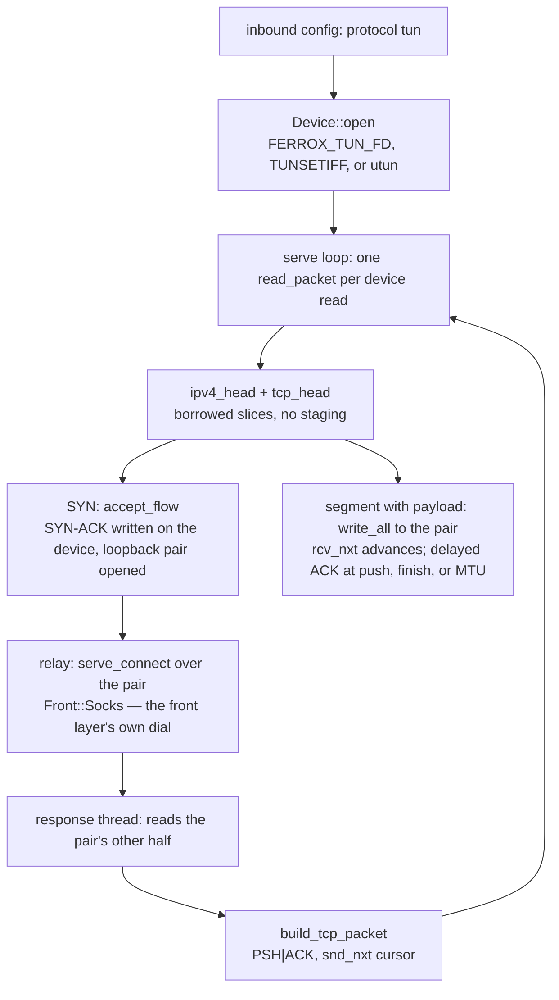

# TUN device inbound (native)

A `tun` inbound opens a virtual network device and reads raw IPv4 packets off
it; every TCP flow the packets form becomes a proxy dial through the machinery
the tree already had, and the bytes that come back leave again as IP packets on
the same descriptor. Both roles the row has are served and both are proved:
device-to-dial and dial-to-device.

A device carries no wire byte-stream to diff, so this row's identity claim is
the (target, payload) dial set: the pairs the inbound produces from a pinned
packet stream must equal the pairs the pinned reference stack produces from it.
The oracle is `scripts/tun-oracle` — smoltcp 0.12, the userspace stack the
pinned zero-tun crate builds on — run over `script.txt`, and
`the_dial_set_matches_the_pinned_stream` diffs the handler's own dials against
the golden `expected.txt` that run recorded. The convention the golden pins
(dial on handshake, deliver the reassembled payload in order, EOF at FIN) is
also what xray's `proxy/tun/tcp_lightweight.go` reaches at `input`, `receive`
and `ReadMultiBuffer`, and the SYN-ACK numbers follow its `newTCPConn` rule.

The platform opens are Linux (`/dev/net/tun` + `TUNSETIFF`, `IFF_TUN|IFF_NO_PI`
so no protocol-info header to strip), macOS (`AF_SYSTEM` utun control channel)
and an inherited descriptor (`FERROX_TUN_FD`) — zero-tun's `inherited.rs` seam,
which is also the only path a CI runner or a test can exercise, since no
runner holds `CAP_NET_ADMIN`. The privileged opens are compile-checked only,
and the tests drive an `AF_UNIX` `SOCK_DGRAM` socketpair through the same
`read_packet`/`write_packet` pair the device does — datagram because a TUN
delivers whole packets, and `SOCK_SEQPACKET` does not exist on macOS.

## Data path



## Measured

<!-- counts:begin -->
| key | value | checked by |
| --- | --- | --- |
| ops-retired-instructions | UNBLESSED | scripts/count-ops.sh |
| dial-set-flows-matching-the-pinned-stack | 3 | ferrox-app-tun::tests::the_dial_set_matches_the_pinned_stream |
| reverse-role-response-round-trips | 1 | ferrox-app-tun::tests::the_response_bytes_come_back_as_ip_packets |
| parse-copies-per-packet | 0 | ferrox-app-tun::tests::the_payload_is_borrowed_from_the_read_buffer |
<!-- counts:end -->

The first row is the identity claim itself: three flows — a request line, a
four-byte blob, and a two-chunk payload whose lengths are not a segment
boundary — dialed with exactly the (target, payload) pairs the smoltcp run
recorded. The reverse-role row sends bytes out through the relay and requires
them back as an IP packet carrying those bytes on the same descriptor. The
copies row is gated by pointer identity, not bytes:
`the_payload_is_borrowed_from_the_read_buffer` asserts the parsed payload's
base *is* the read buffer plus the fixed headers, because a byte test passes
with a parsing copy and without one.

Syscalls: the serve loop is one `read(2)` per inbound packet and one
`write(2)` per emitted packet — SYN-ACK, pure ACK, response — but a loopback
socketpair test cannot gate a syscall total, so no row claims one; the shape is
prose. The one allocation the emit path makes is named under what was not
removed. Time: not measured locally, see below.

## Ops

```bash
./scripts/count-ops.sh report \
  tun::tests::the_dial_set_matches_the_pinned_stream 'tun::Handler::dispatch'
```

`UNBLESSED`, as above — macOS/aarch64 ships no `valgrind`, so this count is
CI-only there and has not been read; it is not a number and is not quoted as
one.

## Time

**Not measured on this branch.** Durations come from CI runners (`bench.yml`,
`parity.yml`); no artefact from this branch has been read. A device read over a
real interface involves the kernel routing the packet, and every contributor
machine sits behind a VPN — a local dial would measure that, not this code.

## What we removed

Against the pinned references, which is where the bar is:

- **The whole userspace stack, for the traffic a relay can answer without
  one.** Xray's `proxy/tun/tcp_lightweight.go` is ~1 000 lines: `hold`/`loss`
  reassembly lists, SACK blocks, an RTO timer goroutine per connection,
  delayed-ACK and PTO timers, and window growth. zero-tun instantiates a real
  smoltcp `TcpSocket` per flow with 32 KiB rx/tx buffers, and sing-box's tun
  runs its own netstack over its device API. This inbound keeps three numbers
  per flow — `rcv_nxt`, `snd_nxt`, `last_acked` — one delayed-ACK rule (answer
  at a push, at the finish, or once a full MTU has gone unacknowledged, never
  for a segment that brought nothing), and no timer at all. What was kept is
  the convention the differential can see and the handshake-number rule of
  `newTCPConn`; the stack machinery was removed down to the smallest thing
  that still produces the reference's dial set, and the removed reassembly and
  retransmit are named below rather than claimed away.
- **A second dialer.** The tun2socks shape this tree could have grown is a
  bespoke outbound call from the packet handler. It does not: `accept_flow`
  opens a loopback `TcpStream` pair and calls the same
  `serve_connect(conn, out, dest, Front::Socks, &[])` every other front
  reaches, so the destination from the IP header rides the existing SOCKS
  front and no protocol code is duplicated — the idea zeptun sells (translate
  the device onto the SOCKS machinery, do not re-implement it), taken without
  its translator thread. `is_device` refuses `utun`/`wintun`/`tun2socks` as
  *protocol* names while serving `tun` with all three device spellings, so the
  config surface keeps one way in.
- **The parsing copy.** The references stage each packet: xray's stack reads
  through a `buf.Buffer` it copies into segments, smoltcp parses into its own
  `IoBuffers`. Here `ipv4_head` and `tcp_head` hand back slices *of the read
  buffer*, the payload goes from that borrowed slice straight into the pair's
  `write_all`, and the pointer-identity row above is the gate. A segment with
  TCP options parses at its real data offset (`a_syn_with_options_leaves_the_payload_where_the_header_ends`), and a forged length or short header is
  refused, not repaired (`a_forged_packet_is_refused_not_repaired`).

## What was not removed

Named rather than claimed, with the worst input worked out first:

- **One fresh `Vec<u8>` per emitted packet.** `build_tcp_packet` renders
  IP + TCP + payload into a new vector — one allocation per SYN-ACK, per pure
  ACK, per response packet. A reused per-handler buffer with a
  `write_vectored` header would remove it, but nothing counts allocations on
  this path yet, so it stays a named cost, not a row.
- **Out-of-order and duplicate segments are not reassembled.** The handler
  delivers payload in arrival order and advances `rcv_nxt` to the last
  segment's end. A script does not reorder; a network does. Xray holds
  segments off sequence, smoltcp buffers them — this tree does neither yet,
  and that is the next TCP slice, not a hidden one.
- **No retransmit, no receive window, no congestion.** The advertised window
  is a constant 65535 and nothing paces a response. If the descriptor's buffer
  fills, a `write` fails and dispatch reports it; the references timer-retry.
- **The SYN-ACK sequence is `syn+1`, not a random ISN.** `newTCPConn` picks
  `rand.Uint32()`; a golden cannot pin a random number, the dial set does not
  depend on it, and the wrap case is gated instead by
  `the_syn_ack_numbers_wrap_at_the_sequence_space_boundary` (`u32::MAX-1`
  replies `u32::MAX`).
- **UDP and ICMP are dropped, not demuxed.** The add-on's increment (b) says
  the packet demux should land on "the dials the front layer already makes",
  and the arithmetic of this tree says the datagram half of that does not
  exist yet: every `serve_socks_udp_*` path is welded to a bound `UdpSocket`
  relay, so a TUN datagram has no seam to dial onto without first growing a
  datagram relay through the front — the seam refactor is its own slice, the
  way row 30's `Connection` seam was, and it is named here rather than folded
  half-proven into this one. TCP-only is what the differential can see today.
- **The privileged opens are compile-checked only.** No CI runner holds
  `CAP_NET_ADMIN`, so nothing runs `TUNSETIFF` or the utun control connect;
  the inherited-fd path is the one the tests and any real CI use, and that no
  run-check exists for the ioctls is stated here, not glossed.

## Pins

| what | where |
| --- | --- |
| the handshake numbers and dial convention | `upstream/xray-core/proxy/tun/tcp_lightweight.go` |
| the stack the oracle runs, and the inherited-fd seam | `upstream/zeronet/crates/zero-tun` |
| the device API and netstack shape the row trims | `upstream/sing-box/protocol/tun`, `upstream/sing-box/transport/device` |
| the translate-onto-SOCKS idea, not its translator | `upstream/zeptun` |
| the recorder that produced `expected.txt` | `scripts/tun-oracle/main.rs` |

## CI scope

What a change here owes, read by `scripts/ci-scope.py`; see [`docs/ci-scope.md`](../ci-scope.md).

<!-- scope:begin -->
- paths: crates/ferrox-app/src/tun.rs
- symbols: tun
<!-- scope:end -->
