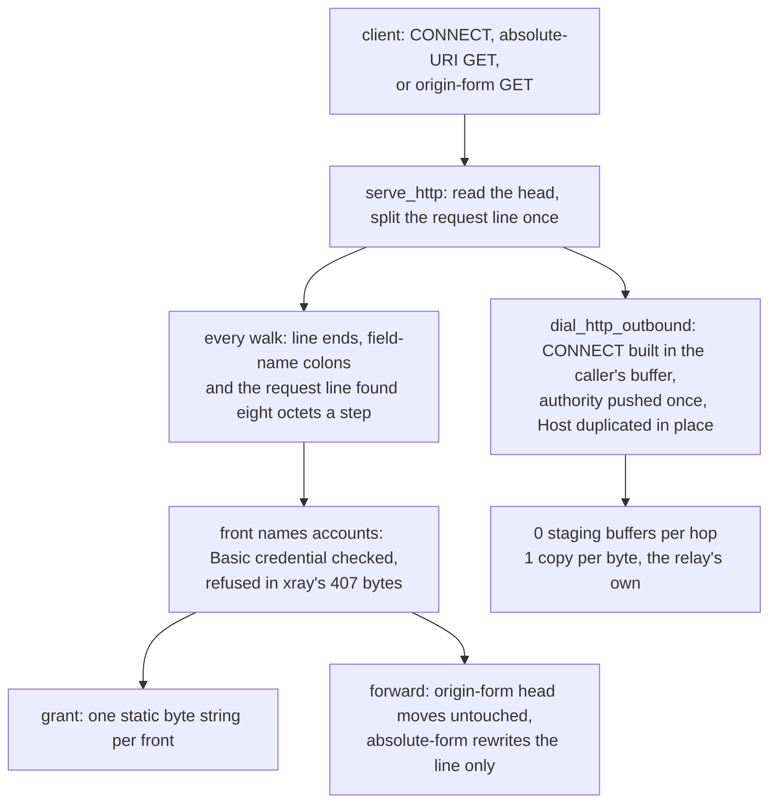

# HTTP proxy, both roles

Row 23: the `http`/`mixed` inbound answers a client (front), and the `http` outbound tunnels through an upstream proxy (hop). Both roles speak the same one-line grammar — a `CONNECT authority HTTP/1.1` to open a tunnel, an absolute-URI or origin-form head to forward a plain request — and both now pay for it in the caller's own buffer: the front's grant is one static byte string, the hop's CONNECT request is built with zero staging allocations, and a head that is already origin-form reaches the uplink where it landed.

A forwarded request's head is walked twice before it leaves — the credential's line dropped, the `Connection` value read, and every field offered to the routing rules — and each walk used to compare one octet at a time. Every line end, every field-name colon and the request line's own scans are now one `ferrox_core::foxy::octet_in` call, which weighs eight octets a step and names the first hit without looking back.

A front whose settings name `accounts` (or `users`) demands `Proxy-Authorization: Basic` and answers a missing or unknown credential in xray's own 407 head; the credential is consumed before the head leaves for the origin, and the `mixed` front lends the same accounts its SOCKS side carries, which is what xray's socks server does (`server.go:44-50`).

## Data path



## Measured

<!-- counts:begin -->
| key | value | checked by |
| --- | --- | --- |
| ops-retired-instructions | UNBLESSED | scripts/count-ops.sh |
| connect-grant-allocations | 0 | ferrox-app-proxy::tests::a_connect_grant_costs_no_heap_buffer |
| connect-request-allocations | 0 | ferrox-app-proxy::tests::the_connect_request_builds_in_one_buffer |
| forwarded-head-allocations | 0 | ferrox-app-proxy::tests::an_origin_form_head_reaches_the_uplink_where_it_landed |
| forwarded-head-copies | 0 | ferrox-app-proxy::tests::a_forwarded_head_is_the_head_that_was_read |
<!-- counts:end -->

`connect-request-allocations` is gated on base and capacity held steady over a four-target sweep of the caller's `Vec` (name, bracketed name, v4 literal, v6 literal): the request reserve counts the authority without materialising it, so no CONNECT grows or replaces the buffer it was handed. `forwarded-head-allocations` is the moved head's own pointer and capacity asserted at the uplink writer — a rebuilt head would not be the same allocation. Copies the rows do not see stay out of the table: the in-buffer `Host` duplication is one copy per authority byte with no allocation to witness, and the front's head read is still `peek` then re-read, so two syscalls per request stand — named below, not blessed as a number.

## Ops

```bash
./scripts/count-ops.sh report \
  proxy::tests::the_connect_request_builds_in_one_buffer 'proxy::http_connect_request'
```

`UNBLESSED`, as above. `scripts/count-ops.sh` needs valgrind, which does not exist on macOS/aarch64, so this count is CI-only (`ops.yml`); nothing quotes it until the artefact has been read.

A second frame prices the head walk: `the_head_walk_costs_the_head_and_nothing_else` runs `drop_header` and `connection_named` over 64 rounds of the same fixed 439-octet forwarded head, folding the head's length and the `Connection` value's length after each, and `the_byte_walk_header_costs_the_same_answer` runs the two walks as they stood over the same head and rounds to the same pinned `0xb74e_4000`, which is the bit-identity claim as much as the fold. Both frames are in `scripts/method-ops.txt`, so one `ops.yml` run reports both and only their difference is a claim about the scan; the figures are read from the artefact, never from a local run, because a local run measures this machine's tunnel and not this code. `ops.yml` run `40911310819` (x86_64 Linux, artefact `method-ops`) reads **176 278** for the shipped frame against **326 806** for the byte walk — **150 528 fewer instructions over 64 heads, 2 352 a head, 1.85×** — and inside the shipped frame `proxy::drop_header` is **92 224** and `proxy::connection_named` **76 160**, which is **2 754 against 5 106 a forwarded head** once the loop both frames share is counted once. Each of those symbols is a frame rather than `inlined-not-a-frame`, so the two rows price the two walks the request actually takes.

## Time

**Not measured.** `scripts/lib-matrix.sh` carries no benchmark cell for this row — no `http-*` scenario id exists — so `bench.yml` and `compare.yml` gate nothing here; the live shape is the `foxy-relay.yml` http-front legs, which download 1 MB through the front and do not gate on duration either.

## What we removed

- **An octet compare per octet, five walks deep.** A forwarded head is walked for every line end it has — `drop_header` to take the credential line out, `connection_named` to read the `Connection` value, `forward_headers` to offer every field to the rules — and each of those walks found the next line end with `head[at..].iter().position(|byte| *byte == b'\n')` and the field-name colon with a second one, while `drop_header` matched its two-octet `\r\n` with `windows(2).position`. That is one compare, one branch and one increment per octet, four times over, on every request a browser sends through the front. The scan is now an equation on eight octets: fold the needle out of the block, `miss = block ^ (needle × 0x0101_0101_0101_0101)`, and `miss - 0x0101_…_0101` underflows at every octet that equals it; `& !miss & 0x8080_…_8080` keeps those underflows and nothing else, because an octet below `0x80` that is not a hit borrows nowhere and an octet at or above it loses its high bit to `!miss`. Reading the mask low to high is exact rather than approximate: every octet below the first hit is nonzero, so no borrow reaches it from below, and the lowest set high bit is therefore the first hit's own — `trailing_zeros / 8` names it in one instruction and the loop never looks back at what it passed. One `ferrox_core::foxy::octet_in` call is now the whole of `drop_header`'s `\r\n` (the first `\n` a `\r` precedes, which is the same two octets the window matched), the whole of every line-end scan in the three walks, every field-name colon, and the request line's own scans in `request_line_attributes`, `http_proxy_request` and `connect_authority`. The same call is the sniffer's HTTP walk, so a flow the sniffer reads pays one scan per line too. What is **not** removed, stated rather than listed: the last partial word, because a scan ends byte-wise at the seven octets that do not fill one (the head's last line is the shortest it has); the AVX2 lane `head_end` uses, deliberately, because a field line is twenty to sixty octets and a thirty-two-octet window's broadcast and mask extract cost more than the line has octets to weigh — the wider kernel pays only on a scan that crosses lines and no walk here does, each one stopping at a line end; the second walk `connection_named` and `forward_headers` each make over the head, because fusing them means holding every line's offsets in a buffer whose stores and loads cost about what the second scan's one or two words per line cost; `hop_by_hop`'s eight `eq_ignore_ascii_case` attempts per field, because the length compare already settles seven of them — all eight names have distinct lengths — and a length-first fingerprint was analysed and buys nothing; and `header_value_in`'s `str::split("\r\n")`, which is std's two-way search over a head already decoded as UTF-8 and is only reached when the front names accounts. The checkers: `the_octet_scan_is_the_byte_walk_at_every_start` sweeps the primitive against `iter().position` at every start of every length across four whole blocks, over a dense body and over the three bodies whose borrows a naive mask would misreport (a hit followed by an `0x01`, four hits in one word, a hit in the last octet); `the_head_walk_costs_the_head_and_nothing_else` and `the_byte_walk_header_costs_the_same_answer` are the pinned frame pair above; and `the_forwarded_head_is_what_the_removal_left` drives a real http front and pins both halves at once — the head the origin receives byte for byte (the credential line gone, `Connection` kept) and which of those fields reach a rule, so a walk that dropped a line it should have kept, kept one it should have dropped, or lost a field on the way to the rules reads as bytes and as a blocked flow.

- **A copy of every forwarded head.** The absolute-form rewrite built a second buffer and copied the whole head into it, so a forwarded request paid an allocation and a copy of its own head — every header byte — before the uplink saw it. The rewrite now happens inside the head's own buffer: the headers shift left to where the shorter origin-form line ends, and the line's pieces are moved from where they were. The witness is pointer identity: `a_forwarded_head_is_the_head_that_was_read` holds the head the caller gets to the head it read, which a copy could not do, and pins the bytes beside it. What did not move: the bytes on the wire — the same origin-form line and the same headers — and the destination's own name, which is a `String` the routing rules read. The `String` the CONNECT was dialled through. The hop formatted its authority into a `String` and copied it twice into the request — into the request line and again into `Host:` — so one heap buffer and three walks of the authority bytes per tunnel. Now `authority_len` counts the octets without producing them (exact for a name and a v4 literal, the uncompressed bound `42 + digits(port)` for v6), `push_authority` writes them straight into the caller's buffer, and `extend_from_within` repeats them for `Host:` from where they already are. `the_connect_request_is_the_golden_bytes` pins the bytes unchanged — v4, v6 bracketed, basic-auth and custom-header shapes — and `the_connect_request_builds_in_one_buffer` holds the caller's pointer and capacity steady across the sweep, which is the allocation proof; the duplication it removes is visible only through the capacity gate, so that is what the row claims and no more.

The grant that was re-rendered per request. `Front::grant_line` returned a fresh `Vec` per call — `foxy_socks_reply(0).to_vec()` for SOCKS, a `to_vec()` of a literal for HTTP — and `direct_grant` built its own copy again beside it. Both answers are fixed octets, so they are now one `&'static [u8]` per front, shared by `grant_line` and `direct_grant`: `a_connect_grant_costs_no_heap_buffer` asserts the two calls hand back the same base pointer, that `direct_grant` hands back exactly that pointer, and that the bytes are the ones the old builders wrote.

The rewrite every forwarded request paid. An origin-form head — already `GET /path HTTP/1.1` as it landed — was run through `origin_head` like an absolute one, allocating a second head and copying every byte into it. The predicate now recognises the shape (CRLF line end, three line tokens, no trailing junk) and moves the caller's `Vec` to the uplink untouched; `an_origin_form_head_reaches_the_uplink_where_it_landed` asserts the forwarded head's base and capacity *are* the parsed buffer's, and that a four-token line and a bare-LF absolute line still get the rebuilt bytes the old path wrote. The request-line scan itself was fused too: the `\n` position found to split the line is handed to `origin_head` as `line_end` instead of being walked a second time — arithmetic on the same pass, which no row counts, so it stays here.

Against the references: xray-core's hop builds an `http.Request` with a `url.URL` and a `http.Header` map and hands it to `req.Write` (`upstream/xray-core/proxy/http/client.go:211-235`), and its front writes the `200` as a fresh `[]byte` per request (`server.go:173`); sing-box routes its CONNECT through its `transport/http` client stack the same way. Neither re-walks what this tree now copies zero times — the map, the URL and the per-request byte slice exist there, and none exist here.

## What was not removed

The absolute-form rewrite still allocates: a `http://`-form head leaves as a fresh `Vec` with every byte copied once, because its request line changes and `Vec` cannot shrink an allocation in place. The front's head read still costs `peek` plus re-read: `read_http_head` is what `serve_http` calls, because a CONNECT head that keeps the bytes behind `\r\n\r\n` has nowhere to put them — only the `Freedom` and Foxy-direct legs can accept a pipelined prefix today, so the kept-head reader swap is its own slice and this page only prices the calls it carries. `Destination::authority()` still returns a `String` for the Foxy cache key beside it (`proxy.rs:5856`); the CONNECT builder no longer calls it, and no other hot rung does, so it stays. The base64 credential still walks `user:pass` through `EncoderWriter` into the same request buffer — one pass, the encoder's own tail cache unchanged. And the relay copy per byte is the relay's own, counted nowhere in this page.

## Pins

| what | where |
| --- | --- |
| CONNECT hop via `http.Request`, per-request `200` write | `upstream/xray-core/proxy/http/` |
| h1/h2/h3 client stack, extended CONNECT errors | `upstream/sing-box/transport/http/`, `upstream/sing-box/protocol/http/` |
| socks-side CONNECT grant shapes to keep byte-identical | `upstream/zeronet/crates/zero-protocol/src/socks.rs` |

## CI scope

What a change here owes, read by `scripts/ci-scope.py`; see [`docs/ci-scope.md`](../ci-scope.md). The run's oracle is the `xray-core` pin's four http scenario tests (`TestHttpConformance`, `TestHttpError`, `TestHTTPConnectMethod`, `TestHttpPost`), all named by the pin's suite — no `oracle:` pattern can narrow it further, because the suite has no `--` name list to filter.

<!-- scope:begin -->
- paths: -
- symbols: serve_http, http_proxy, http_proxy_request, http_request_parses, http_connect, connect_request, connect_grant, connect_authority, origin_head, origin_form, grant_line, direct_grant, SOCKS_GRANTED, authority_len, push_authority, authority_target, http_outbound, http_accounts, http_credential_account, drop_header, forward_headers, connection_named, crlf_in, hop_by_hop, request_line_attributes, HTTP_AUTH_REQUIRED
- go: ./proxy/http/...
<!-- scope:end -->
