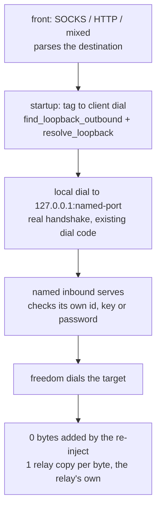

# The loopback re-inject outbound

A `loopback` outbound names an inbound by tag, and a flow that reaches it is
handled as if it had arrived on that inbound: the tag is resolved once at
startup into the client dial the named inbound's own credentials imply, so the
re-injected flow carries a real handshake on the loopback wire. There is no
routing table in this tree — fronts take the single outbound and servers take
freedom — so the tag has nothing further to select, and resolving at startup
*is* the whole re-inject, with no per-flow hop of its own.

A concrete dial always wins over a re-inject: the loopback resolves only when
no `vless`/`vmess`/`trojan`/`http`/`shadowsocks`/`foxy` outbound matched, ahead
of `freedom`. A config whose fronts should re-inject therefore carries
`outbounds: [loopback, freedom]` and nothing more specific.

What refuses, and where: an empty or missing `inboundTag` skips the outbound
the way other uncarriable settings skip theirs; an enabled `sniffing` block
does the same, since sniffing on re-dispatch belongs to the engine sniffer
this tree has not built. Everything else fails at startup, naming the tag: an
unknown tag, a front (which would re-enter the same resolution), no `freedom`
outbound to leave by, transport security or a datagram carrier the redial
cannot speak, and a relay-shaped Shadowsocks inbound that answers for fixed
destinations rather than the re-injected target. The protobuf form stays
refused: it carries only what the pinned scenarios name, and none names this.

## Data path



## Measured

<!-- counts:begin -->
| key | value | checked by |
| --- | --- | --- |
| ops-retired-instructions | UNBLESSED | scripts/count-ops.sh |
| tcp-echo-bytes-preserved | 65536 | ferrox-app-proxy::tests::a_re_injected_tcp_stream_carries_an_echo |
| udp-datagram-bytes-preserved | 4 | ferrox-app-proxy::tests::a_re_injected_udp_association_carries_a_datagram |
<!-- counts:end -->

Syscalls: one extra local TCP connect per flow plus the named inbound's own
handshake reads and writes — no checker counts this yet. Copies: the resolve
stages nothing per flow, and the redialled session copies exactly what a direct
dial copies, so the only copy is the relay's own — with no loopback-side
pointer-identity test to separate it from a direct dial's, it stays prose, not
a manifest row. The worst case the tests do not reach is a payload past both
relay promotions: the 64 KiB echo already promotes each of the two relay legs
past `RELAY_SMALL_BUFFER` once each, exactly as a direct dial promotes its one,
and a larger payload only pipelines further — no second promotion, no deadlock,
since both legs stay duplex.

## Ops

```bash
./scripts/count-ops.sh report \
  proxy::tests::a_re_injected_tcp_stream_carries_an_echo 'proxy::resolve_loopback'
```

`UNBLESSED`, as above.

## Time

**Not measured yet.** Durations in this repository come from CI
runners (`bench.yml`, `parity.yml`); no CI artefact has been
read, and a laptop behind a VPN measures a tunnel either way.

## What we removed

The dispatcher's per-flow re-entry. Xray's `Loopback::Process` hands the live
link back to the dispatcher, which routes again under the new tag; ZeroNet
caps that second look at `MAX_LOOPBACK_DEPTH` and xray-core-rust injects it
through a `LoopbackSink` that errors aloud when unassembled. None of those
pieces has anything to route here, so the cycle they guard against is refused
once at startup instead of bounded per flow: a front would re-enter the same
resolution, and every server shape leaves by freedom, so no chain this tree can
express goes around twice.

## What was not removed

The local hop itself. An in-process dispatch moves no handshake; this one
dials `127.0.0.1` and handshakes as any client would, which costs one connect
and the inbound's handshake bytes per flow. That is the re-inject the row
names, not overhead around it, so it stays on the page rather than in a
follow-up. The protobuf form stays refused alongside it: no pinned scenario
names a loopback, so there is no seam to prove it through — the xray-core
scenario suite has no loopback test, ZeroNet's loopback tests are in-process,
and the xray-core-rust suite ships disabled.

## Pins

| what | where |
| --- | --- |
| re-inject into a named inbound tag, with sniffing | `upstream/xray-core/proxy/loopback/` |
| sink injection, explicit no-sink error, target validation | `upstream/xray-core-rust/crates/xray-proxy-loopback/` |
| depth cap, unknown-inbound error, balancer-member refusal | `upstream/zeronet/crates/zero-runtime/src/server.rs`, `upstream/zeronet/crates/zero-config/src/xray_json.rs` |
| no loopback protocol to take anything from | `upstream/sing-box/`, `upstream/xray-rust/` |

## CI scope

What a change here owes, read by `scripts/ci-scope.py`; see [`docs/ci-scope.md`](../ci-scope.md).

<!-- scope:begin -->
- paths: -
- symbols: find_loopback_outbound, resolve_loopback, loopback_dial, loopback_carrier, loopback_carrier_of
- go: ./proxy/loopback/...
<!-- scope:end -->
