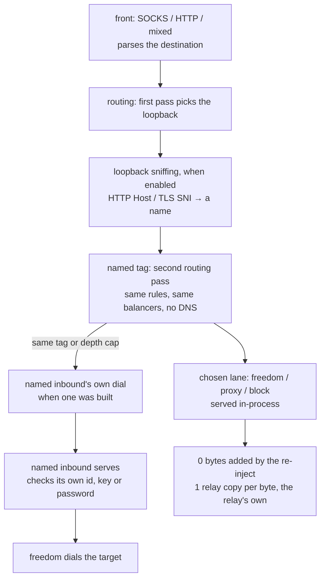

# The loopback re-inject outbound

A `loopback` outbound names an inbound by tag. In a routed config, a flow that reaches it is re-injected under that tag: the outbound's own `sniffing` runs first, then the named tag's rules run a second time without resolving a name, and the lane they choose is served in-process. The tag is the whole address — no inbound has to exist for it, matching the reference's dispatcher, which does not look the tag up when it re-routes. The no-resolve pass is the reference's `SkipDNSResolve`: a name reaches only the named tag's domain rules, never an IP rule, which the router's `a_skip_dns_route_does_not_resolve_a_name` holds. A chain of loopbacks ends after eight hops or when the same tag is selected again; a named server inbound then falls back to its own dial, and a front tag closes.

A config with no routing keeps the startup convenience: the tag resolves once into the client dial the named inbound's own credentials imply, so the re-injected flow carries a real handshake on the loopback wire. A front is refused there because it would re-enter the same resolution. The outbound's `sniffing` block runs before that dial too, so an HTTP `Host` or TLS SNI can replace the destination the front was asked for.

Sniffing is the reference's TCP behavior. A loopback datagram keeps the named inbound's dial lane when one was built and is not read by the outbound's sniffer; the reference's loopback `Process` has no UDP arm, and a routed front tag has no datagram lane. In the unrouted path a concrete dial always wins over the single front outbound: `find_loopback_outbound` resolves only when no `vless`/`vmess`/`trojan`/`http`/`shadowsocks`/`foxy` outbound matched, ahead of `freedom`. A loopback outbound is also a routing target and a default outbound, built by `route_shared` through the same tag.

What refuses, and where: in the unrouted path an empty or missing `inboundTag` skips the outbound the way other uncarriable settings skip theirs, while a routed config carries the empty tag as its second pass; a malformed `sniffing` block refuses at startup rather than silently not sniffing. In a routed config the tag need not name an inbound, and a named server inbound whose redial cannot be built warns once and keeps its TCP second pass, losing only the datagram lane. In the unrouted path everything else fails at startup, naming the tag: an unknown tag, a front (which would re-enter the same resolution), no `freedom` outbound to leave by, transport security or a datagram carrier the redial cannot speak, a first user whose flow is unknown or Vision because the plain dial cannot complete it, a listener that expects a PROXY header no loopback redial sends, and a relay-shaped Shadowsocks inbound that answers for fixed destinations rather than the re-injected target. The protobuf form is carried: `xray.proxy.loopback.Config` decodes `inbound_tag` and `sniffing`.

## Data path



## Measured

<!-- counts:begin -->
| key | value | checked by |
| --- | --- | --- |
| ops-retired-instructions | UNBLESSED | scripts/count-ops.sh |
| tcp-echo-bytes-preserved | 65536 | ferrox-app-proxy::tests::a_re_injected_tcp_stream_carries_an_echo |
| udp-datagram-bytes-preserved | 4 | ferrox-app-proxy::tests::a_re_injected_udp_association_carries_a_datagram |
| sniffed-http-host-dials-the-sniffed-name | 1 | ferrox-app-proxy::tests::a_loopback_sniffing_overrides_the_re_inject_destination |
| route-targets-resolved-at-startup | 1 | ferrox-app-proxy::tests::a_loopback_outbound_is_a_route_target |
| named-inbound-rules-consulted | 1 | ferrox-app-proxy::tests::a_loopback_consults_the_named_inbounds_rules |
| protobuf-outbound-decoded | 1 | ferrox-app-xray_pb::tests::the_loopback_outbound_decodes_to_the_json_this_tree_serves |
<!-- counts:end -->

Syscalls: a routed second pass adds no local connect; the unrouted path adds one extra local TCP connect per flow plus the named inbound's own handshake reads and writes. No checker counts either yet. The sniffer adds `peek` calls on the client until it reads a whole HTTP head or a whole TLS ClientHello, or 200 ms pass; the re-inject itself adds none. Copies: the routed second pass stages nothing per flow, and the redialled session copies exactly what a direct dial copies, so the only copy is the relay's own — with no loopback-side pointer-identity test to separate it from a direct dial's, it stays prose, not a manifest row. The worst case the tests do not reach is a payload past both relay promotions on the unrouted path: the 64 KiB echo already promotes each of the two relay legs past `RELAY_SMALL_BUFFER` once each, exactly as a direct dial promotes its one, and a larger payload only pipelines further — no second promotion, no deadlock, since both legs stay duplex.

## Ops

```bash
./scripts/count-ops.sh report \
  proxy::tests::a_re_injected_tcp_stream_carries_an_echo 'proxy::resolve_loopback'
./scripts/count-ops.sh report \
  proxy::tests::a_loopback_consults_the_named_inbounds_rules 'proxy::serve_connect_at'
```

`UNBLESSED`, as above.

## Time

**Not measured yet.** Durations in this repository come from CI runners (`bench.yml`, `parity.yml`); no CI artefact has been read, and a laptop behind a VPN measures a tunnel either way.

## What we removed

The resolver call. The named tag's second pass reads the same rules with `SkipDNSResolve`, so an IP rule cannot turn a name by an address the reference would not look up. The recursion. Xray's `Loopback::Process` hands the live link back to the dispatcher, which routes again under the new tag; ZeroNet caps that second look at `MAX_LOOPBACK_DEPTH` and xray-core-rust injects it through a `LoopbackSink` that errors aloud when unassembled. This tree runs the same second look as a loop inside `serve_connect`, not as a call back into the connector, so the stack stays flat; the depth cap is ZeroNet's eight. The unrouted startup desugaring remains only where there is no routing table to consult.

The routed path's old startup refusals are gone. A named inbound whose first user asks for Vision, a PROXY-header listener, a relay-shaped Shadowsocks inbound and a datagram carrier all redial nothing now: the second pass picks the lane, and only the unrouted convenience or the datagram fallback ever builds that dial. The sniffer no longer refuses. An enabled `sniffing` block is parsed with the reference's fields and applied before the TCP re-inject; when it is absent or disabled the outbound keeps the plain dial, so the unsniffed path allocates and reads exactly what it did before. The datagram half delegates to the named dial unchanged, because the reference's loopback `Process` has no UDP arm.

## What was not removed

The local hop on the unrouted path. An in-process dispatch moves no handshake; that path dials `127.0.0.1` and handshakes as any client would, which costs one connect and the inbound's handshake bytes per flow. A routed named server inbound still builds that dial for its datagram lane, so a redial that cannot be built warns and loses only that lane. The reference has no loopback UDP arm, so a routed front tag carries TCP only.

## Pins

| what | where |
| --- | --- |
| re-inject into a named inbound tag, with sniffing and the dispatcher's second pass | `upstream/xray-core/proxy/loopback/` |
| sink injection, explicit no-sink error, target validation | `upstream/xray-core-rust/crates/xray-proxy-loopback/` |
| depth cap, unknown-inbound error, balancer-member refusal | `upstream/zeronet/crates/zero-runtime/src/server.rs`, `upstream/zeronet/crates/zero-config/src/xray_json.rs` |
| no loopback protocol to take anything from | `upstream/sing-box/`, `upstream/xray-rust/` |

## CI scope

What a change here owes, read by `scripts/ci-scope.py`; see [`docs/ci-scope.md`](../ci-scope.md).

<!-- scope:begin -->
- paths: -
- symbols: find_loopback_outbound, resolve_loopback, resolve_routed_loopback, loopback_out, loopback_dial, loopback_dial_for_inbound, loopback_carrier, loopback_carrier_of, loopback_sniffing, loopback_asked, loopback_settings, LoopbackOut, MAX_LOOPBACK_DEPTH
- go: ./proxy/loopback/...
<!-- scope:end -->
