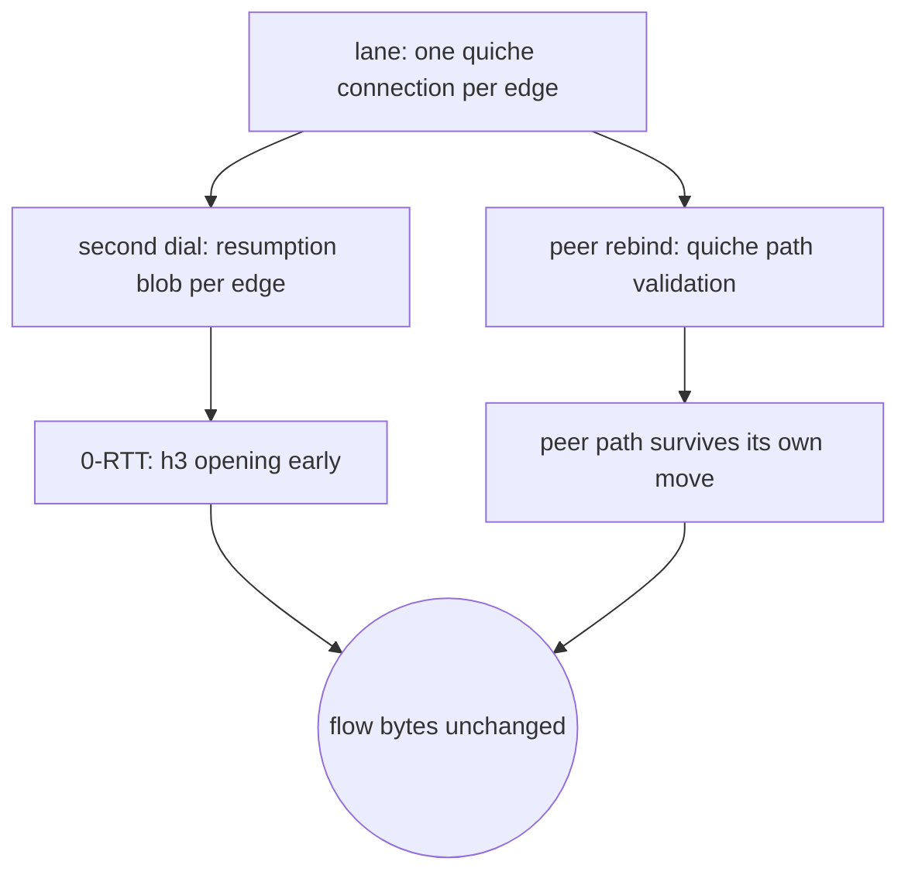

# Multipath QUIC

## Data path

The lane rides `carrier-quic`'s single connection: quiche validates the peer's next path, the
dialer resumes a session per edge, and early data is in the plan only when an edge already sent a
ticket. There is no second path here to draw.

<!-- counts:begin -->
| key | value | checked by |
| --- | --- | --- |
| ops-retired-instructions | UNBLESSED | scripts/count-ops.sh |
| syscalls-per-relayed-megabyte | UNBLESSED | scripts/count-ops.sh |
| relay-staging-copies-per-byte | UNBLESSED | not measured |
| seconds-per-relayed-megabyte | UNBLESSED | .github/workflows/bench.yml |
<!-- counts:end -->

## Time

**Not measured yet.** There is no code path this page carries; durations are CI's only, and no
cell in `bench.yml` or `parity.yml` named this method before the page existed, and no measured run
was read.

Row 78 asks for a connection carrying several paths, the reference being draft-quic-multipath (PATH_ID, ADD_PATH/RETIRE_PATH, multipath transport parameters) as realized by `mqvpn`'s xquic fork or SlipStream's picoquic mode. That wire surface does not exist in the pinned quiche — `grep -rni multipath upstream/quiche/quiche/src/` finds nothing, and the `quiche` filter of `upstream/mqvpn` builds its own stack rather than calling the pinned one. A method that changes wire bytes without a pinned stack to diff against cannot be byte-identity proved, and this row's gates require one. The removal comparison against the references therefore rests with the existing carrier page: no wire-method removal can be established for this planned method, so see [`carrier-quic`](carrier-quic.md) for the lane's removed work.

What *is* in the tree: row 79's quiche lane already carries, both roles, the layer-aware single-path semantics the importers normally call the multipath floor: `QuicStream::migrate_source` walks the client onto a new local source without re-handshaking (`a_stream_migrates_its_connection_to_a_new_local`), the server validates a peer's rebound path (`a_peer_rebind_keeps_the_quic_lane`), key updates ride the established connection, 0-RTT resumes by one blob per edge, and batched datagrams run on Linux. The lane's page [`carrier-quic`](carrier-quic.md) names those checks.

So the row stays planned rather than being called finished: cherry-picking a different QUIC crate stack would ship an unproved wire dialect, and fabricating an extension of the pinned quiche would not be "learning how the reference implements it, and writing the better thing" — the pinned mqvpn and SlipStream references implement multipath on their *own* forks (xquic, picoquic), so the references exist but offer no ready conformance seam, and neither talks the pinned id. The day `upstream/quiche` pins a revision carrying multipath, this row's first step is to mirror its API calls and diff against it, not to reinvent by rereading draft text.

<!-- scope:begin -->
- paths: -
<!-- scope:end -->
