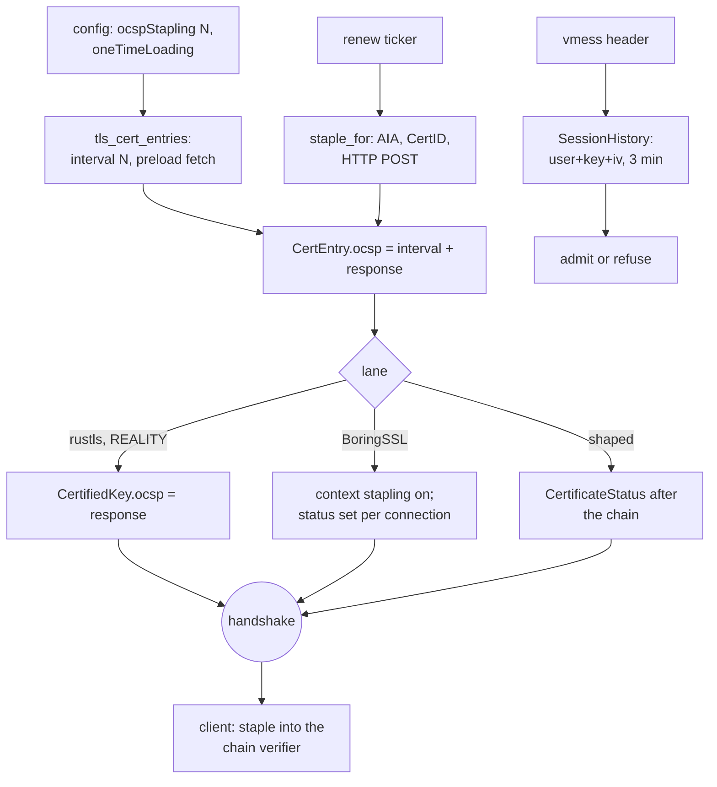

# OCSP stapling and the anti-replay / time-window caches

xray-core's `ocspStapling` is a seconds interval on a `certificates` entry: its `setupOcspTicker`
fetches the leaf's OCSP status on that interval and staples the answer into the handshake, and its
cert-file reload rides the same interval, so one ticker serves both. Its anti-replay caches are
three time-window maps: the `antireplay.ReplayFilter` for VMess auth ids (120 s stamp window) and
Shadowsocks-2022 salts (30 s stamp window), the VMess `SessionHistory` for session ids (3 min
lifetime, 30 s sweep), and the VLESS-encryption ticket store (live-minute expiry with a per-session
nfs-key set).

`crates/ferrox-core/src/tls/ocsp.rs` is the fetch: a minimal DER walker reads the leaf's Authority
Information Access for the responder (and the issuer URL when the chain names no issuer), builds
the CertID xray's `ocsp.CreateRequest` builds — SHA-1 over the issuer's subject name and public
key, the leaf's serial — and posts it over plain HTTP. `TlsServerConfig.renew` re-fetches on the
existing ticker and swaps the staple only when the bytes change, so a steady responder never
rebuilds the listener; the config preloads once at identity build the way xray-core-rust's stapler
`preload`s, rather than waiting an interval for the first status. `oneTimeLoading` pins the
identity as read, so an entry naming both staples nothing. `VMess::SessionHistory` was the
one cache this tree did not carry: `accept_request` now refuses a header whose user, body key and
body IV were admitted inside the lifetime, with the sweep folded into the admission so no second
thread exists.

## Data path



## Measured

<!-- counts:begin -->
| key | value | checked by |
| --- | --- | --- |
| ops-retired-instructions | UNBLESSED | scripts/count-ops.sh |
| syscalls-per-relayed-megabyte | UNBLESSED | scripts/count-ops.sh |
| relay-staging-copies-per-byte | UNBLESSED | not measured |
| seconds-per-relayed-megabyte | UNBLESSED | .github/workflows/bench.yml |
| ocsp-fetch-unit-tests | 11 | ferrox-core-tls::ocsp::tests |
| ocsp-handshake-witness-tests | 5 | ferrox-core-tls::rustls_backend::tests::a_stapled_identity_reaches_the_client_and_is_checked |
| vmess-history-tests | 4 | ferrox-app-vmess::tests::the_history_refuses_a_session_within_its_lifetime |
| ocsp-config-tests | 1 | ferrox-app-config::tests::an_ocsp_stapling_entry_records_the_ticker_and_renews_with_it |
<!-- counts:end -->

## Ops

```bash
./scripts/count-ops.sh report \
  tls::ocsp::tests::a_chain_staples_from_a_loopback_responder 'ocsp::staple_for'
```

`UNBLESSED`. The fetch runs once per interval at config time, not per byte relayed; its cost is a
config-load cost, and no row here quotes it as a figure until `ops.yml` measures it.

## Time

**Not measured yet.** Stapling changes handshake bytes, not a relay hot path; the `benchmark-matrix.yml`,
`bench.yml` and `parity.yml` CI cells that would exercise a stapled listener run in CI, and no CI
artefact has been read. The benchmark is the dispatch, never a laptop run.

## What was removed, and what was not

- **The "parse `ocspStapling` as a ticker only" shape.** The field already named the reload
  interval; now it names the staple fetch on the same one, for file-backed and inline entries
  alike, and `reload_interval` takes the min of both. `reread` compares a fresh fetch against what
  the listener serves, not what the config started with, so one new response swaps the config once
  and a steady cache re-reads forever returns false (`a_renewed_staple_swaps_the_served_response`,
  `a_file_backed_listener_reloads_the_certificate_it_serves`).
- **The missing VMess session cache.** `SessionHistory`-less headers were admitted twice; the
  admission now refuses inside the lifetime, with the sweep folded into the check itself so no
  extra thread exists. `the_history_refuses_a_session_within_its_lifetime`,
  `the_history_names_the_user_and_the_body_material` and `the_history_sweeps_its_expired_entries`
  carry the three verdicts.
- **The shaped lane's refusal of a status message.** A shaped server now answers with
  `CertificateStatus` after the chain when its cert staples, and the shaped client consumes it
  before the exchange instead of reading it as unexpected (`a_shaped_client_consumes_a_stapled_chains_status`).
- **No second stapling mechanism.** xray-core-rust wraps the resolver in `ocsp-stapler`'s
  background worker; this tree staples by attaching the response to the `CertifiedKey` every lane
  already builds, and refreshes through the cert ticker it already runs. The costs that were *not*
  removed: no client lane in this tree validates the staple — the rustls verifier traces it, the
  Boring lane passes an empty response to its verify callback, and the shaped client carries it to
  the same chain verifier — and the configured `https` responder is refused: Go's `http.Post`
  would dial it, and this fetch is `http`-only, so a cert naming only `https` responders staples
  nothing, warned once at load.
- **The fetch is bounded once connected, not in total.** xray's fetch blocks dialing with no
  bound; the fetch here bounds each read and write at 10 s and caps the response at 64 KiB, and
  the connect runs on the process's own timeout the way `reality`'s splice dials, so a slow drip
  responder can hold the ticker thread far longer than any one timeout. That is the named ceiling:
  a slower responder gives up where Go holds a single write open.

## Pins

| what | where |
| --- | --- |
| staple fetch, ticker, file cache | `upstream/xray-core/common/ocsp/ocsp.go`, `transport/internet/tls/config.go` |
| auth-id filter, session history | `upstream/xray-core/common/antireplay/mapfilter.go`, `proxy/vmess/aead/authid.go`, `proxy/vmess/encoding/server.go` |
| salt filter, tickets | `upstream/xray-core/proxy/shadowsocks_2022/inbound.go`, `proxy/vless/encryption/server.go` |
| preload, background refresh | `upstream/xray-core-rust/crates/xray-tls/src/ocsp_stapling.rs` |

## CI scope

<!-- scope:begin -->
- paths: crates/ferrox-core/src/tls/ocsp.rs
- symbols: server_config, reality_server_config, tls_cert_entries, start_cert_ticker, http
- go: ./common/ocsp/..., ./transport/internet/tls/..., ./proxy/vmess/aead/..., ./proxy/vmess/encoding/..., ./proxy/shadowsocks_2022/..., ./proxy/vless/encryption/...
<!-- scope:end -->
