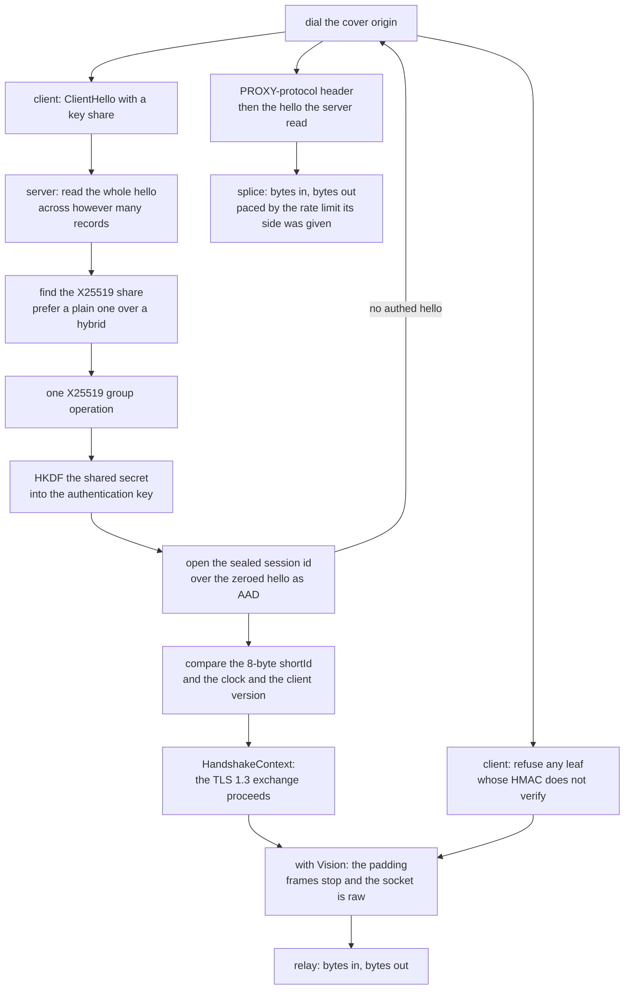

# REALITY and TLS

One TLS stack, one interface. `TlsProvider` is implemented by rustls and the
provider *is* `Read + Write`, so nothing above this rung can depend on the stack
underneath — no feature to select, no build without TLS, and no second provider
to keep in step. `active_backends()` names it, and it names one.

REALITY dials raw TCP and serves every carried carrier. The client seals the
session id into a stock rustls hello in two passes over one scripted provider
— the probe for the AAD, the flight with the seal — and refuses any leaf whose
HMAC does not verify, so a cover origin never carries a proxy byte. A REALITY
outbound over any carrier is still skipped rather than dialled. That is the
first thing to know about this method; the rest is the handshake's cost.

What the handshake does: read the ClientHello, find the X25519 key share, do one
group operation, derive the shared secret, HKDF it into an authentication key,
and check that the certificate the peer presented is the certificate this
session's key can account for — plus an eight-byte `shortId` compared against
what the client sent. The certificate is minted per authentication key, so two
sessions never present the same bytes.

## Data path



## Measured

<!-- counts:begin -->
| key | value | checked by |
| --- | --- | --- |
| ops-retired-instructions | UNBLESSED | scripts/count-ops.sh |
| tls-providers | 1 | ferrox-core::active_backends |
| client-outbound-rows-dialled | 1 | ferrox-app-proxy::tests::vless_outbound_with_reality_security_dials_raw_only |
| x25519-shares-recognised | 3 | ferrox-core-reality::tests::the_x25519_share_is_found_in_every_group_that_carries_one |
| short-id-bytes | 8 | ferrox-core-reality::tests::a_short_id_is_zero_padded_to_eight_bytes |
| cover-origin-dials-per-authenticated-hello | 0 | ferrox-core-reality::tests::an_authenticated_hello_costs_the_cover_origin_nothing |
| cover-origin-bytes-per-spliced-hello | 1 | ferrox-core-reality::tests::an_unauthenticated_hello_is_spliced_into_the_cover_origin_byte_for_byte |
| peer-reply-bytes-per-spliced-request | 1 | ferrox-app-proxy::tests::the_cover_origin_splice_carries_the_reply_back_to_the_peer |
| proxy-protocol-header-bytes | 28 | ferrox-core-reality::tests::the_binary_proxy_header_is_a_fixed_rectangular_twenty_eight_bytes |
| hello-buffers-per-single-record-read | 1 | ferrox-core-reality::tests::reading_a_single_record_hello_allocates_one_buffer |
| tls13-session-tickets-per-authenticated-handshake | 0 | ferrox-core-reality::tests::an_authenticated_session_sends_no_tickets_after_the_handshake |
| certificateverify-signature-scheme | ED25519 | ferrox-core-reality::tests::the_reality_certificate_verify_answers_ed25519_the_peer_never_offered |
| disarmed-limiter-records-per-read | 2 | ferrox-core-reality::tests::a_disarmed_limiter_stops_bounding_reads |
| addrs-resolved-per-xver0-handshake | 0 | ferrox-app-proxy::tests::reality_edges_skip_lookups_without_xver |
| client-hello-passes-per-handshake | 2 | ferrox-core-reality::tests::client_hellos_differ_only_in_the_session_id |
| sealed-session-id-bytes | 32 | ferrox-core-reality::tests::client_seal_matches_the_test_oracle_byte_for_byte |
| unauthenticated-servers-accepted | 0 | ferrox-core-reality::tests::a_client_with_a_wrong_key_is_refused_before_any_proxy_byte |
<!-- counts:end -->

## Ops

```bash
./scripts/count-ops.sh report \
  reality::tests::an_authenticated_hello_is_accepted 'ferrox_core::tls::reality::authenticate'
```

`UNBLESSED`, as above, and `scripts/method-ops.txt` names no REALITY symbol, so
`ops.yml` will not report one until it does.

## Time

**Not measured on this branch.** `der_to_pem 2653` is the single instruction
count this repository has ever blessed, and it is measured by `ops.yml` on
`ubuntu-latest` because valgrind does not exist on the other runners. No
handshake duration is quoted from a machine without a named runner.

## What we removed

- **A second TLS stack to keep in step.** Xray carries REALITY as a fork of
  `crypto/tls` at a pinned pseudo-version, and reaches into `tls.Conn` with
  `reflect` plus `unsafe.Pointer` at `proxy.go:688-728` to steal the live
  `input *bytes.Reader` and `rawInput *bytes.Buffer` so Vision can flush what was
  over-read. sing-box clones a `utls.Config` per handshake and builds the
  ClientHello **twice** — once, then again after filtering out ML-KEM
  (`common/tls/reality_client.go:144-160`) — and then reads an unexported
  `peerCertificates` field through reflection and `unsafe.Add` to verify
  (`:284-306`). One provider that *is* the stream means Vision never needs to
  reach into anything, which is why
  [the Vision page](xtls-vision.md) can end the framing by handing the socket
   over instead of by copying bytes out of someone else's buffer.
- **Reflection and `unsafe` in the handshake.** The gates are
  `an_authenticated_hello_is_accepted`, `every_unauthenticated_hello_is_refused`
  and `the_certificate_differs_per_auth_key`.
- **A hybrid key share when a plain one is present.** One group operation per
  authenticated hello, not two; `a_plain_share_is_preferred_over_a_hybrid_one`
  is the gate.
- **One cover-origin dial per accepted socket.** Both references dial the real
  site *before* reading a byte, so a port scanner costs one outbound connection
  each. The dial here is lazy: an authenticated hello costs the cover origin
  nothing, and a refused one costs exactly the hello the server read, which is
  `an_authenticated_hello_costs_the_cover_origin_nothing`.
- **Two session tickets after every handshake.** rustls sends two by default and
  both references send none, so the REALITY identity pins the count at zero
  while plain TLS keeps two; `an_authenticated_session_sends_no_tickets_after_the_handshake`
  reads the wire flight (ServerHello, dummy cipher change, one encrypted flight)
  and asserts the constructed count on both identities. Tickets are emitted only
  once the client's Finished arrives, which no test peer can send without forking
  the sealed transcript, so the count is pinned where it is set.
- **Scheme negotiation in `CertificateVerify`.** No `uTLS` fingerprint offers
  `Ed25519`, so a stock negotiation answers `NoSharedCipher` and the handshake
  dies after authenticating. All three references comment the negotiation out
  and hard-set `Ed25519`; the `REALITY` identity here does the same through one
  signing-key wrapper, and only that identity — plain `TLS` rows keep negotiating.
  `the_reality_certificate_verify_answers_ed25519_the_peer_never_offered` is the gate.
- **A relay that holds a full echo until close.** The shared copy loop wrote each
  chunk with `write_all` and never flushed, which is nothing on a raw socket and
  a stall on a `TLS` session: the framed echo sat in the send buffer until a later
  read drove the stack, and a request/response exchange has no later read. When
  either direction ends the loop now closes the other side too, or the far end
  never learns the exchange is over and waits out its own deadline instead.
  `a_relay_write_is_sent_without_waiting_for_close` and
  `a_finished_relay_closes_the_other_side` drive a flush-gated writer with no
  sockets at all, and the `reality_vision` conformance row is the witness.
- **A splice that outlived its own exchange.** Once both directions were live, a cover origin that stays open and silent pinned the far pump forever: `copy_paced` stopped only on bytes or an error, and its poll timeout only continued. A finished leg now raises a flag the sibling notices on its next twenty-millisecond grain, the same end-the-other-side discipline `copy_stream` already keeps; `the_cover_origin_splice_ends_when_the_peer_finishes` holds a keep-alive-silent origin against a finished peer and is red without the flag.
- **A splice that pumped the upload twice.** `relay_fallback` crossed its copy directions, so both `copy_paced` pumps read the client and wrote the cover origin: the origin's reply never reached the peer, and two racing readers of one client half could deliver the hello to the origin out of order. The directions are crossed now, and the spliced target carries the same twenty-millisecond poll every other relay point sets, because an untimed read on a silent origin holds the mutex its upload writes on. `the_cover_origin_splice_carries_the_reply_back_to_the_peer` drives both legs over loopback and fails red on either direction.
- **A split hello reassembled twice.** The reader grows one buffer and stops at
  the declared handshake length, then hands rustls the same bytes through a
  replay prefix, so the record framing is read once rather than re-parsed by a
  second implementation. A timeout keeps waiting for a hello that arrived in
  two segments instead of refusing a handshake that was working. A hello that
  arrives in one record is never copied aside: it authenticates out of the
  record stream with the session id restored afterwards, so the read is one
  buffer and only a split hello gathers a second.

- **A session that dies when Vision goes direct.** The outer TLS stack reads
  past the last framed record into its own buffer, so the raw bytes after it
  are stuck inside the session just as the read side switches to the raw
  socket, and the next outer read decrypts raw bytes with the outer keys.
  `xray-rust` keeps a record-bounded reader in front of its stack for exactly
  this (`penetrating_tls.rs`); this tree does the same with one `RecordLimiter`
  that caps every socket read at the current record's end, so the unwrap is
  lossless and no `unsafe` reaches into anyone's buffers.
  `record_bounded_reads_never_swallow_the_bytes_after_a_record` pins the
  chunking and `vision_direct_switch_carries_inner_tls_over_loopback` carries
  eight inner-`TLS` rounds through the switch on loopback. The plain-`TLS`
  accept wraps the same limiter open: it only tracks until the `Link` throws
  the switch at the first 1.3 `ServerHello`, so lanes that never unwrap pay one
  branch per read and no extra syscall, and foxy never sees it at all.
- **A handshake that refuses a slow peer.** Every socket here polls on a
  twenty-millisecond grain, and the `REALITY` handshake took one attempt: under
  a thirty-two-flow burst a slow flight read landed past the grain and the
  flow died as `socks connect rejected`, five to eleven of thirty-two depending
  on the runner's mood. The handshake is now retried to the same thirty-second
  deadline the plain-`TLS` path already used, and the burst row is the witness.
- **A service name compared unescaped.** The server built `/interop grpc/Tun`
  while every reference escapes the configured name Go's way, so the client
  asked for `/interop%20grpc/Tun` and the `grpc_reality` row died in warmup.
  `grpc_path` escapes one segment now, and
  `a_grpc_service_name_is_escaped_the_way_xray_escapes_it` pins it.

- **Five single-byte header iterations read as one five-byte load.** Both
  framers parse a header byte per loop trip with no observable in between, so
  a whole header present in the buffer parses at once and a split one falls
  back to the byte loop; `open_seeded_splits_match_whole_feeds` sweeps 32
  seeded chunkings against whole feeds, short reads, mid-header splits and
  empty frames included.
- **A session that never goes direct stops bounding and tracking reads.**
  `disarm_record_alignment` is the else-branch of the Vision check on both
  roles, so non-Vision bulk pays one straight socket read; Vision flows keep
  the limiter and `engage` re-arms defensively.
  `a_disarmed_limiter_stops_bounding_reads` delivers two records in one read
  and every relay test still moves the same bytes.
- **A handshake without a PROXY header costs no address lookup.** The only
  reader of the edges is the `xver > 0` branch, so lookups happen only there;
  `reality_edges_skip_lookups_without_xver` pins default against real.
- **One client config builds both hello passes**, so the probe and the flight
  cannot drift apart; the determinism test still shows only the session id
  moving.

Tried and set aside with reasons: probe elimination (both references build
twice and one RTT dominates the build), smaller Vision staging reads (read
granularity moves the syscall count, which this page counts), zero-fill
removal in padding (zeros are wire bytes), second relay copy removal (partial
frames need the staging buffer), full edge laziness inside `accept` (a generic
stream has no addresses; the `xver` gate covers the common path).

What is **not** removed, and stays named: there is no uTLS fingerprint shaping
in this tree at all, so the `unsafe-*` fingerprint extension parses, requires
opt-in, and would spoof nothing even with consent, and a REALITY hello carries
the stock rustls shape under every fingerprint. A REALITY outbound over any
carrier is still skipped rather than dialled. The
`dest`-mimicry the references do (their `ServerHello` template and
post-handshake record shaping, which no functional row needs), the `ML-DSA-65`
second signature (verified when present, never sent), and the cover origin's
own chain, which an authenticated session never presents here or upstream. A
plain-`TLS` server that switches to direct has the same over-read shape and no
limiter in front of it yet; no row carries inner `TLS` over plain `TLS`, so it
is a named gap and not a carried cost.

## Pins

| what | where |
| --- | --- |
| the fork of `crypto/tls`, the reflection into it | `upstream/xray-core` → `github.com/xtls/reality`, `proxy/proxy.go` |
| the double ClientHello, `utls`, reflection | `upstream/sing-box/common/tls/reality_client.go` |
| the certificate and shortId oracle | `github.com/xtls/reality` `tls.go:200-300`, `handshake_server_tls13.go:100-180` |