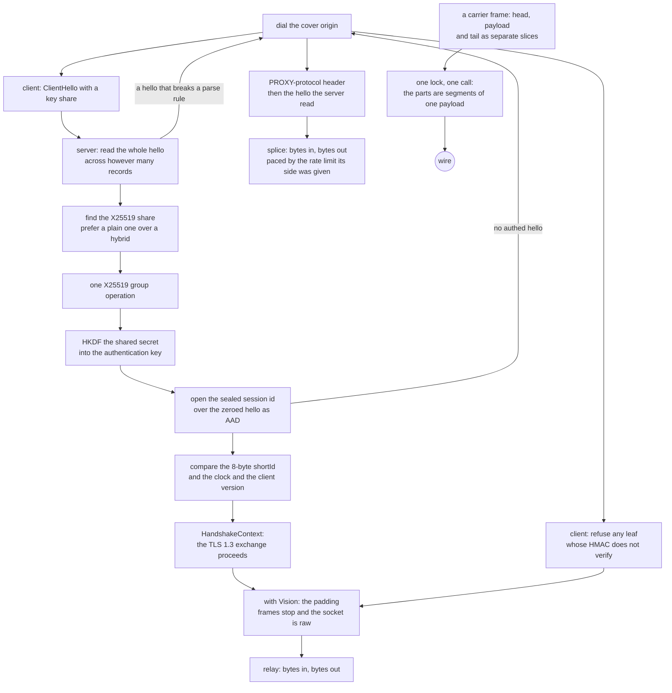

# REALITY and TLS

One TLS stack, one interface. `TlsProvider` is implemented by rustls and the provider *is* `Read + Write`, so nothing above this rung can depend on the stack underneath — no feature to select, no build without TLS, and no second provider to keep in step. `active_backends()` names it, and it names one.

REALITY dials raw TCP and every carried carrier, and serves the same set. The client seals the session id into a stock rustls hello in two passes over one scripted provider — the probe for the AAD, the flight with the seal — and refuses any leaf whose HMAC does not verify, so a cover origin never carries a proxy byte. A carried REALITY outbound rides the `ws`, `httpupgrade`, `grpc`, `xhttp` and `http-header` framings over the very seal the raw dial pays, so the hello is the one rung that does not care what sits above it; the UDP-carrier set (`quic`, `kcp`, `hysteria`) stays refused for want of a client leg. The rest is the handshake's cost.

What the handshake does: read the ClientHello, find the X25519 key share, do one group operation, derive the shared secret, HKDF it into an authentication key, and check that the certificate the peer presented is the certificate this session's key can account for — plus an eight-byte `shortId` compared against what the client sent. The certificate is minted per authentication key, so two sessions never present the same bytes.

## Data path



## Measured

<!-- counts:begin -->
| key | value | checked by |
| --- | --- | --- |
| ops-retired-instructions | UNBLESSED | scripts/count-ops.sh |
| tls-providers | 1 | ferrox-core::active_backends |
| client-outbound-rows-dialled | 6 | ferrox-app-proxy::tests::vless_outbound_with_reality_dials_raw_and_every_carrier |
| client-carriers-roundtrip-verified | 1 | ferrox-app-proxy::tests::reality_ws_dial_reaches_echo_through_the_relay |
| x25519-shares-recognised | 3 | ferrox-core-reality::tests::the_x25519_share_is_found_in_every_group_that_carries_one |
| short-id-bytes | 8 | ferrox-core-reality::tests::a_short_id_is_zero_padded_to_eight_bytes |
| cover-origin-dials-per-authenticated-hello | 0 | ferrox-core-reality::tests::an_authenticated_hello_costs_the_cover_origin_nothing |
| cover-origin-bytes-per-spliced-hello | 1 | ferrox-core-reality::tests::an_unauthenticated_hello_is_spliced_into_the_cover_origin_byte_for_byte |
| cover-origin-dials-per-unparseable-hello | 1 | ferrox-core-reality::tests::a_hello_that_cannot_be_parsed_still_reaches_the_cover_origin |
| cover-origin-dials-per-silent-peer | 0 | ferrox-core-reality::tests::a_peer_that_sends_nothing_costs_the_cover_origin_nothing |
| peer-reply-bytes-per-spliced-request | 1 | ferrox-app-proxy::tests::the_cover_origin_splice_carries_the_reply_back_to_the_peer |
| proxy-protocol-header-bytes | 28 | ferrox-core-reality::tests::the_binary_proxy_header_is_a_fixed_rectangular_twenty_eight_bytes |
| hello-buffers-per-single-record-read | 1 | ferrox-core-reality::tests::reading_a_single_record_hello_allocates_one_buffer |
| tls13-session-tickets-per-authenticated-handshake | 0 | ferrox-core-reality::tests::an_authenticated_session_sends_no_tickets_after_the_handshake |
| certificateverify-signature-scheme | ED25519 | ferrox-core-reality::tests::the_reality_certificate_verify_answers_ed25519_the_peer_never_offered |
| disarmed-limiter-records-per-read | 2 | ferrox-core-reality::tests::a_disarmed_limiter_stops_bounding_reads |
| addrs-resolved-per-xver0-handshake | 0 | ferrox-app-proxy::tests::reality_edges_skip_lookups_without_xver |
| client-hello-passes-per-handshake | 2 | ferrox-core-reality::tests::client_hellos_differ_only_in_the_session_id |
| sealed-session-id-bytes | 32 | ferrox-core-reality::tests::client_seal_matches_the_test_oracle_byte_for_byte |
| unauthenticated-servers-accepted | 0 | ferrox-core-reality::tests::a_client_with_a_wrong_key_is_refused_before_any_proxy_byte |
| server-shared-session-poll-millis | 1 | ferrox-app-proxy::tests::a_server_relay_bounds_the_shared_session_to_one_tick |
| late-hello-grains-survived | 12 | ferrox-app-proxy::tests::a_plain_tls_lane_retries_a_hello_that_arrives_past_the_grain |
| unsafe-fingerprint-header-bytes-added | 0 | ferrox-core-vless::tests::an_unsafe_fingerprint_adds_no_header_byte |
| plaintext-to-public-header-bytes-added | 0 | ferrox-core-vless::tests::pattng_plaintext_to_public_needs_opt_in_and_adds_no_byte |
| certificate-refusals-folded-into-other | 0 | ferrox-core-tls::rustls_backend::tests::mismatched_certificate_name_fails |
| trust-anchors-parsed-per-dial-after-the-first | 0 | ferrox-core-tls::rustls_backend::tests::the_parts_a_config_is_built_from_are_built_once |
| trust-anchor-bytes-copied-per-dial | 0 | ferrox-app-foxy::loopback::every_dial_of_one_trust_names_the_same_anchors |
| handshakes-skipped-by-an-earlier-dials-ticket | 0 | ferrox-core-tls::rustls_backend::tests::a_second_dial_with_the_same_config_still_fetches_the_chain |
| untrusted-dials-counted-as-retryable | 0 | ferrox-app-proxy::tests::a_refused_chain_is_a_refusal_not_a_drop |
| session-writes-per-frame | 1 | ferrox-app-proxy::tests::a_frame_reaches_the_tls_session_in_one_call |
| user-space-copies-per-framed-write | 0 | ferrox-app-proxy::tests::a_frame_reaches_the_tls_session_in_one_call |
<!-- counts:end -->

`certificate-refusals-folded-into-other 0` is the shape of a refused chain in the error type: the reason lives inside `BadCertificate`, so a caller matches the kind and still reads which certificate problem it is. `untrusted-dials-counted-as-retryable 0` is what that buys on the dial plane — `tls_failure` can only report a refusal when the backend still names one, and before this a refused chain reached it as `Other`, so it classified as a peer that hung up and counted into the retryable dial total.

`session-writes-per-frame 1` and `user-space-copies-per-framed-write 0` are the frame seam: what `FrameWrite::write_slices` hands the session when a carrier frames a write onto a `TLS` stream. Their checker is `a_frame_reaches_the_tls_session_in_one_call`, a session that records the calls it receives instead of sealing records, driven through the real `h2::write_frame` and the three-segment `write_slices` a gathered batch hands over. It counts one call per frame with two segments and then three, and it fails if the payload segment is not the caller's own buffer — the pointer-identity shape, because a test that compared bytes would pass just as happily on a frame staged into one scratch buffer. The same test asserts the recorded bytes are exactly the two frames concatenated, so the stream the peer decrypts is named as unchanged rather than claimed. `ops-retired-instructions` stays `UNBLESSED`: no instruction count is quoted for this rung, and the call count above is the measurement.

## Ops

```bash
./scripts/count-ops.sh report \
  reality::tests::an_authenticated_hello_is_accepted 'ferrox_core::tls::reality::authenticate'
```

`UNBLESSED`, as above, and `scripts/method-ops.txt` names no REALITY symbol, so `ops.yml` will not report one until it does.

## Time

**Not measured yet.** `der_to_pem 2653` is the single instruction count this repository has ever blessed, and it is measured by `ops.yml` on `ubuntu-latest` because valgrind does not exist on the other runners. No handshake duration is quoted from a machine without a named runner.

The frame seam has no duration either, and it is not a runner problem: no scenario in `scripts/lib-matrix.sh` gives its `streamSettings` a `tlsSettings`, so every matrix cell — including the `ws`, `grpc` and `xhttp` cells — dials the carrier in the clear and never reaches a `TLS` session on the way to the wire. A throughput row here would measure something else. The seam is gated by the write count above and by the rows that do carry a frame over a session: the workspace's `TLS` carrier loops and CI's `conformance` and upstream suites. Giving the matrix a `TLS` arm is the open row that would change that, and it is not this page's to settle.

## What we removed

- **A second TLS stack to keep in step.** Xray carries REALITY as a fork of `crypto/tls` at a pinned pseudo-version, and reaches into `tls.Conn` with `reflect` plus `unsafe.Pointer` at `proxy.go:688-728` to steal the live `input *bytes.Reader` and `rawInput *bytes.Buffer` so Vision can flush what was over-read. sing-box clones a `utls.Config` per handshake and builds the ClientHello **twice** — once, then again after filtering out ML-KEM (`common/tls/reality_client.go:144-160`) — and then reads an unexported `peerCertificates` field through reflection and `unsafe.Add` to verify (`:284-306`). One provider that *is* the stream means Vision never needs to reach into anything, which is why [the Vision page](xtls-vision.md) can end the framing by handing the socket over instead of by copying bytes out of someone else's buffer.
- **A per-dial rebuild of what only the config names.** Every client dial parsed its trust anchor DERs into a `RootCertStore`, cloned and re-sorted the crypto provider for the `cipherSuites` order, and — where the outbound pins — built a `WebPkiServerVerifier` over that store before assembling a `ClientConfig` around them. None of that depends on which host is being dialed or which ALPN is offered next, so the second outbound to the same remote spent it again; the three inputs now name one shared build, found by pointer identity by `the_parts_a_config_is_built_from_are_built_once`. Sharing the parts then made sharing the whole config worth having: rustls offers a stored ticket only under a pointer-equal verifier, so a config rebuilt per dial threw away the ticket the last dial saved, and the cache now holds one `ClientConfig` per trust inputs and `ALPN` for the life of the process. A second dial of one edge therefore resumes instead of re-verifying its chain — `the_second_dial_to_one_edge_resumes` dials one listener twice and reads `HandshakeKind::Full` then `HandshakeKind::Resumed`. `handshakes-skipped-by-an-earlier-dials-ticket 0` is the other half of the same gate: two *different* listeners must not answer as one edge, so a ticket one left is unknown to the next and both are handed a chain.
- **A platform trust store read and copied per dial.** `system_roots()` asked the OS keychain or a CA bundle for every certificate it trusts, mapped each one into a fresh `Vec`, and returned that list by value; a hysteria cover-origin `https` request reached it again on every request, and a foxy flow deep-copied the list into the `FoxyDial` and again into the `TlsConfig` built from it. The store is now read once for the process and carried behind `Anchors` (an `Arc<[Vec<u8>]>`), so a dial costs a reference count, the config cache compares two anchor lists by pointer before it compares their bytes, and `every_dial_of_one_trust_names_the_same_anchors` fails if a dial ever copies again. What was **not** removed: the anchor bytes are still held per-certificate as `Vec<u8>`, because quiche is handed a staged PEM bundle built by walking them; the hysteria `Server` and `QuicServer` pool keys still `Hash` the anchors by content, because a config built from a CA file and the same config read back must pool together, so pointer-hashing them would break that key; and `alpn` is still a `Vec<Vec<u8>>` cloned per dial, which is one short list, not a store.
- **Reflection and `unsafe` in the handshake.** The gates are `an_authenticated_hello_is_accepted`, `every_unauthenticated_hello_is_refused` and `the_certificate_differs_per_auth_key`.
- **A hybrid key share when a plain one is present.** One group operation per authenticated hello, not two; `a_plain_share_is_preferred_over_a_hybrid_one` is the gate.
- **One cover-origin dial per accepted socket.** Both references dial the real site *before* reading a byte, so a port scanner costs one outbound connection each. The dial here is lazy: an authenticated hello costs the cover origin nothing, and a refused one costs exactly the hello the server read, which is `an_authenticated_hello_costs_the_cover_origin_nothing` and `a_peer_that_sends_nothing_costs_the_cover_origin_nothing`.
- **A refusal that closed the socket instead of answering it.** A hello that broke a record or parse rule — not a handshake record, an oversized length, an EOF partway through the body, a `ClientHello` that will not parse — was dropped, while all three references splice whatever they could not authenticate. The close is the detectable break and the hang: a real browser that happened to send an unusual hello got a reset where its own site would have answered. The bytes spent before the break now travel with the splice, and only a peer that sent nothing at all is still closed; `a_hello_that_cannot_be_parsed_still_reaches_the_cover_origin` is red both ways — dialled nothing, or sent bytes the server never read.
- **Two session tickets after every handshake.** rustls sends two by default and both references send none, so the REALITY identity pins the count at zero while plain TLS keeps two; `an_authenticated_session_sends_no_tickets_after_the_handshake` reads the wire flight (ServerHello, dummy cipher change, one encrypted flight) and asserts the constructed count on both identities. Tickets are emitted only once the client's Finished arrives, which no test peer can send without forking the sealed transcript, so the count is pinned where it is set.
- **Scheme negotiation in `CertificateVerify`.** No `uTLS` fingerprint offers `Ed25519`, so a stock negotiation answers `NoSharedCipher` and the handshake dies after authenticating. All three references comment the negotiation out and hard-set `Ed25519`; the `REALITY` identity here does the same through one signing-key wrapper, and only that identity — plain `TLS` rows keep negotiating. `the_reality_certificate_verify_answers_ed25519_the_peer_never_offered` is the gate.
- **A relay that holds a full echo until close.** The shared copy loop wrote each chunk with `write_all` and never flushed, which is nothing on a raw socket and a stall on a `TLS` session: the framed echo sat in the send buffer until a later read drove the stack, and a request/response exchange has no later read. When either direction ends the loop now closes the other side too, or the far end never learns the exchange is over and waits out its own deadline instead. `a_relay_write_is_sent_without_waiting_for_close` and `a_finished_relay_closes_the_other_side` drive a flush-gated writer with no sockets at all, and the `reality_vision` conformance row is the witness.
- **A splice that outlived its own exchange.** Once both directions were live, a cover origin that stays open and silent pinned the far pump forever: `copy_paced` stopped only on bytes or an error, and its poll timeout only continued. A finished leg now raises a flag the sibling notices on its next twenty-millisecond grain, the same end-the-other-side discipline `copy_stream` already keeps; `the_cover_origin_splice_ends_when_the_peer_finishes` holds a keep-alive-silent origin against a finished peer and is red without the flag.
- **A splice that pumped the upload twice.** `relay_fallback` crossed its copy directions, so both `copy_paced` pumps read the client and wrote the cover origin: the origin's reply never reached the peer, and two racing readers of one client half could deliver the hello to the origin out of order. The directions are crossed now, and the spliced target carries the same twenty-millisecond poll every other relay point sets, because an untimed read on a silent origin holds the mutex its upload writes on. `the_cover_origin_splice_carries_the_reply_back_to_the_peer` drives both legs over loopback and fails red on either direction.
- **A server relay that read its shared session at the idle grain.** Two pumps hold one session through one half-lock: one reads it to forward the request, the other writes the answer into it. A read that parks for a whole twenty-millisecond grain holds that lock for the grain, so the answer waits out every silence. Every other session-shared rung already bounds this: the client sets a one-millisecond poll at dial time, and carried sessions hand the pumps halves that sleep unlocked between polls — only the server raw arm never lowered its grain. `relay_vless` now bounds the shared fd to one tick before it parks the pumps, and `a_server_relay_bounds_the_shared_session_to_one_tick` reads the fd's timeout back after the tunnel grant is on the wire: red at twenty, green at one, no byte on the wire moved.
- **A REALITY client that stopped sending to wait for the answer.** `dial_vless_reality` wrote its request, blocked in `read_vless_response` on the session, and only then started the relay — against a server that holds its `[0, 0]` until it has payload to send (`HeaderFirst::hold` waits for it outright, xray flushes a buffered response on the first downstream write) neither end ever moved, and the oracle's two REALITY client rows died at their fifteen-second echo with `up=0 down=0 stage=RequestSent`. Every other carrier rung pumps the upload while the answer is overdue, and REALITY is a carrier: the write half now goes to the same `Pump` and the session comes back through its one lock when that owner joins, so the relay pays no shared lock and Vision still gets the concrete session for its direct switch. The pump is parked for the hundred-millisecond grace and released by the answer itself, so a server that answers at once costs one pool task and no wire byte. `vless_reality_client_pumps_the_upload_before_reading_the_response` holds a REALITY server that answers only after four payload bytes: red at five seconds without the pump, green at a sixth of one with it.
- **A split hello reassembled twice.** The reader grows one buffer and stops at the declared handshake length, then hands rustls the same bytes through a replay prefix, so the record framing is read once rather than re-parsed by a second implementation. A timeout keeps waiting for a hello that arrived in two segments instead of refusing a handshake that was working. A hello that arrives in one record is never copied aside: it authenticates out of the record stream with the session id restored afterwards, so the read is one buffer and only a split hello gathers a second.

- **A session that dies when Vision goes direct.** The outer TLS stack reads past the last framed record into its own buffer, so the raw bytes after it are stuck inside the session just as the read side switches to the raw socket, and the next outer read decrypts raw bytes with the outer keys. `xray-rust` keeps a record-bounded reader in front of its stack for exactly this (`penetrating_tls.rs`); this tree does the same with one `RecordLimiter` that caps every socket read at the current record's end, so the unwrap is lossless and no `unsafe` reaches into anyone's buffers. `record_bounded_reads_never_swallow_the_bytes_after_a_record` pins the chunking and `vision_direct_switch_carries_inner_tls_over_loopback` carries eight inner-`TLS` rounds through the switch on loopback. The plain-`TLS` accept wraps the same limiter open: it only tracks until the `Link` throws the switch at the first 1.3 `ServerHello`, so lanes that never unwrap pay one branch per read and no extra syscall, and foxy never sees it at all.
- **A handshake that refuses a slow peer.** Every socket here polls on a twenty-millisecond grain, and the `REALITY` handshake took one attempt: under a thirty-two-flow burst a slow flight read landed past the grain and the flow died as `socks connect rejected`, five to eleven of thirty-two depending on the runner's mood. The handshake is now retried to the same thirty-second deadline the plain-`TLS` path already used, and the burst row is the witness.
- **A plain-`TLS` raw arm that still shook once.** The retry-to-deadline discipline reached the carrier arms through `accept_tls_session` and the `REALITY` arms through the burst fix, but the `Carrier::Raw` arm of `serve_vless_tls` — matrix row 2 — kept a single `handshake()` on the twenty-millisecond-grained socket: a `ClientHello` that arrived one grain late was refused, not retried, and the lane died before its own deadline. The retry loop was that discipline twice over — `shake_reality` was it with a `REALITY`-only name, and `accept_tls_session` carried an inline copy — so both folds now call one `shake_tls`, and the raw arm calls it too. `a_plain_tls_lane_retries_a_hello_that_arrives_past_the_grain` holds the hello twelve grains and refuses the lane at one: restoring the one-shot shake turns it red on the spot.
- **A service name compared unescaped.** The server built `/interop grpc/Tun` while every reference escapes the configured name Go's way, so the client asked for `/interop%20grpc/Tun` and the `grpc_reality` row died in warmup. `grpc_path` escapes one segment now, and `a_grpc_service_name_is_escaped_the_way_xray_escapes_it` pins it.

- **Five single-byte header iterations read as one five-byte load.** Both framers parse a header byte per loop trip with no observable in between, so a whole header present in the buffer parses at once and a split one falls back to the byte loop; `open_seeded_splits_match_whole_feeds` sweeps 32 seeded chunkings against whole feeds, short reads, mid-header splits and empty frames included.
- **A session that never goes direct stops bounding and tracking reads.** `disarm_record_alignment` is the else-branch of the Vision check on both roles, so non-Vision bulk pays one straight socket read; Vision flows keep the limiter and `engage` re-arms defensively. `a_disarmed_limiter_stops_bounding_reads` delivers two records in one read and every relay test still moves the same bytes.
- **A handshake without a PROXY header costs no address lookup.** The only reader of the edges is the `xver > 0` branch, so lookups happen only there; `reality_edges_skip_lookups_without_xver` pins default against real.
- **One client config builds both hello passes**, so the probe and the flight cannot drift apart; the determinism test still shows only the session id moving.
- **A refused chain that lost its name.** Every certificate problem used to be folded into `Other("bad certificate: …")` to carry the reason, so no caller could match one: `tls_failure`'s `BadCertificate` arm was unreachable, and a server whose chain this device does not trust classified as a peer that hung up — a dial worth retrying, and a message that says io. `BadCertificate(String)` keeps the kind *and* the reason, which is what `mismatched_certificate_name_fails` matches by variant and what the Foxy lane needs to stop asking an edge no second handshake makes trusted ([the Foxy lane](carrier-foxy.md)).

- **A record per part of a frame.** A carrier frame reaches a session as separate slices — a `ws` frame as head and payload (`ws.rs:410`), an `h2` `DATA` frame the same, head, envelope and payload as three of them, an `xhttp` chunk as size line, body and `CRLF` (`xhttp.rs:342`) — and `FrameWrite for TlsHalf` walked that list with one `write_all` per part. Each of those writes took the session lock, ran the handshake drive, handed rustls one buffer and called `complete_io`, so a frame cost two or three locks, two or three sealed records and two or three flushes, with a 9-byte frame head sealing a record of its own before the payload followed. The impl now locks once and hands the whole parts list to `RecordAlignment::write_all_slices`, which is the `coalesce` this tree already pays for Vision: the segments go out in one `write_vectored` (`rustls_backend.rs:342`, gated by `the_framer_path_coalesces_without_a_heap_buffer` at one call and zero allocations), so the fragmenter sees one payload and emits one record, and one lock covering the whole list means no other writer lands between a frame's parts. Two to one on lock, record and flush for a `ws` or `h2` `DATA` frame; three to one for an envelope-carrying frame and for an `xhttp` chunk. What did not move: the bytes the peer decrypts, which the witness compares against the two frames concatenated, and the plaintext path — `FrameWrite for Connection` still means one `writev`. What did move below the stream: the `TLS` record boundaries, since a record now begins at the frame head and runs on into the payload, and a body past one record still fragments. That is why the checker is not only a count: `reality_ws_dial_reaches_echo_through_the_relay` and `vless_outbound_with_reality_dials_raw_and_every_carrier` carry real frames over a session here, and CI's `conformance` and upstream suites are the pinned peers whose reassembly a record-shape change could break — both run on this diff, because the hunk sits in shared code and the plan is wide.

Tried and set aside with reasons: probe elimination (both references build twice and one RTT dominates the build), smaller Vision staging reads (read granularity moves the syscall count, which this page counts), zero-fill removal in padding (zeros are wire bytes), second relay copy removal (partial frames need the staging buffer), full edge laziness inside `accept` (a generic stream has no addresses; the `xver` gate covers the common path), and a relay write that drained records with `write_tls` instead of `complete_io` — `complete_io` returns after its write phase whenever it has output, so the steady-state write already spends no `recv`, and where it does read (pending incoming) that one packet is charged to the connection whichever pump reads it, so a drain-only flush moves the syscall rather than retiring it; an in-memory read-count witness reads zero on both forms, so no count gates the change.

What is **not** removed, and stays named: this tree does no uTLS browser shaping (row 38), so a REALITY hello carries the stock rustls shape under every fingerprint. That is not a gap for the PattNG `unsafe-*` fingerprint: `unsafe` means build the hello with the stdlib `crypto/tls` rather than uTLS — exactly the stock rustls hello this tree already dials — so row 18 is finished by `VlessLink::support_opted` honouring the out-of-band `UnsafeOptIn::allow_unsafe_fingerprint` (`--allow-unsafe-fp`), which clears the parse veto so a consented `fp=unsafe-*` reports `Implemented` and dials, while a bare link still refuses; `an_unsafe_fingerprint_adds_no_header_byte` proves the fingerprint adds no VLESS byte. The sibling consent `UnsafeOptIn::allow_plaintext_to_public` (`--allow-plaintext-public`) is built the same way: a bare link still vetoes `security=none` to a public address, but a consented link reads that session as the private `security=none` it is byte-for-byte, so the two consents are independent (`the_two_unsafe_consents_are_independent`) and the plaintext consent adds no byte either (`pattng_plaintext_to_public_needs_opt_in_and_adds_no_byte`). `cipherSuites` parsing (row 17) landed separately in `tls/cipher_suites.rs`. A carried REALITY outbound now dials the raw-carrier set the server already serves; only the UDP-carrier set stays refused rather than dialled, for want of a client leg. The `dest`-mimicry the references do (their `ServerHello` template and post-handshake record shaping, which no functional row needs), the `ML-DSA-65` second signature (verified when present, never sent), and the cover origin's own chain, which an authenticated session never presents here or upstream. A plain-`TLS` server that switches to direct has the same over-read shape and no limiter in front of it yet; no row carries inner `TLS` over plain `TLS`, so it is a named gap and not a carried cost. The inner-`TLS` lane carried over `KCP` (`serve_carried_tls`) still shakes once: its transport is paced by the `KCP` pump, not by a socket grain, and no row handshakes a late hello through it.
- **Three `getrandom` fills per dial.** `RealityClientSession::connect` asked the OS for the x25519 secret, the hello random and the GREASE pair in three separate fills, one syscall each; one 66-byte fill arms all three and no test sees the difference, because the scripted draws both passes read come from the `ScriptedRandom` provider and the oracle pins the seal, not entropy. Two syscalls fewer per dial; no loopback checker observes a `getrandom` fill, so the page records the shape and no row gate runs over it.

## Pins

| what | where |
| --- | --- |
| the fork of `crypto/tls`, the reflection into it | `upstream/xray-core` → `github.com/xtls/reality`, `proxy/proxy.go` |
| the double ClientHello, `utls`, reflection | `upstream/sing-box/common/tls/reality_client.go` |
| the certificate and shortId oracle | `github.com/xtls/reality` `tls.go:200-300`, `handshake_server_tls13.go:100-180` |

## CI scope

What a change here owes, read by `scripts/ci-scope.py`; see [`docs/ci-scope.md`](../ci-scope.md).

<!-- scope:begin -->
- paths: crates/ferrox-core/src/tls/*
- symbols: reality
- oracle: reality
- go: ./transport/internet/tls/...
<!-- scope:end -->
