# The reverse tunnel: bridge and portal

A bridge behind a NAT opens a VLESS request with command 4 — the header names no address — and the portal answers with the empty response header and treats the rest of that connection as a mux session. The portal then picks that session for any flow its rules send to the inbound user's `reverse.tag`, and the bridge dials the target on the portal's behalf. Both roles are the pinned reference's modern VLESS reverse: there is no separate reverse inbound, outbound or dispatcher any more, and no `rvs` control socket.

The control stream is a mux UDP flow to the internal domain `reverse`. A protobuf `Control` carries `state` (0 `ACTIVE`, 1 `DRAIN`) and a random pad; the portal sends one every two seconds, but only when the counter is 1 or the session is draining, and the bridge decodes it into `WorkerState`. A session drains once it has carried 256 flows; the picker prefers the least-loaded live session, skips a draining one until nothing else is left, and a bridge monitor opens another session when none is live or the live ones average more than sixteen flows each. A session whose control stream is silent for 60 seconds is closed by the monitor.

What refuses, by name and once per process: a bridge whose carrier cannot be split into a stream (xhttp; QUIC, KCP, hysteria and xdrive are refused at startup), a bridge or portal user whose flow is `xtls-rprx-vision`, a reverse user opening anything but command 4, a forward user opening command 4, and a portal flow whose route names any outbound other than `freedom` or `blockhole` — the bridge has no dial that returns a stream, so it says which tag it refused and drops that flow.

## Data path

```mermaid
graph TD
    B["bridge: vless outbound<br/>settings.reverse.tag"] -->|"cmd 4, no address"| P["portal: vless inbound user<br/>reverse.tag"]
    P -->|"[0,0] response"| B
    B --> M["serve_mux_wire over the tunnel<br/>MuxWire::Tunnel, worker state"]
    P --> S["Session per tunnel<br/>read_loop + 2s heartbeat"]
    S -->|"control New: reverse:0"| M
    M -->|"Control{state, pad}"| W["WorkerState<br/>active / stale / connections"]
    C["portal front: socks / http / dokodemo"] --> R["route: Outbound::ReversePortal"]
    R -->|"pick least-loaded session"| S
    S -->|"mux New + Keep"| M
    M -->|"bridge dial: freedom"| T["target"]
    T -->|"origin bytes"| M
    M -->|"mux Keep"| S
    S -->|"flow.down queue"| C
```



## Measured

<!-- counts:begin -->
| key | value | checked by |
| --- | --- | --- |
| ops-retired-instructions | UNBLESSED | scripts/count-ops.sh |
| tcp-echo-bytes-preserved | 5 | ferrox-app-proxy::reverse_tests::a_portal_flow_reaches_the_bridge_and_comes_back |
<!-- counts:end -->

Syscalls: one loopback `connect` plus one `accept` per bridge worker at startup, one mux frame write per uplink chunk, one outbound `connect` per flow the bridge dials, and the relay's own reads and writes — no checker counts this yet.

Copies: the portal's downlink copies each byte once, into the flow's queue (`data.to_vec()`), because the queue is what lets a slow consumer cost only its own flow. The uplink copies nothing: the header is built in the session's scratch and the caller's payload is written with one `writev`, the same two-part write a direct mux session makes. A pointer-identity test does not exist for either arm yet, so both stay prose rather than manifest rows.

## Ops

```bash
./scripts/count-ops.sh report \
  proxy::reverse_tests::a_portal_flow_reaches_the_bridge_and_comes_back 'reverse::'
```

`UNBLESSED`, as above.

## Time

**Not measured yet.** Durations in this repository come from CI runners (`bench.yml`, `parity.yml`); no CI artefact has been read, and a laptop behind a VPN measures a tunnel either way.

## What we removed

The reference's separate dispatcher and its own mux client. Xray used to serve reverse through `app/reverse`'s inbound/outbound pair and, in ZeroNet, through a `reverse.rs` that implemented Mux.cool framing again. Here the portal registers one `Outbound::ReversePortal` inside the route registry the config already built, the session is a mux client used by nothing else, and the bridge serves the portal's flows through the same `serve_mux_wire` a VLESS mux inbound uses. The three command-4 checks (header, user, flow) live in one `reverse_ask`, so no carrier can grow its own.

## What was not removed

The local hop. A bridge still needs a stream that `dial_vless` returns, and that function relays a `Connection`, so each worker opens an extra loopback TCP pair — one connect, one accept, two sockets the reference does not need — and a flow's bytes cross it. Removing that is a `dial_vless` that hands back its relayed halves instead of pumping them, and it is the largest cost on this page.

The bridge also carries only `freedom` and `blackhole` lanes. The reference routes returned flows through the normal dispatcher, so a portal flow can leave through any outbound; here a lane naming another proxy is refused with one line and the flow is dropped, because there is no stream-returning dial behind those outbounds either.

xhttp, QUIC, KCP, hysteria and xdrive carriers are not carried: xhttp frames its own stream rather than exposing one, and the other four have no stream to hand to the mux. The refusal is one line for each. Draining closes the control writer and the tunnel but sends `End` for the control id rather than interrupting the reader the way the reference does; the bytes differ on that teardown only. Per-flow queued downlink is a fixed 32 KiB, not the policy `bufferSize`.

## Pins

| what | where |
| --- | --- |
| command 4 header, empty response, portal handler over mux | `upstream/xray-core/proxy/vless/encoding/encoding.go`, `upstream/xray-core/proxy/vless/inbound/inbound.go`, `upstream/xray-core/proxy/vless/outbound/outbound.go` |
| built-in reverse config: inbound `reverse.tag`, outbound simplified style, sniffing refused | `upstream/xray-core/infra/conf/vless.go`, `upstream/xray-core/proxy/vless/account.go` |
| `Control{state, pad}`, 2s heartbeat, drain past 256, picker, 16-flow monitor | `upstream/xray-core/app/reverse/portal.go`, `upstream/xray-core/app/reverse/bridge.go`, `upstream/xray-core/app/reverse/reverse.go` |
| the ZeroNet shape this row was written against | `upstream/zeronet/crates/zero-runtime/src/reverse.rs` |

<!-- scope:begin -->
- paths: crates/ferrox-app/src/reverse.rs
- symbols: reverse_portals, reverse_carried, reverse_ask, ReverseAsk, attach_reverse, attach_reverse_session, serve_reverse_tcp, vless_reverse_header, BridgeLane, refuse_bridge_lane, serve_bridge_mux, start_bridges, find_bridges, reverse_tests, portal_echo, a_portal_flow_reaches_the_bridge_and_comes_back, a_sixteen_kib_downlink_frame_is_echoed_whole, connection_closer, into_tunnel
- go: ./proxy/vless/..., ./app/reverse/...
<!-- scope:end -->
